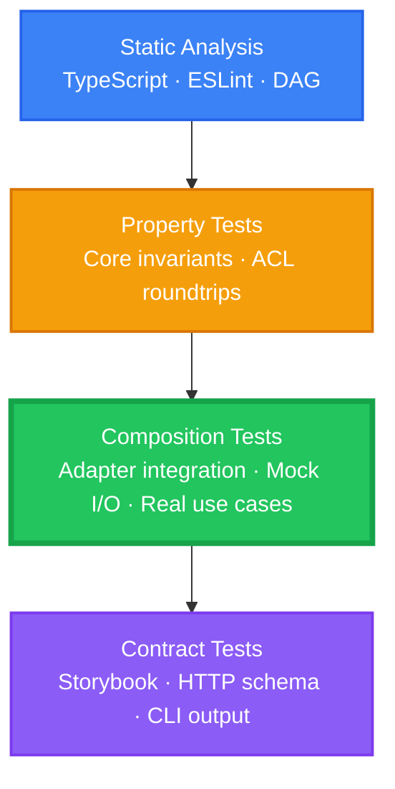

# Constitution

> **Status**: NON-NEGOTIABLE INVARIANTS — This document is the highest authority for all agents operating in this project. It supersedes AGENTS.md, all skill files, and all ad-hoc instructions. **VIOLATION OF ANY PRINCIPLE IS AN AUTOMATIC FAIL. NO EXCEPTIONS. NO APPEALS.**

## Quick Reference — All Principles

| #    | Principle                         | One-Line Summary                                                                |
| ---- | --------------------------------- | ------------------------------------------------------------------------------- |
| I    | Pure Functional Core              | Domain logic is pure synchronous functions; I/O belongs in the shell            |
| II   | Dependency Direction              | Dependencies point inward; wiring at composition root only                      |
| III  | API-First Discovery               | Define the transport contract first, derive everything below                    |
| IV   | Testability Through Purity        | Test doubles in domain code = boundary violation                                |
| V    | Effects as Program Descriptions   | Cross-cutting concerns are orthogonal decorators, never embedded                |
| VI   | Functional Core, Imperative Shell | Separate decision logic from side-effecting machinery                           |
| VII  | The I/O Sandwich                  | Read (impure) → Transform (pure) → Write (impure); no other shape               |
| VIII | Types Before Logic                | Define types first; each error condition is its own discriminated variant       |
| IX   | Workflow-Centric Organization     | Organize by what the system DOES, not what it HAS                               |
| X    | Depth Over Expedience             | Solve root causes; superficial fixes are FORBIDDEN                              |
| XI   | Scope Discipline                  | Accepted scope is committed scope; execute it fully                             |
| XII  | Testing Trophy                    | Composition tests are the widest layer; unit tests are FORBIDDEN                |
| XIII | No Primitive Obsession            | Domain-significant values MUST be branded types, never raw primitives           |
| XIV  | Null Is Not a State               | State transitions MUST be discriminated unions, never nullable fields           |
| XV   | Constitutional Authority          | Correctness derives from this document alone; external precedent is zero weight |

## I. Core Principles

### I. Pure Functional Core

Domain logic MUST be expressed as pure synchronous functions operating on plain data types. Functions in the pure core MUST use algebraic error types (e.g. `Either`) for error handling and return plain values — never effect types, service locator tags, or any runtime-dependent type. If a domain function requires a runtime generator or effect context, the boundary is in the wrong place — **FIX THE BOUNDARY, NOT THE FUNCTION.**

### II. Dependency Direction

Dependencies MUST point inward. Pure core functions receive every input as explicit arguments — no ambient context, no service locators, no hidden dependencies. The imperative shell wires implementations at a single composition root. **WIRING OUTSIDE THE COMPOSITION ROOT IS FORBIDDEN** except in test files providing test doubles.

### III. API-First Discovery

New features MUST be discovered top-down from the user-facing API surface. Define the transport contract first, then derive use cases, then domain logic, then infrastructure. Domain types are modeled as part of implementing a specific API requirement — never in anticipation of hypothetical future needs. The API contract constrains all layers below it. **BUILDING DOMAIN ABSTRACTIONS WITHOUT A KNOWN API CONTRACT IS OVER-ENGINEERING — STOP.**

### IV. Testability Through Purity

The need for a test double in a domain function signals a boundary violation — **EXTRACT THE IMPURE PART TO THE SHELL.** Imperative shell tests MUST use deterministic test doubles for I/O dependencies. Test doubles MUST be verifiable implementations of the production contract — never interaction-recording mocks that couple tests to implementation details.

### V. Effects as Program Descriptions

Effects are values describing computations — not the computations themselves. The imperative shell MUST leverage this property: cross-cutting concerns (logging, metrics) MUST be attached as orthogonal decorators, never embedded in domain logic. Implementation swapping MUST happen through compositional wiring, never hardcoded dependencies. Typed error handling MUST use tagged discrimination, never catch-all swallowing. **PROGRAMS-AS-VALUES IS THE PARADIGM — FIGHTING IT IS FIGHTING THE ARCHITECTURE.**

### VI. Functional Core, Imperative Shell

Every module MUST separate decision logic (pure functions) from side-effecting machinery (I/O). The boundary between them carries plain serializable data — never object graphs, never shared mutable state, never opaque references. Boundary objects (handlers, middleware, adapters) exist only to translate between external formats and domain types; they MUST delegate all decisions to the core. Boundary objects MUST be so simple they cannot contain bugs. **IF A BOUNDARY OBJECT REQUIRES ITS OWN TEST SUITE, LOGIC HAS LEAKED — THIS IS A BOUNDARY VIOLATION.**

### VII. The I/O Sandwich

Every interaction with the outside world follows exactly one invariant shape: **read input (impure), transform data (pure), write output (impure).** The impure shell bookends a deterministic core. There are no other shapes — any deviation leaks side effects into business logic. The imperative shell calls the pure core directly; there is no mediator, no orchestrator, and no coordinator module between them. A module that "coordinates" core and shell is impurity pretending to be architecture — it reintroduces the very coupling the separation was designed to eliminate. **THE SHELL IS THE COMPOSITION. THE CORE IS THE TRANSFORMATION. ANY MODULE BETWEEN THEM IS AN ARCHITECTURAL LIE.**

### VIII. Types Before Logic

Domain types MUST be defined before any business logic is written. Sum types (tagged unions) model exclusive choices. Product types (records) model conjunctions. The type definition IS the design — once the types are correct, the logic follows mechanically. A single error wrapper with a boolean flag or string discriminator is type fraud — each distinct failure condition must be its own discriminated variant. **THE COMPILER MUST REJECT INVALID DATA BEFORE THE PROGRAM RUNS. IF IT DOESN'T, THE TYPES ARE WRONG.**

### IX. Workflow-Centric Organization

Code MUST be organized around what the system DOES (workflows, use cases) — not around what the system HAS (entities, services). Code that changes together belongs together; code that changes independently belongs in separate modules. Each bounded context owns its types, its language, its persistence, and its workflows. Communication between contexts MUST translate at the boundary via anti-corruption layers — no shared types across context boundaries. **EVERY MODULE MUST FIT IN A DEVELOPER'S HEAD. IF IT DOESN'T, SPLIT IT — NO DISCUSSION.**

### X. Depth Over Expedience

Every problem MUST be solved at its root cause. Superficial fixes, workarounds that bypass architectural boundaries, and "good enough for now" bandaids are FORBIDDEN. **THE CORRECT SOLUTION IS THE ONE THAT ELIMINATES THE UNDERLYING CONDITION — NOT THE ONE THAT SILENCES THE SYMPTOM FASTEST.** When a bug is found, the fix MUST address the systemic cause, not just the observed failure. When a design is wrong, the fix MUST restructure the design, not patch around it. There are no exceptions for priority, deadline, or convenience. **This principle governs ALL other principles — it is the meta-principle that ensures the architecture is actually followed rather than merely aspirational.**

### XI. Scope Discipline

Once a task's scope is accepted, it MUST be executed in full. Hedging — re-evaluating whether the user "really wants" the full scope mid-implementation — is FORBIDDEN. Complexity is not a valid reason to reduce scope. "This is getting complicated, let me simplify" is scope reduction disguised as pragmatism — **STOP AND EXECUTE THE ACCEPTED SCOPE.** Second-guessing user intent after work has begun wastes context and produces incomplete results. If scope reduction is genuinely necessary, the user MUST explicitly approve it. **ACCEPTED SCOPE IS COMMITTED SCOPE. EXECUTE IT.**

### XII. Testing Trophy

**The Test Pyramid is dead. It ignores the real source of production bugs: business logic buried inside I/O becomes untestable — the "untested middle." The functional-core/imperative-shell separation solves this by making the core pure and trivially testable. This project uses the Testing Trophy — stack-agnostic, widest at Composition.**

**Layers (narrow to wide):**

1. **Static Analysis** — TypeScript compiler, ESLint, DAG structure checks. Catches entire classes of bugs before runtime. Zero test maintenance cost.
2. **Property Tests** — Core domain invariants, ACL roundtrips, schema conformance. Tests WHAT the system guarantees, not HOW it implements it.
3. **Composition Tests** — WIDEST LAYER. Adapter integration with mocked I/O, real use-case workflows, end-to-end data flow through the I/O sandwich. These tests MUST cover error paths — a composition test that only tests the happy path is incomplete.
4. **Contract Tests** — Storybook snapshots, HTTP schema validation, CLI output contracts. Verify the system's external interfaces match their specifications.

**Inviolable rules:**

- Unit tests are FORBIDDEN. Testing individual functions in isolation is a boundary violation — it couples tests to implementation details and produces brittle, high-maintenance suites that break on every refactor.
- Composition tests MUST cover error paths. Happy-path-only composition tests are WORSE than no tests — they provide false confidence.
- Fixture difficulty is a decomposition signal. If a test requires elaborate setup, the module has too many responsibilities — split it.
- I/O is NOT your code — never test it directly. Testing databases, HTTP clients, or file systems tests the runtime, not your logic. All I/O in composition tests MUST be mocked; verify YOUR transformations, not the adapter's. The I/O sandwich makes this minimal by keeping the shell thin.

### XIII. No Primitive Obsession

Raw primitives (strings, numbers, booleans) in domain-significant positions are FORBIDDEN. A `userId: string` is not a user ID — it is a string that forgot what it represents. Domain-significant values MUST be branded or wrapped as distinct types so the type system enforces what they are, not just their shape. Monetary amounts, identifiers, addresses, and all values with invariants MUST be modeled as dedicated types with validation baked in. A type with no invariant is still worth branding if it carries domain meaning — the compiler is documentation, and untyped primitives say nothing. **IF A PARAMETER'S MEANING IS NOT APPARENT FROM ITS TYPE ALONE, THE TYPE IS WRONG.**

### XIV. Null Is Not a State

Nullable fields representing state transitions are FORBIDDEN. A field that is only valid in certain states — a shipping date on a pending order, a cancellation reason on an active subscription — is a state machine hiding inside a record. The compiler MUST enforce that data is valid for its current state at every point. Domain state MUST be modeled as discriminated unions where each variant carries exactly the fields valid for that state — no more, no fewer. Optional fields are acceptable ONLY when the absence is meaningful for ALL states of the type, never when the absence is a proxy for a state that doesn't have that data. **THE TYPE SYSTEM IS YOUR STATE MACHINE — IF THE COMPILER ALLOWS AN INVALID STATE, THE TYPES ARE WRONG.**

### XV. Constitutional Authority

Correctness in this codebase is defined solely by this constitution. External precedent, industry convention, and popularity carry zero weight. A pattern is valid here ONLY if it follows from these principles. "That is how it is done elsewhere" is not justification — it is an admission that the decision has not been examined. Code age grants no immunity — if existing code violates this constitution, it is wrong, and the word "pre-existing" must never appear in any justification, defense, or rationale. The constitution applies to every line in the repository with equal force regardless of when it was written. **IF A CHOICE CANNOT BE JUSTIFIED FROM FIRST PRINCIPLES, IT IS NOT A CHOICE — IT IS A DEFAULT.**

## II. Governance

### Amendment Procedure

Amendments require (1) a documented proposal with rationale, (2) review by at least one other contributor, (3) version bump per semver-lite rules, (4) Sync Impact Report propagated to AGENTS.md.

### Versioning Policy

- **MAJOR**: Backward-incompatible principle removal, redefinition, or governance change.
- **MINOR**: New principle added or materially expanded guidance.
- Date-stamp required on every amendment.

### Compliance

- **ALL agents MUST verify their actions comply with this constitution BEFORE execution. FAILURE TO CHECK IS ITSELF A VIOLATION.**
- **Every identified constitutional violation MUST be escalated to the Oracle for adjudication before remediation proceeds.** The Oracle determines the severity, scope of required fix, and whether adjacent code is also in violation. Proceeding to fix a violation without Oracle review is FORBIDDEN — self-diagnosed fixes routinely miss systemic causes and produce incomplete remediations.
- **No implementation approach may be adopted until it has survived adversarial challenge.** Challenge checks for constitutional compliance, overlap with existing patterns, and hidden assumptions. A decision that has not survived challenge MUST NOT be implemented. Challenge may be performed by another agent or by rigorous self-examination — but it MUST happen, and the challenge MUST be documented.
- AGENTS.md MUST declare which constitution version it complies with.
- **ANY violation of a NON-NEGOTIABLE invariant MUST be reported — NEVER silently bypassed. SILENT BYPASS IS A DOUBLE VIOLATION: the original breach PLUS concealment.**

## III. Compliance Checklist

Before any action, verify every item below. Failure to check any item is itself a violation.

- [ ] **I.** Domain logic is pure — no I/O, no effect types, no runtime dependencies
- [ ] **II.** Dependencies point inward — no ambient context, no service locators
- [ ] **III.** Feature derived from a known API contract — no speculative abstractions
- [ ] **IV.** No test doubles in domain code — impure parts extracted to shell
- [ ] **V.** Cross-cutting concerns are decorators — not embedded in domain logic
- [ ] **VI.** Module separates pure core from imperative shell — no boundary leakage
- [ ] **VII.** I/O follows read-transform-write shape — no coordinators between core and shell
- [ ] **VIII.** Types defined before logic — each error is its own discriminated variant
- [ ] **IX.** Code organized by workflows — not by entities or services
- [ ] **X.** Root cause addressed — no superficial fixes, no workarounds
- [ ] **XI.** Full accepted scope executed — no hedging, no self-reducing scope
- [ ] **XII.** Unit tests absent — composition tests cover error paths
- [ ] **XIII.** No raw primitives in domain positions — all branded or wrapped
- [ ] **XIV.** No nullable state fields — state modeled as discriminated unions
- [ ] **XV.** No external precedent as justification — correctness from first principles only
- [ ] **Governance.** Adversarial challenge completed and documented before implementation
- [ ] **Governance.** All identified violations escalated to Oracle before remediation

**Version**: 2.1 | **Ratified**: 2026-05-09 | **Last Amended**: 2026-05-11
