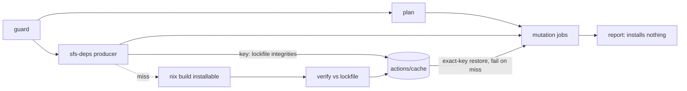

# Reusable workflows materialise a consumer's .sfs-deps tarballs - Plan

## Goal Capsule

- **Objective:** A repository whose lockfile installs systemfsoftware packages from flake-built `.sfs-deps/` tarballs runs this repository's reusable checks, mutation and commitlint workflows with no workflow job or composite action of its own for those tarballs.
- **Means:** one producer per reusable call builds or restores the tarballs under a key derived from the lockfile, and every installing job restores them before it installs (KTD1, KTD2).
- **Product authority:** the sub-conductor ruling of 2026-10-10 for PR 5 of the org shared tooling series, and the PR 5 deferral in `docs/plans/2026-10-10-0734-ci-drop-in-reusable-workflows-plan.md`.
- **Open blockers:** none. The sub-conductor ruled on the plan gate on 2026-10-10: KD2, KD3 and KD4 are accepted, and the review findings are resolved as recorded below.
- **Execution profile:** one PR off `main` on branch `ci/sfs-deps-input`, not stacked on #714, per the ruling. CI is watched with `xd://github run_watch`, and there are no local mutation runs.
- **Stop conditions:** stop and report if a cold producer cannot finish within 10 minutes once its build is narrowed to the tarballs the lockfile demands (R10). A bigger runner or a raised timeout is not a remedy.
- **Finisher:** `ce-work` implements and proves. The sub-conductor merges.

---

## Product Contract

Product Contract preservation: changed KD3, R6, R7, AE1 and AE4. Planning found a key that makes a stale cache unconstructable: the integrities the lockfile records, rather than the flake pins. That replaces the earlier rebuild-on-mismatch rule. The plan-gate ruling then narrowed R8, R10 and AE2 to what they govern, and re-attributed AE4. The planning questions previously under Outstanding Questions are resolved in the Planning Contract and removed here. Every other entry is unchanged.

### Summary

The reusable workflows that install a consumer's pnpm dependencies learn to put the consumer's `.sfs-deps/` tarballs in place first. A run builds them with Nix at most once and caches them, so a warm run restores them in seconds and installs no Nix. The consumer fixture switches its stryker packages from the npm registry to these tarballs and proves the path end to end.

### Problem Frame

There is no npm registry for systemfsoftware packages. Consumers install them as `file:.sfs-deps/<tarball>` entries that a Nix flake builds (`.changeset/README.md:94-98`, `.github/AGENTS.md:24`). The reusable workflows run `pnpm install --frozen-lockfile` through `.github/actions/install-deps` and know nothing about `.sfs-deps/`, so a consumer must put the tarballs there itself before every install.

The two consumers do it in two different ways today. api-extractor-effect runs a dedicated job that builds `.#sfs-deps` with Nix on every run, with no cache: 4 min 36 s on run 38076109223 and 3 min 15 s on run 38036385206. It hands the result to later jobs as an artifact, and its own `checks-lane` hook downloads it. stryker-js-effect calls a `released-tarballs` composite in every job across `ci.yml`, `mutation.yml` and `kill-matrix.yml`. That composite caches on the `stryker-published` lock node and installs Nix only on a miss, and it takes 1-2 s warm (run 38073380492). On a cold cache, though, each job builds on its own. Both copies are per-repository wiring that the reusable workflows were meant to replace (`.github/AGENTS.md:28`: "a caller writes no composite action of its own").

Three reusables install, so all three share the gap. reusable-checks installs in the `plan` (built-in dry run only), `lanes` and `test` jobs, through `builtin-lane` or the caller's own hook. reusable-mutation installs in `mutation` only (`.github/workflows/reusable-mutation.yml:144-147`); its `report` job merges downloaded parts and installs nothing (`reusable-mutation.yml:255-330`, `.github/AGENTS.md:32`), and neither does `timings`. reusable-commitlint installs in its one job (`.github/workflows/reusable-commitlint.yml:36-39`).

### Key Decisions

- KD1. **Lockfile-detected, with a default installable.** The reusables act when the consumer's lockfile names `.sfs-deps/`, and build `.#sfs-deps` unless a new input names another installable. Detection follows the PR 2 rule that behaviour is detected from what the consumer has, not switched on by an input that defaults to off. Governs R1, R2, R3.
- KD2. **The producer is the consumer's own flake output, not this repository's `lib.mkConsumerStore` called directly.** stryker-js-effect's tarballs come from its own release pin, and api-extractor-effect's `.#sfs-deps` combines systemfsoftware with stryker-js-effect tarballs. A contract tied to systemfsoftware's lib would serve neither in full. Governs R3. (session-settled: sub-conductor plan-gate ruling, 2026-10-10)
- KD3. **The cache key is the set of tarballs the lockfile demands (path and integrity), not the systemfsoftware rev.** This is the one challenge to the ruling's "keyed on the consumer's locked systemfsoftware rev". A key on that rev alone would keep serving old stryker tarballs to api-extractor-effect after its `stryker-published` pin moves, and every frozen install would then fail on integrity. A key on the demanded integrities names the exact bytes the install needs. It changes exactly when the tarballs change and never on an unrelated nixpkgs bump. Governs R6, R7. (session-settled: sub-conductor plan-gate ruling, 2026-10-10)
  - The review proposed adding `flake.lock` to the key, so that a moved flake pin could not reuse an entry. Rejected: any entry under this key holds exactly the bytes the frozen install demands, so it satisfies that install by construction. A moved flake pin with an unregenerated lockfile is a consumer error. The key still names the old integrities, so a warm run installs the old, matching bytes. The first cold build after the lockfile is regenerated runs `verify`, which turns any mismatch between the new pin and the lockfile into the named failure `sfs-deps-mismatch`.
- KD4. **At most once per reusable call, not per caller run.** Each reusable call has one producer. When a caller calls several of these reusables in one run (only the consumer fixture does today, and its mutation call runs on push only), a cold cache can build once per call, in parallel. Building once across calls would need a job in the caller, which KD1's no-caller-wiring goal rules out. Governs R5. (session-settled: sub-conductor plan-gate ruling, 2026-10-10)
- KD5. **Nix only on a cold cache.** The warm path follows stryker-js-effect's measured 1-2 s restore. This keeps the PR 2 decision that consumers need not install Nix for tools on the common path. Governs R8.
- KD6. **The fixture proves the path with stryker-js-effect release tarballs.** This is the switch the PR 2 plan names. systemfsoftware's own tarballs already have offline install proofs in the flake checks `consumer-store` and `consumer-load`. Governs R11, R12.

### Requirements

**Materialisation**

- R1. When the lockfile in a call's `working-directory` names any `file:.sfs-deps/` tarball, every job of reusable-checks, reusable-mutation and reusable-commitlint that installs dependencies has those tarballs in `<working-directory>/.sfs-deps/` before the install. This holds in built-in and hook modes.
- R2. A consumer whose lockfile names no `.sfs-deps/` tarball runs as before: no Nix, no build, no new failure.
- R3. The tarballs come from a flake installable evaluated in the call's `working-directory`. The installable is `.#sfs-deps` by default and can be overridden by one new optional input, and its output is a directory of `.tgz` files named as the lockfile's `file:.sfs-deps/` paths.
- R4. The change only adds inputs: every existing input and output keeps its name and meaning, per `.github/AGENTS.md:46`.

**Build once, then cache**

- R5. Within one reusable call, the tarballs are built at most once, and every installing job receives them without running Nix.
- R6. Built tarballs are cached under a key computed from the lockfile's `.sfs-deps/` paths and their recorded integrities. A run whose key is already cached builds nothing.
- R7. Tarballs are saved under a key only after every lockfile-named `.sfs-deps/` tarball matches its recorded integrity. A build that does not match fails the run naming each mismatched tarball.
- R8. On the `.sfs-deps` path, a warm run installs no Nix: neither the producer nor any restoring job installs it. A cold run installs Nix only in the producer, and only to build. Nix a caller's own hook or lane installs for other tools is outside this requirement.

**Failure and timing**

- R9. If the tarballs cannot be built or delivered, the job fails with a named reason and a reproduce command, through `.github/actions/failure-summary`.
- R10. Every job these reusables add or change finishes within the 10-minute PR job ceiling (PR 2 R8), cold or warm. A cold producer builds only the tarballs the lockfile demands. A warm run adds under one minute of wall clock to the call. The PR body records a measured cold run and a measured warm run of the fixture's producers and of every PR lane.

**Fixture proof**

- R11. The consumer fixture installs `@systemfsoftware/stryker-js`, `@systemfsoftware/stryker-js-vitest-runner` and their `@systemfsoftware/*` dependencies from `.sfs-deps/` tarballs that its own flake builds. Its lockfile resolves none of them from the registry.
- R12. On the fixture, `mutation · answer` and `Mutation report` pass on a push run, and the checks and commitlint calls pass on a pull request, all installing from those tarballs.

**Documentation**

- R13. `.github/AGENTS.md` states the `.sfs-deps` convention among the consumer prerequisites and lists the new input in each affected input table.

### Key Flows

- F1. Cold run
  - **Trigger:** a reusable call whose lockfile names `.sfs-deps/`, with no cache entry for its key.
  - **Steps:** the producer builds the installable with Nix, checks it against the lockfile and saves it under the key. Each installing job then restores it and runs the frozen install.
  - **Covered by:** R1, R5, R6, R7, R8
- F2. Warm run
  - **Trigger:** the same call after an earlier run saved the key.
  - **Steps:** the producer finds the key cached and does nothing more. The installing jobs restore it. Nothing installs Nix.
  - **Covered by:** R6, R8, R10

### Acceptance Examples

- AE1. **Covers R2.** Given this repository's own callers (`ci.yml`, `mutation.yml`, `commitlint.yml`), whose root lockfile names no `.sfs-deps/` tarball, when they run, then the producer reports nothing to build, and no job installs Nix for it.
- AE2. **Covers R5, R8.** Given a fixture push run with an empty cache, when reusable-mutation runs, then exactly one job in that call runs `nix build`, and the `mutation` jobs install without Nix.
- AE3. **Covers R6, R10.** Given a second run with the same lockfile, when any of the three reusables runs, then no job runs `nix build`, and the added wall clock is under one minute.
- AE4. **Covers R7.** Given a lockfile whose recorded integrity for one `.sfs-deps/` tarball differs from the bytes the flake builds, when the producer runs, then it fails with `sfs-deps-mismatch` naming that tarball and saves nothing, and no installing job starts an install.
- AE5. **Covers R1.** Given a caller in hook mode whose own `checks-lane` runs the install, as api-extractor-effect's does, when the `static` or `test` lane runs, then `.sfs-deps/` is in place before the hook's install, and the hook carries no download step of its own.
- AE6. **Covers R9.** Given an installable that fails to build, when the producer runs, then the run fails with a reason naming the build and a reproduce command, and no installing job reports a frozen-lockfile error instead.

### Scope Boundaries

- reusable-nix and conflict-check, which install no pnpm dependencies.
- Building once across two reusable calls in one caller run (KD4).
- A tarball producer other than a flake installable.
- Distributing tarballs as GitHub Release assets that a lockfile could fetch by URL. That would remove Nix and the cache from the consumer path, but it changes the distribution channel `.changeset/README.md:94-98` fixes. That choice is costly to reverse (REPO-W8) and belongs to its own decision.

#### Deferred to Follow-Up Work

- api-extractor-effect drops its `sfs-deps` job and its hook's download step, and stryker-js-effect drops its `released-tarballs` composite. Each happens in its own repository's PR after this ships. api-extractor-effect's caller-owned `host-bytes` matrix installs outside these reusables, so that consumer keeps its own tarball job until the matrix is covered; that is its follow-up, not this PR's.
- Pinning reusables and actions by SHA (PR 4) and the `nix flake init` consumer template (PR 3).

### Dependencies / Assumptions

- The tarballs are the same bytes on every system. `nix.yml` asserts this for systemfsoftware's `workspace-tarballs` through `compare-across-systems`, and api-extractor-effect's CI comment states it for its own `.#sfs-deps`. A producer on `ubuntu-latest` can therefore serve `ubuntu-24.04-arm` jobs. This is assumed, not proven, for stryker-js-effect's tarballs.
- The fixture pins stryker-js-effect at `f06f244fad1fbb5cf85937ae717c665a8c5f23bc`, the commit that first published `packages.<system>.workspace-tarballs` (stryker-js 17.0.2, stryker-js-vitest-runner 8.1.1, the versions the fixture installs today). Moving the fixture to the 18.x line is its own change.
- A GitHub cache entry saved by one job is visible to later jobs of the same run on the same ref. A pull request can also read caches saved on its base branch, so `main`'s push run of a lockfile warms every pull request that keeps it. An entry saved on a pull request's merge ref is visible only to that pull request, so a pull request that changes the lockfile builds cold once. R5 and AE3 depend on this.

### Sources / Research

- `docs/plans/2026-10-10-0734-ci-drop-in-reusable-workflows-plan.md`: the PR 5 deferral, the hook-detection decision and R8.
- `.github/actions/install-deps/action.yml`, `.github/actions/builtin-lane/action.yml:32-35`, `.github/actions/checks-lane/action.yml:32,215`, `.github/workflows/reusable-commitlint.yml:36-39`: the install sites R1 must precede.
- `flake.nix` `lib.mkConsumerStore` and `nix/consumer-store-check.nix`: the `file:.sfs-deps/<name>-<version>.tgz` convention and its integrity check.
- api-extractor-effect `b7e907a` `.github/workflows/ci.yml:18-39` and `flake.nix` `sfsDepsOf`, and stryker-js-effect `3495e21` `.github/actions/released-tarballs/action.yml`: the two existing copies. These were read as inputs, not as the design.

---

## Planning Contract

### Key Technical Decisions

- KTD1. **A producer job per reusable call, and a restore step in each installing job.** reusable-checks, reusable-mutation and reusable-commitlint each gain a job named `sfs-deps` that every installing job `needs`. Each installing job restores the exact key with `fail-on-cache-miss` before its install step, and before the hook-or-built-in routing in reusable-checks. That placement gives a hook caller `.sfs-deps/` with no change to its hook (AE5). reusable-commitlint gets the same producer job rather than an inline step, because its one job has a 5-minute timeout (`reusable-commitlint.yml:25`) that a cold build must not share and must not be raised for. Rejected alternative: each job builds or restores for itself, as stryker-js-effect does, which builds once per job on a cold cache and breaks R5.
- KTD2. **Delivery goes through `actions/cache`, not `upload-artifact`.** The producer's save is the hand-off, and a later job's exact-key restore with `fail-on-cache-miss: true` turns a missing entry into a named failure (R9). An artifact would upload and download the same bytes on every run, warm ones included, and would add a second store next to the cross-run cache.
- KTD3. **One Deno tool decides what the lockfile demands and whether a directory satisfies it.** `scripts/tools/sfs-deps.ts` follows `mutation-job.ts` and `test-timings.ts`. It reaches the runner through `.github/actions/sfs-tools` at `job.workflow_sha`. It has two subcommands. `key` reads `pnpm-lock.yaml` and prints the key, empty when no `.sfs-deps/` tarball is named (governs R1, R2, R6). `verify` checks a directory against the lockfile's integrities (governs R7). Parsing is `@std/yaml`, which `scripts/deno.jsonc` already maps; it reads every document of the lockfile, because pnpm 12 writes its own environment as a first document. Hashing is WebCrypto SHA-512. The warm path therefore needs Deno only, never Nix.
- KTD4. **The key is `sfs-deps-v1-<sha256>` over the sorted, de-duplicated `path integrity` lines.** It carries no OS, arch or flake hash, because the bytes are the identity (KD3). Paths are the `tarball: file:` resolutions under `.sfs-deps/` in the lockfile's `packages` map, relative to the working directory. Alias entries that point at the same file count once. Two entries that name one path with different integrities make `key` refuse the lockfile.
- KTD5. **The new input is `sfs-deps-installable`, default `.#sfs-deps`, on all three reusables.** It is evaluated from `working-directory`. The fixed directory name `.sfs-deps` matches both consumers and `lib.mkConsumerStore`'s default, so it gets no input.
- KTD6. **Nix comes from `cachix/install-nix-action@v31` only on a cache miss, and only if Nix is absent.** This is the same action and pin the repository's lanes use today. SHA pinning is PR 4.
- KTD7. **The fixture's flake gains two producers, as api-extractor-effect's `sfsDepsOf` does, and exposes the tarballs its lockfile names as `packages.<system>.sfs-deps`.** stryker-js 17.0.2 depends on `@systemfsoftware/effect-cell-types` at runtime (`packages/stryker-js/package.json:48` at f06f244, packed as `^12.0.0`; stryker-js-vitest-runner 8.1.1's packed manifest names the same), and stryker-js-effect's `workspace-tarballs` does not contain it.
  - stryker-js-effect at `f06f244` supplies `stryker-js` and `stryker-js-vitest-runner`, and nothing follows, so its own lock reproduces the released bytes. Their packed manifests name no other `@systemfsoftware/*` package.
  - systemfsoftware at `732f66a0c85819b2005f9e0930a595bc4de91ee1` supplies `effect-cell-types` 12.0.0, the version stryker-js-effect's release resolves (`pnpm-lock.yaml:2949` at f06f244). That is the same pin api-extractor-effect uses, and the fixture's nixpkgs follows it.
  - The ruling preferred taking systemfsoftware through stryker-js-effect's own locked input with `inputs.follows`. That input is `45f2deb1d0`, and it fails on two counts. Its flake has no `workspace-tarballs` output. Building its workspace with stryker-js-effect's pnpm-release-management is refused: "package.json pins pnpm@12.6.0 but the build uses pnpm 12.3.4". The independent pin is therefore held to the ruling's version constraint: the lockfile names `effect-cell-types-12.0.0.tgz`, so a pin that moves to another version fails `verify` as a missing tarball.
  - Each producer is picked per package (`upstream.${member.attr}`), so a cold build makes only the demanded tarballs. The lockfile names them as `workspace-tarballs` names them (`<name>-<version>.tgz`). pnpm `overrides` in the fixture's `pnpm-workspace.yaml` point each package, and the `stryker-js-vm-runner` alias stryker-js declares, at its tarball.

### High-Level Technical Design

Directional sketch of one reusable-mutation call on a cold cache; reusable-checks has the same shape with `plan`, `lanes` and `test` as the installing jobs.

The producer outputs an empty key when the lockfile names no `.sfs-deps/` tarball. Each restore step is skipped on an empty key, which is R2's path. On a hit, the producer stops after the restore probe; it does not download the entry or install Nix.

### Assumptions

- `actions/cache/save` warns rather than fails when a parallel producer of another reusable call reserved the same key first (KD4). Both producers verified the same integrities, so either entry serves. Execution confirms this on the fixture's first cold push run.
- The fixture's `answer` package keeps its current `stryker.config.mjs` and `vitest` 5.0.1, because the stryker versions do not change.
- reusable-nix builds the fixture's new `packages.<system>.sfs-deps` on both systems once, on this PR's first run, because the output changed. That run must still fit the 10-minute ceiling.

### Risks

| Risk                                                                                                                                            | Mitigation                                                                                                                                                               |
| ----------------------------------------------------------------------------------------------------------------------------------------------- | ------------------------------------------------------------------------------------------------------------------------------------------------------------------------ |
| #714 also edits `.github/workflows/reusable-mutation.yml` and `.github/AGENTS.md`, and this PR is not stacked on it, by ruling.                 | Whichever lands second merges `origin/main` and resolves the conflict; plain push only.                                                                                  |
| Hook mode with `.sfs-deps/` (AE5) has no in-repo caller: this repository's hook workspace names no `.sfs-deps/`, and the fixture runs built-in. | The restore step sits before the routing branch, so both modes share one code path. AE5 is proven when api-extractor-effect adopts (follow-up), and the PR body says so. |
| The plan job in reusable-checks gains `needs: sfs-deps`, which puts the producer on the critical path even for consumers without `.sfs-deps/`.  | The no-op producer is a checkout plus one tool call. Its duration on this repository's `ci.yml` is recorded in the PR body against R10.                                  |

### Sequencing

U1 (tool) lands first, because U2's composites call it. U3 wires the reusables and depends on U2. U4 (fixture) commits after U3's `.github/` commit, because from the fixture commit onward its lockfile names `file:.sfs-deps/` tarballs that only U3's wiring puts in place. U5 (docs) follows U3. Commits follow the Evaluator rule in `AGENTS.md` Surface Classes: `.github/` changes go in their own commit, separate from `scripts/tools/`, the fixture and `.github/AGENTS.md`.

---

## Implementation Units

### U1. Lockfile tarball tool

- **Goal:** decide from a lockfile which `.sfs-deps/` tarballs a consumer needs, their key, and whether a directory holds exactly those bytes.
- **Requirements:** R1, R2, R6, R7; KTD3, KTD4.
- **Files:** `scripts/tools/sfs-deps.ts` (new), `scripts/tools/sfs-deps.test.ts` (new).
- **Approach:** two subcommands on the `mutation-job.ts` CLI pattern (`@std/cli/parse-args`). `key --working-directory <dir>` prints the key and writes `key=<key>` to `GITHUB_OUTPUT`; the key is empty when nothing is needed. `verify --working-directory <dir>` exits 1 and names each missing or mismatched tarball. Both read `<dir>/pnpm-lock.yaml`. A refused lockfile exits 1 naming the cause.
- **Execution note:** test-first. Each test runs the CLI the way the workflow will, as the existing `mutation-job.test.ts` does.
- **Test scenarios:**
  - A lockfile with no `file:.sfs-deps/` resolution gives an empty key.
  - Two lockfiles that differ only in `packages` entry order, or by an alias entry naming the same tarball, give the same key. Changing one recorded integrity changes the key.
  - One path recorded with two different integrities makes `key` exit 1 and name the path.
  - `verify` on a directory whose tarball bytes match the lockfile exits 0. Expected integrities in the test are literals computed once with `openssl dgst -sha512 -binary | base64`, not by the tool.
  - `verify` with one tarball missing, and separately with one tarball's bytes altered, exits 1 and names exactly that file (AE4).
  - Only the `packages` map's resolutions enter the key: an importer specifier that names the tarball by another relative path (`file:../../.sfs-deps/x.tgz`) does not change it.
- **Verification:** `deno test --config=scripts/deno.jsonc --lock=scripts/deno.lock --frozen --allow-read --allow-write --allow-env --allow-run scripts/tools/` passes.

### U2. Producer and restore composites

- **Goal:** one composite that produces the tarballs for a call, and one that restores them into a job.
- **Requirements:** R3, R5, R6, R7, R8, R9; KTD1, KTD2, KTD5, KTD6.
- **Dependencies:** U1.
- **Files:** `.github/actions/sfs-deps/action.yml` (new), `.github/actions/sfs-deps-restore/action.yml` (new), `.github/actions/sfs-tools/action.yml` (register `sfs-deps` on PATH), `.github/actions/failure-summary/action.yml` (four reason branches).
- **Approach:**
  - The producer takes `working-directory`, `installable`, `repository` and `ref`, and outputs `key`. Its steps are: `sfs-tools`, then `sfs-deps key`, which stops with an empty key when nothing is needed. Next it probes the exact key with `actions/cache/restore` and `lookup-only: true`. On a miss it installs Nix if absent, runs `nix build --no-link --print-out-paths <installable>`, and copies the output's `.tgz` files into `<working-directory>/.sfs-deps/`. It then runs `sfs-deps verify` and finally `actions/cache/save`.
  - The restore composite takes `key` and `working-directory`. When the key is non-empty, it restores the exact key with `fail-on-cache-miss: true`.
  - Both write reason codes to `$RUNNER_TEMP/sfs-reason`, and `.github/actions/failure-summary` gets a `case` branch with a next action for each:
    - `sfs-deps-lockfile-invalid`: the lockfile could not be read, or it names one tarball with two integrities.
    - `sfs-deps-build-failed`: the installable did not build.
    - `sfs-deps-mismatch`: the build lacks a tarball the lockfile names, or its bytes differ from the recorded integrity.
    - `sfs-deps-missing`: an installing job found no cache entry under the producer's key.
- **Test expectation:** none in-repo. These are composites whose behaviour U4's fixture runs exercise end to end, and U1 owns the decisions they call.
- **Verification:** the fixture runs in the Verification Contract.

### U3. Wire the three reusables

- **Goal:** every installing job of reusable-checks, reusable-mutation and reusable-commitlint has `.sfs-deps/` in place before it installs.
- **Requirements:** R1, R2, R4, R5, R10; KTD1, KTD5.
- **Dependencies:** U2.
- **Files:** `.github/workflows/reusable-checks.yml`, `.github/workflows/reusable-mutation.yml`, `.github/workflows/reusable-commitlint.yml`.
- **Approach:**
  - reusable-checks gets a new `sfs-deps` job with no `needs`. `plan`, `lanes` and `test` add it to `needs`, and each runs the restore composite before the hook-or-built-in routing step.
  - reusable-mutation gets a new `sfs-deps` job that needs `guard`. `mutation` adds it to `needs` and runs the restore composite before `install`. `report` and `timings` gain neither, because they install nothing.
  - reusable-commitlint gets a new `sfs-deps` job with the commitlint job's `if`. The commitlint job needs it and runs the restore composite before `install`.
  - All three gain the `sfs-deps-installable` input. Each producer job has `timeout-minutes: 10`, uses `runs-on` from the existing input, and calls `failure-summary` on failure.
- **Test expectation:** none in-repo. Workflow wiring is proven by the CI runs in the Verification Contract.
- **Verification:** AE1 on this repository's own callers. AE2, AE3 and AE6 on the fixture. R10 is measured: the producer jobs' cold and warm durations, and each PR lane's duration on both, go into the PR body.

### U4. Fixture installs stryker from flake tarballs

- **Goal:** the consumer fixture depends on stryker-js-effect release tarballs and the systemfsoftware package they need through `.sfs-deps/`, as an outside consumer would.
- **Requirements:** R11, R12; KD6, KTD7.
- **Dependencies:** U3.
- **Files:** `.github/consumer-fixture/flake.nix`, `.github/consumer-fixture/flake.lock`, `.github/consumer-fixture/package.json`, `.github/consumer-fixture/pnpm-workspace.yaml`, `.github/consumer-fixture/pnpm-lock.yaml`, `.github/consumer-fixture/.gitignore`.
- **Approach:** add the two inputs and the `sfs-deps` output (KTD7). Build it locally with `nix build ./.github/consumer-fixture#sfs-deps`, and copy the tarballs into the fixture's `.sfs-deps/`. Point the two devDependencies at `file:.sfs-deps/<tarball>`, with overrides for `effect-cell-types` and the runner alias. Regenerate the lockfile with the fixture's pinned pnpm, and add `.sfs-deps/` to its `.gitignore`.
- **Test expectation:** none new. The fixture is itself the consumer proof, run by `consumer-fixture.yml`.
- **Verification:** the lockfile has no registry resolution for any `@systemfsoftware/` package (R11). The fixture runs pass (R12).

### U5. Consumer documentation

- **Goal:** a consumer can adopt from `.github/AGENTS.md` alone.
- **Requirements:** R13.
- **Dependencies:** U3.
- **Files:** `.github/AGENTS.md`.
- **Approach:** add the `.sfs-deps` convention to "Consumer prerequisites": a lockfile that names `file:.sfs-deps/` tarballs, and a flake installable that builds exactly those files. Add the `sfs-deps-installable` row to the checks, mutation and commitlint input tables. Add the four reason codes wherever the existing reasons are listed.
- **Test expectation:** none -- documentation.
- **Verification:** `./bin/dprint check .github/AGENTS.md` passes.

---

## Verification Contract

| Gate                | Command or evidence                                                                                                                                                                                                             | Proves           |
| ------------------- | ------------------------------------------------------------------------------------------------------------------------------------------------------------------------------------------------------------------------------- | ---------------- |
| Tool tests          | `deno test --config=scripts/deno.jsonc --lock=scripts/deno.lock --frozen --allow-read --allow-write --allow-env --allow-run scripts/tools/`                                                                                     | U1               |
| Static              | `deno check` and `deno lint` with `--config=scripts/deno.jsonc` on the new tool; `./bin/dprint check` on changed files                                                                                                          | U1, U2, U3, U5   |
| Local chain         | `pnpm check:local` exits 0, apart from the known `effect-daemon-microvm#test` failure that needs `/dev/kvm` (OP27)                                                                                                              | repository gates |
| Fixture install     | Locally, `pnpm install --frozen-lockfile --offline` in the fixture after `sfs-deps verify` passes on the built output, then the `answer` tests                                                                                  | U4, R11          |
| Pull request run    | `xd://github run_watch` on the head: CI, Nix, Consumer fixture (checks and commitlint on the fixture), Commitlint and Changeset Check all green                                                                                 | R1, R12, AE1     |
| No-op producer      | On `ci.yml`, `mutation.yml` and `commitlint.yml`, the `sfs-deps` job prints an empty key and runs no Nix step; record its duration                                                                                              | AE1, R10         |
| Push proof          | One-shot push trigger on `consumer-fixture.yml`, then revert, with a net diff of zero (the #714 pattern): `mutation · answer` and `Mutation report` green                                                                       | R12              |
| Cold and warm       | The first fixture run on each ref is the cold run: its producers show `nix build` with durations of at most 10 min. A second run on the same lockfile shows a cache hit, no Nix step, and under one minute added                | R10, AE2, AE3    |
| Mismatch proof      | One-shot commit that changes one recorded `.sfs-deps/` integrity in the fixture lockfile, then revert, net diff zero: the producers fail with `sfs-deps-mismatch` naming that tarball, save nothing, and no installing job runs | AE4              |
| Build-failure proof | One-shot commit that points the fixture's checks call at a missing `sfs-deps-installable`, then revert, net diff zero: the producer fails with `sfs-deps-build-failed` and a reproduce command                                  | AE6              |
| Lockfile            | No `@systemfsoftware/` entry in `.github/consumer-fixture/pnpm-lock.yaml` resolves without `file:.sfs-deps/`                                                                                                                    | R11              |

No permanent test beyond U1 is admitted: the composites and wiring are shell glue proven by the fixture runs, and U1 holds the only decisions.

---

## Definition of Done

- U1-U5 are implemented, and every gate in the Verification Contract has been observed by the parent session, with run IDs and job times recorded in the PR body.
- The PR body states that AE5 (hook mode) is unexercised in-repo and lists the deferred adoption PRs.
- No scratch files, probe scripts or one-shot trigger commits remain in the net diff.
- No `.changeset/` intent is needed, because no publishable package's turbo build hash changes. Confirm this with the Changeset Check run.
