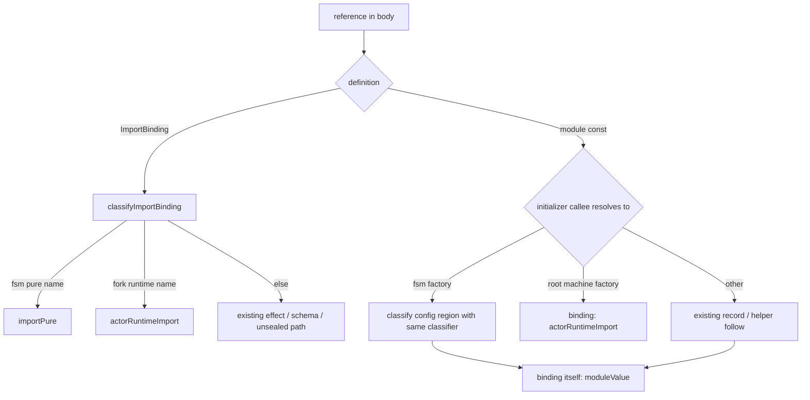

# make-body-purity accepts the xstate fork's pure FSM surface - Plan

## Goal Capsule

- **Objective:** A `Workflow.make` decision can use a lifecycle machine built from `@systemfsoftware/xstate/fsm` as its transition core and still pass `make-body-purity`, while a decision that reaches the fork's actor runtime is refused by the export's own name.
- **Means:** specifier-keyed fork name sets beside the effect surface (KTD1), one new refusal verdict (KTD2), and the existing body classifier run over the machine's config (KTD3).
- **Authority:** this plan's Requirements, then the fork source at `c8c376cc2`, then the rule's existing doctrine in `make-body-purity.config.ts`.
- **Stop conditions:** stop and report if the fork's fsm surface itself would have to change, or if a requirement can only pass by treating the whole `@systemfsoftware/xstate` package as pure.
- **Execution profile:** red tests first, committed separately, then the implementation that turns them green.
- **Finisher:** the implementing agent ships one pull request against `main` and watches it to green.

---

## Product Contract

### Summary

The rule learns two fork exports as pure (`createFSM`, `setup` from `@systemfsoftware/xstate/fsm`) and ten actor-runtime exports as refused by name: eight from the root entry, plus `createEmptyActor` from `/actors` and `createDurable` from `/durable`. When a decision references a module-scope machine built by `createFSM`, the rule judges that machine's config with the same classifier it applies to the body. A module-scope machine built by a root factory is refused.

### Problem Frame

`make-body-purity` refuses every import outside the sealed effect surface and the schema-file edge (`src/rules/ReferenceClassification.ts:204-224`). Building a machine inside a decision is therefore refused outright, so a lifecycle machine cannot be the decision's transition core.

A machine built at module scope already passes, for the wrong reason. The body's reference to it resolves to a module `const`, which classifies as a passing `moduleValue` (`ReferenceClassification.ts:659-684`), and the rule never reads the factory call's arguments. An impure transition callback inside that config therefore passes unread. A fleeting RuleTester probe on the base commit confirmed both facts: in-body `createFSM(...)` reports `unsealedImportReference`; a module-scope `createFSM` config whose callback calls `fetch` reports nothing.

The fork's root package also exports a pure-looking `transition` that is not pure. Its refusal today is the generic "module this rule cannot read" finding, which misstates why.

### Requirements

**Accepted surface**

- R1. A decision body that builds a machine with `createFSM` or `setup(...).createFSM` imported from `@systemfsoftware/xstate/fsm` and calls its `transition` or `initialTransition` passes when the machine's config is pure.
- R2. Acceptance keys on module specifier plus imported name, as the effect surface does: only `createFSM` and `setup` from `@systemfsoftware/xstate/fsm` are pure. The fsm entry's `types` export, a namespace binding of the fsm entry, and the root package's own `setup` stay `unsealedImportReference`.

**The config walk**

- R3. When a body references a module-scope `const` built by the fsm `createFSM`, every reference inside that `createFSM` call's config is judged by the body's classifier, and each failing verdict reports exactly as it would inside the body.
- R4. The walk recognizes the machine through any chain of `const` bindings back to an fsm-entry factory: a named or aliased import, a namespace member, `setup(...).createFSM(...)` chained or through a `const` holding `setup(...)`, a `const` holding the factory, and a `const` aliasing the machine. A config that is itself a reference (an imported binding) is judged as that reference, so an imported config reports `unsealedImportReference`.

**Refused root runtime**

- R5. Root `transition`, `initialTransition`, `getMicrosteps` and `getInitialMicrosteps` are each refused by name with a finding that names the actor runtime, not the generic unsealed-import finding.
- R6. The exports that create, host or drive an actor are refused by name with the same finding: root `createActor`, `Actor`, `createEmptyActor` and `createSystem`; `createEmptyActor` from `@systemfsoftware/xstate/actors`; `createDurable` from `@systemfsoftware/xstate/durable`.
- R9. A body referencing a module-scope machine built by root `createMachine`, `setup(...).createMachine` or `createMachineFromConfig` reports `actorRuntimeReference` on that binding, recognized through the R4 resolution chain.

**Release and guardrails**

- R7. The rule gains no option and no escape hatch; `Options` stays `S.Struct({})`.
- R8. The plugin ships a `minor` intent and each dependent whose build hash moves ships a `none` intent; `pnpm change check` exits 0.

### Key Decisions

- **`transition` and `initialTransition` are the machine's own methods.** At `c8c376cc2` the fsm entry exports no free `transition` or `initialTransition` (`packages/xstate/src/fsm/index.ts:1-17` in the fork). They are members of the value `createFSM` returns (`packages/xstate/src/fsm.ts:161-165`, built at `fsm.ts:465-485`). No fork change is needed. Governs R1.
- **Root `setup` is a different export from fsm `setup`.** Same name, different module, so the specifier decides. Governs R2.
- **A module-scope root machine stepped by a decision is refused.** Its `transition` and `initialTransition` methods run the inert-actor-scope path root `transition` runs (`packages/xstate/src/StateMachine.ts:704-781`, `:1251-1269`). Governs R9. (session-settled: user-directed — chosen over keeping the PR to the named export list and recording the bypass as follow-up: the method path is the same impurity the named refusals exist to report.)
- **The fsm entry's `types` stays unsealed.** The accepted surface is the four names the work was scoped to; a typed `setup` hoists to module scope, where the rule does not look. Governs R2.

### Acceptance Examples

- AE1. **Covers R1.** **Given** a body `createFSM({...}).transition(snapshot, event)` with `createFSM` from the fsm entry, **then** no finding; on the base commit the same code reports `createFSM` as `unsealedImportReference`.
- AE2. **Covers R3.** **Given** a module `const lifecycle = createFSM({ ... on: { START: () => { fetch(url); ... } } })` and a body calling `lifecycle.transition(...)`, **then** `fetch` reports `ioGlobalReference`; the base commit reports nothing.
- AE3. **Covers R5.** **Given** a body calling root `transition(machine, snapshot, event)`, **then** `transition` reports `actorRuntimeReference`; removing `transition` from the name set reverts it to `unsealedImportReference` and the test fails.

### Scope Boundaries

- The control-flow scan stays on the body itself. Config callbacks get the purity classification only, exactly as followed helpers and record members do today (`ReferenceClassification.ts:667-674`).
- Module consts built by any factory outside R3 and R9 keep today's `moduleValue` pass; closing that gap generally is not this change.
- A config reached through a member read of a module record (`createFSM(shared.idle)`) is judged as that read; the record's members are not followed.
- Fork packages other than `@systemfsoftware/xstate`, and root runtime helpers that act on an existing actor (`deliverEvent`, `runStep`, `waitFor`, `toPromise` and the like), keep the generic unsealed refusal.

### Sources

Fork evidence at `c8c376cc2` (paths are in the public `systemfsoftware/xstate` repository):

- fsm purity: `packages/xstate/src/fsm.ts:1-2` imports types only; `fsmOf` (`fsm.ts:465-485`) closes over the config and returns plain snapshots; `setup` ignores its argument (`fsm.ts:492-496`).
- root `transition` and `initialTransition` build an inert actor scope (`packages/xstate/src/transition.ts:85`, `:139`) and attach a lazy actor ref to the returned snapshot (`transition.ts:96`, `:148`). That attach writes module-level WeakMaps (`packages/xstate/src/inertActorScope.ts:60` into the map declared at `:95`; `packages/xstate/src/snapshotActorRef.ts:210`).
- `getMicrosteps` and `getInitialMicrosteps` also register a spawn allocation in a module WeakMap (`transition.ts:201`, `:241`; `packages/xstate/src/transitionActions.ts:388`, `:404`).
- The id claim holds, lazily. Reading the returned snapshot's actor ref materializes an inert actor through `createActor` (`inertActorScope.ts:174`). Its system mints an id from `crypto.getRandomValues`, falling back to `randomUUID`, then `Date.now()` with `Math.random()` (`packages/xstate/src/system.ts:77-99`). It also bumps a module counter (`system.ts:106`, called at `:650`). A scratch Bun probe against the fork source counted, per call: root `initialTransition` 0 random draws and 0 materializations; reading its snapshot's actor ref 1 `getRandomValues` and 1 materialization; fsm `transition` 0 of each, with no actor ref attached.
- actor creation: `createActor` (`packages/xstate/src/createActor.ts:1434`), `createEmptyActor` (`packages/xstate/src/actors/index.ts:71-72`), `createSystem`'s builder (`packages/xstate/src/setup.ts:5193-5197`), `createDurable` driving root `transition` and start effects (`packages/xstate/src/durable/index.ts:707`, `:735`, `:742`).

---

## Planning Contract

### Key Technical Decisions

- KTD1. **Fork names live in `make-body-purity.config.ts` as maps from module specifier to imported names.** `classifyImportBinding` consults them beside the effect sets, so an alias (`import { createFSM as make }`) classifies by the imported name. The config's no-allowlist doctrine is about relative paths an author certifies without anyone reading them. These keys are package specifiers whose source was read at fork version `6.0.0-alpha.64`, commit `c8c376cc2`; the docstring records the commit, and the sets are re-read when the fork pin moves. Governs R2, R5, R6, R9.
- KTD2. **One new verdict kind, `actorRuntimeImport`, reported as `actorRuntimeReference`.** `FAILING_KIND` is keyed by the verdict union, so the compiler forces the new kind to be classified. Root transition functions and actor factories share one message, because both run the actor runtime. Governs R5, R6.
- KTD3. **The config walk generalizes the body classifier to a code region; it adds no second checker.** `classifyFunctionReferences` takes any node. References are filtered to the node's span, which is a no-op for function bodies. A module `const` is recognized by resolving its initializer's callee to a module export (KTD5), and the config region is the first argument of a recognized `createFSM` call. The shared visited set stops cycles. Governs R3, R4.
- KTD4. **No method-name list.** A machine built by the fsm factories is a plain value whose members are pure (KTD evidence in Sources), so calling `transition` or `initialTransition` needs no name check. Governs R1.
- KTD5. **Machine factories are a second pair of specifier-keyed tables.** A callee resolves through `const` aliases to `{ source, name }`, with `X` called on a `setup(...)` result spelled `setup().X`; the fsm table drives the walk and the root table drives the R9 refusal. Governs R3, R4, R9.

### High-Level Technical Design

### Assumptions

- Plain-language instruction to proceed without stopping counts as skipping the scoping confirmation.
- A turbo dry-run diff against `origin/main` lists the re-hashed dependents; CI's changeset check is the authority.

### Sequencing

U1 is its own commit inside the single pull request and fails against the base rule; U2 turns it green in the next commit; U3 follows. R9 follows the same red-then-green pair.

---

## Implementation Units

### U1. Red RuleTester cases

- **Goal:** encode R1-R6 and R9 as RuleTester cases that fail against the base rule.
- **Requirements:** R1-R6, R9.
- **Files:** `packages/oxlint-plugin/oxlint-plugin-dmmf-workflow/src/rules/__tests__/make-body-purity.test.ts`.
- **Approach:** reuse `makeWorkflow`, `referenceError` and the full-data assertions the file already uses. Every expected `actual`/`fix` string is written out in the test as a literal, never imported from the implementation.
- **Execution note:** run the file against the base rule and record which cases fail before committing.
- **Test scenarios:**
  - Valid: in-body `createFSM(cfg).transition(s, e)` and `createFSM(cfg).initialTransition()`; in-body `setup({}).createFSM(cfg).transition(...)`; aliased `createFSM as make`.
  - Valid guards (green before and after; they catch a walk that refuses pure configs): module `createFSM` with pure string, object and function transitions; module `setup({}).createFSM(...)`.
  - Invalid, one per walk refusal path, via a module-scope machine callback: `ioImportReference` (a `node:fs` binding), `ioGlobalReference` (`fetch`), `moduleStateReference` (module `let`), `mutableLocalReference` (callback `let`), `unresolvableReference` (unbound name), `unsealedImportReference` (sibling-module binding), `runtimeImportReference` (`require`), `moduleMutationReference` (module const push), `actorRuntimeReference` (root `createActor`).
  - Invalid, one per detection shape (R4): aliased `createFSM as make`, namespace `Fsm.createFSM`, chained `setup(...).createFSM`, two-step `const s = setup(); s.createFSM(...)`, a `const makeMachine = createFSM` factory alias, a `const core = lifecycle` alias, and a config passed by imported binding.
  - Invalid, one per root machine factory (R9): `createMachine`, `setup({}).createMachine`, `createMachineFromConfig`, each expecting `actorRuntimeReference` on the machine binding.
  - Invalid, one per refused root name (R5, R6): `transition`, `initialTransition`, `getMicrosteps`, `getInitialMicrosteps`, `createActor`, `Actor`, root `createEmptyActor`, `./actors` `createEmptyActor`, `createSystem`, `./durable` `createDurable`, each expecting `actorRuntimeReference`.
  - Invalid, specifier boundary (R2): root `setup`, fsm `types`, and a namespace fsm binding referenced in the body each report `unsealedImportReference`.
  - Admission: each case observes the rule's diagnostics through RuleTester, the plugin's public surface; each guards a behavior a consumer would see (a refused or accepted decision), so none is a characterization or wiring test.
- **Verification:** `pnpm --filter @systemfsoftware/oxlint-plugin-dmmf-workflow exec vitest run src/rules/__tests__/make-body-purity.test.ts` fails on the R1, R3, R4, R5 and R6 cases and passes the guards.

### U2. Classification and config walk

- **Goal:** turn U1 green without breaking the 252 existing cases.
- **Requirements:** R1-R7, R9.
- **Dependencies:** U1.
- **Files:** `packages/oxlint-plugin/oxlint-plugin-dmmf-workflow/src/rules/make-body-purity.config.ts`, `src/rules/ReferenceClassification.ts`, `src/rules/make-body-purity.ts`.
- **Approach:** KTD1 name maps, message strings and the `meta.docs.description` sentence in the config, KTD2 verdict plumbing in the classifier and the rule, KTD3 region generalization and the KTD5 factory recognizer in the classifier.
- **Test scenarios:** U1's cases; the existing suite is the regression guard.
- **Verification:** the package's `test`, `typecheck` and `lint` scripts exit 0.

### U3. Docs and release intents

- **Goal:** record the new surface where adopters read it and ship the intents.
- **Requirements:** R8.
- **Dependencies:** U2.
- **Files:** `packages/oxlint-plugin/oxlint-plugin-dmmf-workflow/README.md`, `.changeset/<generated>.md`.
- **Approach:** extend the README rule row. Run `pnpm change --bump minor` for the plugin and `--bump none` for each dependent. The changelog body states consumer-observable facts only (pack: package-topology, surface-changes-are-versioned.md).
- **Test expectation:** none -- docs and release metadata.
- **Verification:** `pnpm change check` exits 0.

---

## Verification Contract

| Gate           | Command                                                                           | Proves                    |
| -------------- | --------------------------------------------------------------------------------- | ------------------------- |
| Rule behavior  | `pnpm --filter @systemfsoftware/oxlint-plugin-dmmf-workflow test`                 | R1-R6, R9, existing suite |
| Types and lint | `pnpm --filter @systemfsoftware/oxlint-plugin-dmmf-workflow typecheck` and `lint` | KTD2 exhaustiveness       |
| Intents        | `pnpm change check`                                                               | R8                        |
| Local gate     | `pnpm check:local`                                                                | REPO-D1                   |
| CI             | the PR's checks on its exact head                                                 | REPO-D1                   |

Mutation is evaluated in CI only; no local Stryker run (pack: mutation-discipline, README.md).

## Definition of Done

- Every case the change moves (R1, R3, R4, R5, R6, R9) fails on its red commit and passes on its green commit, and the SHAs are recorded in the PR body; the guard cases (pure-config walk guards and the R2 specifier-boundary cases) pass on both.
- No new test imports a name set or a new message constant from the implementation.
- `Options` in `make-body-purity.config.ts` is still `S.Struct({})` and no option gates the name tables or the walk (R7).
- No `stryker.config.ts` is touched and no lint disable is added.
- Scratch probes are deleted, and the diff carries no abandoned-attempt code.
- One non-draft PR is green on its exact head.
