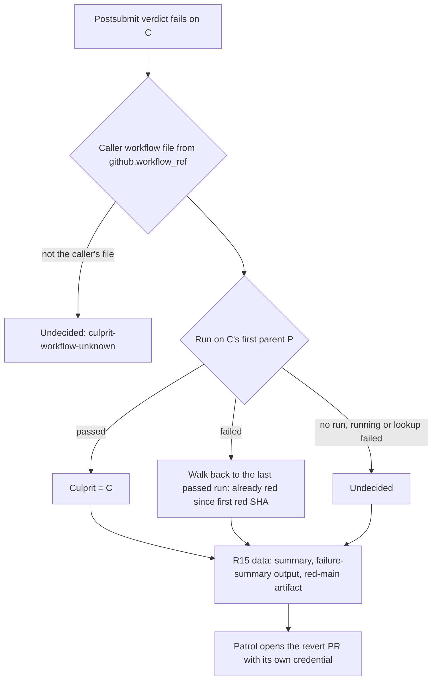
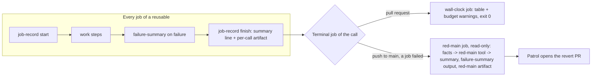

# CI Wall Clock in the Shared Reusables - Plan

## Goal Capsule

- **Objective:** Every repository that calls systemfsoftware's reusable workflows gets measured CI wall time instead of kill switches, a commitlint that finishes in about a minute, a main branch where every merge gets its own postsubmit verdict, and a red verdict that names its culprit and hands the patrol a ready-to-run revert the same day, by bumping one pin.
- **Means:** Changes land in the shared reusables (`reusable-checks`, `reusable-mutation`, `reusable-nix`, `reusable-commitlint`), their shared actions and Deno tools, and systemfsoftware's own callers (KTD1-KTD6, KTD8-KTD13), in two pull requests (Key Decisions).
- **Product authority:** Root's CI-discipline brief (rules 1-5, three tiers, done items D1-D4 and D6-D8), as amended on 2026-10-11: the rule pack is its own unit (`compound-packs/ci-wall-clock/`, separate PR); root's mutation-lane ruling (each push mutates what is affected since the last green main SHA; full corpus only on dispatch or a lane-input change); and root's plan-gate rulings of 2026-10-11: two PRs, a patrol-only revert route, the review findings as ruled (Sources), the D6 deletions, and no `--force` for packages affected only through a dependency. Amended again on 2026-10-12 by root's elicitation rulings: amendments F-I as approved (Appendix A, R28-R36, KTD10-KTD13), Q1 (Plan R18, patrol-only, with a P0 comment under `pull-requests: write`) and Q2 (the rule-id mapping below, approved with R19's caveat).
- **Rule citations:** the ci-wall-clock ids the root froze, mapped by root's ruling of 2026-10-12: D1 and R4 `one-stuck-job-backstop`; R5 `pr-gate-runs-only-what-the-diff-affects`; D3 `light-checks-run-the-pinned-tool`, with R10's 60 s also `setup-under-a-minute`; D8 (R11-R12, and PR-B's R22-R27) `heavy-suites-judge-every-main-commit`; D4 (R13-R18) `red-main-reverts-its-culprit-same-day`; R19 `heavy-lanes-state-their-daily-minutes`; D6 (R20) `no-lane-grades-the-repos-own-docs`. D7 cites none.
- **Open blockers:** none for planning. Amendments F-I arrived with root's elicitation rulings of 2026-10-12 and are recorded verbatim in their requirements (R28-R36). PR-A's U3 template edit waits on #736 (Dependencies).
- **Product Contract preservation:**
  - Changed at planning: R14's lookup.
  - Changed at the plan gate:
    - R1, R2 and R11 split across PR-A and PR-B; R11's group is keyed per run, not per SHA.
    - R3 adds the kill-cap grep over `.github` and `scripts`.
    - R5 states its instrumented set and the docs-only overrun cause.
    - R9 makes the toolchain list and its failure explicit; R10 is measured from the jobs API.
    - R14 now requires P to be C's first parent, takes the caller's workflow file as its lookup key and walks twice.
    - R15 carries the patrol's data (merged_by, failing jobs, revert flag, `Reverts:` trailer, no-PR notice, an artifact).
    - R16 and R17 are removed; R18 becomes "no write token in shared code".
    - R19's table splits measured from projected; R20 records the D6 deletions; R21 says per-run grouping; R27 names PR-B's branch.
    - AE1, AE2, AE3, AE4 and AE7 rewritten for patrol-only; AE13-AE16 added.
  - Added at the mutation-lane ruling: R22-R27 and AE8-AE12.
  - Otherwise unchanged.
  - Changed on 2026-10-12 (root's rulings at the start of PR-A):
    - The rule-id citations above replace the placeholders.
    - Superseded by Q1 below: R18 stays patrol-only, but the shared `red-main` job now writes the P0 as a comment. Its first form here ("files no P0") is replaced.
    - R19 prices the run shape R22 mandates. A Mutation push run is in-diff, about 10 runner-min (the pack's measured in-diff run), so about 107 runner-min a day at 10.7 first-parent merges a day. The measured 324-422 job-min whole-lane runs are the rejected full-lane-per-push counterfactual.
    - KTD1's record name carries a per-call id, because the caller and reusable names collide in one run (below).
    - U8's survey found `systemfsoftware/stryker-js-effect` running `repo-checks single-plan` from this flake, so the subcommand and its planted probe stay.
  - Changed on 2026-10-12 (root's elicitation rulings Q0-Q2, amendments F-I):
    - F: the plan stops at the plan gate with its commit SHA and Appendix A, one row per pack rule naming PR-A, PR-B or the exact out-of-scope reason.
    - G (PR-B): R33-R35. A cold mutation run is shard-sized to about 10 minutes from its first run, from a dry-run-measured estimate, then from recorded timings. The 1-second fallback is removed.
    - H (PR-A): R28-R30. The test-timing recorder separates runner work from fixed per-shard cost, and the planner sizes against both, so a shard count can fall as well as rise.
    - I (PR-A): R9 rewritten, R31-R32 and AE17-AE19 added. Commitlint keeps four rules; header rules read only the PR title, and `no-ai-coauthors` reads every PR-range commit message plus the PR body.
    - Q1: R18 rewritten, R36 and AE20 added. The `red-main` job writes the P0 comment under `pull-requests: write` only and never opens a revert PR. The rerun and parent dispatch the pack rule's conditions (c) and (d) need are a design question (Outstanding Questions), with no handler in either PR.
    - Q2: the mapping above is approved. R19's daily-minutes table prices the affected/in-diff shape and stays evidence in the PR body; there is no new pack id.
- **Execution profile:** `ce-work`, two PRs, each watched to green and stopped for root's review.
  - PR-A is `ci/ci-discipline`, cut from `origin/main`.
  - PR-B is `ci/ci-discipline-mutation`, after #733 (Dependencies).

---

## Product Contract

### Summary

The reusables drop every per-job timeout input for one 60-minute stuck-job backstop, report each job's wall time against the PR budget without failing anything, and run commitlint from a toolchain pinned at their own commit.
systemfsoftware's callers stop cancelling main runs, so each merge gets its own postsubmit verdict.
A red postsubmit verdict names its culprit squash commit and leaves the patrol the data and the command to revert it.
Mutation on main re-verifies only what changed since the last green run.

### Problem Frame

Measured on main over 2026-10-04 to 2026-10-11 (74 merges, 10.6 a day; `.context/ci-discipline/main-runs-7d.json`, jobs API):

- **Main runs cancel each other.** `ci.yml:10-12`, `nix.yml:11-13`, `mutation.yml:6-8` and `consumer-fixture.yml:18-20` group concurrency by `github.ref` with `cancel-in-progress: true`, so a merge cancels the previous merge's run on `refs/heads/main`.
  - In those 7 days, 24 of 55 Mutation runs, 4 CI runs and 1 Nix run on main were cancelled this way. The cancelled Mutation runs had already burned 7,779 runner-minutes, and their commits never got a verdict.
  - Setting `cancel-in-progress: false` alone does not fix it. GitHub keeps at most one pending run per group and cancels the older pending one (workflow syntax docs, `concurrency`: "By default, any existing `pending` job or workflow in the same concurrency group will be canceled").
- **Timeouts are budgets enforced as kills.** The reusables expose `timeout-minutes`, `plan-timeout-minutes`, `gate-timeout-minutes`, `report-timeout-minutes` and per-lane `"timeout-minutes"`, and hard-code 2, 3, 5 and 20-minute caps (full list in Sources). A cap below the job's real wall time turns a slow run into a red one, and nobody learns how long the job actually took.
- **Commitlint pays for a full consumer install.** `reusable-commitlint.yml` runs a `sfs-deps` job (`:27-57`) and a full `pnpm install` before a one-second `commitlint` step.
  - In systemfsoftware that costs 34-38 s median per job (76 PR runs; `checkout` 13 s and `install-deps` 15 s median).
  - In Stead, where the install needs Nix and the `.sfs-deps` tarballs, it took 10+ minutes (`.context/evidence/stead-setup-cost.md:26,55,59`).
- **A red main has no owner path.** `failure-summary` writes a reason code and a reproduce command, but nothing names the culprit commit or its author.

### Key Decisions

- **Two PRs, not one stacked on #733.** #733 belongs to another lane, and stacking the whole unit on it would hold D1-D3 hostage.
  - PR-A takes every change outside `reusable-mutation.yml` and `mutation.yml`, so it does not wait on #733.
  - PR-B takes those two files, for both this unit's contract and U7.
  - The plan doc lands in PR-A; PR-B adds no second plan.
- **One backstop, no budget inputs.** Each reusable takes one `backstop-minutes` input (default 60) and applies it to every job. Budgets are measured and reported, never configured as caps. Governs R1-R3.
- **The backstop is a uniform 60, mutation included.** #733's planner packs shards at `target-seconds` 900 (15 min). Add the p90 setup before mutation starts (70 s) and a planned shard is about 16.2 min, well under 60. No per-reusable default above 60. Governs R1.
- **Wall time is measured without new caller permissions.** Requiring `actions: read` from every caller of `reusable-nix` and `reusable-commitlint` just for wall time would break their current callers (`nix.yml:9` and `commitlint.yml:8` grant `contents: read` only). So the measurement cannot depend on the jobs API. `red-main`'s run lookup is the one job that asks callers for `actions: read` (R18). Governs R4-R7.
- **Budgets are fixed by the shared code, not per-caller inputs.** 10 minutes per PR job, 10 minutes per PR workflow, 3 minutes per docs-only PR job. A per-caller dial would let each repo re-raise its own budget. Governs R5.
- **Commitlint's toolchain is pinned at the reusable's own commit; the consumer's config is still the rule set.**
  - Rejected: installing the consumer's workspace (needs `.sfs-deps` and Nix, the 10-minute path).
  - Rejected: an org-wide config that ignores the consumer's. It would drop systemfsoftware's own `no-ai-coauthors` rule (`commitlint.config.ts:6-45`).
  - This reverses the commitlint half of #735 (merged as `02bf9653b1`). Governs R8-R10.
- **Every postsubmit run gets its own group.** Push, `merge_group` and dispatch runs group per run id, while pull request runs keep per-ref grouping with cancel-in-progress. Per-run keying does not depend on what `merge_group`'s ref looks like. Governs R11-R12.
- **Patrol-only revert route.** The reusable decides culprit / already-red / undecided and publishes the data. The patrol opens the revert PR with its own credential.
  - 22 of the 75 main merges from 2026-10-04 to 2026-10-11 changed `.github/workflows/` (root's `git diff-tree` count; this session reproduced 22). A `GITHUB_TOKEN` push cannot revert those (AE7).
  - A PR opened with `GITHUB_TOKEN` starts no `pull_request` run, so the gate would need a dispatch whose check name differs per caller.
  - Two callers of one reusable would race to open the same revert.
  - The patrol already reads main's runs every cycle and opens PRs with a credential that triggers CI, so it covers every case without a write token in shared code.
  - Governs R13-R18.
- **Name only the first red commit of a verdict as culprit.** With per-run postsubmit, a broken commit turns every later run red too, and naming each red SHA would point at innocent merges. Governs R14.
- **Mutation re-verifies what changed since the last green main run.**
  - The baseline is a mutation call that went green under the same lane inputs, never the newest cache.
  - Full corpus runs when a caller asks for it on dispatch, or when the lane itself changed, because Stryker's incremental records cannot see a lane change.
  - Packages affected only through a dependency reuse their records (Scope Boundaries, known limitation).
  - Governs R22-R27.

### Requirements

**Backstop (D1)** (`ci-wall-clock/one-stuck-job-backstop`)

- R1. No job or step under `.github/` sets a `timeout-minutes` other than the backstop, and the backstop is never below 60 minutes. This covers the input-driven caps and every hard-coded one, including those a caller cannot override.
  - PR-A covers every file except `reusable-mutation.yml` and `mutation.yml`.
  - PR-B covers those two on whatever lines its merged base has. On `02bf9653b1` the caller-proof caps are `reusable-mutation.yml:58` (2), `:74` (5) and `:255` (5); #733's head moves them to `:56` (2), `:72` (20) and `:501` (15).
  - Each PR body shows `git grep -n timeout-minutes -- .github` from before and after its change. PR-A's shows `reusable-mutation.yml`'s caps unchanged in both, named as PR-B's; PR-B's shows them moved to the backstop.
  - Invariant written into PR-B's `.github/AGENTS.md` inputs table: a planned shard's wall time stays below the backstop. That is `target-seconds` (900, 15 min) plus the p90 setup before mutation starts (70 s, `.context/ci-discipline/main-jobs-7d.json`), about 16.2 min against 60. #733 deletes `scripts/tools/mutation-job.ts` with its 60-minute job budget and caps the shard job at 30 (#733 head `reusable-mutation.yml:23-27`).
- R2. `reusable-checks`, `reusable-mutation`, `reusable-nix` and `reusable-commitlint` each expose one `backstop-minutes` input (default 60). It replaces `timeout-minutes`, `plan-timeout-minutes`, `gate-timeout-minutes`, `report-timeout-minutes` and the lane JSON's `"timeout-minutes"` key, which are removed. `reusable-mutation`'s change is PR-B's.
- R3. No cap moves elsewhere.
  - No `timeout` command, `continue-on-error`, skip flag or lowered input replaces a removed cap. The `timeout 300` at `.github/actions/checks-lane/action.yml:125` goes too.
  - `git grep -nE "\btimeout( +[0-9-]|['\"])|--kill-after" -- .github scripts` matches nothing after each PR.
  - On `origin/main` it matches `checks-lane/action.yml:125`, `sfs-tools/action.yml:47`, `scripts/tools/mutation-job.ts:102,104` and `mutation-job.test.ts:13`. On #733's head it matches only the `checks-lane` line (`:134` there), because #733 deletes `mutation-job.ts`.

**Measured wall time (D2)** (`ci-wall-clock/one-stuck-job-backstop` for R4; `ci-wall-clock/pr-gate-runs-only-what-the-diff-affects` for R5-R7)

- R4. Every job in the four reusables writes its own wall time to its step summary, measured from the job's start, whether the job passed, failed or was cancelled. `reusable-mutation`'s jobs are PR-B's.
- R5. On a pull request, one warning annotation names the job, its measured minutes and the budget when:
  - a job runs over 10 minutes;
  - a reusable call runs over 10 minutes from first-job-start to last-job-end;
  - a docs-only job runs over 3 minutes.
  - D2 fixes both the budgets (10/10/3) and the instrumented set (the four reusables). The `abort on mid-run merge conflict` watcher (`ci.yml:24-53`) sits outside that set and is not measured.
  - The docs-only lane's measured overruns come from its `nix run .#repo-checks -- single-plan` (`ci.yml:72`), which R20 deletes.
- R6. The flag never fails, cancels or skips anything; the job's conclusion is the same with or without it.
- R7. Postsubmit runs (push, `merge_group`, dispatch) report wall time and carry no budget flag.

**Light commitlint (D3)** (`ci-wall-clock/light-checks-run-the-pinned-tool`; R10's 60 s also `ci-wall-clock/setup-under-a-minute`)

- R8. `reusable-commitlint` lints a pull request with a commitlint toolchain pinned at the reusable's own commit; it installs nothing from the consumer's workspace, builds no `.sfs-deps` and uses no Nix.
- R9. The consumer's commitlint config is loaded from the consumer's checkout and decides each rule's level and value.
  - The toolchain pins `@commitlint/cli` and `@commitlint/config-conventional`. The R9 survey (2026-10-12, 82 repositories) found `systemfsoftware/systemfsoftware` the only caller, extending only `@commitlint/config-conventional`, so no other package joins.
  - A config that imports a package the toolchain lacks fails the job, with reason `commitlint-config-unresolved` naming that package. There is no warning grace period: a lint that cannot load its config must not pass.
  - PR-A's body lists the survey's result. The survey read the org's repository list and edited nothing anywhere.
- R31 (amendment I). The root `commitlint.config.ts`, `.github/consumer-fixture/commitlint.config.mjs` and `templates/consumer/commitlint.config.mjs` keep only `no-ai-coauthors`, `type-enum`, `type-empty` and `subject-empty`. Every other rule, whether `@commitlint/config-conventional` enables it or the file sets it, is `[0]`.
  - The two `.mjs` configs carry `no-ai-coauthors` inline, as the root config does today (`commitlint.config.ts:6-49`). No shared preset package is created: no oxlint-config preset, and nothing in another repository.
  - `type-enum` keeps the root's 16 types (`commitlint.config.ts:56-77`) in all three files.
- R32 (amendment I). Under this repository's squash settings, each rule reads exactly one source. The settings, read with `gh api repos/systemfsoftware/systemfsoftware` on 2026-10-12, are `squash_merge_commit_title: PR_TITLE` and `squash_merge_commit_message: COMMIT_MESSAGES`.
  - `type-enum`, `type-empty` and `subject-empty` read only the PR title, the squash commit's header.
  - `no-ai-coauthors` reads every commit message in the PR's range plus the PR body.
  - An intermediate commit's header is never linted, so a bad intermediate header with a valid title passes.
- R10. A real `reusable-commitlint` job on a PR in this repository takes 60 s or less of job wall time, from the jobs API's `started_at` to `completed_at`. PR-A's body carries the per-step table from the jobs API for a cold-cache run and a warm-cache run.

**Per-run postsubmit (D8)** (`ci-wall-clock/heavy-suites-judge-every-main-commit`)

- R11. Each caller sets concurrency to `group: ${{ github.workflow }}-${{ github.event_name == 'pull_request' && github.ref || github.run_id }}` and `cancel-in-progress: ${{ github.event_name == 'pull_request' }}`. No push, `merge_group` or dispatch run is then cancelled or replaced by a later one.
  - PR-A covers `ci.yml`, `nix.yml`, `consumer-fixture.yml` and `storybook-gherkin-browser.yml`.
  - PR-B covers `mutation.yml`.
- R12. No postsubmit job blocks a pull request: nothing that runs only on main is a required check or a PR-side copy.

**Test-timing recorder ratchet (amendment H; PR-A)** (`ci-wall-clock/setup-under-a-minute`, `ci-wall-clock/heavy-lanes-state-their-daily-minutes`)

Root's statement of the cause:

- The timed window excludes checkout, install and build, but includes each shard's pnpm/vitest startup, transform/collection and global setup.
- `mergeRecord` sums shards and the planner divides by shard count.

Checked on this branch:

- A shard entry is the `$SECONDS` delta around the whole `pnpm --filter <pkg> test --shard=i/n` process (`reusable-checks.yml:568-571`).
- `mergeRecord` sums a sharded package's entries into one `seconds` (`test-timings.ts:353-355`).
- The planner predicts from that stored `seconds` (`:134-135`), wants `ceil(seconds/target)` shards (`:212`), and divides only for the jobs' displayed prediction (`shardJobsOf`, `:158`).
- So n shards store work + n × fixed, and the next count is computed from that inflated figure: it can hold or rise, never fall.
- The newest records shard no package (run 38114939817 at `7fd2cca0`, and the three before it), so the ratchet is latent here today.

- R28. The record keeps a sharded package's runner work separately from its fixed per-shard cost.
  - Work is the span of its test files' execution.
  - Fixed is the rest of each shard's process time: pnpm and vitest startup, transform/collection, global setup, teardown.
  - A sharded package stores `work` (the sum of its shards' work) and `fixed` (the largest shard's fixed), plus `seconds = work + fixed`. `seconds` is then the cost of running the package once, whole, so a planner that ignores the new fields still predicts a whole run correctly.
  - A package measured whole, in a packed job, keeps today's single `seconds` (turbo's task interval) and no decomposition.
  - A shard whose vitest report holds no test file, an empty shard under `--passWithNoTests`, has work 0 and its whole process time as fixed: it measured pure fixed cost.
  - A shard with no report at all (vitest exited before writing it) makes the package's decomposition unknown for that run. The package records `seconds` alone, under today's lower-bound rule for a failed run (`test-timings.ts:327-334`), and keeps its previous `work` and `fixed`.
- R29. The planner sizes a shardable package against both terms.
  - With a decomposition, a shard at count n is predicted at `fixed + work / n`. The count is the smallest n whose prediction fits `target`, raised to the `maxSeconds` floor and lowered to the job budget as today. The count therefore falls when work falls, and adding a shard never raises the next prediction.
  - When `fixed` alone exceeds `target`, the package gets the floor count and a warning that sharding cannot reach the target.
  - Without a decomposition (never sharded), it plans from `seconds` as today.
- R30. Proof is a real before/after record.
  - One real CI run shards a package at count n. Its downloaded `test-timings-part-*` artifacts and the same previous record are merged twice: by `origin/main`'s `test-timings merge` (before) and by the fix's (after). Each result is planned at one second target.
  - The PR body quotes both records and both planned counts. The before plan keeps n or raises it. The after plan names a smaller count, with the after record's `work` equal to the shards' summed work.
  - A second real run, planned from the after record at that target, runs the smaller count. Its run id goes in the PR body.

**Affected-only mutation since the last green main run (D8, mutation-lane ruling; PR-B)** (`ci-wall-clock/heavy-suites-judge-every-main-commit`)

- R22. A push run of `reusable-mutation` mutates only the enrolled packages that turbo reports affected between the last green SHA (R23) and the run's commit. A package is enrolled when its `package.json` has a `mutation` script, which is the selection the plan job already makes (#733 head `reusable-mutation.yml:116-130`).
- R23. The last green SHA is the nearest first-parent ancestor of the run's commit, the commit itself included, that meets both conditions:
  - a mutation call for the same working directory finished there with every coverage, shard, merge and batch job succeeded or skipped;
  - it ran under the same lane inputs (R24).
  - The newest cache, a red run and an unfinished run are never the baseline. Today every restore takes the newest `stryker-incremental-<dir>-*` cache by prefix, whatever that run's verdict was (`02bf9653b1` `reusable-mutation.yml:198-203`, `:312-317`; #733 head `:105-111`, reused at `:595` and `:673`). The save (`02bf9653b1` `:324-328`; #733 head `:681-686`) also runs after red runs.
- R24. The run is full corpus (every enrolled package, no reused incremental records) when no last green SHA exists or any lane input differs from it. Lane inputs are the files and lockfile entries that can change a mutant's verdict without changing the package's own source:
  - the lane at `job.workflow_sha`: `.github/workflows/reusable-mutation.yml` and the actions it runs that decide what is installed and run: `setup-node-runtime`, `install-deps`, `sfs-deps`, `sfs-deps-restore` (all `uses: $/...` in #733 head `reusable-mutation.yml`; `install-deps/action.yml:17`);
  - every enrolled package's `stryker.config.*` (e.g. `packages/atom/effect-atom/stryker.config.ts:1-22`, `.github/consumer-fixture/packages/answer/stryker.config.mjs:1-10`);
  - the lockfile entries of the packages those configs load, `@systemfsoftware/stryker-*` and `vitest` (#733 head `pnpm-lock.yaml:5418-5427`, `:9151`; fixture `pnpm-lock.yaml:748,755` and `package.json:10-14`). A package from that set that is a workspace package counts by its directory's content instead: `@systemfsoftware/stryker-config` (`packages/toolchain/stryker-config/`) is a `workspace:^` dependency (e.g. `packages/atom/effect-atom/package.json:64`).
  - Not lane inputs: planning and reporting code (`record-pricing`, `job-attempt`, `failure-summary`, `mutation-event-guard`, `.github/mutation-seed-costs.json`). They change cost or messages, not verdicts.
- R25. `reusable-mutation` takes a `scope` input, `affected` (default) or `full`. `full` selects every enrolled package and still reuses the last green SHA's records when the lane inputs match.
  - `mutation.yml` runs on push to main and on `workflow_dispatch` (#733 restores the push trigger, #733 head `mutation.yml:3-6`). It passes `affected` on push, and on dispatch its input `mutation-scope` (default `full`).
  - `consumer-fixture.yml`, which already runs on push and dispatch (`:14-16`), does the same.
- R26. The plan job's step summary names the mode, the selected packages, and the baseline SHA or why there is none. "None" means either no green ancestor, or a nearest green SHA under other lane inputs, which the summary names so the change is one `git diff` away. When a push run's affected set holds no enrolled package, the run mutates nothing, concludes success, and carries the baseline's records forward to its own commit.
- R27. Proof on PR-B only, on `consumer-fixture.yml`, each run cited by run id in the PR body:
  - one `workflow_dispatch` run with `mutation-scope=full`;
  - one affected-only run dispatched with `mutation-scope=affected` (the push code path), at a later commit of PR-B whose diff from the first touches no lane input.
  - No other repository is used, and there is no temporary push trigger.
  - If GitHub refuses the dispatch (403, as it refused #714's), the session stops and reports the exact commands: `gh workflow run consumer-fixture.yml -R systemfsoftware/systemfsoftware --ref ci/ci-discipline-mutation -f mutation-scope=full`, then the same with `-f mutation-scope=affected` at the later commit.

**Cold mutation runs shard-sized from the first run (amendment G; PR-B)** (`ci-wall-clock/heavy-suites-judge-every-main-commit`, `ci-wall-clock/heavy-lanes-state-their-daily-minutes`)

Today's cold path, checked on #733's head `558d1c32fd` and the pinned fork `systemfsoftware/stryker-js-effect` `84052beb4c` (`@systemfsoftware/stryker-js` 17.0.2, `pnpm-lock.yaml:304-306`):

- **#733's plan job sizes every project before any dry run.** Its `coverage` job needs `plan` (`reusable-mutation.yml:336`).
- **A cold project is priced by rate:**
  - with a seed file, the seed's slowest rate (`:142-145`);
  - with no seed file, one second per mutant (`:16-19`).
- **Its records are hidden, so `stryker plan` "prices every mutant at one second"** (`:152-157`).
- **The fork's planner prices each mutant in a fixed order** (`plan-request.cell.ts:115-147`):
  - first, a recorded report cost;
  - else covering-test time plus overhead from a persisted dry-run coverage (the sum of covering tests' `timeSpentMs` plus `timeOverheadMs`, `:115-133`);
  - else `DEFAULT_MUTANT_COST_MS = 1_000` (`:65`).
  - It reads that coverage from the incremental report (`:260-263`) and runs no dry run itself.
- **`stryker run` with `dryRunOnly` stops after the dry run** (`admit-mutation-test.workflow.ts:35-52`). It persists that coverage into the incremental file through `publishDryRunCoverage` (`mutation-test.cell.ts:56-66`, `mutation-reporting.service.ts:1093-1100`), which runs when `incremental` is on (`packages/toolchain/stryker-config/lib/base.js:15`).
- **The dry run measures what that pricing reads** (`run/dry-run.cell.ts:336-370`):
  - per-test `timeSpentMs`;
  - per-test mutant coverage under `coverageAnalysis: 'perTest'` (`base.js:14`);
  - overhead as gross wall minus summed test time.

- R33. A project with no recorded report costs and no persisted dry-run coverage is cold. Before it is sized, it gets one `stryker run` with `dryRunOnly`, and `stryker plan` then prices its mutants from that dry run's coverage.
  - The 1-second default never prices a mutant that runs.
    - The sizing step (KTD13) checks that each cold project's incremental file holds a `dryRunCoverage` before it calls `stryker plan`, and fails naming the project when it does not.
    - Under `perTest`, a mutant no test covers falls to the default (`plan-request.cell.ts:128-133,146`). It is reported `NoCoverage` without a run, so the default can only overprice it, which errs toward more shards.
  - The seed file and its slowest-rate path are deleted with their input, description and `record-pricing` use, because the dry run replaces them.
  - A cold project whose dry run fails, or writes no `dryRunCoverage`, fails its own dry-run job with reason `mutation-dry-run-failed`, added to `failure-summary`'s closed set, naming the project. The matrix runs `fail-fast: false`, so other projects' dry runs and the warm projects' shards still run, and the call's verdict is red.
- R34. A cold project's shards are sized to about 10 minutes from its first run.
  - The shard target is 600 seconds, with the lane's existing per-shard overhead and test-runner concurrency.
  - Once a run has recorded report costs, the next plan prices from them (`plan-request.cell.ts:143`), so sizing switches to recorded timings with no flag.
  - The shard jobs reuse the cold dry run's persisted coverage rather than running it again (`run/dry-run.cell.ts:588-589`, "Reusing the persisted dry-run coverage").
- R35. Proof is, in root's words, "a fresh A-lane run against the commit carrying the fix, dispatched by root if the token returns 403".
  - The run is fresh: no restored incremental records. R24 already makes it so, because the fix changes `reusable-mutation.yml`, a lane input.
  - PR-B's body tabulates each cold project's dry-run-priced shard count, and each shard's predicted and measured wall time from the jobs API.
  - If GitHub refuses the dispatch, the session stops and reports the exact `gh workflow run` command for root.

**Red main reaches its owner (D4, patrol-only)** (`ci-wall-clock/red-main-reverts-its-culprit-same-day`; R19 `ci-wall-clock/heavy-lanes-state-their-daily-minutes`)

- R13. Every main-only verdict reports on its own main commit.
- R14. When a postsubmit verdict fails on main commit C, the reusable looks up push runs of the caller's workflow file and decides with two walks.
  - The workflow file is the basename after `.github/workflows/` in `github.workflow_ref`, with everything from `@` dropped. A name that is not the caller's file (for example the callee reusable's) yields "undecided" with reason `culprit-workflow-unknown`.
  - Walk 1 decides the culprit. P is C's first parent. C is the culprit only if P has a finished push run of that workflow and it passed. If P's run failed, C is "main already red". If P has no run (a path-filtered workflow), P's run is still in progress, or the lookup fails, the verdict is undecided.
  - Walk 2 names the first red commit. Only when P's run failed, it continues back along first parents through consecutive failed runs to the last passed run. The commit after that run is the first red SHA, and the message reads "main already red since <first red SHA>". A commit with no finished run ends the walk, and the message reads "since at or before <last walked SHA>".
- R15. The failing run carries the patrol's data in three places: its step summary, the `failure-summary` output, and an uploaded `red-main` JSON artifact. The data holds:
  - the verdict (culprit, already-red with its first red SHA, or undecided with its reason);
  - for a culprit: the SHA, its PR number, the PR's author and `merged_by`, and the failing jobs with their reason codes;
  - whether any failed job carries a verdict reason (KTD6), which is the patrol's signal to revert;
  - a flag when C is itself a revert. That means a subject matching `/^revert(\([^)]*\))?!?:/i` or starting `Revert "`, or a `Reverts: <sha>` trailer;
  - a ready-to-run `git revert` command whose message adds the `Reverts: <sha>` trailer, plus a `gh pr create -R <repo>` command;
  - when C has no associated PR, a notice saying so in place of the PR fields.
- R16. Removed at the plan gate (patrol-only route): the reusable opens no revert PR and starts no gate run, rerun or dispatch.
- R17. Removed at the plan gate: dedupe belongs to the patrol. R15's revert flag replaces the reusable's own revert-of-a-revert guard.
- R18 (Plan R18, patrol-only; Q1 ruling of 2026-10-12). Shared code pushes nothing and never opens the revert PR. Its one write scope, `pull-requests: write`, is used only for the P0 comment, because that scope could also open a pull request from an existing branch.
  - The `red-main` job asks for `contents: read`, `actions: read` (to list the caller's earlier runs) and `pull-requests: write` (the P0 comment, R36), and nothing else. Every other job in a reusable with a `red-main` job declares its own read-only permissions, so only `red-main` holds the write scope.
  - Every caller of `reusable-checks` or `reusable-nix` grants those three scopes on the calling job.
  - Neither PR adds a repository-own handler, and PR-B does not defer one. The patrol's user credential alone opens the revert PR, and only when all five confidence conditions of `ci-wall-clock/red-main-reverts-its-culprit-same-day` hold.
- R36 (Q1). When the verdict is culprit, `red-main` writes the P0 as a comment on C's merged pull request. Issues are disabled here: `has_issues: false`, read on 2026-10-12, and turning issues on is a settings change.
  - The comment carries:
    - the culprit SHA;
    - the range the failing run covered (last green..C);
    - the failing jobs and their reason codes;
    - a mention of the author (the commit's linked login, else the PR's author);
    - the confidence conditions as shared code knows them: (a) true and (b) true by the culprit verdict, (c) and (d) "not run by shared code; the patrol's", and (e) whether `git revert --no-commit C` applies to main's tip;
    - "revert: no";
    - R15's ready-to-run revert command.
  - The culprit's subject, author and message appear only inside a fenced block, with `@` neutralised.
  - The comment carries a marker naming the caller workflow file and C. A later attempt or call for the same pair edits that comment in place rather than adding another.
  - When the verdict is already-red or undecided, or C has no merged pull request, no comment is written, and R15's data says why.
  - A failed comment write fails `red-main` with reason `p0-comment-failed`. The data in R15's three places stays published.
- R19. The PR-A body tabulates every main-only job in systemfsoftware's workflows and the reusables, with its trigger, its concurrency, and its runner-minutes per day. Measured and projected figures sit in separate columns. The projection prices the run shape each lane runs after this unit: the per-run mean, cancelled runs included, times the post-R11 run rate. The exception is Mutation, whose push runs are in-diff (R22): they are priced from the measured in-diff run, and the 324-422 job-min whole-lane runs are labelled as the rejected full-lane-per-push counterfactual (Sources).
  - Q2 caveat: the table prices the affected/in-diff shape and stays evidence in the PR body. It mints no new pack id; it is cited as `ci-wall-clock/heavy-lanes-state-their-daily-minutes`.

**Hygiene subjects in shared code (D6)** (`ci-wall-clock/no-lane-grades-the-repos-own-docs`)

- R20. The shared workflows and actions ship no a11y lane and no test whose subject is the calling repository's own docs or hygiene. Each of systemfsoftware's own docs/hygiene gates is ruled with file:line (Sources, D6 ruling).
  - PR-A deletes the `single-plan` gate in its own Evaluator commit (U8).
  - REPO-D2 stays as a convention checked at the plan gate.

**Learning (D7)**

- R21. One `docs/solutions/` entry records the per-ref main concurrency failure: cancelled postsubmit runs lose verdicts and burn runner time, and `cancel-in-progress: false` alone still drops pending runs. The fix is per-run grouping for every non-pull-request event.

### Key Flows

- F1. Red postsubmit to the patrol's revert
  - **Trigger:** a postsubmit verdict job fails on main commit C.
  - **Steps:**
    1. The job's failure summary records its reason code.
    2. The `red-main` job looks up the caller workflow's run on C's first parent and decides culprit / already red / undecided (R14).
    3. It writes R15's data to the summary, the `failure-summary` output and the `red-main` artifact.
  - **Outcome:** the patrol reads main's runs, finds the artifact and opens the revert PR with its own credential when the data names a verdict culprit that is not itself a revert. A human merges it under the main ruleset (1 approval, last-push approval, required check `build · lint · typecheck · test / the gate (pnpm check:ci)`).
  - **Covered by:** R13-R15, R18.

### Acceptance Examples

- AE1. **Covers R14, R15.** Merges A, B, C land in order and A breaks the gate, so the runs for A, B and C all fail. Only A's data names a culprit; B's and C's both say "main already red since A".
- AE2. **Covers R14.** P's run is still in progress when C's run fails, so C is undecided and its data names no culprit.
- AE3. **Covers R15, KTD6.** The gate fails on C with `install-failed` only. C's data names it the culprit with no verdict reason, so the patrol does not revert.
- AE4. **Covers R15.** C is `revert(vitest): restore the shared vitest config` and its run fails. C's data flags it as a revert.
- AE5. **Covers R5, R6.** A PR test job runs 11 minutes and passes. Its summary shows 11 min, one warning names the 10-minute budget, and the job's conclusion is success.
- AE6. **Covers R9.** A consumer config extends a package outside the pinned toolchain. Commitlint fails with `commitlint-config-unresolved` naming that package, not with an install error.
- AE7. **Covers R18.** Culprit C changed a file under `.github/workflows/`. `red-main` writes the same data and its one P0 comment, and makes no push, pull-request creation, rerun or dispatch call; the patrol's credential opens the revert.
- AE8. **Covers R22, R23.** Main's last green mutation call ran at G, and commit C changes only `packages/discern/src`. C's push run mutates only the enrolled packages turbo reports affected (discern and any enrolled dependents), and its summary names G.
- AE9. **Covers R23.** G went green and the later H went red. When C (after H) plans, the baseline is G, not H, and the selection covers everything changed from G to C.
- AE10. **Covers R24.** C bumps `@systemfsoftware/stryker-js` in the lockfile. C's run is full corpus with no reused records, and its summary names G as the nearest green SHA under other lane inputs.
- AE11. **Covers R24.** C changes only `reusable-mutation.yml`. turbo reports no affected package (Sources, fixture probe), but the run is still full corpus because a lane input changed.
- AE12. **Covers R26.** C changes only a package with no `mutation` script. C's run mutates nothing and succeeds, and C becomes the next run's baseline, holding G's records.
- AE13. **Covers R15, KTD6.** C's lane hook fails at `install-deps`. The reason is `hook-infra-failed` and is not a verdict.
- AE14. **Covers R14.** A path-filtered workflow has no run on C's first parent, and its last finished run five commits back passed. C is undecided.
- AE15. **Covers R14.** The lookup is given the callee's file (`reusable-checks.yml`). The verdict is undecided with `culprit-workflow-unknown`, not "no earlier run".
- AE16. **Covers R15.** Culprit C was pushed with no associated PR. Its data carries the no-PR notice and still carries the revert command.
- AE17. **Covers R31, R32.** A PR titled `fix(ci): keep the backstop` carries intermediate commits headed `wip` and `Bad Subject.`. Commitlint passes.
- AE18. **Covers R32.** A PR titled `Bad Subject.` whose commits are all conventional fails on `type-empty` and `subject-empty`, read from the title.
- AE19. **Covers R31, R32.** A PR with a valid title has one commit whose message carries `Co-authored-by: Claude <noreply@anthropic.com>`. Commitlint fails on `no-ai-coauthors`, naming that commit.
- AE20. **Covers R18, R36.** Culprit C merged as PR #N. `red-main` writes one P0 comment on #N with (c) and (d) marked as the patrol's and "revert: no". A rerun of the same call edits that comment and adds none.

### Success Criteria

- After both PRs, `git grep -n timeout-minutes -- .github` shows only the backstop expression and values of 60, and R3's kill-cap grep over `.github` and `scripts` matches nothing.
- On PR-A, the commitlint job's wall time from the jobs API is 60 s or less, with cold and warm per-step tables in the body.
- On PR-A, the docs-only lane's time after the `single-plan` deletion is in the body.
- After merge, no main run of the R11 workflows is cancelled by a later merge (jobs API, next 7 days).

### Scope Boundaries

- The rule pack itself (`compound-packs/ci-wall-clock/`) and `.compound-engineering/config.yaml` are another unit's; neither PR touches them.
- PR-A touches neither `reusable-mutation.yml` nor `mutation.yml`.
- Opening, deduplicating and gating revert PRs is the patrol's. Shared code only decides and publishes (R15, R18).
- Other repositories (Stead, the flake template's callers on `feat/flake-template`) adopt R11's caller concurrency themselves; a reusable cannot set its caller's workflow-level concurrency.
- A PR-side merge-freeze check (only the fix merges onto a red main) is a new gate (GATE1). The freeze stays conductor-enforced from main's check runs unless root approves a gate.
- Restoring the push trigger on `mutation.yml` is #733's (`fix/mutation-lane`); R11's per-run grouping applies to whatever triggers main has.
- Planner sizing inputs (`max-seconds`, `target-seconds`, `max-jobs`) stay; they pack work, they do not kill jobs.
- **Known limitation, kept by ruling:** a package affected only through a dependency reuses its incremental records, with no `--force`.
  - Stryker reuses a mutant's result when its file and covering tests are unchanged, and does not detect "updated (dev) dependencies" or changes to other files (stryker-js `docs/incremental.md`, Limitations).
  - Today's lane has the same gap, so it is not a regression.
  - A full-corpus dispatch and every lane-input change already run without records.

### Dependencies / Assumptions

- **PR-A** is `ci/ci-discipline`, cut from `origin/main` (`02bf9653b1`); the branch already holds it. It touches neither `reusable-mutation.yml` nor `mutation.yml` and does not wait on #733.
  - It shares seven files with #733 (head `558d1c32fd`, open), found by `comm -12` of `git diff --name-only origin/main...origin/fix/mutation-lane` against PR-A's file list: `.github/AGENTS.md`, `failure-summary`, `sfs-tools`, `checks-lane`, `consumer-fixture.yml`, `package.json` and `scripts/tools/repo-checks/cli.ts`.
  - `package.json:20` (`gate:repo`) and `cli.ts:7` are the same lines #733 edits, so whichever lands second resolves a conflict there.
  - PR-A keeps each of its edits to those files in its own small hunk.
  - **R31's template file waits on #736.** `templates/consumer/commitlint.config.mjs` exists only on #736 (`feat/flake-template`, head `3a07409b7b`), not on `origin/main` (`git ls-tree origin/main templates/consumer` is empty on 2026-10-12).
    - PR-A edits the root and fixture configs now. Once #736 merges, it edits the template's config after a plain merge of `origin/main`.
    - PR-A is not done (Definition of Done) until all three files carry R31.
- **PR-B** is `ci/ci-discipline-mutation`, covering `reusable-mutation.yml`, `mutation.yml` and U7's `consumer-fixture.yml` dispatch input.
  - It is cut from main after #733 merges. If #733 is still open when PR-A is green, PR-B starts as a draft stacked on #733 with U7 and the backstop.
  - Its job-record, concurrency and `red-main` wiring use PR-A's `job-record` action and `red-main` tool, so they land after PR-A merges, via a plain merge of `origin/main`.
  - #733's head moved after the 2026-10-11 citations (#733 head `...:116-130`, `:68-304`). On `558d1c32fd`, enrolment is at `reusable-mutation.yml:141`, the plan job at `:68`, and `coverage` at `:334`. PR-B re-reads every cited line on its merged base before editing, as R1 already says for the caps.
- "Allow GitHub Actions to create and approve pull requests" is on: root read `gh api repos/systemfsoftware/systemfsoftware/actions/permissions/workflow`, which returned `can_approve_pull_request_reviews: true`. It is no longer load-bearing under the patrol-only route.

### Outstanding Questions

**Resolve Before Planning:** none.

**Root's call at the plan gate:**

- **Q1's design question: how conditions (c) and (d) get their evidence.** No handler exists in either PR (R18). This question records the shape, permissions and settings facts, and asks for no decision now.
  - The pack rule's handler is a `workflow_run`-triggered workflow. It reruns C's failed jobs (condition c) and dispatches lane L on `main` with the parent's SHA as an input (condition d).
  - Permissions it would need: `actions: write` for the rerun and the dispatch ("Re-run failed jobs from a workflow run" and "Create a workflow dispatch event" each require "Actions" repository permissions (write)); `contents: read`; and `pull-requests: write` to update R36's comment.
  - Lane L would need a dispatch contract: `sha` and `jobs` inputs, and a `run-name` naming the SHA.
  - Neither needs a new App or a settings change: `GITHUB_TOKEN` carries `actions: write` when a workflow declares it.
  - Until it is ruled, the patrol establishes (c) and (d) with its own credential before opening a revert.
- **Merge commits are allowed.** R32's title-only header rules hold for squash merges, but the repository also has `allow_merge_commit: true` (read 2026-10-12). A merge-commit merge lands intermediate headers on main unlinted. The plan does not change the setting: that is a settings change, and the ruling fixed squash semantics.
- **R35's "A-lane".** The plan records root's words verbatim and reads "A-lane run" as a `workflow_dispatch` run of this repository's Mutation lane (`mutation.yml`) at PR-B's fix commit. If root meant another lane, for example `consumer-fixture.yml`'s mutation call as in R27, R35's run moves there with nothing else changed.

**Resolved in planning:**

- Commitlint's `extends` resolution and TypeScript config loading (KTD3, probed).
- How a job measures its own start (KTD1).
- The `mutation-job` kill cap: #733 deletes `scripts/tools/mutation-job.ts` with its `timeout --kill-after`, and #733's lane runs no `timeout` command (R3's grep on #733's head).

**Resolved at the plan gate, 2026-10-11:** two PRs; patrol-only revert route; review findings as ruled (Sources); D6 deletions (`single-plan` goes, `deno-locks.sh` stays); no `--force` for packages affected only through a dependency.

### Sources / Research

**Measured runner minutes on main, 2026-10-04 to 2026-10-11** (74 merges, 10.6 a day; jobs API, `filter=latest`; `.context/ci-discipline/main-runs-7d.json`, `main-jobs-7d.json`)

| Workflow         | Main runs | Cancelled by a later merge | Measured: runner-min per run, mean incl. cancelled | Measured: runner-min per day | Measured: runner-min burned on cancelled runs | Projected post-R11: runner-min per day                                                                     |
| ---------------- | --------- | -------------------------- | -------------------------------------------------- | ---------------------------- | --------------------------------------------- | ---------------------------------------------------------------------------------------------------------- |
| CI               | 74        | 4                          | 20.0                                               | 211                          | 19                                            | 211 (one run per merge)                                                                                    |
| Nix              | 49        | 1                          | 13.7                                               | 96                           | 2                                             | 96 (measured run rate)                                                                                     |
| Mutation         | 55        | 24                         | 335.6                                              | 2,637                        | 7,779                                         | ~107 (in-diff push runs, R22: ~10 per run × 10.7 merges); rejected full-lane-per-push counterfactual 3,548 |
| Consumer fixture | 11        | 0                          | 4.5                                                | 7                            | 0                                             | 7 (measured run rate, path-filtered)                                                                       |
| Release          | 58        | 1                          | 5.3                                                | 44                           | 0                                             | 44 (measured run rate)                                                                                     |

- All 31 Mutation main runs that finished failed. Mutation has been `workflow_dispatch` only since #700 (`mutation.yml:3-4`, 2026-10-09).
- The projection is a floor: a cancelled run's partial minutes pull the mean down.
- Mutation's projection is for a full-corpus run per merge. Under R22 most merges run fewer packages, but any lockfile change marks every package affected (Mutation-lane probes).

**PR wall time, same window** (`.context/ci-discipline/pr-jobs-7d.json`)

- 16 of 3,859 PR job runs exceeded 10 minutes: 15 were `abort on mid-run merge conflict` (`ci.yml:24-53`, a watcher that lives as long as the run, outside R5's instrumented set) and 1 was a planned test job (11.1 min).
- CI PR runs: median 7.6 min, p90 11.9 min, 26 of 182 over 10.
- Docs-only PR jobs: p90 5.03 min, with the docs lane running `nix run .#repo-checks -- single-plan` (`ci.yml:72`).

**Caps on main after #735** (`git grep -n timeout-minutes -- .github/workflows .github/actions` at `02bf9653b1`). This is a starting set, not the authority: each PR re-runs the grep on its merged base.

- Workflows: `changeset-check.yml:21` (5); `ci.yml:28` (46); `ci.yml:71,73` lane JSON (45, 30); `ci.yml:77` (5); `ci.yml:91` (30); `conflict-check.yml:22` (5); `consumer-fixture.yml:38,89` (2); `storybook-gherkin-browser.yml:34` (20).
- `reusable-checks.yml`: `:164,221,582` (plan input, 5); `:357,542,610,627,643` (step-level, 3); `:408` (lane); `:469` (input, 30); `:665` (gate input, 2).
- `reusable-commitlint.yml:64` (5).
- `reusable-mutation.yml`: `:58` (2); `:74,255` (5); `:167` (input, 75); `:301` (input, 25).
- `reusable-nix.yml`: `:52,232` (5); `:79` (input, 60).
- Actions: `checks-lane/action.yml:125` (`timeout 300`).
- Already 60: `consumer-fixture.yml:58,65`, `reusable-checks.yml:381`, `reusable-commitlint.yml:31` and `reusable-mutation.yml:138`. Inside the reusables these become the backstop expression too.
- A caller cannot override the hard-coded caps (`reusable-mutation.yml:58,74,255` among them); only the input-driven ones respond to `with:`.

**Revert route evidence (patrol-only ruling)**

- **Workflow-file culprits.** 22 of the 75 main merges from 2026-10-04 to 2026-10-11 changed `.github/workflows/` (root's `git diff-tree` count; this session's first-parent date window gives 22 of 76). GitHub refuses a `GITHUB_TOKEN` push that creates or updates a workflow file ("refusing to allow a GitHub App to create or update workflow ... without `workflows` permission", github.com/orgs/community/discussions/27072), and a workflow cannot grant that permission to its token.
- **No CI on a token-opened PR.** Events made with `GITHUB_TOKEN` start no workflow runs except `workflow_dispatch` and `repository_dispatch` (docs.github.com/actions/concepts/security/github_token). Observed: PR #579's `pull_request` runs from `github-actions[bot]` had zero jobs and concluded `failure`; its gate passed through a dispatched CI run.
- **Revert subjects in this repository** (last 800 commits on `origin/main`): 4 `revert(`, 2 `revert:`, 0 `Revert "`, which is why R15's revert flag matches the conventional form.
- **Secrets referenced on main:** `turbo-api` and `turbo-token` only (`reusable-checks.yml:215-216`); neither is a GitHub token.

**Review findings as ruled** (`.context/ci-discipline/review-findings.json`; C = correctness, A = adversarial)

- **Accepted:**
  - C1: per-call record names (KTD1).
  - C2: `hook-failed` split (KTD6).
  - C3: two walks (R14).
  - C4: per-run groups (R11).
  - C5: a terminal `wall-clock` job in `reusable-checks` (KTD2).
  - C7: workflow file from `github.workflow_ref` (R14).
  - C9: `run_attempt` filtering (KTD1, U2).
  - C10: the no-PR notice (R15).
  - C11: R10 from the jobs API.
  - C12: inputs descriptions and the already-60 lines (U1, caps list).
  - A2: revert flag and trailer (R15).
  - A3: first parent only (R14).
  - A5: toolchain, fail without a grace period, caller survey, Risks (R9).
  - A6: kill-cap grep (R3).
  - A8: lookup key (R14).
  - A12: measured and projected columns (R19).
- **Moot:**
  - C6, A7 and A9 under patrol-only.
  - C8 and A4, except that `consumer-fixture.yml` grants `actions: read` to its calls (U5).
  - C10's dispatch poll and empty-revert code.
  - A1 for PR-B, which builds on #733 (R1 invariant).
- **Rejected:**
  - A10: R5 states D2's instrumented set.
  - A11: 3 minutes is root's fixed budget, and R20 removes the cause.
  - A12's invariant test: A1's numbers cover it.
  - A1's 75-minute mutation default: the backstop stays a uniform 60.

**D6 ruling: systemfsoftware's own docs/hygiene gates**

| Gate                                  | Where                                                                                      | Subject                                         | Ruling                                                                                                                                                                                                                                                              |
| ------------------------------------- | ------------------------------------------------------------------------------------------ | ----------------------------------------------- | ------------------------------------------------------------------------------------------------------------------------------------------------------------------------------------------------------------------------------------------------------------------- |
| `repo-checks single-plan`             | `AGENTS.md:68` (REPO-D2), `package.json:20`, `.husky/pre-push:58-60`, `ci.yml:72` docs-run | this repo's `docs/plans`                        | Deleted in PR-A's Evaluator commit (U8). Its subject is this repo's own docs (rule 5). It is the docs lane's Nix run behind the docs-only overruns, and it refused PR3's stacked push. REPO-D2 stays as a convention checked at the plan gate, with no tool column. |
| `repo-checks` planted violations      | `checks-lane/action.yml:55-100`                                                            | the `repo-checks` flake package other repos run | Product test of a shipped tool; stays, minus the `single-plan` probe (`:88-93`), which goes with its check.                                                                                                                                                         |
| `deno-locks.sh` and its planted probe | `package.json:20`, `checks-lane/action.yml:101-118`                                        | `scripts/` Deno lockfiles                       | Stays. It guards the frozen lock that consumers run the shipped tools under through `sfs-tools`, and it caught main's #714 breakage: product integrity, not hygiene.                                                                                                |
| stryker refuses a run outside CI      | `checks-lane/action.yml:119-129`                                                           | `@systemfsoftware/stryker-js` behaviour         | Product test; stays; its `timeout 300` goes under R3.                                                                                                                                                                                                               |
| sandboxed gritlint planted violation  | `checks-lane/action.yml:184-245`                                                           | the gritlint the flake ships                    | Product test; stays.                                                                                                                                                                                                                                                |
| `scripts/tools` suite                 | `checks-lane/action.yml:23`                                                                | tools shipped through `sfs-tools`               | Product tests; stays.                                                                                                                                                                                                                                               |
| `dprint check`, `lint:conventions`    | `ci.yml:72`, `package.json:23`                                                             | formatting and conventions                      | Lint, not tests.                                                                                                                                                                                                                                                    |
| `pack:all` required entries           | `scripts/tools/pack-all.mjs:25`                                                            | the shipped tarballs                            | Packaging check of shipped output (CONST-T8); stays.                                                                                                                                                                                                                |
| a11y lanes                            | none in `.github/` (`git grep -i a11y -- .github` matches only a lockfile hash)            | none                                            | Nothing to remove.                                                                                                                                                                                                                                                  |

`single-plan`'s other sites on `origin/main` (`git grep -n single-plan`):

- `checks-lane/action.yml:133-136`, the docs lane's commit-graph unshallow step, which exists for it.
- `scripts/tools/repo-checks/single-plan.ts`, and `cli.ts:7,15,30`.
- The `flake.nix:83` comment.
- Older plans under `docs/plans/`. They are dated records and are not edited.

**Planning probes, 2026-10-11** (scratch in `.context/ci-discipline/commitlint-probe/`)

- **Pinned toolchain.** A separate pnpm root holding only `@commitlint/cli@21.2.3` and `@commitlint/config-conventional@21.2.3` installed in 0.44 s. Run from a consumer directory with no `node_modules`, it loaded this repository's `commitlint.config.ts` (TypeScript, inline `no-ai-coauthors` plugin) and the fixture's `commitlint.config.mjs`. It failed `Bad Subject.` and passed `feat(x): good subject` in 0.2 s, once `npm_config_prefix` pointed at a directory whose `lib/node_modules` is the toolchain's `node_modules`.
- **Without that prefix,** both configs failed `Cannot find module "@commitlint/config-conventional" from "<consumer dir>"`. `@commitlint/resolve-extends` 21.2.3 `resolveId` tries the config's directory, then `resolveGlobalSilent` (npm and yarn global package dirs); `global-directory` 5.0.0 `getNpmPrefix` reads `npm_config_prefix` first.
- **Deno route rejected** (`deno run npm:@commitlint/cli@21.2.3`). With no config of its own, it migrated the nearby `pnpm-workspace.yaml` into this repository's `package.json` (a write to the consumer's checkout, reverted). With an isolated config, it hit the same `extends` failure.
- **Dependabot skips commitlint.** `reusable-commitlint.yml:29,62` skip `dependabot[bot]` pull requests, and `.github/dependabot.yml:3-13` labels `github-actions` bumps `automerge`.

**Mutation-lane probes, 2026-10-11** (turbo 2.11.5, `turbo ls --affected` with `TURBO_SCM_BASE=HEAD~1 TURBO_SCM_HEAD=HEAD` over one-commit changes in throwaway worktrees of #733's head unless noted; 26 enrolled packages)

| Change                                                                         | Packages affected                 |
| ------------------------------------------------------------------------------ | --------------------------------- |
| one file in `packages/discern/src` (on `origin/main`)                          | 1: discern                        |
| `pnpm-lock.yaml` only (`b6b294f9e4`, Stryker 12.1.0 to 12.1.1)                 | 50: all                           |
| `packages/toolchain/stryker-config/lib/base.js`                                | 41: its dependents                |
| `packages/atom/effect-atom/stryker.config.ts`                                  | 2: effect-atom, effect-atom-react |
| `turbo.json` (one `globalPassThroughEnv` entry)                                | 49                                |
| `pnpm-workspace.yaml`, root `package.json`, `.github/mutation-seed-costs.json` | 0                                 |
| fixture (run from `.github/consumer-fixture`): `packages/other/src/other.js`   | 1: other                          |
| fixture: `.github/workflows/reusable-mutation.yml` only                        | 0                                 |

- Stryker's incremental mode "will not detect any changes you've made in files other than mutated files and test files", nor "updated (dev) dependencies" (stryker-js `docs/incremental.md`, Limitations). That is why a lane-input change runs without records (R24), and it is the known limitation in Scope Boundaries.
- turbo `--affected` compares `main...HEAD` by default (overridable with `TURBO_SCM_BASE`/`TURBO_SCM_HEAD`), and a checkout too shallow to hold the range makes every package affected (turborepo.dev `docs/reference/run`, `--affected`).
- The cache REST list takes `key`, "an explicit key or prefix", and `ref` (docs.github.com/en/rest/actions/cache).

---

## Planning Contract

### Key Technical Decisions

- **KTD1. One per-job record, written by the job itself.**
  - A composite action `.github/actions/job-record` runs twice in every job of the four reusables. First step `phase: start` stamps the start epoch under `$RUNNER_TEMP`. Last step `phase: finish` (`if: always()`) writes the job's wall time to its step summary and uploads a record holding job id, start, end, outcome, reason code and `run_attempt`.
  - The record's artifact name is `job-record-<call>-<job>-a<run_attempt>`, where `<call>` is `<caller>-<reusable>-<8 hex>`. `<caller>` is the caller's workflow file basename (KTD6's derivation), and the call's root job (`classify`, or commitlint's one job) mints the hex and passes the id to every other job. `<job>` is the job's failure-summary id, which already carries the matrix key. Caller and reusable alone would collide: `consumer-fixture.yml` calls `reusable-checks` twice in one run (`:27` and `:49`), and `upload-artifact` refuses a second artifact of the same name.
  - Each call downloads only its own `job-record-<call>-` prefix. The fixture asserts one distinct call id per call in one run.
  - `failure-summary` writes its reason code where `finish` reads it. Uploading and downloading artifacts within a run uses the runner's own token, so no caller grants `actions: read` for wall time.
  - The window starts after GitHub's "Set up job" (9 s median, 25 s max on 70 PR commitlint jobs); the summary line says so.
  - Rejected: the jobs API (needs `actions: read`), and job outputs (matrix jobs overwrite each other's outputs).
- **KTD2. The budget decision is a Deno tool, run once per reusable call in a dedicated terminal job.**
  - `scripts/tools/wall-clock.ts`, on PATH through `sfs-tools` like `classify-diff`, reads the call's records of the current attempt and the event and scope. It writes a per-job table to the step summary and emits one warning per budget broken (R5).
  - It exits 0 on every input. A malformed record, a missing record, a record of another attempt, or an end before its start each gets its own warning (R6).
  - It runs in a `wall-clock` job that `needs` every job of the call and runs `if: always()`, read-only. This is the same shape in `reusable-checks` and `reusable-nix`; `reusable-checks`'s `check` job does not end the call, because `timings` can finish after it.
  - In `reusable-commitlint`, it runs as the last step of its single job.
  - `reusable-mutation` refuses pull requests, so it writes job records and no budget table (R7, PR-B).
- **KTD3. Commitlint's toolchain is its own pnpm root at the reusable's commit.**
  - `scripts/commitlint/` holds `package.json` (with `packageManager`), its own `pnpm-workspace.yaml` (carrying the root's supply-chain settings such as `minimumReleaseAge`) and `pnpm-lock.yaml`. These pin `@commitlint/cli`, `@commitlint/config-conventional` and any reputable `@commitlint/*` package R9's survey finds, at the versions the root lockfile resolves where it has them.
  - A composite action `.github/actions/commitlint` sparse-checks out `scripts/` at `job.workflow_sha` (the `sfs-tools` pattern). It installs that root with a frozen lockfile through `setup-node-runtime`, whose store cache keys on this lockfile, then runs `commitlint` from the consumer's checkout with `npm_config_prefix` pointing at the toolchain (probe in Sources).
  - The toolchain's direct dependencies are the set a consumer config may `extends`; `.github/AGENTS.md` lists them.
  - A `Cannot find module` failure becomes reason `commitlint-config-unresolved` naming the module, and the job fails (R9).
- **KTD4. Caller concurrency keys every non-pull-request run by run id.** Each R11 caller uses R11's group and `cancel-in-progress` expressions. `release.yml` keeps its per-ref group with `cancel-in-progress: false`: a release publishes main's newest state, so a dropped pending release run loses no verdict.
- **KTD5. The culprit decision runs in its own read-only job.**
  - `reusable-checks` and `reusable-nix` (PR-A) and `reusable-mutation` (PR-B) each gain a `red-main` job. It `needs` every other job and runs only on a push to the default branch when one of them failed.
  - It asks for `contents: read` and `actions: read`.
  - Callers grant `actions: read` at the call site: `ci.yml` and `nix.yml` in PR-A, `consumer-fixture.yml`'s calls so their data path runs, and `mutation.yml` in PR-B (it already grants `actions: write`).
- **KTD6. Decide in Deno, publish in shell.**
  - `scripts/tools/red-main.ts` is a pure decision over JSON facts: C's message and trailers, C's first-parent chain, the failed jobs' reason codes, the caller's push runs keyed by head SHA, and C's associated PR (number, author, `merged_by`) or its absence.
  - It returns the verdict per R14's two walks, R15's data, and the revert command with its `Reverts: <sha>` trailer.
  - `.github/actions/red-main` gathers the facts with `gh api` and `git` and calls the tool. It writes the summary and the `failure-summary` output, and uploads the `red-main` artifact. It never pushes, opens a PR or dispatches.
  - The caller's workflow file is the basename after `.github/workflows/` in `github.workflow_ref`, with everything from `@` dropped. The tool checks the name against the reusables' own file names; a callee name is `culprit-workflow-unknown`.
  - A verdict reason is one of `test-failed`, `lane-failed`, `build-failed`, `hook-verdict-failed`, `nix-eval-failed`, `nix-build-failed`, `outputs-differ-across-systems` or `mutation-failed`. Every other code is not, including `unclassified`, `gate-failed` (the gate only echoes other jobs) and `hook-infra-failed`.
  - `hook-failed` (`reusable-checks.yml:368,456,567,572,710`) splits by the phase of the `checks-lane` hook that failed:
    - If a shared setup action inside the hook (`install-deps`, `setup-node-runtime`, `sfs-deps-restore`, `sfs-tools`) wrote its infra code to `$RUNNER_TEMP/sfs-reason`, the failure is `hook-infra-failed` carrying that code. `failure-summary/action.yml:37` already reads that file first. `install-deps` gains `install-failed` there; `git grep sfs-reason -- .github/actions` lists no write from it today.
    - Any other hook failure is `hook-verdict-failed`.
- **KTD7. Removed at the plan gate** (the revert gate workflow input; patrol-only route).
- **KTD8. Green records are the baseline (PR-B).**
  - Records are cached under `stryker-incremental-<dir>-<lane>-<sha>`, where `<lane>` is a sha256 over R24's lane inputs.
  - The report job saves the cache only when every `needs` result (plan, coverage, shard, merge, batch) is success or skipped. It skips the save when the restored key is already its own.
  - The plan job lists cache keys with prefix `stryker-incremental-<dir>-` on the run's ref and on the default branch. It walks `git rev-list --first-parent` from the run's commit and takes the first SHA with a key under the current `<lane>` as the baseline.
  - Every restore then uses that exact key (a plan output) in place of `restore-keys`.
  - One lookup answers both "green" and "same lane": after a lane change no key matches, so the run is full corpus (R24), and the nearest key under another lane goes in the summary (R26).
  - Rejected: the runs API. A caller's run conclusion is not the mutation verdict (the fixture's run also holds checks, nix and commitlint jobs), and it says nothing about lane inputs.
  - Cache eviction (7 days unused) falls back to an older baseline or to full corpus, never to a wrong baseline.
  - Listing caches needs `actions: read`; both callers grant `actions: write` (#733 head `mutation.yml:19-21`, `consumer-fixture.yml:24`).
- **KTD9. Turbo decides what is affected; a Deno tool decides the scope (PR-B).**
  - The plan job checks out with `fetch-depth: 0` and `filter: blob:none` (Sources: a shallow checkout makes every package affected) and keeps its sparse path.
  - From the working directory, it runs the consumer's own `turbo ls --affected --output=json` with `TURBO_SCM_BASE=<baseline>` and `TURBO_SCM_HEAD=<github.sha>`. turbo is already a consumer prerequisite (fixture `package.json:13`).
  - `scripts/tools/mutation-scope.ts`, put on PATH by `sfs-tools` like `record-pricing` (#733 head `sfs-tools/action.yml:46-50`), is a pure decision over JSON facts: the scope input, the current lane hash, the first-parent SHAs, the keys found, the enrolled packages and turbo's affected list. It returns the mode, baseline, restore key, selected packages and summary text.
  - The shell gathers the facts:
    - Lane files come from the `sfs-tools` checkout at `job.workflow_sha`, whose sparse paths gain the reusable and the four actions (`sfs-tools/action.yml:32` names only `scripts` today).
    - Configs and workspace lane packages are read with `git rev-parse <sha>:<path>`.
    - The remaining lane packages come from their lockfile entries.

- **KTD10. The shard step asks vitest for its own file times (PR-A, H).**
  - The `Test shard` step appends `--reporter=default --reporter=json --outputFile.json=<part dir>/<job>.vitest.json` to its command. A shardable package's script already ends in `vitest run` (`honoursShard`), so the flags reach vitest. The step uploads that file with the shard's part.
  - `test-timings part` reads it. `work` is the latest file `endTime` minus the earliest file `startTime` (`JsonTestResult`, vitest 5.0.1 `plugin.d.CN87HSxv.d.ts:2987-2994`). `fixed` is the step's `$SECONDS` delta minus `work`.
  - `mergeRecord` stores R28's fields. The record stays `version: 2` with two optional fields, so a pinned older reusable reading a newer record ignores them and still reads `seconds` as a whole-run cost.
  - Rejected: parsing the default reporter's `Duration (transform, setup, collect, tests …)` line. Those figures are summed across workers rather than wall time, and the line is display output, not a format.
  - Rejected: fitting fixed and work from two runs at different counts. It needs two observations per package and inherits both runs' noise.
  - [UNVERIFIED] whether a file's `startTime` falls before or after that file's own collection. U10 step 1 measures it on one real shard and states which side `fixed` lands on.
- **KTD11. The reusable partitions rules by source; the consumer's config still decides each rule (PR-A, I).**
  - `scripts/commitlint/` adds a small lint entry beside the CLI. It loads the consumer's config with `@commitlint/load` (plugins included), then lints with `@commitlint/lint` in two passes:
    - the PR title against `type-enum`, `type-empty` and `subject-empty` at the config's levels and values;
    - each commit message in `base..head`, plus the PR body, against `no-ai-coauthors` alone.
  - Title and body come from `github.event.pull_request` in the reusable's own job, so callers pass nothing new.
  - Rejected: one `commitlint --from --to` run over the commits. It lints intermediate headers, which R32 forbids.
  - Rejected: an environment switch read inside each consumer config. It puts the reusable's source rule into every consumer's file.
  - Rejected: a shared preset package. Root excluded it.
- **KTD12. The P0 is one comment per caller workflow and culprit, written by `red-main` (PR-A, Q1).**
  - `red-main.ts` gains a pure renderer for the comment body (R36) and a marker `<!-- red-main:<workflow file>:<sha> -->`.
  - The action finds an existing comment with that marker through `GET /repos/{repo}/issues/{pr}/comments` and edits it with PATCH, or creates it with POST. These are issue-comment endpoints, which take pull requests, under the job's `pull-requests: write`.
  - (e) is `git revert --no-commit C` on a detached `origin/main`. The job fetches `origin/main` at depth 1 and C at depth 2, so C's parent tree is present, then discards the tree; nothing is committed or pushed.
  - A failed fetch or a revert that errors for any reason other than a conflict renders (e) as "unknown: <step outcome>", never as false.
  - Rejected: an issue for the P0. Issues are disabled, and enabling them is a settings change.
  - Rejected: a separate `workflow_run` handler. Q1 rules it out of both PRs.
- **KTD13. Cold projects get a dry-run step before sizing (PR-B, G).**
  - #733's job graph gains a matrix job between `plan` and the shard jobs for the projects `plan` reports cold. It runs `stryker run` with `dryRunOnly` (persisting `dryRunCoverage`, R33) and uploads the incremental file.
  - A sizing step then runs `stryker plan --target-seconds` over those files, with the target from R34 and the lane's overhead and concurrency model (#733 head `reusable-mutation.yml:47-50,172`).
  - Warm projects keep today's single `plan` pass.
  - Rejected: keeping the seed file as the cold price. A seed is a stale whole-project rate rather than a per-mutant cost, and its absence is the 1-second fallback.
  - Rejected: running the dry run inside `plan` for every project. Warm projects already price from their records, and the dry run costs one test-suite pass per project.

### High-Level Technical Design

### Assumptions

- `job.workflow_repository` and `job.workflow_sha` are available to every reusable job, as `sfs-tools` already requires (runner 2.336.0 or newer).
- `gh` and `git` are on the PATH of every runner that runs `red-main`. That is true on `ubuntu-latest`; UNVERIFIED for consumers' self-hosted fleets, where a missing tool fails with its own reason code.
- `if: always()` steps run when a job is cancelled, including by the backstop. GitHub documents this for cancellation. Behavior at the job timeout is confirmed during execution from a real cancelled job record, not assumed.
- `red-main` reads C's associated PR, its author and `merged_by` (`GET /repos/{repo}/commits/{sha}/pulls`) under the `pull-requests: write` that R18 grants it for the P0, which includes read. The earlier fallback is kept only for a refused read: the PR number parsed from the squash subject's `(#N)` and a notice naming the refused read. In that case no P0 comment is written, and R15's data says so.

### Sequencing

- **PR-A:**
  - U1, U3, U4, U8 and U10 are independent.
  - U2 precedes U5 (`red-main` reads the job records).
  - U3's template edit follows #736's merge.
  - U6 is last (it needs every unit's evidence).
- **PR-B:**
  - U7 and U9's backstop need only #733.
  - U11 follows U7 in the same file and needs #733's plan, coverage and shard jobs.
  - U9's job-record, concurrency and `red-main` wiring need PR-A on main.
- Evaluator files (`ci.yml`, `nix.yml`, `mutation.yml`, `commitlint.yml`, `consumer-fixture.yml`, `storybook-gherkin-browser.yml`, `changeset-check.yml`, `AGENTS.md`, `package.json`'s `gate:repo`, `.husky/pre-push`, `checks-lane`) change in commits separate from the shipped reusables, actions and tools they run.

### Risks

- **Removed inputs and new permissions break callers on their next pin bump.**
  - A caller still passing `timeout-minutes`, `plan-timeout-minutes`, `gate-timeout-minutes`, `report-timeout-minutes` or `sfs-deps-installable` (commitlint) fails with an unknown-input error.
  - A caller of `reusable-checks` or `reusable-nix` that does not grant `actions: read` fails at startup, because a nested job may not ask for more than its caller grants. `nix.yml:9` grants `contents: read` only today, so PR-A updates it.
  - Allowed under REPO-R1; `.github/AGENTS.md` names each removed input, its replacement, and the new grant.
- **A commitlint pin bump can turn a consumer red without its author seeing it.**
  - Consumers' Dependabot `github-actions` bumps of the reusable pin carry the `automerge` label (`.github/dependabot.yml:3-13` here). `reusable-commitlint` skips `dependabot[bot]` pull requests (`reusable-commitlint.yml:29,62`), so a bump merges without commitlint running at the new pin.
  - If the new toolchain lacks a package the consumer's config extends, the consumer's next human PR is the first to fail, with `commitlint-config-unresolved`.
  - R9's survey of every calling repository's config before PR-A ships is the mitigation; a later toolchain removal must repeat it.
- **Mutation runner time per merge.**
  - Once #733 restores the push trigger, a full-corpus run per merge projects to about 3,548 runner-minutes a day (Sources).
  - Under R22 a push run mutates only affected packages. But any lockfile change marks every package affected, and a lane-input change (a Stryker or vitest bump, a stryker config edit) runs the full corpus without records (Sources).
  - R19 puts the measured and projected figures in the PR body.
- **A hook's own setup step reads as a verdict.** A non-shared setup step inside a caller's `checks-lane` (e.g. `cachix/install-nix-action` at `checks-lane/action.yml:258`) writes no `sfs-reason`, so its failure is `hook-verdict-failed`. The patrol, not shared code, decides the revert, and `.github/AGENTS.md` tells hook authors to write an infra code to `$RUNNER_TEMP/sfs-reason`.
- **PR-A and #733 overlap in seven files** (Dependencies). Whichever lands second merges the other's hunks; `package.json:20` and `scripts/tools/repo-checks/cli.ts:7` conflict for certain.

---

## Implementation Units

### U1. One 60-minute backstop (PR-A)

**Goal:** Every job under `.github/` outside the mutation lane runs under one 60-minute backstop and nothing else that kills it on time.

**Requirements:** R1, R2, R3.

**Dependencies:** none.

**Files:**

- `.github/workflows/reusable-checks.yml`, `.github/workflows/reusable-nix.yml`, `.github/workflows/reusable-commitlint.yml`, `.github/workflows/conflict-check.yml`
- `.github/actions/checks-lane/action.yml` (drop `timeout 300`)
- Evaluator commit:
  - `.github/workflows/ci.yml` (job caps and the lane JSON's `"timeout-minutes"`)
  - `.github/workflows/changeset-check.yml`
  - `.github/workflows/consumer-fixture.yml` (job caps, lane JSON)
  - `.github/workflows/storybook-gherkin-browser.yml`
- `.github/AGENTS.md` (inputs tables, removed-input migration lines)

**Approach:**

1. Re-run `git grep -n timeout-minutes -- .github` on the branch and save the output as the "before" evidence. That output, not the Sources list, is the set to change; `reusable-mutation.yml`'s and `mutation.yml`'s lines are recorded and left for PR-B.
2. Replace the three reusables' timeout inputs with `backstop-minutes` (number, default 60). Every job and step `timeout-minutes` in them takes `${{ inputs.backstop-minutes }}`, whether it read an input, was hard-coded (the step-level 3s in `reusable-checks.yml`), or already said 60 (`reusable-checks.yml:381`, `reusable-commitlint.yml:31`).
3. Drop the lane JSON `"timeout-minutes"` key from `reusable-checks` and its callers. Update the descriptions that cite the removed keys: `max-seconds` ("keep it at or under the test job's timeout-minutes", `reusable-checks.yml:66`), the `lanes` schema (`:51`), and `.github/AGENTS.md:58-61`.
4. Set every hard-coded job and step cap outside the reusables to 60.
5. Remove `timeout 300` from the stryker-refusal probe in `checks-lane`; the backstop bounds it.

**Patterns to follow:** the existing `inputs:` descriptions in `reusable-checks.yml`; the inputs tables in `.github/AGENTS.md`.

**Test scenarios:** Test expectation: none -- configuration only; the greps in the Verification Contract are the check.

**Verification:**

- The "after" grep lists only `${{ inputs.backstop-minutes }}` expressions and literal 60s outside `reusable-mutation.yml` and `mutation.yml`.
- Every "before" line below 60 outside those two files has a matching "after" line.
- R3's kill-cap grep matches only #733's `mutation-job` lines while #733 is open, and nothing once it has merged.

### U2. Measured wall time and the PR budget flag (PR-A)

**Goal:** Every job of `reusable-checks`, `reusable-nix` and `reusable-commitlint` reports its own wall time; on a pull request the call flags budget overruns without changing any job's conclusion.

**Requirements:** R4, R5, R6, R7; AE5.

**Dependencies:** none (uses U1's job layout but not its inputs).

**Files:**

- Create: `.github/actions/job-record/action.yml`, `scripts/tools/wall-clock.ts`, `scripts/tools/wall-clock.test.ts`
- Modify:
  - `.github/actions/sfs-tools/action.yml` (register `wall-clock`)
  - `.github/actions/failure-summary/action.yml` (write the reason where `job-record` reads it)
  - the three reusables (start/finish steps in every job; KTD2 `wall-clock` jobs)
  - `scripts/deno.jsonc` / `scripts/deno.lock` if the tool adds imports
  - `.github/AGENTS.md`
- Evaluator commit: `.github/workflows/consumer-fixture.yml` (assert N distinct record names for its N calls)

**Approach:**

1. `job-record` per KTD1, with the per-call artifact name and the attempt filter.
2. `wall-clock` per KTD2. Budgets are constants in the tool (10 min per PR job, 10 min first-start to last-end per call, 3 min per job when the call's scope is `docs-only`); "over" means strictly greater.
3. `reusable-checks` and `reusable-nix` each gain a terminal `wall-clock` job (`needs` every job, `if: always()`, read-only permissions). The gate's own result logic is untouched.
4. `reusable-commitlint` runs `wall-clock` as its job's last step.

**Execution note:** write `wall-clock.test.ts` first against the budget table; the shell wiring is proven on PR-A's own runs.

**Patterns to follow:** `scripts/tools/classify-diff.ts` and its test for a Deno tool with a pure core and a thin CLI; `sfs-tools` tool registration.

**Test scenarios:**

- Covers AE5. A pull-request job record of 11 min with outcome success yields one warning naming the job, 11 min and the 10-minute budget, and the table shows success.
- A pull-request job of exactly 10:00 yields no warning.
- A `docs-only` call with a job of 3:01 yields a docs-only budget warning; the same job in a `code` call yields none.
- A call whose jobs each take under 10 min but span 10:30 from first start to last end yields one call-level warning.
- A push record of 45 min yields a table row and no warning.
- A malformed record yields a warning naming the artifact, the remaining records still get their rows, and the tool exits 0.
- At `run_attempt` 2, attempt-1 records are ignored with a warning, and only attempt-2 records form the table.
- A job with no record yields a "missing record" warning and no row.
- A record whose end precedes its start yields its own warning and no budget decision.
- A job that is over budget and failed gets both its budget warning and its reason code in the table.
- A failed job's record carries its reason code into the table.

**Verification:**

- On PR-A's runs, each instrumented job's summary shows its minutes, and both `wall-clock` jobs' summaries show the table.
- No job's conclusion differs from the same run's other evidence.
- The fixture's record-name assertion passes.

### U3. Commitlint from a pinned toolchain (PR-A)

**Goal:** `reusable-commitlint` lints a PR's commits in about a minute without the consumer's install, `.sfs-deps` or Nix.

**Requirements:** R8, R9, R10, R31, R32; AE6, AE17, AE18, AE19.

**Dependencies:** none, except that R31's template file waits on #736 (Dependencies).

**Files:**

- Create: `scripts/commitlint/package.json`, `scripts/commitlint/pnpm-workspace.yaml`, `scripts/commitlint/pnpm-lock.yaml`, `.github/actions/commitlint/action.yml`
- Modify:
  - `.github/workflows/reusable-commitlint.yml` (delete the `sfs-deps` job and the `sfs-deps-installable` input; one job)
  - `.github/actions/failure-summary/action.yml` (`commitlint-config-unresolved`)
  - `.github/AGENTS.md` (toolchain package list, removed input)
  - `scripts/commitlint/package.json` and its lockfile: add `@commitlint/load` and `@commitlint/lint` at the CLI's version, plus the two-pass lint entry (KTD11).
  - `.github/actions/commitlint/action.yml`: `title` and `body` inputs, and the two-pass entry in place of `commitlint --from --to`.
- Evaluator commit:
  - `commitlint.config.ts` and `.github/consumer-fixture/commitlint.config.mjs` (R31), and `templates/consumer/commitlint.config.mjs` after #736 merges.
  - `.github/workflows/consumer-fixture.yml` gains the jobs below. Each mirrors `mutation-refuses-pull-request` at `consumer-fixture.yml:85-100`:
    - one job runs the action on a planted config extending a package outside the toolchain and asserts the reason;
    - three jobs plant commits in their own checkout and pass a planted title and body, one each for AE17-AE19.

**Approach:**

1. Survey first (R9). From the org's repository list, find every repository whose workflows call `reusable-commitlint`. Read its commitlint config from a local shallow clone (OP8) and record what it extends. Any reputable `@commitlint/*` package found joins the toolchain. Edit nothing outside this repository.
2. Toolchain root per KTD3; versions match the root lockfile's `@commitlint/*` resolution.
3. The action records the failing module's name from commitlint's `Cannot find module "<x>"` line into the reason file before exiting non-zero.
4. Keep `fetch-depth: 0` unless R10 is missed; then measure a blobless fetch before changing it.
5. R31: each config lists every rule `@commitlint/config-conventional` 21.2.3 enables at `[0]` except `type-enum`, `type-empty` and `subject-empty`, and sets `no-ai-coauthors` to `[2, 'always']`. The two `.mjs` files inline the plugin from `commitlint.config.ts:6-49`.
6. R32 per KTD11. The reusable passes `github.event.pull_request.title` and `.body` to the action.

**Execution note:** packaging and wiring; prove it with the real `Commitlint` runs on PR-A and the fixture's runs, not unit tests.

**Patterns to follow:** `.github/actions/sfs-tools/action.yml` (checkout at `job.workflow_sha`, sparse `scripts`); `.github/actions/mutation-event-guard` plus its fixture assertion.

**Test scenarios:**

- Covers AE6. The fixture's planted config extending `@commitlint/config-angular` (outside the toolchain unless the survey adds it; the planted package is then one the survey did not find) fails the action with `commitlint-config-unresolved` naming that package.
- The fixture's own `commitlint.config.mjs` (extends `@commitlint/config-conventional`) passes its PR commits.
- This repository's `commitlint.yml` run loads `commitlint.config.ts`, including its inline `no-ai-coauthors` plugin, and passes PR-A's title, body and commits.
- Covers AE17. Fixture job: title `fix(ci): keep the backstop`, planted commits `wip` and `Bad Subject.`; the action passes.
- Covers AE18. Fixture job: title `Bad Subject.`, conventional commits; the action fails, naming `type-empty` and `subject-empty` for the title.
- Covers AE19. Fixture job: valid title, one planted commit with `Co-authored-by: Claude <noreply@anthropic.com>`; the action fails, naming `no-ai-coauthors` and that commit.
- No unit test: the two-pass entry is wiring over `@commitlint/load` and `@commitlint/lint`, proved by those fixture jobs on the shipped action.

**Verification:**

- PR-A's `Commitlint` job has no install or `sfs-deps` step.
- Its jobs-API wall time (`started_at` to `completed_at`) is 60 s or less.
- PR-A's body carries the cold and warm per-step tables and the survey's list.

### U4. A postsubmit run per merge (PR-A)

**Goal:** No push, `merge_group` or dispatch run of systemfsoftware's PR-A callers is cancelled or dropped by a later one.

**Requirements:** R11, R12, R13.

**Dependencies:** none.

**Files:** Evaluator commit: `.github/workflows/ci.yml`, `.github/workflows/nix.yml`, `.github/workflows/consumer-fixture.yml`, `.github/workflows/storybook-gherkin-browser.yml`.

**Approach:** concurrency per KTD4 with R11's exact expressions; nothing else in these files changes in this unit.

**Test scenarios:** Test expectation: none -- configuration; checked by the post-merge Success Criterion.

**Verification:** every PR-A caller's `concurrency` is R11's group and `cancel-in-progress` expressions verbatim.

### U5. A red main hands the patrol its revert (PR-A)

**Goal:** A failed postsubmit verdict in `reusable-checks` or `reusable-nix` names its culprit, already-red origin or undecided reason, publishes the patrol's data, and writes the culprit's P0 comment, with `pull-requests: write` as its only write scope.

**Requirements:** R13, R14, R15, R18, R36; AE1, AE2, AE3, AE4, AE7, AE13, AE14, AE15, AE16, AE20; F1.

**Dependencies:** U2 (job records carry the reason codes).

**Files:**

- Create: `scripts/tools/red-main.ts`, `scripts/tools/red-main.test.ts`, `.github/actions/red-main/action.yml`
- Modify:
  - `.github/actions/sfs-tools/action.yml` (register `red-main`, read-only Deno permissions)
  - `.github/actions/failure-summary/action.yml` (`culprit-lookup-failed`, `culprit-workflow-unknown`, `hook-infra-failed`, `hook-verdict-failed`, `p0-comment-failed`)
  - `.github/actions/install-deps/action.yml` (write `install-failed` to `$RUNNER_TEMP/sfs-reason`)
  - `reusable-checks.yml` (`red-main` job with `pull-requests: write`; every other job declares read-only permissions; `hook-failed` split at `:368,456,567,572,710`), `reusable-nix.yml` (the same)
  - `.github/AGENTS.md` (the data's fields, the P0 comment, the `actions: read` and `pull-requests: write` grants, the hook reason convention)
- Evaluator commit: `.github/workflows/ci.yml`, `.github/workflows/nix.yml`, `.github/workflows/consumer-fixture.yml` (grant `actions: read` and `pull-requests: write` at each call of a reusable with a `red-main` job)

**Approach:**

1. `red-main.ts` per KTD6, with the verdict-code set and the revert-subject pattern as data in the tool.
2. The action derives the caller's workflow file from `github.workflow_ref`. It lists that file's push runs on main for C's first parent and, when needed, for walk 2's earlier first parents (R14).
3. The action looks up C's associated PR. A refused read falls back per Assumptions; an absent PR yields the notice (R15).
4. It writes the summary and the `failure-summary` output, and uploads `red-main` with retention long enough for the patrol's cycle (the existing failure-log retention).
5. On a culprit verdict with a merged PR, it computes (e) from a detached `origin/main`, renders R36's comment, and writes it per KTD12: find by marker, then PATCH, or POST when none exists.

**Execution note:**

- Implement the decision test-first from AE1-AE4, AE7 and AE13-AE16.
- Smoke the action once against a stub `gh` on PATH in `.context/`, then delete the scratch.

**Patterns to follow:** `scripts/tools/sfs-deps.ts` and its test (facts in, decision out); `failure-summary`'s artifact upload.

**Test scenarios:**

- Covers AE1. Runs for A, B, C all failed with `test-failed` and the run before A passed. A is the culprit; B and C both report "main already red since A".
- Covers AE2. P's run in progress when C fails: undecided.
- Covers AE3. C failed only with `install-failed`: culprit with no verdict reason.
- C failed with `install-failed` in one job and `test-failed` in another: culprit with a verdict reason.
- C failed with `unclassified`: culprit with no verdict reason.
- Covers AE13. A hook failure with `install-failed` in the reason file is `hook-infra-failed`, not a verdict. A hook failure with no reason file is `hook-verdict-failed`.
- Covers AE4. C's subject is `revert(vitest): restore the shared vitest config`: revert flag set. The same holds for `revert!: x`, `Revert "feat: x"` and a `Reverts: <sha>` trailer, while `feat: revert button` is not flagged.
- Covers AE14. No run on C's first parent, and a passed run five commits back: undecided.
- Covers AE15. Given `reusable-checks.yml` as the workflow file: undecided with `culprit-workflow-unknown`.
- Workflow-file derivation: `systemfsoftware/systemfsoftware/.github/workflows/ci.yml@refs/heads/main` and `owner/repo/.github/workflows/nix.yml@0123abc` yield `ci.yml` and `nix.yml`.
- Covers AE16. No associated PR: notice in place of the PR fields, revert command present.
- The revert command's message carries `Reverts: <C>`.
- Walk 2 reaching a commit with no finished run reports "since at or before <SHA>".
- Covers AE7 and AE20. In the stub-`gh` smoke, the only write is one comment POST on the culprit's PR. A second run of the same call makes one PATCH to that comment and no POST. No push, pull-request creation, rerun or dispatch call appears, for a workflow-file culprit as for any other.
- The comment renderer (pure, in `red-main.ts`):
  - the culprit's subject, author and message sit only inside the fenced block, with `@` neutralised;
  - the body carries the marker, the range, the failing jobs with their reasons, the author mention, (a) and (b) true, (c) and (d) as the patrol's, (e)'s value, "revert: no" and the revert command;
  - an already-red or undecided verdict renders no comment.

**Verification:**

- `red-main.test.ts` passes.
- The stub smoke shows read-only calls and the three data outputs.
- PR-A's runs show `red-main` skipped on pull requests.

### U6. Runbook, learning and PR evidence (PR-A)

**Goal:** Consumers and the next session can read the new contract, and PR-A carries the evidence root asked for.

**Requirements:** R19, R20, R21.

**Dependencies:** U1-U5, U8.

**Files:** `.github/AGENTS.md`; create one `docs/solutions/` entry on per-ref main concurrency (category and frontmatter per the existing entries).

**Approach:** PR-A's body carries:

- the R19 table with measured and projected columns;
- the R20 D6 ruling;
- U1's before and after greps (R1, R3);
- the commitlint cold and warm per-step tables and the caller survey (R9, R10);
- the docs-only lane time after U8.

**Test scenarios:** Test expectation: none -- documentation.

**Verification:** the solutions entry states the failure, why `cancel-in-progress: false` alone is not enough, and the per-run fix, with the measured numbers.

### U7. Mutation over what changed since the last green main run (PR-B)

**Goal:** A push run mutates only the enrolled packages affected since the last green main SHA; the full corpus runs on a dispatch that asks for it or after a lane-input change.

**Requirements:** R22, R23, R24, R25, R26, R27; AE8, AE9, AE10, AE11, AE12.

**Dependencies:** #733's planner (#733 head `reusable-mutation.yml:68-304`); U9's backstop (same file).

**Files:**

- Create: `scripts/tools/mutation-scope.ts`, `scripts/tools/mutation-scope.test.ts`
- Modify:
  - `.github/workflows/reusable-mutation.yml`: the `scope` input; plan checkout history; lane digest, key list, affected and decision steps; exact-key restores replacing `restore-keys`; a green-only save keyed by lane and SHA.
  - `.github/actions/sfs-tools/action.yml` (register `mutation-scope`; sparse paths for the lane files)
  - `.github/AGENTS.md` (the `scope` input, the lane inputs, the baseline rule, the known limitation)
- Evaluator commit: `.github/workflows/mutation.yml`, `.github/workflows/consumer-fixture.yml` (dispatch input `mutation-scope`, default `full`; pass `scope`)

**Approach:**

1. The plan job gathers KTD9's facts, runs `mutation-scope`, and restricts its enrolled-package loop (#733 head `:130`) to the selected packages. It outputs `restore-key` and `lane`.
2. Every restore (`*restore`, #733 head `:105-111`, reused at `:595` and `:673`) takes `key: ${{ needs.plan.outputs.restore-key }}` with no `restore-keys`, and is skipped when the mode carries no records.
3. The report job also needs `coverage` and `shard`, and saves `stryker-incremental-<dir>-<lane>-<sha>` per KTD8.
4. A run that selects no package still reaches the report job, which restores the baseline's records and saves them under its own SHA (R26).

**Execution note:** write `mutation-scope.test.ts` first, from AE8-AE12. The probes in Sources pin turbo's behaviour, so the tool takes turbo's list as a fact and is not tested through turbo.

**Patterns to follow:** `scripts/tools/classify-diff.ts` and its test (pure core, thin CLI); `record-pricing`'s registration in `sfs-tools`.

**Test scenarios:**

- Covers AE8. A key at G and affected `[discern, a package with no mutation script]`: mode affected, baseline G, selection `[discern]`.
- Covers AE9. First-parent `[C, H, G]` with a key only at G: baseline G.
- Covers AE10, AE11. No key under the current lane and one under another lane at G: mode full, no restore key, summary names G.
- Covers AE12. An affected list with no enrolled package: mode affected, empty selection, restore key G.
- `scope=full` with a key at G: mode full, restore key G, every enrolled package.
- No key at all: mode full, no records, summary says there is no green ancestor.
- A re-run at a green SHA: the commit itself has a key, so the baseline is the commit and the selection is empty.

**Verification:**

- R27's two fixture runs: run 1's plan summary shows mode full; run 2's shows mode affected with run 1's commit as baseline. Both run ids go in PR-B's body.
- After merge, `mutation.yml` is checked by its first push run's plan summary, a check PR-B's body names.

### U8. Delete the `single-plan` gate (PR-A, Evaluator commit)

**Goal:** systemfsoftware's own docs/plans hygiene check leaves CI, `gate:repo` and the pre-push hook, and leaves no dead code.

**Requirements:** R20; R5's docs-only cause.

**Dependencies:** none.

**Files:**

- `.github/workflows/ci.yml:72`: the docs-run keeps `./bin/dprint check` and drops the `nix run .#repo-checks -- single-plan`.
- `.github/actions/checks-lane/action.yml`: drop the planted `single-plan` probe (`:88-93`) and the docs lane's commit-graph step (`:133-136`). Drop the docs lane's `install-nix` step (`:131-132`) only if `./bin/dprint` runs without it there.
- `package.json:20` (`gate:repo`): drop the `single-plan` entry.
- `.husky/pre-push:58-60`: drop the call and its comment.
- `AGENTS.md:68`: REPO-D2 stays as a convention checked at the plan gate, with no tool column.
- If no other repository runs `repo-checks single-plan`: delete `scripts/tools/repo-checks/single-plan.ts` and the `cli.ts:7,15,30` entries, and update the `flake.nix:83` comment.

**Approach:**

1. Survey the org's repositories for `single-plan` the same way as U3 (repository list, local shallow clones, OP8).
2. If one uses it, the subcommand stays and PR-A's body names that repository; otherwise it goes with its call sites.
3. Then `git grep -nI single-plan -- . ':!docs/plans' ':!*.lock'` must return nothing, or only the subcommand and its planted probe when a surveyed repository runs it. Outcome on 2026-10-12: `systemfsoftware/stryker-js-effect` runs it from its `.husky/pre-push` and `gate:repo` through this flake's `repo-checks`, so `single-plan.ts`, its `cli.ts` entries, the `flake.nix:83` comment and the `checks-lane` probe stay.

**Test scenarios:** Test expectation: none -- removal; the grep is the check.

**Verification:**

- The grep above exits 1, or names only the subcommand a surveyed repository uses.
- The docs-only lane's jobs-API time on PR-A goes in its body.

### U9. The mutation lane under this unit's contract (PR-B)

**Goal:** `reusable-mutation.yml` and `mutation.yml` get what U1, U2, U4 and U5 gave the other reusables and callers.

**Requirements:** R1, R2, R4, R11, R13-R15, R18 for those two files.

**Dependencies:** #733 merged or PR-B stacked on it as a draft (backstop, concurrency); PR-A merged (job records, `red-main`).

**Files:** `.github/workflows/reusable-mutation.yml`, `.github/AGENTS.md`; Evaluator commit: `.github/workflows/mutation.yml`.

**Approach:**

1. Backstop on whatever lines the merged base has, with before and after greps.
2. R1's shard-wall-time invariant goes into `.github/AGENTS.md`'s `reusable-mutation` inputs table.
3. Job-record steps go in every job; there is no `wall-clock` job (no pull requests).
4. `mutation.yml` takes R11's concurrency.
5. A `red-main` job reads the caller's workflow file.
6. `mutation.yml` carries the cost header `ci-wall-clock/heavy-lanes-state-their-daily-minutes` asks for, built from R19's figures: about 107 runner-min/day for the in-diff push run, its run ids and window, and the full-corpus 324-422 job-min runs labelled as the fallback and rejected counterfactual.

**Test scenarios:** Test expectation: none -- wiring of tools PR-A tests; checked by PR-B's runs and greps.

**Verification:**

- PR-B's greps show `reusable-mutation.yml`'s caps before and after.
- R3's kill-cap grep matches nothing.
- PR-B's fixture runs (R27) show job-record summary lines.

### U10. The test-timing record stops ratcheting (PR-A, amendment H)

**Goal:** A sharded package's record separates runner work from fixed per-shard cost, and the planner sizes against both, so its shard count can fall.

**Requirements:** R28, R29, R30.

**Dependencies:** none in PR-A.

- #733 also edits `scripts/tools/test-timings.ts`, but its diff only removes `--task` and its parameters (`skippedOf`, `entriesFromTurboSummary`, `summaryTable`, `workspacePackagesWith`, `parseArgs`). It leaves `TimingRecord`, `Measured`, `Entry.shard` and `mergeRecord` alone.
- Whichever PR lands second merges `origin/main` and keeps both.

**Files:**

- Modify: `scripts/tools/test-timings.ts` (`part` reads the vitest JSON, `Measured` gains optional `work` and `fixed`, `mergeRecord`, `planJobs`), `scripts/tools/test-timings.test.ts`, `.github/workflows/reusable-checks.yml` (`Test shard` step flags and the part upload), `.github/AGENTS.md` (record fields, standing fact on test planning).
- Evaluator commit, only if step 1 selects it: `.github/workflows/ci.yml` gains a `workflow_dispatch` input that passes `target` and `record` to the checks call for R30's runs.

**Approach:**

1. Measure one real shard per KTD10 and settle the [UNVERIFIED] `startTime` semantics. In the same step, choose R30's vehicle by what it measures:
   - the consumer fixture, if one of its shards shows `fixed` and `work` each above 2 s (the record keeps whole seconds);
   - otherwise this repository's CI, dispatched with a lowered `target` and a proof `record` name, so the second run plans from the first's record.
2. Change `part`, `Measured`, `mergeRecord` and `planJobs` per R28-R29 and KTD10.
3. Run R30: the before merge with `origin/main`'s tool (`git show origin/main:scripts/tools/test-timings.ts` into `.context/`), the after merge with the fix, both plans, and the second real run.

**Execution note:** write the `test-timings.test.ts` cases first, from R28-R29.

**Patterns to follow:** the existing shard cases at `test-timings.test.ts:558-623`; `entriesFromTurboSummary` for reading a tool's JSON.

**Test scenarios** (admitted: pure core decisions and the ratchet regression):

- Ratchet regression: three shards each with fixed 20 s and work 100 s merge to `work` 300, `fixed` 20 and `seconds` 320, not 360.
- From that record at target 200, the plan picks 2 shards (20 + 150 = 170). From a record of the same package at 4 shards with the same work, it also picks 2, so the count falls.
- `fixed` 250 at target 200: the floor count and the "sharding cannot reach the target" warning.
- A package measured whole keeps `seconds` only and plans as today.
- An incomplete shard set records nothing new, as today (`:591-623`).

**Verification:**

- `test-timings.test.ts` passes.
- R30's before and after records, both planned counts and the second run's id are in PR-A's body.

### U11. Cold mutation runs sized from a dry run (PR-B, amendment G)

**Goal:** A project's first mutation run is shard-sized to about 10 minutes from a dry-run-measured cost, then from recorded timings.

**Requirements:** R33, R34, R35.

**Dependencies:** #733's plan, coverage and shard jobs (head `558d1c32fd`), and U7 and U9 in the same file.

**Files:**

- Modify: `.github/workflows/reusable-mutation.yml` (the cold dry-run job and sizing step per KTD13; delete the `seed-costs` input and the slowest-rate and 1-second path, `:15-22,142-157` on #733's head), `.github/AGENTS.md` (`reusable-mutation` inputs).
- Delete: `.github/mutation-seed-costs.json`, and the seed branch of `record-pricing` with its tests.
- Evaluator commit: any caller that passes `seed-costs`.

**Approach:**

1. The plan job lists cold projects (no report costs, no persisted `dryRunCoverage`) and sizes the warm ones as today.
2. A matrix job runs the cold projects' dry runs with `dryRunOnly` and uploads their incremental files.
3. A sizing step checks each file for `dryRunCoverage` (R33), then runs `stryker plan` at R34's target.
4. Shards reuse the persisted coverage.

**Test scenarios:** Test expectation: none. This is job ordering over the fork's planner; R35's run is the proof, and no local mutation run is allowed (REPO-D3).

**Verification:** R35's run id and its predicted/measured shard table in PR-B's body, or the stop message carrying the exact dispatch command.

---

## Verification Contract

- `deno test` over `scripts/tools/` with `scripts/deno.jsonc` and the frozen `scripts/deno.lock` passes: `wall-clock.test.ts`, `red-main.test.ts` (with the comment renderer) and `test-timings.test.ts` on PR-A, and `mutation-scope.test.ts` on PR-B.
- `./bin/dprint check` and `pnpm check:local` exit 0 after the last edit of each PR.
- On each PR, CI, Nix, Commitlint, Changeset Check and Consumer fixture are green, watched with `xd://github run_watch`. On PR-A, the fixture asserts AE6's reason code, N distinct record names, and AE17-AE19.
- R30's real before/after record on PR-A, and R35's fresh run on PR-B. On a 403, the stop message carries the exact dispatch command.
- `git grep -nE "\btimeout( +[0-9-]|['\"])|--kill-after" -- .github scripts` matches nothing after both PRs (R3). On PR-A before #733 merges, it matches only #733's still-present `mutation-job` lines on main.
- R27's two `consumer-fixture.yml` dispatch runs on PR-B, full then affected, with their run ids and plan summaries in the body. On a 403, the stop message carries R27's exact commands.
- Evaluator commits are separate from the shipped files they run, per the repository's surface classes.
- Never: local mutation runs (REPO-D3), `--no-verify`, force-push, hand-edited lockfiles.

## Definition of Done

- **PR-A:**
  - U1-U6, U8 and U10 have landed, and every R in its scope is met or, for R11's post-merge criterion, has its check named in the body.
  - R31 is in all three commitlint configs, the template's after #736 merges.
  - It is green apart from failures that predate it on main, each named.
  - Its body carries the R1 and R3 greps (with `reusable-mutation.yml`'s caps named as PR-B's), R9's survey, R10's tables, R19's table, R20's ruling, the docs-only lane time, R30's records and run ids, and the AE17-AE19 fixture job ids.
- **PR-B:**
  - U7, U9 and U11 have landed. R1 and R3 hold across `.github` and `scripts`, and R22-R27 and R33-R35 are met or, for R25's post-merge criterion, have their check named.
  - Its body carries its greps, R27's run ids and R35's run and shard table.
- In both, the second check that can fail is R3's kill-cap grep over `.github` and `scripts`, beside the `timeout-minutes` grep.
- Scratch probes under `.context/` and any abandoned-attempt code are removed from each diff.
- Root has the plan-gate questions (Outstanding Questions) and Appendix A in front of it.

## Appendix A. Pack coverage (amendment F)

One row per rule of `compound-packs/ci-wall-clock/` as of #742's head `fbe3f6dcd7` (README "Rules in this pack govern", 11 rules). Each row names the PR that meets it, or the exact reason this unit does not.

| Rule (`ci-wall-clock/<slug>`)               | PR-A                                                                                                                                                                       | PR-B                                                                                                         | Not in this unit, and why                                                                                                                                                                                                                                                                                                                                             |
| ------------------------------------------- | -------------------------------------------------------------------------------------------------------------------------------------------------------------------------- | ------------------------------------------------------------------------------------------------------------ | --------------------------------------------------------------------------------------------------------------------------------------------------------------------------------------------------------------------------------------------------------------------------------------------------------------------------------------------------------------------- |
| `one-stuck-job-backstop`                    | R1-R4 for `reusable-checks`, `reusable-nix`, `reusable-commitlint`, `conflict-check` and the callers (U1, U2)                                                              | R1, R2 and R4 for `reusable-mutation.yml` and `mutation.yml` (U9)                                            | Nothing.                                                                                                                                                                                                                                                                                                                                                              |
| `setup-under-a-minute`                      | R10 (commitlint's job at 60 s or less); R28-R30 cite it for the shard record (U10)                                                                                         | None                                                                                                         | The rest: every other PR job reaching its first verdict step within 60 s. `reusable-checks`' test and lint jobs run the hook's install, Nix, Deno and `turbo run build` before their first verdict step (`checks-lane/action.yml:242-286`). Removing that build needs the build-once-on-main artifact below, which no brief item (D1-D8) or amendment (F-I) asks for. |
| `light-checks-run-the-pinned-tool`          | Commit-message and PR-title checks: R8-R10, R31-R32 (U3)                                                                                                                   | None                                                                                                         | The changeset check: this repository's `changeset-check.yml` calls `systemfsoftware/pnpm-release-management`'s shared job (`changeset-check.yml:14`), whose source build is the rule's own WRONG example. That code lives in another repository, which root's ruling for I forbids touching.                                                                          |
| `no-dev-shell-on-verdict-lanes`             | Holds with no change: no job under `.github/` on this branch or on #733's head runs `nix develop` or a dev-shell action (grep, 2026-10-12); PR-A adds none                 | Holds with no change; PR-B adds none                                                                         | Nothing.                                                                                                                                                                                                                                                                                                                                                              |
| `flake-outputs-build-once-on-main`          | None                                                                                                                                                                       | None                                                                                                         | No brief item (D1-D8) or amendment (F-I) covers it, and its substituter or cache-key design would add a main-only producer job and, for a private fleet, credentials. It needs its own plan; this unit leaves `reusable-nix`'s per-PR changed-derivation build as it is.                                                                                              |
| `pr-gate-runs-only-what-the-diff-affects`   | R5-R7 (measured 10-minute and docs-only budgets, never enforced), R20 (no accessibility-only lane), on top of the existing classifier and turbo-planned test jobs (U2, U8) | None (mutation never runs on a pull request)                                                                 | Nothing.                                                                                                                                                                                                                                                                                                                                                              |
| `heavy-suites-judge-every-main-commit`      | R11-R13 for `ci.yml`, `nix.yml`, `consumer-fixture.yml`, `storybook-gherkin-browser.yml` (U4)                                                                              | R11 for `mutation.yml`; R22-R27 (affected since the last green SHA); R33-R35 (cold runs sized) (U7, U9, U11) | Nothing.                                                                                                                                                                                                                                                                                                                                                              |
| `red-main-reverts-its-culprit-same-day`     | Culprit, range, conditions (a), (b) and (e), the revert command, and the P0 comment under `pull-requests: write` (R13-R18, R36; U5)                                        | `red-main` for the Mutation lane (U9)                                                                        | By Q1's ruling: the rerun and parent dispatch behind conditions (c) and (d), and lane L's dispatch contract, are a plan-gate design question (Outstanding Questions); the revert PR is the patrol's, under its user credential. The merge freeze is held at the merge decision with no code or setting, per the rule's own text.                                      |
| `release-promotes-the-staging-proven-build` | None                                                                                                                                                                       | None                                                                                                         | No brief item (D1-D8) or amendment (F-I) covers `release.yml`. This unit only keeps its per-ref concurrency (`docs/solutions/integration-issues/per-ref-concurrency-drops-main-verdicts.md`).                                                                                                                                                                         |
| `heavy-lanes-state-their-daily-minutes`     | R19's table in PR-A's body, priced on the affected/in-diff shape (Q2's caveat); R28-R30 cite it                                                                            | `mutation.yml`'s cost header from R19's figures (U9 step 6); R35's measured shard table                      | Nothing.                                                                                                                                                                                                                                                                                                                                                              |
| `no-lane-grades-the-repos-own-docs`         | R20: the `single-plan` gate leaves CI, `gate:repo` and pre-push (U8)                                                                                                       | None                                                                                                         | Nothing.                                                                                                                                                                                                                                                                                                                                                              |
