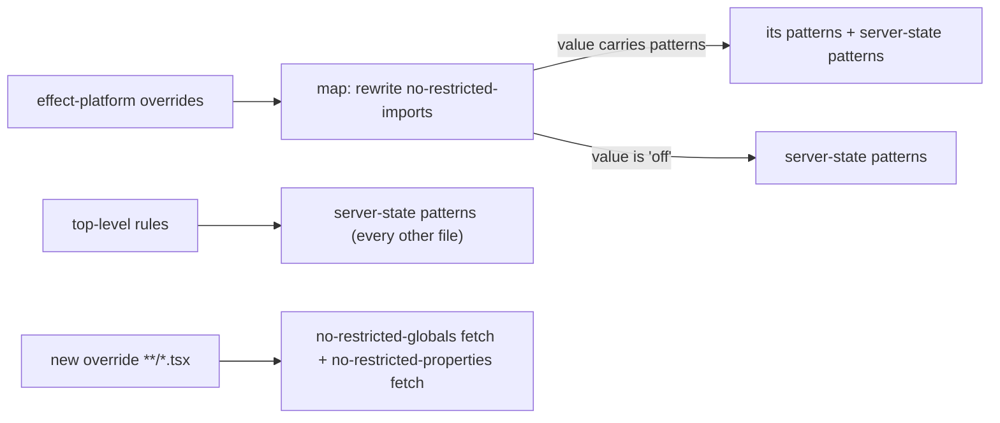
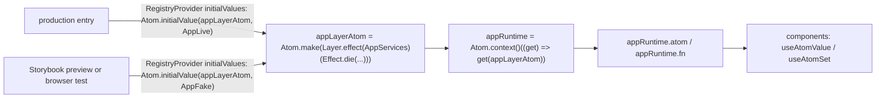

# UI state and lifecycle-machine packs and two lint bans - Plan

## Goal Capsule

- **Objective:** Every systemfsoftware repo that enrolls the packs has its plans and ce-code-review judge React UI state against one rule set: server data lives in effect-atom atoms over Effect services provided through a runtime built from a Layer, view-models are pure functions, and components render and dispatch only. The same reviews judge every lifecycle a product shows, stores or sends against a second rule set: its transitions live in a `createFSM` table from `@systemfsoftware/xstate/fsm`, never in hand-written branching, and its host follows whether it must outlive the process. They also refuse a test whose verdict comes from the code under test's own output, from a deployed stage, or from a local stand-in looser than the real service on a behaviour the product relies on, and a VM test or a hand-driven hook, job script or handler presented as proof that the real host takes a job.
- **Means:** a new compound pack `compound-packs/ui-state/` with four rules, plus two bans in `@systemfsoftware/oxlint-config-recommended` that each map 1:1 onto one pack rule (KTD1, KTD2); one new boundary-testing rule, three boundary-testing amendments and one mutation-discipline citation, all graded by review (R28-R39, R57-R58); clauses in two ui-state rules and its README for lifecycles (R41-R44, R55); and a second new pack `compound-packs/lifecycle-machines/` with three review-only rules and no lint (R46-R53). This plan's Key Decisions are the lifecycle adoption record (R45).
- **Product authority:** the root conductor's unit brief of 2026-10-11, its confirmation with seven amendments, its six planning rulings, its rulings on the plan's document review, its test-discipline scope addition, its lifecycle-machine scope addition and its second lifecycle-machine scope addition carrying the owner's adoption ruling, all the same day; the root's work-item decision of 2026-10-12, which adds the boundary-testing and lifecycle-machines units, keeps the adoption record in this plan's Key Decisions, and authorizes no `docs/solutions/` file beyond the two U11 corrects; the root's restart ruling on work item it_60b5c196 the same day, which names root work item U7 (boundary-testing M2, M5 and M7 plus the stand-in-strictness amendment, the private S3 incident unnamed, no lint) and root work item U8 (lifecycle machines on the pure `@systemfsoftware/xstate/fsm` surface, with the in-process `EffectActor` and the durable persisted decider kept apart); the root's evidence ruling on the U7 runner-bypass rule the same day; and the root's final adjudication of 2026-10-12, which rules on this delta's reviews (R52's refusal, R58's second question, the supervisor-kernel line, form B only, #742 merging first), supplies incidents n-r for R48-R53, and authorizes U6 and every remaining unit. The ci-wall-clock pack on its own branch is not active scope.
- **Open blockers:** none. The root supplied dated incidents for R48-R53 on 2026-10-12 (n-r, observed 2026-10-10), so R56's drop path does not trigger, all three `lifecycle-machines` rule files are written, and R43 and R55 stand.
- **Execution profile:** one PR on branch `packs/ui-state`, cut from `main` at 02bf9653b1, published as a `gh stack` layer on trunk `main` (OP13b). It touches only `compound-packs/ui-state/`, `compound-packs/lifecycle-machines/` (R46-R53), `compound-packs/boundary-testing/` (R29-R37, R57-R58), `compound-packs/mutation-discipline/README.md` (R38), `packages/oxlint-presets/oxlint-config-recommended/`, `.compound-engineering/config.yaml`, two separate `.changeset/` intent files, `.changeset/README.md` and `docs/solutions/tooling-decisions/changeset-requirement-keys-on-turbo-build-hash.md` (R40), and this plan. Nothing under `packages/atom/` is committed. Mutation runs only in CI (REPO-D3). U1-U5 and U11 are committed and pushed: `origin/packs/ui-state` was `340fb3ef0c` (pushed 2026-10-12, the root overriding OP13b's overlap check on `.compound-engineering/config.yaml`, which `packs/ci-wall-clock`, PR #742, also appends to). Root work item U7 is this plan's U7-U10 and U15; root work item U8 is U13 and U14. The root's final adjudication of 2026-10-12 authorizes U7-U10, U15, U13, U14 and U6: each unit is pushed to this branch as it lands, and #742 (ci-wall-clock) merges before this PR, so the canary citation resolves on `main`.
- **Stop conditions:** stop and report if a lint cannot be made equal to or narrower than the pack rule it cites, or if the overlap check at push finds another open PR of yours touching these files beyond `.compound-engineering/config.yaml` shared with `packs/ci-wall-clock` (#742), which the root accepted on 2026-10-12. Stop and report if U13's probe refuses an FSM in `createEffectActor` or `snapshots`, or if a supplied lifecycle incident needs what `/fsm` lacks (Risks). Stop before a push if the KTD7 privacy grep matches.
- **Finisher:** `ce-work` implements and proves; the operator merges.

---

## Product Contract

### Summary

Add a `ui-state` compound pack with four rules, each tied to a dated incident and a check question a reviewer can answer from the diff. Add two bans to the shared oxlint preset: one on imports of React server-state libraries and one on `fetch` in `.tsx` files. Each ban cites its pack rule, is proven by a planted violation and a clean file, and ships with a `major` changeset for the preset and a separate `patch` changeset file for its 25 publishable dev-dependents. The same PR corrects the two docs that still teach `none` for those dependents (R40). Both new packs are enrolled only in this repo's CE config.

The owner ruled on 2026-10-11 that the house forked XState for a reason and lifecycles use it, and the root ruled on 2026-10-12 that they use its pure `@systemfsoftware/xstate/fsm` surface. A second pack, `lifecycle-machines`, carries those rulings as three review-only rules. A lifecycle that a product shows, stores or sends declares its transitions in a `createFSM` table, and hand-written transition code is refused. Guards are transition functions that read only the context and the event, and the table declares no side effects: the shell runs them after the transition. The host follows durability: an in-process lifecycle runs as an `EffectActor` owned by the app runtime and read only through runtime atoms, and a durable one is a stored state value advanced by the FSM's pure `transition` inside a decider that refuses an unchanged snapshot with a tagged error. ui-state keeps request progress in `AsyncResult` (R41) and refuses actors that components start (R42). Its README hands every other lifecycle to the new pack. The adoption record replaces the earlier fold-first recommendation. Every new rule carries a dated incident from the root's private inventory, supplied on 2026-10-12 (R56).

In the same PR, boundary-testing gains one rule and three amendments, each with a dated incident and a diff-answerable check: a test takes no expected value from what the code under test wrote, nothing scripted asks a deployed stage, a local stand-in is at least as strict as the real service on every behaviour the product relies on, and neither a VM test nor a hand-driven hook or job script is presented as proof that the real host takes a job. Mutation-discipline names the two owners of a weak test instead of gaining a rule.

### Problem Frame

No systemfsoftware compound pack covers UI state, so ce-plan and ce-code-review have nothing to cite when React code reaches for react-query, keeps server data in `useState`, or fetches inside `useEffect`. On 2026-10-11 a private product UI that declares `@systemfsoftware/effect-atom` and `@systemfsoftware/effect-atom-react` imported neither. It used react-query, kept server data in `useState`, fetched inside `useEffect`, and every UI PR in flight added more of the same. Even where it used Effect, it ran fibers by hand from components and pushed results back into `useState`. No count from that UI appears in this plan, the pack, a commit or the PR body.

The incidents below are recorded as unnamed patterns, observed on 2026-10-11:

- a. A page calls `useMutation` from `@tanstack/react-query`, and several components call `useQuery(api.<feature>.<endpoint>({ params }))`, where `useQuery` is a react-query hook re-exported through the app's own internal package.
- b. `useEffect(() => { fetch(url).then((r) => r.json()).then((r) => setDemand((d) => ({ ...d, [sku]: r.pending }))) }, [])` fetches server data in an effect and holds it in `useState`.
- c. `useState<View | null>(null)` plus a `useEffect` that builds an Effect, runs it with `runtime.runFork(...)`, and pushes the result back with `Effect.sync(() => setView(...))` and `Effect.catch((e) => Effect.sync(() => setError(e.message)))`.
- d. `useState<AppRuntime | undefined>(undefined)`: the composition root is built inside a component.
- e. `useEffect(() => { const t = setInterval(() => setNow(new Date()), 30_000) ... })`: an ambient clock read inside a component.
- f. `useEffect(() => { localStorage.setItem(key, JSON.stringify(v)) }, [v])`: persistence written from a component.
- g. Legitimate UI-local state: `useState<HTMLElement | null>(null)` holding a scroll container, and `useState<Provider | null>(null)` recording which option's dialog is opening.
- h. Display logic (sorting, filtering, formatting, status-to-label branching) written inline in component bodies, with no pure function and no property test.

The root conductor added a test-discipline scope to this PR on 2026-10-11. Four gaps let a test pass while the code it names is wrong, and no enrolled pack gives a reviewer a question to ask of the diff for any of them. A test can take its expected value from what the code under test wrote. A scripted check can ask a deployed stage instead of a local system. A local stand-in can accept what the real service refuses, so the fake and the real adapter agree on the wrong answer. A test can drive a hook or job script by hand, or boot an image in a VM, and be read as proof that the real host takes a job. The incidents below come from private repos and are recorded as unnamed patterns. They were observed on 2026-10-10, incident m on 2026-10-12, and incident k's last fix landed on 2026-10-11. No count from them appears in this plan, the packs, a commit or the PR body.

- i. Several example apps each had a test that only compared a committed generated OpenAPI file with the generator's own output, and a long golden text fixture of a code generator's output sat beside them. Both were deleted, and no test replaced either.
- j. A repo deleted, whole, its CI runs against deployed stages, the dedicated smoke sign-in identity those runs used, and the inbox that received its sign-in codes.
- k. In a CI runner fleet, after a cache path switch every production cache save failed, twice, each time on a refusal the local moto stand-in did not make. On 2026-10-10 every part declared a CRC32 that was not its body's, and S3 refused each one with `BadDigest`. moto checked no checksum, so the save tests passed. The fix put moto behind a loopback front that refuses such a request as S3 does and relays the rest. The re-land still failed in production the same day: the sidecar's HTTP client sent each part PUT in HTTP chunked transfer encoding with no `Content-Length`. S3 refused a chunked PUT that carried no `x-amz-decoded-content-length` with 501 `NotImplemented`, and an unframed one with 411 `MissingContentLength`. moto accepted both, so the VM test passed while every fleet save failed. On 2026-10-11 the fix sent each part with a `Content-Length` and held every stand-in to S3's framing rules. One pattern produced two refusal behaviours, checksum and framing, with three codes (400 `BadDigest`, 501 `NotImplemented`, 411 `MissingContentLength`): the stand-in was tightened for the checksum and was still looser on framing.
- m. In a CI runner fleet on 2026-10-12, an integration test of a runner machine image booted it in a VM and drove the image's job hook and job scripts by hand, with stand-ins for the services the runner provides, instead of letting the real runner take a real job through its real entry point. The test passed. The hook lacked the file extension the runner needs to start it, and the image took the fleet down. GitHub's runner docs state rules only the runner applies: "Your script files must use a file extension for the relevant language, such as `.sh` or `.ps1`, in order to run successfully", and the hook environment variable "must contain the absolute path to the script" (https://docs.github.com/en/actions/how-tos/manage-runners/self-hosted-runners/run-scripts, read 2026-10-12). ci-wall-clock's `release-promotes-the-staging-proven-build.md` records the same incident for the release side.

The root added a lifecycle-machine scope on 2026-10-11: should the pack require machines from the public fork `systemfsoftware/xstate`, pinned at `c8c376cc2fd798c00c131185149fa6536cc3a027` (main, 2026-10-09)? This repo deferred the question on 2026-09-25 ("Still to decide: whether to adopt XState at all (REPO-W8 requires researching at least two alternatives).", `docs/plans/2026-09-25-1551-feat-rich-schema-laws-plan.md:180`). The first answer recommended folding a tagged union first. Later the same day the owner ruled that the house forked XState for a reason and lifecycles use it, which settles the adoption under REPO-W8, and the root reopened R41-R45. A public consumer exists: `systemfsoftware/effect-endgame-starter-kit` at `375e468f` depends on `@systemfsoftware/xstate` (`apps/site/package.json`) and decides a guestbook entry's lifecycle with the root package's `transition` inside a `Workflow.make` decider (`moderate-guestbook-entry.workflow.ts:35,49-50`). That `transition` writes module-level state (Key Decisions), so the root's ruling of 2026-10-12 keeps the decider's shape and replaces the call with `/fsm`'s. None of incidents a-h is a lifecycle bigger than a request. The public repos searched hold one UI lifecycle incident, and it is request progress:

- l. Public `systemfsoftware/effect-endgame-starter-kit` at `375e468f` (main, 2026-10-09), `apps/site/src/features/guestbook/guestbook-page.tsx:51-97`. The page tracks its requests in boolean `useState` flags: `ready` (added 2026-10-07 in `c46755c`) and `busy` (added 2026-10-09 in `d3e2f1b`, PR #84). `moderate` sets `busy` around an `Effect.runPromise` chain. `sign` runs its command without touching either flag, so the submit button (`disabled={!ready || busy}`, `:97`) stays enabled while a signature is in flight. The same PR decides the entry's server-side lifecycle on the xstate fork, with a root-package `transition` call inside a `Workflow.make` decider (`moderate-guestbook-entry.workflow.ts:35-60`), with no actor.

No public repo searched holds a dated defect in a hand-written state transition. The searches ran on 2026-10-11. This repo's history was searched for `fix` commits naming a state, status, phase, step, stage, transition or lifecycle; the four hits are a build-ordering fix, a matcher-step fix and two CI fixes. Eleven public first-party repos were cloned and searched the same way: `stryker-js-effect`, `api-extractor-effect`, `pnpm-release-management`, `worktrunk-scripts`, `omp-claude-compat`, `are-the-types-wrong-effect`, `essentials`, `youtube-autocomplete-scraper`, `gritlint`, `comment-checker` and `constitution`. None of their hits is a state transition. The starter kit adopted the fork for a new lifecycle (`64cfc96`, 2026-10-09, PR #82) and replaced no buggy hand-written one. The root's inventory of the private product repos supplied the patterns below on 2026-10-12. They were all observed on 2026-10-10 and are recorded as unnamed patterns in neutral code:

- n. An agent-run lifecycle (running, then done, failed or interrupted) was a hand-written string union. A SQL insert wrote `running`, a local mutable state variable was reassigned as the run went on, and a startup sweep rewrote `running` to `interrupted`. Its transitions were spread across three places with no table, while the house fork had no consumer there.
- o. The next state was chosen by reading a shared mutable object, `if (shared.stopping) state = 'interrupted'`, instead of the event and the context.
- p. Database writes, presence calls and event mirroring were interleaved with the transitions, instead of being declared effects that the shell runs after the transition.
- q. A durable lifecycle kept in a database row had no decider. Recovery rewrote its state in raw SQL, outside any transition table.
- r. A terminal component held a connection lifecycle in `useState<'connecting' | 'open' | 'closed'>`.

---

### Key Decisions

- **Six dictated rules become four.** The react-query rule and the server-data `useState` rule merge: incidents a, b and c all put a second copy of server data outside the atom registry. "No useEffect+fetch" widens to "no I/O in components", because incidents e and f are a clock and storage, not fetch. Governs R4, R5, R6, R7. (session-settled: user-approved — chosen over the six-rule list: two of the dictated rules shared one failure and one was narrower than its incidents.)
- **"Components render and dispatch only" stays a check, folded into the runtime-atoms rule.** Incident c is its incident. The rule is renamed `components-dispatch-to-runtime-atoms` to cover its wider scope. Governs R8, R9, R10. (session-settled: user-directed — chosen over README-only prose: the contract lists it as a checked rule.)
- **A handler dispatches at most one command and may also call UI-local setters.** Closing a dialog after submitting is fine; awaiting, chaining, a second command and branching on atom or service values are not. Governs R10. (session-settled: user-directed — chosen over "exactly one setter": that was stricter than the conductor ruled.)
- **The clock check names reads only.** `Date.now()`, `new Date()` with no argument and `performance.now()` are clock reads; `new Date(x)` is formatting and belongs to R11. Governs R7. (session-settled: user-directed — chosen over matching any `new Date(`: it caught parsing a passed value.)
- **The house rule names the systemfsoftware fork, not upstream `effect/reactivity`.** The fork is the dependency consumers declare, and this repo owns it outright (REPO-O1). Upstream marks every reactivity export `@stability unstable`. The fork has no `Atom.runtime` alias, so the rule text spells `Atom.context()`. Governs R9.
- **The server-state ban lists only React-specific packages, named in full in the rule text.** The lint pattern set equals the rule's list, so the lint cannot be stricter than the rule. Governs R5, R16. (session-settled: user-directed — chosen over a framework-agnostic list: `@tanstack/query-core`, root `@apollo/client` and `@urql/core` also serve non-React code.)
- **The fetch ban covers every `.tsx`, stories, tests and server components included.** It holds because R7 forbids I/O in every `.tsx` module, and stories and browser tests already get I/O from port fakes. Governs R7, R18. (session-settled: user-approved — chosen over narrowing the glob: RSC is accepted as out of scope.)
- **`major` for the preset, `patch` for each of its 25 publishable dependents.** Code that lints clean today with these imports or calls fails after the upgrade, and a dependent left at `none` keeps its tagged version while its packed manifest changes, which the release tooling refuses. Governs R22, R23. (session-settled: user-directed — `major` chosen over `minor` at confirmation; `patch` over `none` settled from the release tooling's source per the conductor's planning ruling of 2026-10-11.)
- **M2 becomes one new boundary-testing rule, limited to what the lawful Vitest fork cannot see.** CONST-T10 states the law and the constitution's solution doc names the shapes, but neither gives a check question, and the doc's enforcement is "Review only" with no instrument (`repos/constitution/docs/solutions/architecture-patterns/a-test-never-takes-its-expected-value-from-the-code-under-test.md:37-41`). It lives in vendored `repos/`, which is read-only (REPO-S3), and no enrolled pack carries it: mutation-discipline defers it by name (`compound-packs/mutation-discipline/README.md:5`). Snapshot matchers are already refused at compile time and run time by `@systemfsoftware/vitest` (`packages/runner/vitest/src/internal/refusals.ts:54-63`), so the rule cites them and covers only expected values read from what the subject generated or wrote. Boundary-testing owns it because both incidents are generators whose output is a written file, and plans already cite `real-system-oracles.md` for "expected values never from the code under test" (`docs/plans/2026-10-01-2335-fix-property-failure-structured-errors-plan.md:100`). Governs R29-R31.
- **The allowlist shape is dropped.** No incident grounds a test whose allowlist allows its own names, and CONST-T10 already covers it as an expected value the code under test produced. Governs R29.
- **R29's check carries the re-bless provenance test.** kb://software/llm-test-standing-policy (verified 2026-10-09) lists the failure shape "(5) same-session gold re-bless — gold-vs-commit provenance", says "a persisted gold after a rewrite is a changelog", and says "place snapshots only on the published surface as differentials or externally-gated golds". A file a test reads its expected value from, added or changed in the same diff as the code that generates it, is therefore a re-bless, and a reviewer reads that from the diff's file list. Governs R29.
- **The pack follows CONST-T10 where the wiki's oracle list is wider.** kb://software/test-oracles (verified 2026-10-09): "The verification value of a test lives in oracle independence: the expected output must come from an authority not drawn from the same-session system under test — a spec, a second implementation, a prior version, a differential/metamorphic relation, or captured production behavior." CONST-T10's corpus criteria fail an expected value "computed or recorded by running the code under test, or any build or version of it" (`repos/constitution/docs/solutions/architecture-patterns/a-test-never-takes-its-expected-value-from-the-code-under-test.md:28-29`), so a prior version of the code and captured production output of the code under test are not oracles under this pack. Governs R29, R30.
- **A refusal the real service returned is the provider's output, so CONST-T10 does not reach it.** CONST-T10's law reads "Take every expected value from an oracle the code under test did not produce - a spec literal, an independent fixture, a law between two views, or a second implementation", and its why reads "A test that compares the code with itself cannot fail when the code is wrong." (`CONSTITUTION.md:85-86`). A refusal S3 returned was produced by S3, not by the adapter under test, so a scenario that replays it compares the stand-in with the provider, not the code with itself. R30 therefore excludes "captured production output of the code under test", not every response observed in production. Both sources of item 5's refusal history stand. Governs R30, R35.
- **M5 amends `real-system-oracles.md` and makes it the single owner.** Its lead concedes the loophole ("When testing boundary adapters without heavy remote infrastructure", `compound-packs/boundary-testing/real-system-oracles.md:10`), so a separate file would contradict it. Boundary-testing, not ci-wall-clock, owns the rule because it must reach package tests, scheduled workflows, hooks and scripts, and ci-wall-clock's file applies only to release, deploy, tag and publish jobs. That file's clause "nothing scripted runs against a deployed stage", its `applies_when` line and its gate question become a citation of this item. The root carries that edit to the ci-wall-clock branch, which enrolls both packs in one config. The item states its why as a harm: a scripted run against a deployed stage spends CI time and fails on environment drift, and it proves nothing that staging and a QA agent's check do not already prove. Governs R32-R34.
- **Incident m amends `no-mocks-on-internal-glue.md`, not `real-system-oracles.md`, and links ci-wall-clock's canary instead of restating it.** The failure is in what the test drove, the internals instead of the host's entry point, not in which oracle answered. `no-mocks-on-internal-glue.md` item 3 already says "Test the boundary through its executable entry point" (`compound-packs/boundary-testing/no-mocks-on-internal-glue.md:16`), but only for unit tests of helpers, and with no check and no incident. `real-system-oracles.md` names the oracle (loopback, temporary directories, local child processes, `:12-15`), already carries M5's item 4, and an oracle clause alone would pass a test that runs a hook by hand against a real local service. Where the host cannot take a job locally, because its jobs come from a remote service as a hosted CI runner's do, the proof that the host starts the code is the canary that ci-wall-clock's release rule requires: a runner booted from the exact image takes real jobs before the fleet pointer moves (`release-promotes-the-staging-proven-build.md`, runner-or-machine-image clause). #742 carries that clause and merges before this PR (root ruling, 2026-10-12), so the citation resolves on `main`. This pack cites that clause by pack and file and states nothing about promotion, bake periods or rollback. Governs R57, R58. (directive: the root's ruling of 2026-10-12 named the two candidate files; this plan chose between them.)
- **A VM test is configuration and boot evidence, never real-component evidence.** The NixOS manual: "A NixOS test usually consists of one or more test machines. Each machine is either a QEMU virtual machine or a `systemd-nspawn` container." (https://github.com/NixOS/nixpkgs/blob/9ea0f380482b4273603af5975b9d91d084536876/nixos/doc/manual/development/writing-nixos-tests.section.md, lines 122-123, the file's last commit as of 2026-10-12). The root's research result of 2026-10-12, verified by the root and kept outside this repository, draws the boundary: "NixOS VM tests (`nixosTest` / `nix flake check`) in CI prove the configuration boots and services come up in an isolated QEMU VM — fast and hermetic, but they run under QEMU with the NixOS closure, so they cannot prove AWS-specific behavior: a real AMI boot, IMDS, EC2 networking/IAM, instance-store, or actual GitHub-runner registration. For those properties, validate the actual image before fleet rollout. The real canary proof is one real GitHub Actions job end-to-end: register, claim, run, and deregister." So R57 sorts evidence into three kinds: configuration and boot (a VM test), the code's own behaviour (a hook or job script run by hand), and the real component taking a real job. Only the third proves that a runner takes a job. R57 and R58 name runner registration only as a property a VM test cannot show. The canary's own mechanics (a canary runner taking real jobs through a stated bake period before the fleet pointer moves, and automatic rollback) stay in ci-wall-clock, which this pack links and does not restate. Governs R57, R58. (directive: root ruling of 2026-10-12.)
- **R58's second question asks the PR body to name the real-host evidence (root ruling, 2026-10-12).** The earlier question asked whether the host's entry point is built in the same repository, which no diff answers for a host whose jobs come from elsewhere. The root replaced it: "When a test in the diff calls a host-started hook, job script or handler directly, does the PR body name the real-host evidence that covers it: a test that drives the host's entry point, or ci-wall-clock's canary?" A daemon, scheduler or supervisor whose entry point lives elsewhere is covered the same way: the PR names the evidence or the check fails. Governs R57, R58. (session-settled: user-directed — chosen over the run-locally condition.)
- **The pack follows the owner's 2026-10-10 ruling over the wiki's staging pages.** kb://software/test-placement and two other wiki testing pages, dated 2026-10-08 and 2026-10-09, still say end-to-end tests run against a staging environment. The owner ruled on 2026-10-10 that nothing scripted runs against a deployed stage and that checking a deployed environment is a QA agent's job. The later ruling governs. Governs R32.
- **"Remote host" narrows to the subject's peer.** This repo's own CI calls the GitHub API to watch a PR's merge state (`.github/workflows/ci.yml:41-47`), to fetch timing records (`.github/workflows/reusable-checks.yml:319-338`, `.github/workflows/reusable-mutation.yml:103-105`), and to read the conclusions of jobs it ran (`.github/workflows/consumer-fixture.yml:72`). A literal "no remote host" bans all of them, and none checks a deployed stage. The rule bans a verdict taken from a deployed stage of the product, or from a remote instance of a service the code under test calls. Governs R33.
- **M7 gets no rule; mutation-discipline names its two owners.** A test is weak when it asserts only truthiness, type or that nothing threw, or when its target's mutants survive it. Either condition counts. Condition (a) is mechanical. `@systemfsoftware/vitest` refuses `toBeDefined`, `toBeTruthy`, `toBeFalsy`, `not.toBeNull`, `not.toBeUndefined`, `toBeInstanceOf`, `toBeTypeOf`, `toThrow()` with no argument, a boolean actual and a test body that yields no check, at compile time and at run time (`refusals.ts:35-101,137-138`, `checks.ts:7,87,93-111`). `vitest-from-systemfsoftware-vitest` is at `error` in the test-discipline plugin's recommended set (`packages/oxlint-plugin/oxlint-plugin-test-discipline/src/index.ts:56`), so every test runs on that `expect`. The fork accepts one shape: `not` refuses only the `negatedText` set (`refusals.ts:80-89`, `checks.ts:80,106-108`), which holds no `toThrow`, so a lone `expect(() => f()).not.toThrow()` compiles. Condition (b) belongs to `kill-survivors-with-contract-properties.md`, whose Gate line reads: "Gate: `review`. The killing test's expected value traces to a contract source, not to the mutated expression. The kill itself is read off the mutant id in the next CI Mutation report, never from a local run (REPO-D3)." Its first sentence is answerable from the diff. Whether a mutant survives is read from a CI report, not from the diff. No matcher incident for (a) exists in this repo: no test outside lint fixtures uses the refused matchers (`git grep`, 2026-10-11). No Mutation run on `main` has a report since run 2610 on 2026-09-25, whose artifacts have expired, and runs 2690 to 2704 failed or were cancelled with no report artifact. Governs R38.
- **The lone `not.toThrow()` has a dated incident here, and no rule owns its review.** On 2026-07-15 `e9716ac73f` added an integration test whose only assertion was `expect(() => JSON.parse(stripped)).not.toThrow()` over the stryker-js tsconfig comment stripper (`packages/stryker-js/core/test/integration/ts-config-preprocessor.it.spec.ts:144-148` at that SHA). The stripper dropped the byte after every backslash escape until `95582401d4` (2026-08-03) replaced it and that test. The test stayed green because its fixture held no backslash (`packages/stryker-js/typescript-checker/testResources/single-project/tsconfig.json` at `e9716ac73f`). The miss traces to the fixture as much as to the matcher, because a value assertion on that fixture would also have passed. No pack has a rule for the review side of condition (a). The README is description-only, and the root ruled that R38 adds no rule, so the README names the gap without a check. Whether the fork refuses a lone `not.toThrow()` is the root's follow-up, and `packages/runner/vitest/` is outside Scope. Governs R38.
- **The step-wrapper harm has no home in this PR.** The harm: Given/When/Then wording over imperative steps that hold inline selectors or regex on stdout reads as behaviour, breaks on markup and output text, and passes on wrong behaviour. R29's check catches a golden file recorded from generated stdout, but not a regex literal written in the test or an inline selector. storybook-testing's `journeys-are-embedded-gherkin.md` owns selectors only in story scenarios. No rule here catches the shape, so none carries the harm and none is invented. It goes back to the root.
- **P sits as item 5 of `port-fakes-pass-the-port-contract.md`: a stand-in is at least as strict as the real service on every behaviour the product relies on.** It qualifies the local test system item 4 requires, so it follows item 4. Item 3's "same result on both adapters" cannot catch a loose stand-in, because the fake and the real adapter agree on its wrong answer. Incident k is one pattern with two refusal behaviours: the stand-in was tightened for the checksum and was still looser on framing. So the item enumerates behaviours by each request field the adapter sets and by how it frames the body, not by the last refusal seen. "Every refusal the provider documents for an operation" was challenged once and narrowed. S3's PutObject page documents refusals the adapter cannot trigger, so the documented source covers refusals listed against a field the adapter sets or the framing it uses. The second source covers what the documentation does not tie to a header: each refusal the real service returned in a dated incident. AWS's `NotImplemented` text, for one, names no header. A refusal neither source enumerates is outside what the suite proves, and the item says so. Governs R35-R37.
- **Fowler's contract tests are considered and rejected, and so is running the refusal history against both services.** Fowler's remedy for a drifting double is to "periodically run a separate set of contract tests. These check that all the calls against your test doubles return the same results as a call to the external service would", "usually best to do so against a test instance of the external service" (https://martinfowler.com/bliki/ContractTest.html, 2011, revised 2018). R32 bans a scripted run against a remote instance of a service the code under test calls. That rules out Fowler's remedy, and it equally rules out replaying the refusal history against the real service as well as the stand-in. The proof stays local. Item 5's two sources of refusal scenarios replace the remote run, as kb://software/llm-test-standing-policy prescribes for its shape "(7) refuse-nothing round-trip — enumerate documented refusal-boundary inputs". Governs R35.
- **The new rule file uses a `## Rule` heading; the amended files keep their shape.** Mutation-discipline's three rules use `## Rule`, and no boundary-testing file does today. Restructuring the amended files is not this unit's work. Governs R29.
- **The owner's adoption ruling replaces the fold-first recommendation, and the dictated rule is narrowed where the evidence breaks it.** On 2026-10-11 the owner ruled that lifecycles use the house fork. That settles the adoption question REPO-W8 (`AGENTS.md:66`) left open, so this plan withdraws the earlier "no machine rule" decision and its recommendation of a hand-written fold. The root's dictated rule read: "any lifecycle with named states and transitions is a machine from that fork: run/approval/wait gates, OAuth connect, onboarding flows, deploy promotion. Guards and actions are pure, and side effects run as Effect actors. Hand-rolled status enums plus if/switch transitions are banned." Three of its assumptions break on evidence, and the rule text answers each one. "Any lifecycle with named states" also catches request progress, decision outcomes, UI-local toggles and a library's internal bookkeeping (what-counts decision). "Side effects run as Effect actors" holds only in-process (durability decision). "Actions are pure" is false at the fork, where actions are the Effects (guards-and-actions decision). The radical alternative was weighed and dropped: no machine rule, with CONST-D4 alone owning the shape. It was waiting on the adoption the owner has now settled. Governs R45-R53. (session-settled: user-directed — the owner's ruling, chosen over the fold-first record.)
- **Interop verdict: the bridge and this repo's atom packages do not typecheck together.** `createActorAtoms` types its runtime as `effect/reactivity`'s `Atom.AtomRuntime<R, ER>` (fork `packages/xstate-effect/src/atom.ts:3,73-77`), an interface over core's `Atom` that carries `toJSON`, `[NodeInspectSymbol]`, `[TypeId]` and `lazy` (`repos/effect/packages/effect/src/reactivity/Atom.ts:71-74,636-640`, effect 4.0.1, the version both repos lock). `Atom.context()(layer)` from `@systemfsoftware/effect-atom` returns a `Blueprint.Blueprint` type (`packages/atom/effect-atom/src/atom.blueprint.ts:386`). A typecheck probe on 2026-10-11 (tsc 7.0.2, effect 4.0.1, the packages' built `dist/mod.d.ts`, in a scratch directory outside the worktree, since deleted) refused that assignment with TS2739: "missing the following properties ... toJSON, [NodeInspectSymbol], [TypeId], lazy". The other direction fails too: `AtomReact.useAtomValue` and `AtomReact.useAtomSet` (`packages/atom/effect-atom-react/src/hooks-value.ts:101,163`) refused core atoms (TS2769, and TS2345 "Property '[TypeId$1]' is missing"). The control lines, this repo's hooks over this repo's atoms, typechecked. The built `dist` came from `fdf57d17a8`; between it and `02bf9653b1`, `packages/atom/` changed only the HTTP API and RPC service modules, three tests, a Vitest config and `AGENTS.md`. AT5's shared TypeId is the same text but not the same key: this repo keys atoms by `Symbol.for('~effect/reactivity/Atom')` (`atom.blueprint.ts:48`) and Effect core by the string `"~effect/reactivity/Atom"` (`Atom.ts:62`), so the objects are not interchangeable at run time either. Using the bridge today means a second atom registry (`effect/reactivity` with `@effect/atom-react`) beside the one R4 requires. Governs R45 and the Scope Boundaries. (session-settled: user-approved — the root re-verified `Atom.ts:62,636-640` and `atom.blueprint.ts:48,386` on 2026-10-11.)
- **Interop verdict, second probe: three bridge-free host forms typecheck, and the bridge still does not.** The probe was re-run on 2026-10-11 with tsc 7.0.2 and effect 4.0.1, against this branch's built `packages/atom/*/dist` and the fork's sources at `c8c376cc2f` through `paths`, in a scratch directory outside the worktree. `createActorAtoms(appRuntime, machine)` is still refused with TS2739. Three forms typecheck with no diagnostics:
  - Form A: `appRuntime = Atom.context()(Layer.effect(ReviewActor, createEffectActor(machine)))` and an actor atom `appRuntime.atom(Effect.gen(function* () { return yield* ReviewActor }))`, read with `AtomReact.useAtomSuspense`. The narrowed actor goes to `useSelector` (fork `packages/xstate-react/src/useSelector.ts:13-23`), and the component calls `actor.send({ type: 'APPROVE' })`.
  - Form B: an atom over `snapshots(actor)` (`packages/xstate-effect/src/actor.ts:112`), read with `useAtomValue`, and an `appRuntime.fn` that calls `send` (`actor.ts:87`), dispatched with `useAtomSet`.
  - Atom-owned: one actor per instance, `Atom.family((id) => appRuntime.atom(createEffectActor(machine)))`.

  Three negative lines were refused, and an unused `@ts-expect-error` would have reported TS2578: an event the machine does not declare, a selector that reads a field the snapshot lacks, and an `AsyncResult` passed as the actor. Runtime behaviour was not exercised. The claim that a Layer-held actor starts once per registry is inferred from the runtime's layer atom being `keepAlive` (`packages/atom/effect-atom/src/atom.blueprint.ts:2231`) and from the actor being a scoped resource (`packages/xstate-effect/src/createEffectActor.ts:56-59`). Governs R42, R53.
- **Finding for the root, outside this PR: this repo's runtime atoms type their success value as `A | Context.Context<R>`.** Two control lines in the probe failed with TS2322. `appRuntime.atom` returns `Atom<AsyncResult.Result<A | Context.Context<R>, E | ER | NoSuchElementError>>` (`packages/atom/effect-atom/src/atom.blueprint.ts:852`), while upstream's `AtomRuntime.atom` returns `AsyncResult<A, E | ER>` (`repos/effect/packages/effect/src/reactivity/Atom.ts:649`). The widened text first appears in this repo's history at `53d0964bfe` (2026-08-17). A reader of a runtime atom's `Success` value must therefore narrow it with `Context.isContext`. The packs' neutral code is not compiled, so nothing fails today, but a consumer who copies an R53 or ui-state RIGHT shape that reads a runtime atom's value meets TS2322. `packages/atom/` is out of scope; the root owns the follow-up.
- **What counts as a lifecycle, drawn from the diff.** A lifecycle counts when code decides a value's next named state from its current state and an event, and the value is rendered, persisted or sent across a process boundary. Four cases stay out. Each is owned elsewhere or carries no harm:
  - The progress or outcome of one read or command is its `AsyncResult` (R41, incident l).
  - A decision's outcome union has no next state (`docs/solutions/architecture-patterns/workflow-success-channel-tagged-union.md`).
  - A UI-local value that no code branches on to compute its next value belongs to R6, for example an open/closed flag set to `true` or `false`.
  - A library's internal bookkeeping is never rendered, persisted or sent. effect-atom's node phase advances through a hand-written `Match` over phase and event (`packages/atom/effect-atom/src/advance-node-state.workflow.ts:104-112`). Making the registry depend on a machine library would be a wide dependency of its own under REPO-W8.

  Rendering that branches on a state is display (R11), not a transition. Governs R47, R48.
- **The dictated "side effects run as Effect actors" holds in-process only, so a durable lifecycle is a stored value advanced by the FSM's pure `transition`.** An `EffectActor` lives in memory and is "a scoped resource" that stops when its Scope closes (fork `packages/xstate-effect/src/createEffectActor.ts:56-59`). No such actor can hold an approval gate that waits days, a deploy promotion, or an OAuth connect that leaves the page for the provider and comes back on a fresh load. The durable shape is the one the org's adopter shipped, a stored value decided in `Workflow.make` (starter kit `moderate-guestbook-entry.workflow.ts:49-50`), and the one kb://software/durable-agent-runtime prescribes: "model the lifecycle as a pure `decide`/`evolve` fold over events; the imperative shell executes commands and appends events", and "model the human/approval gate as a lifecycle state, not a callback". The decider rebuilds the FSM snapshot from the stored value and context and calls `transition` from `@systemfsoftware/xstate/fsm`, which returns `[nextSnapshot, []]` and writes nothing else (fork `packages/xstate/src/fsm.ts:465-485`; its imports are type-only, `:1-2`). The shell stores the next value before it runs the effects.

  The other side has a real case. Upstream XState v6 keeps an actor alive across reloads by persisting `getPersistedSnapshot()` and restoring it through the `snapshot` option, and on the server it restores one per request (https://dev.stately.ai/docs/xstate/v6/persist-and-restore-actors). The fork supports the same restore (`packages/xstate-effect/docs/actors.md:9,188-195`). It is still refused as the durable host, for three facts at the pin:
  - A restored `EffectActor` runs declared Effect actions as forked Effects while it transitions (`createEffectActor.ts:51-55`), so an effect can run before the state is stored.
  - A running Effect task restarts from the beginning on restore (`actors.md:193`).
  - `restoreSnapshot` throws a plain `Error` on a machine id or version mismatch (`StateMachine.ts:1543,1552,1561`), where CONST-D2 wants a tagged failure. Upstream itself warns that a malformed snapshot "starts an actor in an unusable state".

  The fork's `durable` module is marked `@experimental` (`packages/xstate/src/durable/index.ts:41,53`), and no rule requires it. Governs R50, R51, R52.
- **Guards are FSM transition functions over `context` and `event`, and the table declares no effects.** An FSM transition may be a function `({ context, event }) => config | undefined` (fork `packages/xstate/src/fsm.ts:26-33`). Returning `undefined` refuses the event, so that function is the guard, and a reviewer checks its purity by what its body reads. An FSM transition returns its effects typed `never[]` (`:128-139`), so the dictated "actions are pure" becomes "the table has no actions": effects are Effect values the shell runs after the transition. The root package's guard contract (`types.v6.ts:1619-1621`) and `setupEffect` actions (`packages/xstate-effect/docs/schemas-and-actions.md:29-33`) are not used. The fork's `xstate-effect/no-inline-effect` oxlint rule (`schemas-and-actions.md:165-167`) checks Effects passed to `enq.spawn`, which an FSM has none of, and per the root's no-lint ruling it is not enrolled. Governs R49, R50.
- **`/fsm` only: the root package's transition helpers write module state.** Verified at the pin: the root package's `transition` calls `setInertActorScopeSnapshot` and `attachSnapshotActorRef` (fork `packages/xstate/src/transition.ts:86,93,96`; `initialTransition` at `:147-148`). Those set the module-level WeakMaps `snapshotActorScopes` (`inertActorScope.ts:95`, set at `:60`) and `snapshotActorRefs` (`snapshotActorRef.ts:19`, set at `:184`). A decider that calls it is not a pure function of its input. `/fsm`'s `transition` builds the next snapshot from the table, the snapshot and the event alone (`fsm.ts:465-485`). The costs are recorded under (a): tables are flat, effects live in the shell, and `taggedState` does not apply, because it is constrained to `AnyMachineSnapshot` (`packages/xstate-effect/src/state.ts:112`, `packages/xstate/src/types.ts:1215`). The 2026-10-11 probe of forms A and B ran a root-package machine in `createEffectActor`. Whether an FSM typechecks there and in `snapshots` is UNVERIFIED, so U13 probes it before writing R53. Governs R46, R48-R53. (session-settled: user-directed — chosen over root-package `createMachine` and `setupEffect` machines, because the root package's `transition` writes module-level WeakMaps.)
- **Form B only (root ruling, 2026-10-12).** The root's earlier hypothesis admitted form A, `useSelector` plus `actor.send` on a runtime-owned `EffectActor`, and the probe showed it typechecks. The challenge recorded then stands: form B changes no ui-state rule, keeps one subscription system (the registry), and reads like every other runtime atom, while form A needs R4 and R10 each to admit it and adds `@systemfsoftware/xstate-react` and its `use-sync-external-store` dependency to the UI. The root narrowed the rules to form B: R54 is withdrawn, R53 names form B only, and R4 and R10 gain no exception. Governs R53, R54. (session-settled: user-directed — form B chosen over admitting both forms.)
- **Actor hooks are an R8 finding on incident c, not on an xstate incident.** No searched repo calls `useMachine`, `useActor` or `useActorRef`. The finding rests on incident c's failure, a process started in a mount effect and owned by the component. At the pin, `useActorLifecycle` starts the actor inside `useEffect` (fork `packages/xstate-react/src/useActorRef.ts:72,91`) and stops it in a microtask on cleanup (`:99-101`). `useActorRef` (`:143`) and `useActor` (`useActor.ts:65`) both call `useActorLifecycle`, `useMachine` delegates to `useActor` (`useMachine.ts:18`), and `createActorContext`'s Provider calls `useActorRef` (`createActorContext.ts:45`). The fork's own guide says Effect-backed logic starts "in an Effect runtime with `createEffectActor`" (`packages/xstate-effect/docs/atoms-and-react.md:155`). Governs R42. (session-settled: user-approved — chosen over dropping R42 for want of an xstate-specific incident: the hooks reproduce incident c's failure under another API name.)
- **xstate-store is not a second refused store.** It is its own signals system (fork `packages/xstate-store/src/atom.ts`), and its docs place it at "event-based state without a state machine" (`packages/xstate-store/docs/quick-start.md:6`), the job a writable effect-atom atom with a pure reducer already does. R4 already refuses it where it does harm, state another component reads. Governs R44. (session-settled: user-approved — chosen over a named ban: no incident, and R4 already covers shared state.)
- **REPO-W8 comparison: the adoption record (R45), held in this plan.**
  - (a) Chosen: a `createFSM` table from `@systemfsoftware/xstate/fsm`, hosted by durability (R51-R53). Costs: every package is alpha (`xstate` 6.0.0-alpha.64, `xstate-effect` 0.1.0-alpha.7, `xstate-react` 7.0.0-alpha.4, each in its `package.json`). Installs come from git tags and flake tarballs, not an npm registry (fork `README.md`). The table is flat: it has no actions, delayed transitions, invoked children, hierarchy or parallel states (fork `packages/xstate/README.md:72-74`, `fsm.ts:128-139`). So effects live in the shell, and a lifecycle that needs more has no admitted form at this pin (Risks). `taggedState` does not render its snapshot, and hosting it in an `EffectActor` is unprobed (U13). Readers also narrow `Context` away (finding above). Wins: the owner's and the root's rulings, one declared table a reviewer reads in one place, and a `transition` a decider can call as a pure function, where the root package's writes module-level WeakMaps. Guards are transition functions over `context` and `event` only. The same table serves an in-process actor and a durable decider.
  - (b) Declined for counted lifecycles: a hand-written decide/evolve fold over a closed tagged union. Cost: the transition table is written by hand, which R48 refuses for a counted lifecycle. Wins: no dependency, and it stays the shape for a library's internal bookkeeping (R47's fourth exclusion).
  - (c) Declined: `@systemfsoftware/xstate-store`. Costs: a second reactive system outside the registry, no Effect services, and atoms that `useAtomValue` cannot read. Wins only in an app without effect-atom, never in an app these packs govern.
  - (d) Kept for requests: `AsyncResult` for reads and commands, already required by R4, R8 and R41.
  - (e) Not used: the fork's bridge `createActorAtoms` (`packages/xstate-effect/src/atom.ts:73-77`). Costs: refused at the pin with TS2739, and a second atom registry if forced. Wins only once the bridge accepts this repo's runtime, and the bridge-free forms (R53) need nothing from it.
  - Decision: (a) per the owner, (d) for requests, (b) only outside R47's count, and neither (c) nor (e). Governs R45.
- **Placement: a new pack, `lifecycle-machines`, not an amendment to cell-architecture or ui-state.** The root's examples span both sides of the wire. Run, approval and wait gates and deploy promotion are server lifecycles; onboarding and OAuth connect are client ones. ui-state's `applies_when` covers `.tsx` files and UI packages, so it cannot carry a server gate. cell-architecture governs cells, "an authored unit called a Cell" (`compound-packs/cell-architecture/README.md:5`). It already owns the decider that a durable lifecycle runs in: `pure-decision-workflows.md` forbids `if` and `switch` in decision bodies (`:14`) and lints them in `*.workflow.ts` (`:45`). An in-process actor in a UI runtime's Layer is not a cell decision. A pack whose `applies_when` names lifecycles on both sides, citing cell-architecture for the decider and ui-state for the component boundary, states the concept once. That pack holds three rules, each with its own check. Governs R46-R53. (directive: the pack's placement, one challenge spent weighing cell-architecture and ui-state; the root may move it.)
- **The adoption record lives in this plan's Key Decisions, not in `docs/solutions/`.** The root's work-item decision of 2026-10-12 keeps it here and authorizes no `docs/solutions/` file beyond the two U11 corrects. So the planned `docs/solutions/architecture-patterns/` record, its unit and the two KTDs that shaped it are dropped. Its probe is not re-run, and the 2026-10-11 verdicts in the two interop entries stand as recorded. The packs cite this plan by path. The cost is in Risks: a later machine-adoption question has to find a plan, not a solution record. Governs R45. (session-settled: user-directed — chosen over a third `docs/solutions/` file.)
- **Every `lifecycle-machines` rule carries a dated incident from the root's inventory.** The brief admits no rule without one, and the public search found none (Problem Frame). On 2026-10-12 the root supplied incidents n-r, all observed on 2026-10-10: n for R48 (a hand-written string union whose transitions sat in three places), o for R49 (a next state chosen from a shared mutable object), p for R50 (writes, presence calls and event mirroring interleaved with transitions), q for R51-R52 (a database-row lifecycle with no decider, recovered in raw SQL), and r for R53 (a connection lifecycle in a component's `useState`). The in-process host clause also keeps incident c, shared with R42. R56's drop path does not trigger, and R43 and R55 stand. Governs R56.
- **Incident l is cited where an existing check already reaches its `Effect.runPromise`.** The handler in incident l runs its command with `Effect.runPromise`. `components-perform-no-io`'s check names I/O globals, clock reads and timers, not `Effect.run*` (R7's check), so that rule does not cite l. `components-dispatch-to-runtime-atoms`'s existing check already asks whether a component calls `Effect.run*` (R8-R10's check), so l joins that rule's incidents with no new check. Governs R41, R8. (session-settled: user-directed — chosen over citing l under `components-perform-no-io`: its check does not cover a `runPromise` in a handler, and no new check is added.)
- **The durable-agent-runtime quotes are verified.** The root re-read kb://software/durable-agent-runtime on 2026-10-11 (last verified 2026-10-09) and confirmed these three quotes verbatim: "model the human/approval gate as a lifecycle state, not a callback"; "model the lifecycle as a pure `decide`/`evolve` fold over events; the imperative shell executes commands and appends events"; and "MCP's Tasks extension makes the same thing wire-visible: a task lifecycle `working -> input-required -> working -> complete/canceled/failed`, where `input-required` is the human-approval state". The fork README's description sits at `README.md:7`, and "its runtime runs on Effect" at `:11`.
- **A durable decider refuses every unchanged snapshot (root ruling, 2026-10-12).** An unhandled event, a guard refusal and a guard returning `undefined` all resolve to an empty transition (fork `fsm.ts:390-396`), and `/fsm`'s `transition` then returns the input snapshot object itself (`:459-463`). The decider treats that as a decision failure and returns a tagged refusal naming the current state value and the event type. A no-op is not a legal command under CONST-D2. A review finding had proposed a separate outcome for a guard refusal; the root ruled one refusal for all three. Governs R52. (session-settled: user-directed — chosen over a silent no-op and over a distinct guard-refusal outcome.)
- **The decider reaches the table through its `*.schema.ts` import.** `make-body-purity` admits, inside a `Workflow.make` body, only parameters, const locals, same-file declarations, the pure `effect` surface and "a binding imported from a relative `*.schema.js`/`*.schema.ts` specifier - the schema-file edge, the one local import a decision may make" (`packages/oxlint-plugin/oxlint-plugin-dmmf-workflow/src/rules/make-body-purity.ts:176-183`). An import of `@systemfsoftware/xstate/fsm` in the workflow file is outside that edge. The lifecycle's `*.schema.ts` therefore builds the table with `createFSM` and exports it, and the decision body calls the table's own `transition` through that import. `pure-decision-workflows` refuses `if` in decision bodies (`:14`), so the refusal of an unchanged snapshot is a total `Match` over whether the snapshot changed. Governs R52.
- **A supervisor's child status counts under R48 when it is public surface or encodes policy (root ruling, 2026-10-12).** It counts when its states are exported, persisted or shown to a user, or when its transitions encode policy (restart, backoff, give-up). Private bookkeeping owned by one function does not count. The rule applies when that code is next changed; nothing is swept. Governs R47, R48. (session-settled: user-directed.)

---

### Requirements

**Pack shape**

- R1. The pack lives at `compound-packs/ui-state/`. It has a `README.md` that states the thesis "components render and dispatch only", lists the four rules and maps each to its incidents, plus one `.md` file per rule. No existing pack owns UI state; the overlaps are cited, not restated (R13, R14). The README states the pack's scope: application UI, meaning the components, hooks and view-models of an app or UI package. It does not govern the implementation of the effect-atom bindings (`packages/atom/effect-atom`, `packages/atom/effect-atom-react`), which are the runtime edge. `useAtomValue`'s own inline `Atom.map` (`effect-atom-react/src/hooks-value.ts:110`) is therefore not an R11 violation, and the fetch lint does not reach that file because it is a `.ts` module.
- R2. Each rule file uses the format the six existing packs use: YAML frontmatter with `title` (one prescriptive sentence), `applies_when` (a list of prose situations) and `tags`, a prescriptive body, WRONG/RIGHT fenced code blocks, and a closing ``Gate: `review` - <check question>`` line. A mechanized rule adds a `Lint:` line naming its oxlint rule.
- R3. Every rule's `applies_when` names, in prose, writing or reviewing a React component, hook or `**/*.tsx` file, and changing a UI package (a package that renders React), excluding the effect-atom bindings' own implementation (R1). The CE plugin matches `applies_when` semantically, not as globs, so the glob appears as text inside a situation.

**Rule: `server-data-lives-in-atoms` (incidents a, b, c; g is the allowed side)**

- R4. Data that originates from a server, an Effect service or another component is read through effect-atom atoms (`useAtomValue`, `useAtomSuspense`), never copied into `useState`, `useReducer` or `useRef`.
- R5. No module imports a React server-state library, in any import form, type-only included. The rule text names every banned specifier: `@tanstack/react-query`, `@tanstack/react-query-devtools`, `@tanstack/react-query-persist-client`, `@tanstack/react-query-next-experimental`, `react-query`, `swr`, `urql`, `@apollo/client/react`, `@reduxjs/toolkit/query/react`, `@trpc/react-query` and `@trpc/tanstack-react-query`, each with its subpaths. A module that re-exports one of them is banned the same way as the library.
- R6. `useState` is allowed only for UI-local state, which a reviewer recognizes from the diff by four facts: no other component reads the value, it is not derived from an atom, service or fetch result, it is never persisted, and it dies with the component. DOM element handles, open/closed flags, hover and focus, and an uncommitted input draft qualify.
- Check: "Does the diff import a banned specifier, or a local module that re-exports one, or put into `useState`/`useReducer`/`useRef` a value that another component reads, that is derived from an atom, service or fetch result, that is persisted, or that outlives the component?"
- WRONG shape: incident b, a `useEffect` that fetches and calls a setter. RIGHT shape: `const demand = useAtomValue(demandAtom(sku))`, where `demandAtom = Atom.family((sku: Sku) => appRuntime.atom(Demand.pending(sku)))`, and the component renders the `AsyncResult`.

**Rule: `components-perform-no-io` (incidents b, e, f)**

- R7. A `.tsx` module performs no I/O and names no I/O global, server components included. That means no `fetch` (bare, aliased, as a type, or as a property of `globalThis`, `window` or `self`), `XMLHttpRequest`, `WebSocket` or `EventSource`; no `localStorage`, `sessionStorage`, `indexedDB` or `document.cookie`; no clock read (`Date.now()`, `new Date()` with no argument, `performance.now()`); and no `setTimeout` or `setInterval`. `new Date(x)` built from a passed value is display formatting, governed by R11. If U1's probe shows `effecttsgo/global-date` reports `new Date(x)`, R7, R11 and AE7 name instead a formatting form that lint accepts, taken from effect's `DateTime` module at this pin and cited by file:line; never an override or a disable. I/O goes through an Effect service built in a `.ts` module and reached through a runtime atom.
- Check: "Does any `.tsx` file in the diff name `fetch`, `XMLHttpRequest`, `WebSocket`, `EventSource`, `localStorage`, `sessionStorage`, `indexedDB` or `document.cookie`, read the clock with `Date.now()`, `new Date()` with no argument or `performance.now()`, or call `setTimeout` or `setInterval`?"
- WRONG shapes: incidents e and f. RIGHT shapes: a clock read becomes `appRuntime.atom(DateTime.now).pipe(Atom.withRefresh("30 seconds"))`; persistence becomes `Atom.kvs({ runtime, key, schema, defaultValue })` over a runtime whose Layer provides a `KeyValueStore`; input debounce becomes `Atom.debounce`.

**Rule: `components-dispatch-to-runtime-atoms` (incidents c, d)**

- R8. Every Effect the UI runs is a runtime atom. Reads are `appRuntime.atom(effect)` (wrapped in `Atom.family` when parameterised), consumed with `useAtomValue` or `useAtomSuspense`. Commands are `appRuntime.fn(...)`, dispatched with the setter from `useAtomSet`. No component or hook builds, holds or runs a runtime, a fiber or an Effect.
- R9. The runtime is built once, at module scope in a `.ts` module, as `appRuntime = Atom.context()((get) => get(appLayerAtom))`. The Layer-choice atom and its failing default are owned by storybook-testing's `stories-compose-at-their-own-root.md` (items 1-2 at `:14-15`, RIGHT block at `:45-57`). This rule cites that file by path and shows the same shape without redefining it. `appLayerAtom = Atom.make(Layer.effect(AppServices)(Effect.die('no AppServices Layer was provided')))` is a default that fails on use. The production entry seeds the live Layer through `RegistryProvider` `initialValues={[Atom.initialValue(appLayerAtom, AppLive)]}`, and the Storybook preview and a browser test seed their fakes into the same atom the same way. Seeding `appRuntime.layer` directly is wrong: it replaces the merged layer that carries `Reactivity`, so commands die and invalidation stops (KTD6).
- R10. An event handler dispatches at most one command: the `useAtomSet` setter of an `appRuntime.fn` or of a server-backed writable atom. It may also call UI-local setters as R6 defines them, such as closing a dialog after submitting. It passes the event's data or the component's UI-local draft, awaits nothing, chains no `.then`, runs no Effect, dispatches no second command, and branches on no atom or service value. Sequencing and domain branching move into the `appRuntime.fn` Effect.
- Check: "Does any component or hook in the diff call `Effect.run*`, `runtime.run*`, `ManagedRuntime.make` or `Atom.context(`, hold a runtime or fiber in state or a ref, or contain an event handler that dispatches two commands, uses `await` or `.then`, or branches (`if`, `switch`, ternary, `&&`) on a value read from an atom or service?"
- WRONG shapes: incidents c and d, plus `onClick={async () => { await save(draft); navigate(next) }}` and `onClick={() => { save(draft); archive(id) }}`. RIGHT shape: `const save = useAtomSet(saveOrder)` and `onClick={() => { save(draft); setOpen(false) }}`, where `saveOrder = appRuntime.fn((draft: Draft) => Effect.gen(...))` performs the save and the navigation through services.

**Rule: `view-models-are-pure-functions` (incident h)**

- R11. Display derivation over atom data (sorting, filtering, grouping, formatting, status-to-label mapping) is a named pure function, defined at module scope in a `.ts` module. A component applies it only as `useAtomValue(atom, f)`. A derived atom built with `Atom.map` or `Atom.mapResult` is defined at module scope (or inside `Atom.family`), never in a component body. The derivation is never written inline in the body or JSX, and never as an inline arrow.
- R12. The rule states why the function must not be an inline arrow: `useAtomValue` wraps `f` in `React.useMemo(() => Atom.map(atom, f), [atom, f])`, so a fresh arrow on every render derives a new atom on every render.
- R13. The rule cites the existing property-test and mutation obligations on pure functions instead of restating them (storybook-testing `stories-are-the-ui-integration-tests.md`, mutation-discipline `kill-survivors-with-contract-properties.md`).
- Check: "Does any component in the diff sort, filter, group, format or branch on a domain status inline (in the body, in JSX, or in an arrow passed to `useAtomValue`), or call `Atom.map`/`Atom.mapResult` in a component body, instead of passing a named function imported from a `.ts` module?"
- WRONG shape: `useAtomValue(ordersAtom, (o) => [...o].sort(byDate).map(toRow))`. RIGHT shape: `useAtomValue(ordersAtom, toOrderRows)`, with `toOrderRows` exported from `order-rows.ts` and property-tested there.

**Overlap with existing packs**

- R14. The pack cites, and does not restate: storybook-testing `stories-compose-at-their-own-root.md` (stories get I/O from port fakes through the production provider), cell-architecture `service-and-layer-boundaries.md` (services, Layers and the single composition root), and the effect-platform plugin's `runtime-construction-placement` lint, which already refuses `ManagedRuntime.make` inside a function body under `src/`.

**Mechanization**

- R15. Each lint lives in `@systemfsoftware/oxlint-config-recommended`, the preset that every workspace package in this repo extends, and that consumer repos extend for their UI packages. Its message cites the pack rule id (`ui-state/server-data-lives-in-atoms`, `ui-state/components-perform-no-io`).
- R16. `no-restricted-imports` bans the R5 specifier list through `patterns` groups, each name plus `<name>/*`, in every file the preset lints. The pattern set is exactly R5's list.
- R17. Every file group in which effect-platform bans node builtins gets both bans. Every group in which effect-platform turns that ban off (the fixture directories) gets the server-state ban only. Every other file gets the server-state ban only. The node-builtin half is effect-platform's own value, never a copy. The preset also exports the two composed values beside its default export: `serverStateImports` (server-state patterns only) and `nodeBuiltinAndServerStateImports` (built from the imported `noNodeBuiltinImports` followed by the server-state patterns). A consumer that sets its own `no-restricted-imports` must spread the export for that file group, because oxlint replaces the value instead of merging it.
- R18. `no-restricted-globals` bans `fetch`, and `no-restricted-properties` bans `fetch` on `globalThis`, `window` and `self`, in one override on `**/*.tsx`. No preset or plugin in this repo, and neither `@effect/tsgo` preset, sets either rule today, so there is no replace hazard to compose around.
- R19. No `useState` lint, and no lint for storage, clock or the other client-state libraries. `effecttsgo/global-date` and `effecttsgo/global-timers` already fire on `src/**/*.tsx` under the preset as they do on `.ts` (probed 2026-10-11 for `Date.now()`, `new Date()`, `setInterval` and `setTimeout`). The pack's sentence states exactly which of `new Date(x)`, `new Date()` and `Date.now()` `effecttsgo/global-date` reports, as U1's probe observes it. This work adds nothing for them.

**Lint proof**

- R20. For each lint, the preset's own tests show a planted violation reported and a clean file not reported. They also show that a file under `src/` importing both `node:fs` and `@tanstack/react-query` reports both, and that a file under a fixtures directory reports only the server-state import. The drift guard is behavioural: for each file group effect-platform's exported overrides declare, it lints a real file in that group with oxlint under the full preset and asserts the node-builtin error and the server-state error (fixture groups: the server-state error only). It also lints the same groups under a consumer config that sets its own `no-restricted-imports` by spreading R17's exports and adding one pattern of its own, and asserts all three errors where effect-platform bans node builtins. A future effect-platform glob change, or an export that stops composing, therefore fails this test instead of silently dropping a ban.
- R21. The fetch proof covers bare `fetch`, an aliased `const f = fetch`, `typeof fetch`, `globalThis.fetch`, `window.fetch` and `self.fetch` in a `.tsx` file, plus `fetch` in a `.stories.tsx` file, each linted under the full preset, so any config in the chain that later replaces `no-restricted-globals` or `no-restricted-properties` turns the proof red. A `.ts` service module that calls `fetch`, and a `.tsx` parameter that shadows the name `fetch`, stay clean.

**Release and enrollment**

- R22. A changeset marks `@systemfsoftware/oxlint-config-recommended` as `major`. Its body states the two new error-level bans, what consumers must change, and that a consumer setting its own `no-restricted-imports` must spread `serverStateImports` or `nodeBuiltinAndServerStateImports` (R17). The preset has no `README.md`, so the changeset body is where consumers read this.
- R23. A second changeset marks `patch` for each of the 25 publishable workspace packages that list the preset under `devDependencies`. Each is tagged at its current version, and `pnpm pack` rewrites its `workspace:^` range to the preset's new version, so its packed `package.json` moves. The two private dependents (`effect-sim-kernel-tests`, `vitest-conformance`) get no row, and no package lists the preset under `dependencies` or `peerDependencies`.
- R24. `.compound-engineering/config.yaml` gains `- source: compound-packs/ui-state`. No other repo's config changes.

**Delivery**

- R25. One PR on base `origin/main`, green in CI. Its body states the stack order: #742 (ci-wall-clock) merges before this PR. It carries the report-only ce-code-review rulings and the ce-compound learnings this PR lands: U11's correction (R40) and the owner's lifecycle adoption ruling as this plan's Key Decisions record it (R45).

**Test admission**

- R26. R20 and R21 are the only tests this work adds. They are admitted as the observable contract of the published preset: what a consumer's lint run reports. They run the oxlint binary against an ignored fixture directory that extends the built preset, following `tests/unstable-api-usage.test.ts`. That spawns a process, which the in-process integration gate normally refuses. The exception holds because oxlint 1.82.0 exposes no in-process lint API (`node_modules/oxlint/dist/index.d.ts:7171` exports only `defineConfig`), and a test asserting the config object's shape would only restate its source.
- R27. Refused: any test of the pack's markdown (file existence, frontmatter listing, rule text), any test asserting the preset object's rule values, and any `useState` or storage test. The pack is graded by review, not by a test.

**Test-discipline scope addition (boundary-testing, mutation-discipline)**

- R28. Each boundary-testing addition follows R2's format, carries a dated incident (i, j, k or m) and ends its gate with a check question answerable from the diff alone. The new file in R29 adds a `## Rule` heading. The amended files keep their numbered-item shape. R38's mutation-discipline clause is README description and carries no incident or gate.

**Rule: `boundary-testing/expected-values-never-come-from-the-subjects-output` (incident i)**

- R29. A new boundary-testing rule says a test never takes its expected value from what the code under test generated or wrote. That covers a committed generated artifact compared with the generator's fresh output, a golden fixture recorded from the code's output, a value the subject wrote that the test reads back, and a re-bless: a file a test file reads its expected value from, added or changed in the same diff as the code that generates it. It cites CONST-T10 (`CONSTITUTION.md:84-89`) and the constitution's solution doc (`:18-30`) for the law and adds only the check, the shapes and the incident.
- R30. It cites the fork's snapshot refusals (`packages/runner/vitest/src/internal/refusals.ts:54-63`) and does not restate them. Allowed oracles stay as CONST-T10 lists them: a spec literal, an independent fixture, a law between two views (an encode-then-decode round trip through an independent reader), or a second implementation. A prior version of the code and captured production output of the code under test are not oracles.
- R31. The kind of file that holds a comparison decides whether the rule governs it. A comparison of the generator's output with its committed artifact inside a test file, meaning a file the package's test runner collects, is governed and fails R29. A drift-gate script outside the test lanes, such as a package's `api:check` over `etc/*.api.md`, is not governed. No plan, PR body or rule cites such a gate as the generator's test.
- Check: "Does any test file the diff adds or changes take its expected value from output the code under test produced (a committed generated or golden file, or a value the subject wrote and the test reads back) instead of a spec literal, an independent fixture, a law between two views or a second implementation? Does the diff add or change a file a test reads its expected value from, together with the code that generates that file? Does the diff or the PR body cite a drift-gate script as the generator's test?"
- WRONG shape: incident i, `expect(await generateSpec(app)).toEqual(JSON.parse(await readFile('openapi.json', 'utf8')))` in a test file, where `openapi.json` is the generator's committed output. RIGHT shape: `expect(Object.keys(spec.paths)).toEqual(['/orders', '/orders/{id}'])`, with the expected paths written in the test from the route contract.

**Amendment: `boundary-testing/real-system-oracles.md` (incident j)**

- R32. The lead drops the conditional "without heavy remote infrastructure". A new item 4 says nothing scripted takes a verdict from a deployed stage of the product, or from a remote instance of a service the code under test calls. Scripted means a test, a CI job or step, a scheduled workflow, a hook or a script. Checking a deployed stage is a QA agent's job, never committed code. The item states its why as a harm: such a run spends CI time and fails on environment drift, and it proves nothing that staging and a QA agent's check do not already prove.
- R33. The item draws the line at the subject's peer. A CI platform API read that orchestrates a run, the job results of a workflow the CI platform itself ran, and fetched build inputs are not checks of a deployed stage, and stay allowed.
- R34. The file gains the `applies_when` situation "adding a scripted check, smoke test, scheduled workflow or CI step that reaches a deployed stage or a remote service", incident j, and the check question below in its gate. The existing gate text stays.
- Check: "Does anything scripted in the diff (a test, a CI job or step, a scheduled workflow, a hook or a script) send a request to a deployed stage of the product, or to a remote instance of a service the code under test calls, and act on the answer?"
- WRONG shape: incident j, a CI job that runs after deploy, signs in to staging with a dedicated smoke identity and reads the sign-in code from an inbox. RIGHT shape: the adapter suite runs against a local test system on loopback (item 1; `port-fakes-pass-the-port-contract.md` item 4), and the release promotes what CI proved.

**Amendment: `boundary-testing/port-fakes-pass-the-port-contract.md` (incident k)**

- R35. A new item 5, "No looser than the real service", follows item 4. A stand-in is at least as strict as the real service on every behaviour the product relies on: each header, query parameter or body property the adapter sets, and how the adapter frames the request body. Its refusal history is the list of contract-suite scenarios run against the stand-in, drawn from two sources. One source is every refusal the provider's documentation lists against those fields or that framing, each scenario citing the documentation URL. The other is every refusal the real service returned in a dated incident, each scenario named with the incident date. A stand-in that cannot produce one of them runs behind a loopback front that answers it as the provider does and relays the rest. The history runs against the stand-in only, never against the real service (R32). A refusal neither source enumerates is outside what the suite proves. The refusal history is the stand-in suite's scenario list, not a separate ledger: a refusal the real service returns in a new incident joins that list as a scenario named with its date, in the fix that answers the incident. Item 5's text states both of these sentences. The item states its why as a harm: a suite whose every boundary is a stand-in looser than the real service proves only the stand-ins. Items 5 and 6 become 6 and 7; no file in this repo cites them by number.
- R36. The incident names two refusal behaviours, checksum and framing, with three codes: 400 `BadDigest`, 501 `NotImplemented` and 411 `MissingContentLength`. The checksum refusal uses the `x-amz-checksum-crc32` header form only and is grounded in AWS's pages: https://docs.aws.amazon.com/AmazonS3/latest/userguide/checking-object-integrity-upload.html ("If the individual checksum value doesn't match the set value of the checksum algorithm, Amazon S3 fails the request with a BadDigest error.") and https://docs.aws.amazon.com/AmazonS3/latest/API/API_Error.html (`BadDigest`, "HTTP Status Code: 400 Bad Request"). The framing refusal says "HTTP chunked transfer encoding", the incident record's term, and never "aws-chunked". It is grounded in https://docs.aws.amazon.com/AmazonS3/latest/API/API_Error.html (`MissingContentLength`, "You must provide the Content-Length HTTP header.", "HTTP Status Code: 411 Length Required"; `NotImplemented`, "A header you provided implies functionality that is not implemented.", "HTTP Status Code: 501 Not Implemented"). It also cites https://docs.aws.amazon.com/AmazonS3/latest/developerguide/RESTCommonRequestHeaders.html (`Content-Length`: "This header is required for PUTs and operations that load XML, such as logging and ACLs.") and https://docs.aws.amazon.com/AmazonS3/latest/developerguide/sigv4-streaming.html ("If you include the Transfer-Encoding header and specify any value other than identity, you must omit the Content-Length header." / "For all requests, you must include the x-amz-decoded-content-length header, specifying the size of the object in bytes."). AWS's `NotImplemented` text names no header, so the incident record supplies the pairing of 501 with a chunked PUT that lacks `x-amz-decoded-content-length`, and that scenario is labelled an incident refusal with its date, not a documented one. "chunked" appears in committed pack text only in the framing refusal. No committed text (pack, plan, commit message or PR body) claims that S3 refuses a checksum carried in a presigned URL's query: no AWS page found on 2026-10-11 says so, and the incident record is private.
- R37. Item 5 states that an adapter change carries its refusal list in the same diff: for each field it adds or changes, and for any change to its framing, the diff cites the provider page that lists refusals against it, or the dated incident in which the real service refused it. The file's gate gains the check question below; the existing gate text stays. The pack text calls the local double a fake, the word `port-fakes` already uses.
- Check: "For each header, query parameter or body property the diff's adapter adds or changes, and for any change to how it frames the request body, does the same diff add a contract-suite scenario for each refusal that the provider page cited in the diff lists against it and for each refusal from a dated incident the diff cites, and does a fake that cannot produce one sit behind a front that does?"
- WRONG shape: incident k, a cache-save suite that runs the adapter against a local S3 stand-in. The stand-in accepts a body whose `x-amz-checksum-crc32` header is not its own CRC32, and it accepts a part PUT in HTTP chunked transfer encoding that carries no `x-amz-decoded-content-length`. RIGHT shape: a front on `127.0.0.1:0` answers 400 `BadDigest`, 411 `MissingContentLength` and 501 `NotImplemented` and relays the rest to the stand-in. Beside it sit three scenarios, one per code: the `BadDigest` and `MissingContentLength` scenarios are documented refusals citing their AWS URLs, and the `NotImplemented` scenario is labelled an incident refusal dated 2026-10-10.

**Amendment: `boundary-testing/no-mocks-on-internal-glue` (incident m)**

- R57. Item 3 gains a clause for integration and VM tests that names three kinds of evidence. A VM test (a NixOS VM test under `nix flake check`, or any QEMU boot of the image) is configuration and boot evidence: it shows the configuration builds, boots and its services come up. It shows nothing that only the real environment has: a real image boot on the provider, the provider's instance metadata service, networking and IAM, instance storage, or the runner registering and claiming a job. A test that calls a hook, job script, handler or task by hand, with stand-ins for what its host process (a CI runner, a daemon, a scheduler or a supervisor) provides, is evidence of that code's own behaviour only. It skips the host's own rules (file name and extension, path, environment, permissions, exit-code handling). Only the real host taking a real job through its real entry point proves that the host starts the code. Where the host's entry point is built or started in the same repository, the test drives it. A hand-driven test is covered when the PR body names the real-host evidence: a test that drives the host's entry point, or, for a runner or machine image, the canary ci-wall-clock's release rule requires, cited by pack and file (`ci-wall-clock`, `release-promotes-the-staging-proven-build.md`) and not restated. A VM test or hand-driven test may stay, named for what it shows, and is never presented as proof that the real runner takes a job. Items 1 and 2, the existing code block and the existing gate text stay verbatim.
- R58. The file gains the `applies_when` situation "writing or reviewing an integration or VM test of a hook, job script, handler or task that a host process (a CI runner, daemon, scheduler or supervisor) starts, or a test that boots a machine image", the incident m paragraph (unnamed, dated 2026-10-12) before the Gate line, one WRONG/RIGHT block after the existing example (KTD9), and the check question below appended to its gate. The check's second question is the root's wording of 2026-10-12, verbatim.
- Check: "Does a test, test name, CI step name or the PR body in the diff present a VM test, or a test that runs a hook or job script by hand, as proof that a runner takes a job or that the image works on its provider (a real image boot on the provider, instance metadata service, networking, IAM, instance storage, runner registration)? When a test in the diff calls a host-started hook, job script or handler directly, does the PR body name the real-host evidence that covers it: a test that drives the host's entry point, or ci-wall-clock's canary?"
- WRONG shapes: incident m in neutral code. A VM test boots the runner image, runs `bash /opt/runner/hooks/job-started` and `bash /opt/runner/jobs/build` itself with a fake job-context file and a stub cache server on loopback, asserts both exit 0, and is named "runner image takes jobs". A CI step named `fleet-ready` that runs only `nix flake check` on the image's VM test. A daemon test that imports the daemon's job handler and calls it with a fake queue message, in a PR whose body names no real-host evidence. RIGHT shapes: the VM test is named "image boots and runner service starts" and asserts only that. The hook-script test is named for what the script prints for a given input, and the PR body cites ci-wall-clock's canary as the proof that the runner takes a job. The daemon test starts the daemon through its CLI against a real local queue, submits a job and asserts the job's observable result, and the PR body names it as the handler's real-host evidence.

**Citation: `mutation-discipline/README.md` (no rule)**

- R38. The README's paragraph of owners it does not repeat gains one clause. A test is weak when it asserts only truthiness, type or that nothing threw, or when its target's mutants survive it, and either condition counts. `@systemfsoftware/vitest` refuses the matcher shapes at compile time and run time (`packages/runner/vitest/src/internal/refusals.ts:35-101`), and the test-discipline lint `vitest-from-systemfsoftware-vitest` holds every test to that `expect`. `kill-survivors-with-contract-properties.md` owns a survivor once a CI Mutation report lists it. The README's existing pointer to CONST-T10 for expected values gains boundary-testing's `expected-values-never-come-from-the-subjects-output` beside it. The clause adds no rule. It names one gap without a check: a lone `not.toThrow()` compiles under the fork, and no rule owns its review.
- R39. These edits add no test and no changeset. `compound-packs/` is outside the workspace `packages:` globs (`pnpm-workspace.yaml:80-92`), and R27 already refuses tests of pack markdown.

**Changeset guidance correction**

- R40. `docs/solutions/tooling-decisions/changeset-requirement-keys-on-turbo-build-hash.md` (the last sentence of `:44` and the Prevention bullet at `:102`) and `.changeset/README.md` (`:21-24`) stop saying a devDependency-only, script-only or transitively-hashed package earns `none`. They say instead that a publishable package tagged at its current version whose packed tarball changes, `package/package.json` included, earns at least `patch`. The pinned release tooling's tag digest check fails `release plan` with `TagIntegrityMismatch` on such a `none` row, and each correction cites KTD5's file:line sources at that SHA. `none` stays correct for a package whose build hash moved while its packed tarball stays byte-identical. No other line in either file changes.
- Check: "Does either corrected file still call a devDependency-only, script-only or transitively-hashed change `none` without the condition that the package's packed tarball is unchanged, and does each correction cite the tag digest check by file:line at the pinned SHA?"

**Lifecycles in ui-state (lifecycle-machine scope additions)**

- R41. `server-data-lives-in-atoms` names the case R6's four facts leave open: a value that tracks whether a read or command is pending, finished or failed (loading, ready, busy, submitting, error, or a notice built from a command's outcome) is not UI-local. The component reads it from the `AsyncResult` of the runtime atom or `appRuntime.fn` it concerns: `Initial`, `Success` or `Failure`, each carrying `waiting` (`packages/atom/effect-atom/src/async-result.schema.ts:63,88`). R4-R6 keep their text. The rule's check gains the question below, and incident l joins its incidents. Incident l also joins `components-dispatch-to-runtime-atoms`'s incidents, under that rule's existing `Effect.run*` check, with no new check there; `components-perform-no-io` does not cite it.
- Check (added): "Does the diff keep in `useState`, `useReducer` or `useRef` a flag or value that tracks whether a read or command is pending, done or failed, instead of reading the `AsyncResult` of the runtime atom or `appRuntime.fn` it concerns?"
- WRONG shape: incident l in neutral code, `const [busy, setBusy] = useState(false)` with a handler that sets it before a command and clears it after, and `disabled={busy}`. RIGHT shape: `const moderation = useAtomValue(moderateEntry)` and `disabled={moderation.waiting}`, where `moderateEntry = appRuntime.fn(...)` is dispatched through `useAtomSet` (R10).
- R42. `components-dispatch-to-runtime-atoms` treats an actor the way it treats runtimes and fibers: no component or hook starts or owns one. `useMachine`, `useActor` and `useActorRef` from `@systemfsoftware/xstate-react`, and a Provider made by its `createActorContext`, start an actor in a mount effect and stop it on unmount. `createActor` or `createEffectActor` called in a component does the same by hand. An actor in UI is created inside the runtime, in its Layer or in a runtime atom (R53). A component reaches that actor only through runtime atoms: an atom over its snapshots and an `appRuntime.fn` that sends its events (R53, form B). The rule's check gains the question below, and incident c is its incident. The rule cites `lifecycle-machines` for the host and says nothing about the bridge.
- Check (added): "Does any component or hook in the diff call `useMachine`, `useActor`, `useActorRef`, `createActor` or `createEffectActor`, or render a Provider made by `createActorContext`?"
- R43. ui-state's README routes lifecycles in one sentence that carries no check. Request progress belongs to R41 and a UI-local value to R6. Every other lifecycle a component shows belongs to the `lifecycle-machines` pack (R46-R53), whose machine lives in the runtime. No ui-state rule requires or bans a machine library itself.
- R44. `@systemfsoftware/xstate-store` is not refused by name. A store that more than one component reads already fails R4, and a store one component owns is UI-local, like `useReducer`. It has no incident, the same standing as zustand, jotai and redux (Scope Boundaries). A store whose next state is computed by branching on its current one is a counted lifecycle and fails R48, however many components read it.
- R45. This plan's Key Decisions are the REPO-W8 adoption record; no `docs/solutions/` file carries it (root work-item decision, 2026-10-12). The record's decision is the owner's ruling of 2026-10-11, and it recommends no fold first. The REPO-W8 comparison entry carries options (a) to (e), each with a cost and a win condition. The two interop entries carry file:line in this repo and in the fork at `c8c376cc2fd798c00c131185149fa6536cc3a027` and both probes' diagnostics: the bridge refused with TS2739, and the three bridge-free forms typechecked with their three negative lines refused. The second interop entry records the runtime-atom `Context` widening as a cost. The durable-agent-runtime entry quotes kb://software/durable-agent-runtime, and the fork README is cited at the pin. The record states no rule; the rules live in `lifecycle-machines`. Each `lifecycle-machines` rule file, the pack's README, and ui-state's README sentence (R43) cite this plan by path as the record. The rule files carry the citation because CE's learnings research reads pack rule files and skips a pack's README.
- Check: "Do this plan's Key Decisions state the owner's adoption ruling as the decision, compare (a) to (e) with a cost and a win condition for each, cite file:line in this repo and in the fork at the pinned SHA for every interop claim, quote both probes' diagnostics, and state no rule; and does any `docs/solutions/` file in the diff other than U11's carry the record?"

**Pack shape: `lifecycle-machines`**

- R46. The pack lives at `compound-packs/lifecycle-machines/`. It holds a README and three rule files in R2's format: frontmatter with `title`, `applies_when` and `tags`, a prescriptive body, WRONG/RIGHT blocks, and a closing ``Gate: `review` - <check question>`` line. The README:
  - states the thesis: "a lifecycle's transitions are declared once, in a `createFSM` table from `@systemfsoftware/xstate/fsm`, and its host follows its durability";
  - pins the fork at `c8c376cc2fd798c00c131185149fa6536cc3a027` and lists the rules with their incidents;
  - cites, without restating, CONST-D4 and schema-laws `tagged-unions-over-state-by-presence.md` for the shape of the state value, cell-architecture `pure-decision-workflows.md` for the durable decider, ui-state R41 for request progress, R42 for who owns an actor, and kb://software/durable-agent-runtime.

  Every `applies_when` situation is written in prose, because CE matches it semantically (R3). The situations are:
  - adding or reviewing a status, phase or step field that code moves between named states;
  - a run, approval or wait gate, a deploy promotion, an OAuth or other connect flow, an onboarding flow or a multi-step wizard, whether on a server or in a `**/*.tsx` component, a hook or an atoms module;
  - a `*.workflow.ts` decider over a stored state;
  - adopting or reviewing `@systemfsoftware/xstate`, `xstate-effect` or `xstate-react`.

  Taken together, the entries name both server gates and `.tsx` components. The pack has no lint (root ruling). It is enrolled only in this repo's `.compound-engineering/config.yaml`, beside ui-state.

**Rule: `lifecycles-are-xstate-machines` (incident n)**

- R47. A lifecycle counts when code decides a value's next named state from its current state and an event, and the value is rendered, persisted or sent across a process boundary. The root's examples count: run, approval and wait gates, OAuth connect, onboarding flows and deploy promotion, and so do multi-step wizards. Four cases do not count:
  - the progress or outcome of one read or command, which is its `AsyncResult` (ui-state R41);
  - a decision's outcome union, which has no next state;
  - a UI-local value that no code branches on to compute its next value (R6);
  - a library's internal bookkeeping that is never rendered, persisted or sent, such as effect-atom's node phase (`packages/atom/effect-atom/src/advance-node-state.workflow.ts:104-112`).

  Branching on a state to render it is display, governed by R11, not a transition. A supervisor's child status counts when its states are exported, persisted or shown to a user, or when its transitions encode policy (restart, backoff, give-up); private bookkeeping owned by one function does not. Review reaches such code when a diff next changes it, and nothing is swept (root ruling, 2026-10-12).
- R48. A counted lifecycle declares its states, events and transitions in one table built with `createFSM`, or `setup(...).createFSM` for typed context and events, from `@systemfsoftware/xstate/fsm` (fork `packages/xstate/src/fsm/index.ts:1-17`). The fork revision is pinned. The root package's `createMachine`, and `setupEffect(...).createMachine` from `@systemfsoftware/xstate-effect`, do not declare a counted lifecycle (Key Decisions). Hand-written transition code is refused wherever it sits, in a component, hook, atom, service, SQL statement or decider: a status, phase or step enum or string union whose next value is computed by `if`, `switch`, a ternary, `Match`, a lookup keyed by the current state, or a write spread across several places with no table (incident n). Code outside the table that reads the stored value decodes it through a Schema literal union of the state names (CONST-D4). A reader renders it with `Match.value(snapshot.value)`, since `taggedState` is typed for root-package snapshots (`packages/xstate-effect/src/state.ts:112`).
- Check: "Does the diff add or change code that computes or writes a value's next named state by branching (`if`, `switch`, ternary, `Match`, or a lookup keyed by the current state) on its current state, or by assigning it outside a table, where the value is rendered, persisted or sent across a process boundary, or is a supervisor child status that is exported or encodes restart, backoff or give-up policy, and is none of R47's four exclusions, instead of declaring the transition in a `createFSM` table from `@systemfsoftware/xstate/fsm`? Does it declare a counted lifecycle with the root package's `createMachine` or with `setupEffect(...).createMachine`?"
- WRONG shapes: incident n in neutral code, `type RunState = 'running' | 'done' | 'failed' | 'interrupted'`, written `running` by an SQL insert, reassigned in the run loop, and rewritten to `interrupted` by a startup sweep. `type Step = 'profile' | 'billing' | 'done'` in `useState<Step>`, advanced by `setStep(step === 'profile' ? 'billing' : step === 'billing' && complete ? 'done' : step)`. A service that sets `gate.status = 'approved'` when `gate.status === 'pending' && event === 'approve'`. And the same steps declared with the root package's `createMachine`. RIGHT shape: `createFSM({ initial: 'profile', states: { profile: { on: { NEXT: 'billing' } }, billing: { on: { NEXT: ({ event }) => (isComplete(event) ? { target: 'done' } : undefined) } }, done: {} } })`, whose `NEXT` out of `billing` is guarded by a transition function over the event alone (R49). The component reads the state through the runtime (R53) and renders it with `Match.value(snapshot.value)`.

**Rule: `machine-guards-are-pure-and-effects-are-declared` (incidents o, p)**

- R49. A guard is an FSM transition function, `({ context, event }) => config | undefined` (fork `packages/xstate/src/fsm.ts:26-33`), that returns `undefined` to refuse the event. It reads only `context` and `event`: no clock, randomness, I/O, Effect, module-level mutable value or ambient context. A time-dependent guard reads `now` from the event, and the shell takes it from Effect's `Clock`.
- R50. The table declares no side effects. An FSM transition returns `[nextSnapshot, []]`, with its effects typed `never[]` (fork `fsm.ts:128-139`, `:475-483`). Effects are Effect values the shell runs after the transition. In a durable lifecycle the decider's shell runs them after it stores the next state (R52). In an in-process one the runtime `fn` that sent the event runs them. No transition function performs I/O or calls `Effect.run*`, and the root package's `setupEffect` actions and `fromEffect` children are not used (R48).
- Check: "Does any FSM transition function in the diff read anything but its `context` and `event` (a clock, randomness, I/O, an Effect, a module-level variable), perform I/O, or call `Effect.run*`? Does an effect that a state change requires run anywhere but the shell after the transition: after the store in a durable lifecycle, or in the runtime `fn` that sent the event in an in-process one?"
- WRONG shapes: incident o in neutral code, `STOP: () => (shared.stopping ? { target: 'interrupted' } : undefined)`, which reads a shared mutable object instead of the event; incident p, a transition step that writes the row, calls a presence service and mirrors the event while it moves the state; `PAY: () => (Date.now() < deadline ? { target: 'done' } : undefined)`; and a transition function that calls `fetch('/orders', ...)` or `Effect.runPromise(...)`. RIGHT shapes: `STOP: ({ event }) => (event.type === 'STOP' ? { target: 'interrupted' } : undefined)` with the stop request carried as an event; `PAY: ({ event }) => (event.now < event.deadline ? { target: 'done' } : undefined)`, with `now` read from `Clock` in the shell; and `audit.record(event.reviewer)` run by the shell after it stores `approved`.

**Rule: `lifecycle-hosts-follow-durability` (incident q for the durable clauses; c and r for the in-process clause)**

- R51. A reviewer reads the host's durability from the diff. A lifecycle is durable when its state is persisted, when it waits for a human, a provider callback or a redirect, or when it spans a deploy: approval and wait gates, deploy promotion, an OAuth connect across the provider's redirect, or onboarding resumed in a later session. It is in-process when it lives and dies inside one running process with nothing persisted, such as a connect handshake within one page or an in-page wizard.
- R52. A durable lifecycle is a stored state value and context. A `Workflow.make` decider rebuilds the FSM snapshot from them, `{ status: 'active', value, context, output: undefined, error: undefined }` (fork `packages/xstate/src/fsm.ts:117-126`; `getPersistedSnapshot` returns the snapshot unchanged, `:474`). It calls the FSM's `transition(snapshot, event)` (`:475-483`), which writes nothing outside its return value. An unhandled event, a guard refusal and a guard returning `undefined` all return the input snapshot unchanged (`:390-396`, `:459-463`). The decider treats an unchanged snapshot as a decision failure and returns a tagged refusal naming the current state value and the event type; a no-op is not a legal command (CONST-D2). The refusal is a total `Match` over whether the snapshot changed, because `pure-decision-workflows` refuses `if` in decision bodies (`:14`). The decider never calls the root package's `transition`, `initialTransition` or `resolveState`, because `transition` writes module-level WeakMaps (Key Decisions). The table lives in the lifecycle's `*.schema.ts`, the one import `make-body-purity` admits in a decision body (`make-body-purity.ts:176-183`), and the decision body calls the table's `transition` through that import. Recovery advances a stored state only through the same decider, never by rewriting it outside the table (incident q). The shell stores the next value and context, then runs the effects (R50). No actor holds durable state, and restoring a persisted snapshot into an actor is not the durable path, for the three facts in Key Decisions. The fork's `@experimental` `durable` module is not required. kb://software/durable-agent-runtime prescribes this shape: "model the human/approval gate as a lifecycle state, not a callback"; "model the lifecycle as a pure `decide`/`evolve` fold over events; the imperative shell executes commands and appends events".
- R53. An in-process lifecycle runs as an `EffectActor` that `createEffectActor` creates inside the runtime over the R48 table. An FSM is actor logic (fork `fsm.ts:141-144`, `packages/xstate/README.md:66`), and `createEffectActor` takes any `AnyActorLogic` (`packages/xstate-effect/src/createEffectActor.ts:62`); U13 probes that this typechecks before the rule is written. When the app has one instance, the actor is a service in the runtime's Layer: `Layer.effect(ReviewActor, createEffectActor(reviewFsm))`. When it has one instance per key, the actor lives in a runtime atom whose scope owns it: `Atom.family((id) => appRuntime.atom(createEffectActor(reviewFsm)))`. A component reaches the actor only through form B (root ruling, 2026-10-12): an atom over `snapshots(actor)` (`packages/xstate-effect/src/actor.ts:112`), read with `useAtomValue`, with events sent by an `appRuntime.fn` that calls `send` (`actor.ts:87`) through `useAtomSet`. No component calls `useSelector` or `actor.send`, so the UI keeps one subscription system, the registry, and neither `@systemfsoftware/xstate-react` nor `use-sync-external-store` enters it. R4 and R10 gain no exception. The bridge `createActorAtoms` is not used. A component never creates the actor (R42), and never holds an in-process lifecycle in `useState` (incident r).
- Check: "Does the diff hold, in an actor or a restored snapshot, a lifecycle that is persisted, waits on a human, a provider callback or a redirect, or spans a deploy, instead of a stored state value advanced by the FSM's `transition` in a decider whose shell stores the next value before running its effects? Does a decider call the root package's `transition`, `initialTransition` or `resolveState`, treat an unchanged snapshot as success instead of returning a tagged refusal that names the state value and the event type, or does any code rewrite a stored state outside the decider? Does the diff create an in-process actor anywhere but the runtime's Layer or a runtime atom, hold an in-process lifecycle in a component's `useState`, or read an actor in a component with `useSelector` or `actor.send`?"
- WRONG shapes: an approval gate held in an `EffectActor` in a server process, with its snapshot restored on boot through the `snapshot` option; an OAuth connect held in an in-memory actor across the provider's redirect; a decider that calls the root package's `transition`; a decider that stores the unchanged snapshot when a guard refuses; incident q in neutral code, a startup recovery that runs `UPDATE jobs SET state = 'interrupted' WHERE state = 'running'` outside any table; incident r, `useState<'connecting' | 'open' | 'closed'>` in a component; incident c's shape with an actor, `useActor(machine)` in a component; and `useSelector(actor, selectStatus)` with `actor.send` in a handler. RIGHT shapes: durable, a decider shaped like the public starter kit's at `375e468f` (`apps/site/src/features/guestbook/moderate-guestbook-entry.workflow.ts:49-58`), which loads the stored state and refuses an unchanged snapshot with a tagged `IllegalTransition`, but calls `reviewFsm.transition` imported from the lifecycle's `*.schema.ts` where the starter kit calls the root package's `transition`, and whose refusal names the state value and the event type. In-process, `reviewStateAtom = appRuntime.atom(Stream.unwrap(Effect.gen(function* () { return snapshots(yield* ReviewActor) })))` with `approve = appRuntime.fn(...)` calling `send` and then running the command's Effect, read and dispatched through `useAtomValue` and `useAtomSet`. Each RIGHT shape that reads a runtime atom's value narrows away `Context` (Key Decisions finding).

**Meeting point and incidents**

- R54. Withdrawn by the root's form-B ruling of 2026-10-12. R4 and R10 gain no clause, and `useSelector` or `actor.send` in a component fails R53's check.
- R55. `server-data-lives-in-atoms` gains one sentence beside R6's four facts: a value that R47 counts is not UI-local even when it passes them. R48's check catches it, so R6's check is unchanged.
- R56. A `lifecycle-machines` rule ships only with at least one dated incident, written as an unnamed pattern in neutral prose, and KTD7's privacy grep covers it. The root supplied incidents n-r on 2026-10-12, all observed on 2026-10-10: `lifecycles-are-xstate-machines` cites n, `machine-guards-are-pure-and-effects-are-declared` cites o and p, and `lifecycle-hosts-follow-durability` cites q for its durable clauses and c and r for its in-process clause. Every rule has its incident, so no rule drops.
- Check: "Does every `lifecycle-machines` rule name at least one dated incident in prose, with no private repo, product, path, package or PR number?"

---

### Acceptance Examples

- AE1. **Covers R4, R6.** `useState<HTMLElement | null>(null)` for a scroll container passes, and so does `useState<Provider | null>(null)` for which dialog is opening. `useState` that receives a fetched `pending` count fails, and so does a `useState` initialised from `useAtomValue(...)`. An input draft passed to a setter on submit passes.
- AE2. **Covers R5, R16.** An app's internal package containing `export { useQuery } from '@tanstack/react-query'` fails lint where that package extends the preset. A component importing `useQuery` from that internal package is silent in lint and fails the review check.
- AE3. **Covers R7, R18, R21.** `fetch(url)` in `Page.stories.tsx` fails lint, and so do `const f = fetch`, `typeof fetch`, `window.fetch(url)`, `self.fetch(url)` and `globalThis.fetch(url)` in any `.tsx`. `fetch(url)` in `demand.service.ts` passes. `localStorage.setItem` in a `.tsx` fails review and is silent in the new lints.
- AE4. **Covers R17, R20.** `src/Page.tsx` importing `node:fs` and `@tanstack/react-query` reports two errors. `src/__fixtures__/x.ts` importing both reports only the server-state error. `scripts/x.ts` importing both reports only the server-state error. `x.test.ts` outside `src/` importing `node:fs` reports the node-builtin error.
- AE5. **Covers R10.** `onClick={() => save(draft)}` passes, and so do `onClick={() => { save(draft); setOpen(false) }}`, one command plus a UI-local setter, `onKeyDown={(e) => e.key === 'Enter' && save(draft)}`, which branches on event data, and `onChange={(e) => setDraft(e.target.value)}`. `onClick={() => order.status === 'paid' ? refund(id) : cancel(id)}` fails, and so do `onClick={() => { save(draft); archive(id) }}` and any handler that awaits.
- AE6. **Covers R11, R12.** `useAtomValue(ordersAtom, toOrderRows)` passes. `useAtomValue(ordersAtom, (o) => o.filter(isOpen))` fails, and so do `const rows = Atom.map(ordersAtom, toOrderRows)` in a component body and `const label = status === 'paid' ? 'Paid' : 'Due'` in a component body. `AsyncResult.match(result, { onInitial, onFailure, onSuccess })` passes: it renders load state, not domain state.
- AE7. **Covers R7.** `Date.now()`, `new Date()` and `performance.now()` in a `.tsx` fail the R7 check. `new Date(order.placedAt).toLocaleDateString()` in a component body does not fail R7; it fails the R11 check as inline formatting.
- AE8. **Covers R29-R31.** In a test file, asserting the generator's output equals the committed `openapi.json` fails the check, and so does a golden text fixture recorded from the generator. A diff that changes the generator and regenerates the `openapi.json` a test reads fails as a re-bless. Regenerating `etc/*.api.md` beside an API change is not a re-bless, because no test file reads it. A test asserting the generated paths equal a literal list passes, and so does `decode(encode(x))` equal to `x` through an independent reader. `api:check` over `etc/*.api.md` is a script, not a test file, so the rule does not govern it, and a PR body naming it as the generator's test fails. `toMatchSnapshot` is refused by the fork, not by this rule.
- AE9. **Covers R32-R34.** A post-deploy CI job that signs in to staging fails, and so does a package test that writes to a real remote S3 bucket. The `ci.yml` watcher reading a PR's `mergeable_state`, `consumer-fixture.yml` reading the conclusions of jobs it ran, and `pnpm install` fetching from the registry pass.
- AE10. **Covers R35-R37.** An adapter that sets the `x-amz-checksum-crc32` header, tested only against a stand-in that accepts a mismatched body, fails. So does an adapter whose part PUT uses HTTP chunked transfer encoding with no `x-amz-decoded-content-length`, tested against a stand-in that accepts it. The same suite passes behind a front that answers 400 `BadDigest`, 411 `MissingContentLength` and 501 `NotImplemented`, with one scenario per code: the documented ones cite their AWS URLs, and the 501 scenario is labelled an incident refusal with its date. A field the adapter sets with no documented refusal and no incident refusal needs no scenario. A suite that also replays the history against real S3 fails R32.
- AE11. **Covers R38.** `expect(result).toBeDefined()` and `expect(isValid(x)).toBe(true)` do not compile under the fork, so review raises no mutation-discipline finding for them; the fork owns them. A test whose target's mutants a CI Mutation report lists as surviving is owned by `kill-survivors-with-contract-properties.md`. A lone `expect(() => f()).not.toThrow()` compiles, and the README names it as a gap with no check.
- AE12. **Covers R41.** `const [busy, setBusy] = useState(false)` set around a command fails, and so does `const [ready, setReady] = useState(false)` set when a read resolves. `disabled={moderation.waiting}` over the command's `appRuntime.fn` passes. `useState<Provider | null>(null)` for which dialog is opening still passes (AE1).
- AE13. **Covers R42.** `const [snapshot, send] = useActor(checkoutMachine)` in a component fails, and so do `useMachine(checkoutMachine)`, `useActorRef(checkoutMachine)`, a Provider made by `createActorContext`, and `createEffectActor(machine)` called in a component body. A component that reads an atom over `snapshots(actor)` and dispatches through an `appRuntime.fn` passes, where the actor lives in the runtime's Layer or in a runtime atom.
- AE14. **Covers R43, R44, R55.** A `createStore` that only one component reads passes R4; the same store read by two components fails R4's check. A store, `useReducer` or writable atom whose next step is computed by branching on its current step, and whose step is rendered, fails R48's check even though it passes R6's four facts. A connection status a component shows, which is neither request progress nor UI-local, is sent by ui-state's README to `lifecycle-machines`, and the README sentence raises no finding of its own.
- AE15. **Covers R45.** This plan's Key Decisions state the owner's ruling as the decision and recommend no fold first. They name (a) to (e), each with a cost and a win condition. Their interop claims cite file:line in this repo and in the fork at the pinned SHA, and they quote both probes' diagnostics: TS2739 for the bridge, and no diagnostics for forms A, B and atom-owned, with the three negative lines refused. They state no rule. The diff adds no `docs/solutions/` file, and changes none other than U11's.
- AE16. **Covers R46.** The `lifecycle-machines` README states the thesis, pins the fork SHA, and cites CONST-D4, schema-laws, cell-architecture, ui-state R41 and R42, and kb://software/durable-agent-runtime without restating them. Each rule file has `title`, `applies_when` and `tags`, WRONG/RIGHT blocks and a `` Gate: `review` `` line. Every `applies_when` entry is prose, and taken together the entries name both server gates and `.tsx` components.
- AE17. **Covers R47, R48.** Incident n's string union, written by an SQL insert, reassigned in a loop and rewritten by a startup sweep, fails. `setStep(step === 'profile' ? 'billing' : 'done')` over a rendered `Step` union fails. `gate.status = 'approved'` behind `if (gate.status === 'pending')` in a service fails. The same steps declared with the root package's `createMachine` fail. A `switch` over effect-atom's node phase passes (fourth exclusion). `disabled={moderation.waiting}` passes (first exclusion). `Match.value(snapshot.value)` that only picks what to render passes (display). A `Workflow.make` decider that branches on the stored state by hand, instead of calling the FSM's `transition`, fails. A supervisor child status that is persisted or drives restart backoff fails when a diff changes its transitions; a status private to one function passes.
- AE18. **Covers R49, R50.** `STOP: () => (shared.stopping ? { target: 'interrupted' } : undefined)` fails (incident o), and so does a transition step that writes the row and calls presence while it moves the state (incident p). `PAY: () => (Date.now() < deadline ? { target: 'done' } : undefined)` fails, and `PAY: ({ event }) => (event.now < event.deadline ? { target: 'done' } : undefined)` passes. A transition function calling `fetch` or `Effect.runPromise` fails. An audit record the shell writes after storing the next state passes.
- AE19. **Covers R51, R52.** An approval gate held in an `EffectActor` and restored on boot from `getPersistedSnapshot()` fails. An OAuth connect held in an in-memory actor across the provider's redirect fails. A decider that calls the root package's `transition` or `resolveState` fails, and so does a startup sweep that rewrites a stored state in SQL outside the decider (incident q). A decider that rebuilds the FSM snapshot from the stored value and context, calls the table's `transition` through its `*.schema.ts` import, returns a tagged refusal naming the state value and the event type for an unchanged snapshot, whether the event is unhandled or a guard refused it, and whose shell stores the next value before running the effects passes. A decider that stores the unchanged snapshot as a success fails.
- AE20. **Covers R53, R54.** `Layer.effect(ReviewActor, createEffectActor(reviewFsm))` in the app runtime's Layer passes, and so does `Atom.family((id) => appRuntime.atom(createEffectActor(reviewFsm)))`. Form B passes R4 and R10 unchanged. `useSelector(actor, selectStatus)` in a component fails R53's check, and so does `actor.send({ type: 'APPROVE' })` in a handler. `useState<'connecting' | 'open' | 'closed'>` in a component fails (incident r).
- AE21. **Covers R56.** A `lifecycle-machines` rule file with no dated incident does not ship. An incident that names a private repo, product, path, package or PR number fails KTD7's grep.
- AE22. **Covers R57, R58.** A VM test named "runner image takes jobs" that runs the hook and job script by hand with a stub cache server fails. A CI step named `fleet-ready` that runs only the image's VM test fails, and so does a PR body that calls the VM test proof the image works on its provider. A test that imports a daemon's job handler and calls it with a fake message fails when the PR body names no real-host evidence. A VM test named "image boots and runner service starts" passes, and so does a hook-script test named for the script's own output, in a PR whose body cites ci-wall-clock's canary as the proof that the runner takes a job. The daemon handler test passes when the PR body names a test that starts the daemon through its CLI against a real local queue and asserts a submitted job's result.

---

### Scope Boundaries

- No `useState` lint (lint cannot tell server data from UI-local state), and no new lint for storage, timers or `XMLHttpRequest`/`WebSocket`. Review alone checks those parts of R7, beside the existing `effecttsgo` clock and timer rules (R19).
- No server-state ban on `@tanstack/query-core`, root `@apollo/client`, `@urql/core`, zustand, jotai or redux. None has an incident, and the non-React ones serve code the rule does not govern.
- No support for React Server Components that fetch. R7 forbids it, and the lint enforces the `fetch` part.
- No enrollment in any other repo's CE config, and no edit to `CONCEPTS.md`, the effect-platform plugin, any `docs/solutions/` file other than U11's, `compound-packs/ci-wall-clock/` or `repos/`. U11 edits one `docs/solutions/` file and `.changeset/README.md` (R40); no other `docs/solutions/` file is added or changed, and the lifecycle adoption record stays in this plan's Key Decisions (R45). Cross-pack ownership between boundary-testing and ci-wall-clock is stated only in this plan's text (Risks); this PR edits no ci-wall-clock file.
- No oxlint disable or override that silences a rule.
- Considered and not built: a module-load guard in the preset that throws when effect-platform's `no-restricted-imports` value has an unexpected shape. The behavioural R20 drift test already fails on that change in CI before release; a guard would only move the failure earlier.
- No new mutation-discipline rule. A lone `not.toThrow()` passes the fork (`packages/runner/vitest/src/internal/checks.ts:106-108`). Its one dated incident here (2026-07-15 to 2026-08-03, Key Decisions) has no rule to carry a check, so the README names the gap, and whether the fork should refuse it is its owner's call. `toEqual(expect.schemaMatching(S))` asserts only shape on purpose and has no incident.
- No lint for R29, R32 or R35. Reading a file into an expected value is also how an independent fixture is read, and a request URL does not tell lint a deployed stage from a local system. Review is their gate.
- No rule from the 2026-10-11 incident of an end-to-end suite deleted for inline UI selectors and regex assertions on stdout. It backs none of R29-R37, and storybook-testing `assert-through-accessible-queries.md` already owns selectors. Its step-wrapper harm goes back to the root with no home (Key Decisions).
- No edit to `compound-packs/ci-wall-clock/`, `repos/constitution/` or `packages/runner/vitest/`. The ci-wall-clock citation (R32-R34 decision) is the root's edit on that branch.
- No lint for R41-R56 (root ruling, 2026-10-11). Lint cannot tell a progress flag from a UI-local flag, or a counted lifecycle from display branching. No machine API is banned by lint; review refuses the root package's `createMachine` for a counted lifecycle (R48), actor hooks in components (R42), and `useSelector` or `actor.send` in components (R53). The fork's own `xstate-effect/no-inline-effect` oxlint rule (`packages/xstate-effect/docs/schemas-and-actions.md:165-167`) is not enrolled.
- No change to `systemfsoftware/xstate` or `packages/atom/`; the bridge mismatch is the root's follow-up, outside this PR. Either `createActorAtoms` in the xstate repo must accept an `@systemfsoftware/effect-atom` runtime, or the effect-atom fork's React hooks (`@systemfsoftware/effect-atom-react`) must read Effect core atoms. Evidence: TS2739 on passing `Atom.context()(layer)` where the bridge's `Atom.AtomRuntime<R, ER>` is expected, and TS2769 on passing a core atom to `AtomReact.useAtomValue` (Key Decisions, interop verdict). Pack text claims nothing about the bridge beyond "does not interoperate at `c8c376cc2f`".
- No committed example shows `createActorAtoms` with `@systemfsoftware/effect-atom` or `@systemfsoftware/effect-atom-react`; they do not typecheck together (Key Decisions).
- No adoption of `@systemfsoftware/xstate`, `xstate-react`, `xstate-effect` or `xstate-store` in any package of this repo.
- No requirement to use the fork's `@experimental` `durable` module (`packages/xstate/src/durable/index.ts:41,53`), and no rule over a library's internal bookkeeping such as effect-atom's node phase (R47).
- No edit to `compound-packs/cell-architecture/` or `compound-packs/schema-laws/`; `lifecycle-machines` cites `pure-decision-workflows.md` and `tagged-unions-over-state-by-presence.md` without changing them.
- Form B only (root ruling, 2026-10-12): neither `@systemfsoftware/xstate-react` nor `use-sync-external-store` enters governed UI, and R54 is withdrawn. No sweep of existing code under R48: a supervisor child status is judged when a diff next changes it.

---

### Dependencies / Assumptions

- No consumer uses React Server Components that perform I/O (accepted 2026-10-11).
- This repo has no linted `.tsx` today. The 176 `*.tsx` files under `repos/` are vendored, and `repos/` is outside the `packages:` globs in `pnpm-workspace.yaml:80-92`, so the preset never lints them. No workspace package declares or imports an R5 specifier, and `pnpm-lock.yaml` has none. On 2026-10-11, `git grep -nE "['\"]($N)(['\"/@])|^ +'?($N)@" -- pnpm-lock.yaml 'packages/**' 'omp/**' 'agent-plugins/**' 'scripts/**'`, with `N='@tanstack/react-query[a-z-]*|react-query|swr|urql|@apollo/client|@reduxjs/toolkit|@trpc/react-query|@trpc/tanstack-react-query'`, exited 1 with no match. The same pattern matched four of four planted lines (an import, a `package.json` key and two lockfile entries) and skipped `export const swr` in `packages/atom/effect-atom/src/atom.blueprint.ts:3690`. The `major` bump therefore breaks nothing in this repo.
- Accepted residual: a false positive in a consumer's own `.tsx` surfaces when that consumer bumps its flake input to the new major, which the `major` changeset announces.
- The R5 names exist on npm and are React-specific, checked against the registry on 2026-10-11: `@tanstack/react-query` 5.104.1, `-devtools`, `-persist-client` and `-next-experimental` 5.104.1 (each peers on `react`); `react-query` 3.39.3; `swr` 2.5.1; `urql` 5.0.4; `@apollo/client` 4.3.3, which exports `./react`; `@reduxjs/toolkit` 2.13.0, which exports `./query/react`; `@trpc/react-query` and `@trpc/tanstack-react-query` 11.19.0. Both tRPC packages exist in v11 and peer on `@tanstack/react-query`.
- `ui-state-fixture/` is its own compiler project, as KTD3 specifies, because the membership gate reads only the projects the package `tsconfig.json` names (`scripts/tools/repo-checks/project-membership.ts:48-69`). The precedent `outside-src-fixture` is claimed through `tsconfig.node.json:13`, whose node types lack `window` and `self`.
- Inferred: `node:path` `matchesGlob` (typed in `@types/node` 26.6.2, `path.d.ts:87`; runtime Node 24) matches oxlint's `files` globs closely enough to pick a fixture file per group. If it diverges, the drift test fails loudly with the unmatched glob, never silently.

### Outstanding Questions

**Resolve Before Planning**

- None. The root supplied every `lifecycle-machines` incident on 2026-10-12 (n-r), so no rule drops, and R43 and R55 stand.

**Deferred to Planning**

- None. The record's home is settled (R45), the probe is not re-run, and U13 and U14 carry the lifecycle work.

---

## Planning Contract

**Product Contract preservation:** changed: R29, R30, R31, R36, AE8, AE10, incident k and the Objective and Means lines, per the root conductor's gate rulings of 2026-10-11 on the test-discipline scope (re-bless provenance in R29's check, the file-kind line in R31, no presigned-query claim). Four Key Decisions were added to record the wiki grounding and the rejected contract-test alternative. Changed again the same day by the root's plan decisions and doc-review rulings: R7 (conditional formatting form), R9 (failing default, cited owner), R19 (probe-stated), R25, incident a's wording, the Summary, the new R40, and the removal of Deferred to Follow-Up Work. Changed again the same day by the root's gate on the lifecycle brainstorm: R25 (two learnings), R41 (incident l also under the runtime-atoms rule), R42 (actor-hosting forms, hook chain cited at the pin), R43 (reworded: no rule requires or bans a machine library), R45 (record under `docs/solutions/architecture-patterns/`, pending root confirmation, with its own check and both reopen facts), AE15, Execution profile, and the Key Decisions and Scope Boundaries lines on the hypothesis, placement, interop and the bridge follow-up. Changed again the same day by the root's rulings on the delta's doc review: R45 and its check, and AE15 (interop reopen fact in either direction; probe diagnostics instead of fixed error codes), and the durable-agent-runtime Key Decision (all three quotes named). Changed again the same day by the root's third test-discipline input: R32 (harm), R35 (at least as strict on every relied-on behaviour; two sources of refusal scenarios; harm), R36 (framing refusal and its AWS quotes; "chunked" allowed there only), R37 and its check, the WRONG/RIGHT shapes, R38 (either condition, two owners, the `not.toThrow()` gap), AE10, AE11, incident k (second refusal), the Objective, Summary and test-discipline Problem Frame lines, and the Key Decisions on M5, M7, P and Fowler; three Key Decisions were added (refusal history as an independent oracle, the `not.toThrow()` incident, the step-wrapper harm). Changed again the same day by the root's rulings on that delta's doc review: R30 (narrowed to captured production output of the code under test), R35 (residual sentence; the refusal history is the suite's scenario list), R36, incident k and KTD10 (two refusal behaviours, three codes; the 501 scenario labelled an incident refusal), AE10, KTD10 (no claimed precedence), U9, and the refusal-oracle and P Key Decisions. No other R-ID changed meaning.

Changed again the same day by the owner's adoption ruling (the root's second lifecycle-machine scope addition): the Objective, Means, Open blockers and Execution profile lines; the Summary and the lifecycle Problem Frame; R42 (hooks and `createEffectActor` in a component, check rewritten), R43 (routes to the new pack), R44 (store that branches on its state fails R48), R45 (adoption record, five options, both probes); new R46-R56 and AE16-AE21; AE13-AE15 rewritten; the Key Decisions on adoption, interop (second probe, `Context` widening), what counts, durability, guards and actions, form A, xstate-store, the REPO-W8 comparison, placement and incidents; Scope Boundaries on lint, the durable module, cell-architecture and form B; and a new Outstanding Questions section. The fold-first decision and the "no machine rule" Scope Boundaries line were withdrawn.

Re-planned on 2026-10-12 in this new dated file, which supersedes `docs/plans/2026-10-11-1451-feat-ui-state-pack-plan.md`, per the root's work-item decision: U12 and its `docs/solutions/` record are dropped, and this plan's Key Decisions are the record (R45, AE15, a new Key Decision, the Scope Boundaries line, R25, R56); U13 writes and enrolls `lifecycle-machines` and U14 adds the ui-state lifecycle clauses U1 shipped without (KTD11-KTD13 replaced); U1's lifecycle steps move to U14; KTD7, Output Structure, Risks, the unit table, U6, the Verification Contract, the Definition of Done, the Goal Capsule and Outstanding Questions follow. No other R-ID changed meaning.

Re-planned again on 2026-10-12 in this new dated file, which supersedes `docs/plans/2026-10-12-1428-feat-ui-state-pack-plan.md`, per the root's restart ruling on work item it_60b5c196: root work item U7 maps to U7-U10 and U8 to U13 and U14, and U6 waits for the root's adjudication of this delta's review (Product authority, Execution profile). The `/fsm` ruling rewrites R48-R50, R52, R53 and their checks and shapes, AE17-AE20, the Objective, the Summary, the starter-kit lines of the Problem Frame, option (a), the durability and guard Key Decisions, and adds the `/fsm` Key Decision, a stop condition, a Risk, U13's probe step and a Sources bullet. No other R-ID changed meaning.

Re-planned a third time on 2026-10-12 in this new dated file, which supersedes `docs/plans/2026-10-12-1453-feat-ui-state-pack-plan.md`, per the root's ruling after the push: root work item U7 gains incident m and a clause in `no-mocks-on-internal-glue.md` (new R57, R58, AE22, U15, a Key Decision, a Risk), with the Means, Execution profile, R28, KTD7, KTD9, Output Structure, the unit table, U6, the Verification Contract and the Definition of Done following. The Execution profile records the push. No other R-ID changed meaning.

Re-planned a fourth time on 2026-10-12 in this new dated file, which supersedes `docs/plans/2026-10-12-1520-feat-ui-state-pack-plan.md`, per the root's evidence ruling on the U7 runner-bypass rule: R57, R58, the check, the WRONG/RIGHT shapes, AE22 and U15 now separate configuration and boot evidence (a VM test), the code's own behaviour (a hand-driven hook or job script) and real-component evidence, citing the NixOS manual and the root-verified research passage in a new Key Decision. The canary stays a link to ci-wall-clock. No other R-ID changed meaning.

Re-planned a fifth time on 2026-10-12 in this new dated file, which supersedes `docs/plans/2026-10-12-1532-feat-ui-state-pack-plan.md`, per the root's final adjudication: R52 refuses every unchanged snapshot with a tagged refusal and keeps its table in `*.schema.ts`; R58's second question is the root's wording; R47 and R48 count a supervisor child status that is public surface or encodes policy; form B only, so R54 is withdrawn and R42 and R53 name form B; incidents n-r join R48-R53, R56 and the rule headings; #742 merges before this PR (R25, Execution profile, Risks). The accepted review rulings change the Objective, Summary and Problem Frame counts, R28, R37 and its check, R38, R57's provider wording, R46's thesis and `applies_when` note, AE14 and AE16-AE22, Scope Boundaries, KTD7, KTD10-KTD12, U9, U10, U13, U14 and U6; Outstanding Questions are closed. No other R-ID changed meaning.

### Key Technical Decisions

- KTD1. **The preset maps effect-platform's overrides instead of appending its own.** Each override from `effectPlatform.configs.recommended.overrides` passes through one function that rewrites only its `no-restricted-imports` entry, deciding by the value's shape: a value that carries `patterns` gets the server-state patterns appended after its own, and `'off'` becomes the server-state value. Nothing compares config values by identity, so a new effect-platform value with patterns is still composed. The top-level `rules` carry the server-state value for every other file. The exported `nodeBuiltinAndServerStateImports` is built from the imported `noNodeBuiltinImports` the same way, and `serverStateImports` is the top-level value (R17). In oxlint 1.82.0 a later override's options replace an earlier one's for the same rule, so a separate server-state override would silently drop the node ban; rewriting in place leaves no later override to replace anything, and effect-platform's globs flow through unchanged. The preset sets `no-restricted-imports` nowhere else (`src/index.ts` has no other match). Governs R16, R17.
- KTD2. **The fetch ban is one new override on `**/*.tsx`.** It sets `no-restricted-globals` for `fetch` and `no-restricted-properties` for `fetch` on `globalThis`, `window` and `self`. Each message starts with `ui-state/components-perform-no-io`. Probed on 2026-10-11: `typeof fetch` is reported, a parameter named `fetch` is not. Governs R18, R21.
- KTD3. **Lint proof runs the real oxlint binary over a new ignored fixture, `ui-state-fixture/`.** The fixture's `recommended.config.ts` extends the built preset, as `outside-src-fixture/` does. The folder name avoids `fixtures`, `__fixtures__`, `testResources` and `src` at its root, so effect-platform's globs match only the files planted for them. Tests read only the two rule ids under test, take the banned names from a literal list in the test file rather than the preset's source, and use the per-test timeout KTD8 sets. The two-ban file pins oxlint's override-replace semantics, so an oxlint upgrade that changes them fails here first (pack: boundary-testing, pin-dependency-semantics.md). No mocks: the oracle is the linter's own output (pack: boundary-testing, no-mocks-on-internal-glue.md). Expected values come from the R5 contract, not from the code under test (pack: mutation-discipline, kill-survivors-with-contract-properties.md). The fixture compiles as follows:
  1. `ui-state-fixture/tsconfig.json` extends `@systemfsoftware/tsconfig/tsc/dom/library-monorepo` (`packages/toolchain/tsconfig/tsc/dom/library-monorepo.json`: `composite`, `dom` lib). It sets `noEmit` and a `tsBuildInfoFile` under `node_modules/.cache` the way `tsconfig.node.json:4-8` does, and includes the whole fixture.
  2. The package `tsconfig.json` (`:4-14`) gains a `references` entry for `./ui-state-fixture`, so every fixture source belongs to exactly one project and `tsc -b` typechecks it.
  3. `ui-state-fixture/banned-modules.d.ts` declares each R5 specifier and its subpath wildcard (`declare module 'swr'`, `declare module 'swr/*'`, and so on). The planted imports therefore resolve for `tsc` while the linter still sees the real specifiers. None of these packages is installed, and `.d.ts` files are exempt from the membership gate (`project-membership.ts:6-7`).
  4. The fixture stays out of the published tarball: the package's `files` is `["dist"]` (`packages/oxlint-presets/oxlint-config-recommended/package.json:26-28`).

  Governs R20, R21, R26.
- KTD4. **The drift guard is behavioural and takes its file groups from effect-platform's exported config.** For every override in `effectPlatform.configs.recommended.overrides` that sets `no-restricted-imports`, and every glob in its `files`, the test lints a fixture file the glob matches with oxlint under the full preset. It asserts the node-builtin error and the server-state error in a group where effect-platform bans node builtins, and the server-state error only in a fixture group, where effect-platform's override turns the rule off. The preset is judged only by what oxlint reports; nothing compares config values by identity. The same files are linted under `ui-state-fixture/consumer-spread.config.ts`, which extends the preset and sets its own `no-restricted-imports` by spreading `nodeBuiltinAndServerStateImports` or `serverStateImports` per group plus one pattern of its own; all expected errors and the consumer's own must be reported. A glob with no matching fixture file fails the test and names the glob. Under the full preset the guard also lints a `.tsx` file holding every R21 `fetch` form and asserts each is reported. Governs R17, R20, R21.
- KTD5. **Two intents: `major` for the preset, `patch` for the 25 dependents.** The release tooling pinned at `8cd6e83009531de040cd9c03e1370b4966fd2a12` (`.github/workflows/release.yml:18`) refuses a `none` dependent:
  1. A publishable member tagged at its current version is an integrity candidate (`packages/github-release-engine/src/integrity.ts:34-38` in that repo). All 25 dependents are tagged at their current versions (checked with `git tag` on 2026-10-11).
  2. Only planned releases are exempt (`integrity.ts:108-114`), and `none` rows are dropped from them (`packages/changesets-adapter/src/plan.ts:88`). changesets' `determineDependents` gives a devDependency-only dependent `none`, not `patch`.
  3. The digest covers every tarball entry, `package/package.json` included (`packages/tarball-adapter/src/TarballLive.ts:40-48`). A bare `workspace:^` packs as `^<current version>` (that repo's `README.md:436-438`). The registry confirms it: `@systemfsoftware/effect-atom` 5.2.0 shipped `^3.3.0` and 6.0.0 shipped `^4.0.0` for the preset.
  4. A mismatch fails `release plan` with `TagIntegrityMismatch` (`integrity.ts:146-160`, `packages/github-release-engine/src/plan.ts:201-206`).
     The `none` precedent in #563 (2026-09-27) predates the check, which landed in that repo's cf45e4e on 2026-10-07. Precedent for `patch` on a devDependency-range move: `.changeset/full-version-dependency-ranges.md`. Two files, not one, because an intent's body ships verbatim into every named package's changelog, and the preset's breaking-change text is false for the dependents (pack: package-topology, surface-changes-are-versioned.md). Governs R22, R23.
- KTD6. **R9's spelling comes from a probe run on 2026-10-11 against the built `@systemfsoftware/effect-atom` 6.0.0.** A Live/Fake `Context.Service`, one read atom, one `withReactivity(['k'])` atom and one `fn` with `reactivityKeys: ['k']`:
  - Seeding `runtime.layer` with `Atom.initialValue` swapped the read to `fake`, but the command ended in `Failure` (`Die`) and the watched atom never re-ran.
  - Seeding a Layer-choice atom read by `Atom.context()((get) => get(choice))` swapped the read to `fake`, the command succeeded, and the watched atom re-ran.
  - Both unseeded controls read `live`, the command succeeded, and the watched atom re-ran.
    The cause is in source: the factory merges the Layer with a global layer carrying `Reactivity` (`packages/atom/effect-atom/src/atom.blueprint.ts:1285-1293`, `:2231`), and seeding `runtime.layer` replaces that merge. The probe was deleted and is not committed. The probe's defaults were the live Layer, which is why its unseeded controls read `live`. The shipped shape gives the Layer-choice atom the failing default storybook-testing owns (`compound-packs/storybook-testing/stories-compose-at-their-own-root.md:15`, RIGHT block `:45-57`). It changes nothing about the seeding the probe proved, because every root, production included, seeds that atom through `Atom.initialValue`. The RIGHT example follows cell-architecture's single composition root (pack: cell-architecture, service-and-layer-boundaries.md) and cites storybook-testing's rule as the owner of the Layer-choice atom. Governs R9.
- KTD7. **The agent runs the privacy grep before every push, over root-named terms that no committed file lists.** The root's final adjudication of 2026-10-12 gives the agent the term list and directs it to grep file contents, file names, commit messages and the PR body before the PR opens. The agent runs the same grep before each unit's push, so nothing reaches the remote unchecked. The grep covers every file the PR touches: the boundary-testing and mutation-discipline files, the `lifecycle-machines` files, U14's ui-state clauses and this plan included. So incidents i, j, k, m and n-r pass through it as a-h do. Any match stops delivery. Private incidents stay unnamed and carry no counts. a-h are dated 2026-10-11, i, j and n-r 2026-10-10, k 2026-10-10 with its last fix on 2026-10-11, and m 2026-10-12. Incident l is public and is cited by repo and SHA (`systemfsoftware/effect-endgame-starter-kit` at `375e468f`). The PR body is written to `/tmp/compound-engineering-0/ui-state-pr-body.md`, outside the repository. The agent's own term check also covers R36's terms: "presigned" and "aws-chunked" appear nowhere in `compound-packs/`, and "chunked" appears only in item 5's framing refusal (Verification Contract). Governs R25, R28, R36, R45, R56, R58.
- KTD8. **Per-test timeout: the precedent's 60 seconds; no CI timeout changes.** The two new suites give each test that spawns oxlint the per-test timeout of `tests/unstable-api-usage.test.ts:19`, `60_000` ms, and nothing larger. A per-test timeout is not a CI cap. CI job and step timeouts are the 60-minute stuck-job backstop, and this unit changes none of them and adds none. Accepted by the root on 2026-10-11 (ledger decision). Governs R26.
- KTD9. **The boundary-testing additions keep each file's shape and add one block.** The new rule file follows `compound-packs/mutation-discipline/kill-survivors-with-contract-properties.md`: frontmatter, a lead paragraph, `## Rule`, one WRONG/RIGHT block, the incident in prose with its date, then the Gate line. Each amended file keeps its existing items, code block and gate text verbatim; its existing block is a single worked example, not WRONG/RIGHT. The amendment inserts its numbered item or clause in place, adds one fenced WRONG/RIGHT block after the existing example, adds the incident paragraph before the Gate line, and appends its check question to that line. The boundary-testing README gains one bullet for the new rule; its three amended rules keep their bullets. Governs R28, R29, R32, R34, R35, R37, R57, R58.
- KTD10. **Item 5's RIGHT block shows a loopback front that refuses what S3 refuses on framing and checksum, one scenario per code.** It covers incident k's two refusal behaviours, checksum and framing, through three codes (400 `BadDigest`, 501 `NotImplemented`, 411 `MissingContentLength`). It uses the Gherkin shape of the file's existing block. The suite starts the front on `127.0.0.1:0` before the fake and stops both when done; the front answers each of the three refusals and relays everything else to the fake. Each scenario sends a request that trips exactly one refusal, so the block states no check order and no byte order, and the pack attributes none to AWS. Two scenarios are documented refusals, each citing its AWS URL: "a body whose declared CRC32 is not its own is refused with BadDigest" and "a part PUT with no Content-Length and no Transfer-Encoding is refused with MissingContentLength". The third, "a part PUT in HTTP chunked transfer encoding without x-amz-decoded-content-length is refused with NotImplemented", is labelled an incident refusal dated 2026-10-10, not a documented one, because AWS's 501 text names no header. Governs R35, R36, R37.
- KTD11. **U14 carries the ui-state lifecycle clauses that U1 shipped without.** U1 is committed (`d0dbf63d8c`), and its four rule files and README hold none of R41-R44 or R55 (no `waiting`, `busy`, `useActor`, `xstate` or lifecycle text). One unit, U14, adds them to the three files they touch, so no other unit edits a ui-state file. Governs R41, R42, R43, R44, R55.
- KTD12. **U13 writes all three rule files.** R56 gates each `lifecycle-machines` rule on a dated incident. The root supplied incidents n-r on 2026-10-12, so every rule has one and none is left out. Governs R46, R56.
- KTD13. **U13 enrolls its pack in the same change.** U5 is committed and enrolled only `ui-state`. U13 appends `- source: compound-packs/lifecycle-machines` to `.compound-engineering/config.yaml` when it writes the pack, so the config never names a directory that does not exist. Governs R46.

No cell-architecture rule governs the preset change itself: `src/index.ts` is a config module with no service, Layer, workflow or barrel. The pack text cites `service-and-layer-boundaries.md` (R14).

### High-Level Technical Design

How the preset composes `no-restricted-imports` (KTD1). Effect-platform's globs flow through; only the value changes.



How a composition root chooses services (R9, KTD6).



### Output Structure

```text
compound-packs/ui-state/
  README.md                            (U14: R43 sentence)
  server-data-lives-in-atoms.md        (U14: R41 clause, check, incident l; R44 and R55 sentences)
  components-perform-no-io.md
  components-dispatch-to-runtime-atoms.md (U14: R42 clause and check, incident c; incident l under the existing Effect.run* check)
  view-models-are-pure-functions.md
compound-packs/boundary-testing/
  README.md                           (modified: one bullet, KTD9)
  expected-values-never-come-from-the-subjects-output.md
  real-system-oracles.md              (modified: R32-R34)
  port-fakes-pass-the-port-contract.md (modified: R35-R37)
  no-mocks-on-internal-glue.md        (modified: R57, R58)
compound-packs/mutation-discipline/
  README.md                           (modified: R38)
packages/oxlint-presets/oxlint-config-recommended/
  src/index.ts                        (modified: KTD1 mapping, KTD2 override, R17 exports)
  tsconfig.json                       (modified: reference ./ui-state-fixture)
  oxlint.config.ts                    (ignore ui-state-fixture/**)
  tests/server-state-imports.test.ts
  tests/fetch-in-tsx.test.ts
  ui-state-fixture/
    recommended.config.ts
    consumer-spread.config.ts
    tsconfig.json
    banned-modules.d.ts
    src/...                           (planted and clean files per unit)
    scripts/...
.changeset/<preset-major>.md
.changeset/<dependents-patch>.md
docs/solutions/tooling-decisions/changeset-requirement-keys-on-turbo-build-hash.md  (modified: R40)
.changeset/README.md                  (modified: R40)
.compound-engineering/config.yaml     (modified: U5 ui-state; U13 lifecycle-machines)
compound-packs/lifecycle-machines/    (new, U13)
  README.md
  lifecycles-are-xstate-machines.md
  machine-guards-are-pure-and-effects-are-declared.md
  lifecycle-hosts-follow-durability.md
```

### Mutation

No Mutation report covers this work, and none will. A package enrolls only when its `package.json` has a `mutation` script (`scripts/tools/test-timings.ts:437`), and the preset's scripts block has none (`packages/oxlint-presets/oxlint-config-recommended/package.json:37-44`); no `stryker.config.*` exists under `packages/oxlint-presets/`. The Mutation workflow runs on `workflow_dispatch` only (`.github/workflows/mutation.yml:3-4`). The new tests therefore target no mutant ids, and no mutation run happens locally or per PR (REPO-D3).

### Risks

- **Cross-PR dependency, owned by the root: two owners of one rule until both branches land.** Until the ci-wall-clock branch and this PR are both on `main`, ci-wall-clock's `release-promotes-the-staging-proven-build.md` keeps its own "nothing scripted runs against a deployed stage" clause beside U8's item 4 in `real-system-oracles.md`. The ci-wall-clock citation of item 4 lands in whichever of the two PRs merges second, never before item 4 is on `main`. The root owns the merge order and that edit; this plan's scope does not change.
- **Cross-PR dependency, owned by the root: the canary citation.** R57 cites ci-wall-clock's canary clause, which was added in `a49c4619f2` on the local `packs/ci-wall-clock` branch; that branch's pushed head `fbe3f6dcd7` did not carry it on 2026-10-12. The root ruled that #742 merges before this PR, so the citation resolves on `main` when this PR lands. The citation names the pack and file only, never a line; this PR edits no ci-wall-clock file.
- **Residual, accepted by the root's work-item decision of 2026-10-12: the adoption record is a plan, which CE's learnings research does not read.** That research searches `<root>/solutions/` and enrolled pack roots, and it skips a pack's `README.md` ("never a rule") (CE plugin 3.30.3, `skills/ce-plan/references/agents/learnings-researcher.md:20-24`). A later machine-adoption question reaches this plan only through the citation in each `lifecycle-machines` rule file (R45).
- **Stop condition: a lifecycle `/fsm` cannot express.** An FSM table is flat, with no actions, delayed transitions, invoked children, hierarchy or parallel states, and the fork sends those to the root package (`packages/xstate/README.md:72-74`). The root package's `transition` is refused in a decider (R52), so a lifecycle that needs one of those has no admitted form at this pin. None of incidents n-r needs one: each is a flat set of named states. If a later incident does, the pack stops and reports instead of admitting root-package machines.
- **Residual, no action: R38's condition (b) has no evidence source today.** Mutation runs only on `workflow_dispatch` (`.github/workflows/mutation.yml:3-4`). The last successful run on `main` was run 2610 on 2026-09-25, and its artifacts have expired, so no report lists a survivor. No check in this plan claims a report exists. A reviewer applying `kill-survivors-with-contract-properties.md` needs the next dispatched run.

---

## Implementation Units

| U-ID | Title                                           | Files touched                                                                                                         | Depends on             |
| ---- | ----------------------------------------------- | --------------------------------------------------------------------------------------------------------------------- | ---------------------- |
| U1   | Write the ui-state pack                         | `compound-packs/ui-state/`                                                                                            | none                   |
| U2   | Server-state import ban                         | preset `src/index.ts`, `tsconfig.json`, `oxlint.config.ts`, `tests/server-state-imports.test.ts`, `ui-state-fixture/` | none                   |
| U3   | Fetch ban in `.tsx`                             | preset `src/index.ts`, `tests/fetch-in-tsx.test.ts`, `ui-state-fixture/`                                              | U2                     |
| U4   | Changesets                                      | `.changeset/` (two intents)                                                                                           | U2, U3                 |
| U5   | Enroll the pack                                 | `.compound-engineering/config.yaml`                                                                                   | U1                     |
| U7   | Expected-value rule in boundary-testing         | `compound-packs/boundary-testing/expected-values-never-come-from-the-subjects-output.md`, its `README.md`             | none                   |
| U8   | Deployed-stage item in real-system-oracles      | `compound-packs/boundary-testing/real-system-oracles.md`                                                              | none                   |
| U9   | Refusal item in port-fakes                      | `compound-packs/boundary-testing/port-fakes-pass-the-port-contract.md`                                                | none                   |
| U10  | Weak-matcher citation in mutation-discipline    | `compound-packs/mutation-discipline/README.md`                                                                        | none                   |
| U15  | Entry-point clause in no-mocks-on-internal-glue | `compound-packs/boundary-testing/no-mocks-on-internal-glue.md`                                                        | none                   |
| U11  | Correct the `none` guidance                     | `docs/solutions/tooling-decisions/changeset-requirement-keys-on-turbo-build-hash.md`, `.changeset/README.md`          | none                   |
| U13  | Write and enroll the lifecycle-machines pack    | `compound-packs/lifecycle-machines/` (README and three rule files), `.compound-engineering/config.yaml`               | U5                     |
| U14  | Lifecycle clauses in ui-state                   | `compound-packs/ui-state/README.md`, `server-data-lives-in-atoms.md`, `components-dispatch-to-runtime-atoms.md`       | U1, U13                |
| U6   | Deliver the PR                                  | this plan                                                                                                             | U1-U5, U7-U11, U13-U15 |

### U1. Write the ui-state pack

**Goal:** the README and four rule files exist in the format the six packs use.

**Requirements:** R1-R14, R19. Committed in `d0dbf63d8c`; the lifecycle clauses R41-R44 and R55 are U14's (KTD11).

**Dependencies:** none.

**Files:**

- `compound-packs/ui-state/README.md`
- `compound-packs/ui-state/server-data-lives-in-atoms.md`
- `compound-packs/ui-state/components-perform-no-io.md`
- `compound-packs/ui-state/components-dispatch-to-runtime-atoms.md`
- `compound-packs/ui-state/view-models-are-pure-functions.md`

**Approach:**

1. Each rule file carries its R-IDs' rule, check, WRONG and RIGHT shapes, with WRONG blocks in neutral code of the incident's shape and the incident letter and date in prose.
2. `server-data-lives-in-atoms.md` and `components-perform-no-io.md` end with a `Lint:` line naming the preset rule (U2, U3) and stating that review covers what the lint misses (re-exports through a local module; storage, clock, timers).
3. `components-dispatch-to-runtime-atoms.md` carries R9's spelling exactly as KTD6 proved it.
4. Grounding is quoted with `file:line` at this pin and with the kb:// passages as the brainstorm recorded them.
5. Before writing R19's sentence and R7's formatting example, probe `effecttsgo/global-date`. Create a scratch fixture inside the preset package, so it resolves the built preset and tsgolint has type information, holding a `.tsx` with `new Date(x)`, `new Date()` and `Date.now()`. Lint it with the package's oxlint binary under the preset, and record exactly which of the three the rule reports. Write R19's sentence from that output. If `new Date(x)` is reported, R7, R11 and AE7 use a formatting form the lint accepts; never an override or a disable. Delete the fixture before committing; it is never staged.
6. The lifecycle clauses are not part of this unit; U14 adds them.

**Patterns to follow:** `compound-packs/storybook-testing/stories-compose-at-their-own-root.md` (frontmatter, Gate line), `compound-packs/storybook-testing/README.md` (rule list and cross-pack citation).

**Test scenarios:** Test expectation: none -- markdown graded by review (R27).

**Verification:** every rule names an incident and ends in a `Gate:` question answerable from a diff. Every effect-atom API name the pack uses resolves in `etc/effect-atom.api.md` or `etc/effect-atom-react.api.md`.

### U2. Server-state import ban composed with the node-builtin ban

**Goal:** the preset reports R5's specifiers everywhere and keeps effect-platform's node ban wherever it applied.

**Requirements:** R15, R16, R17, R20, R26; AE2, AE4.

**Dependencies:** none.

**Files:**

- `packages/oxlint-presets/oxlint-config-recommended/src/index.ts`
- `packages/oxlint-presets/oxlint-config-recommended/tsconfig.json`
- `packages/oxlint-presets/oxlint-config-recommended/oxlint.config.ts`
- `packages/oxlint-presets/oxlint-config-recommended/tests/server-state-imports.test.ts`
- `packages/oxlint-presets/oxlint-config-recommended/ui-state-fixture/` (`recommended.config.ts`, `consumer-spread.config.ts`, `tsconfig.json`, `banned-modules.d.ts`, planted files)

**Approach:**

1. Add the server-state patterns, the override-mapping function per KTD1, and the two R17 named exports beside the default export, importing `noNodeBuiltinImports` from `@systemfsoftware/oxlint-plugin-effect-platform`.
2. Add `ui-state-fixture/**` to the package's own `ignorePatterns`.
3. Create the fixture project and the ambient declarations per KTD3, and reference it from the package `tsconfig.json`.
4. Plant the fixture files KTD3 and KTD4 need, one per file group effect-platform declares today.

**Execution note:** write the tests first and run them through `pnpm turbo run test --filter=@systemfsoftware/oxlint-config-recommended` against the unchanged preset, which builds it first (`turbo.json:68-71`); the server-state and two-ban scenarios must fail red before `src/index.ts` changes. Never run bare vitest for this evidence: the fixture resolves the preset through its built `dist`, so a stale build fakes red or green.

**Patterns to follow:** `tests/unstable-api-usage.test.ts` and `outside-src-fixture/recommended.config.ts`.

**Test scenarios:**

- Covers AE4. `src/Page.tsx` importing `node:fs` and `@tanstack/react-query` reports one node-builtin error and one server-state error.
- Covers AE4. `src/__fixtures__/both.ts` and `scripts/both.ts`, each importing both, report only the server-state error.
- Covers AE2. `src/shell.ts` with `export { useQuery } from '@tanstack/react-query'` reports the server-state error.
- Every name in the test's literal R5 list, and one subpath of each (`swr/infinite`, `react-query/devtools`, `@trpc/react-query/rsc`, and the rest), is reported; `import type`, `export ... from` and dynamic `import()` forms are reported.
- `@tanstack/query-core`, `@apollo/client`, `@urql/core` and `@reduxjs/toolkit/query` stay silent.
- Drift guard (KTD4): for each `files` glob of each effect-platform override that sets `no-restricted-imports`, a matching fixture file linted under the full preset reports the node-builtin error and the server-state error, or only the server-state error in a fixture group; under `consumer-spread.config.ts` it also reports the consumer's own pattern; an unmatched glob fails the test with its name.
- Each reported message for the server-state ban contains `ui-state/server-data-lives-in-atoms`.

**Verification:** through turbo as above, the new suite fails against `main`'s preset and passes after the change; the existing `unstable-api-usage.test.ts` still passes.

### U3. Fetch ban in `.tsx`

**Goal:** the preset reports every R21 `fetch` form in any `.tsx` and nothing in `.ts`.

**Requirements:** R15, R18, R21, R26; AE3.

**Dependencies:** U2 (shared fixture and ignore entry).

**Files:**

- `packages/oxlint-presets/oxlint-config-recommended/src/index.ts`
- `packages/oxlint-presets/oxlint-config-recommended/tests/fetch-in-tsx.test.ts`
- `packages/oxlint-presets/oxlint-config-recommended/ui-state-fixture/` (planted `.tsx`, `.stories.tsx` and `.ts` files)

**Approach:** add the KTD2 override after the existing overrides.

**Execution note:** test-first, red against `main`'s preset, run through turbo as in U2.

**Patterns to follow:** U2's suite.

**Test scenarios:**

- Covers AE3. Bare `fetch(url)`, `const f = fetch`, `typeof fetch`, `globalThis.fetch(url)`, `window.fetch(url)` and `self.fetch(url)` in `src/fetch/*.tsx`, linted under the full preset, are each reported once.
- Covers AE3. `fetch(url)` in `src/Page.stories.tsx` and in a `.tsx` outside `src/` is reported.
- Covers AE3. `fetch(url)` in `src/demand.service.ts` is silent.
- A `.tsx` function whose parameter is named `fetch` and calls it is silent.
- Each reported message contains `ui-state/components-perform-no-io`.

**Verification:** through turbo, the suite fails against `main`'s preset and passes after the change.

### U4. Changesets

**Goal:** the release carries the preset's breaking change and moves every dependent whose packed manifest changes.

**Requirements:** R22, R23.

**Dependencies:** U2, U3.

**Files:**

- `.changeset/<preset-name>.md`: one file naming only the preset, at `major`, with R22's body.
- `.changeset/<dependents-name>.md`: a second, separate file naming the 25 dependents, at `patch`, with R23's body. Never one intent naming both (KTD5).

**Approach:**

1. Create each file through its own `pnpm change --bump <bump>` run (`.changeset/README.md:9`).
2. The preset body states the two bans, the banned names, the move to runtime atoms and `.ts` services, and that a consumer setting its own `no-restricted-imports` spreads `serverStateImports` or `nodeBuiltinAndServerStateImports`.
3. The dependents' body states only that the packed devDependency range on the preset moves to the new major, with no runtime change.
4. The dependent list is the 25 publishable packages whose `devDependencies` name the preset, recomputed from manifests at implementation time.

**Test scenarios:** Test expectation: none -- the changeset check workflow judges it.

**Verification:** `.github/workflows/changeset-check.yml` passes on the PR, and every package whose turbo `build` hash moved is named.

### U5. Enroll the pack

**Goal:** this repo's planning and review read the pack.

**Requirements:** R24.

**Dependencies:** U1.

**Files:** `.compound-engineering/config.yaml`

**Approach:** append `- source: compound-packs/ui-state`.

**Test scenarios:** Test expectation: none -- config only.

**Verification:** the CE plugin's `packs-resolve.py` lists `ui-state` with no warnings or errors.

### U7. Expected-value rule in boundary-testing

**Goal:** boundary-testing gains the rule that a test's expected value never comes from the code under test's own output, with a check a reviewer answers from the diff.

**Requirements:** R28, R29, R30, R31; AE8.

**Dependencies:** none.

**Files:**

- `compound-packs/boundary-testing/expected-values-never-come-from-the-subjects-output.md` (new)
- `compound-packs/boundary-testing/README.md` (one bullet)

**Approach:**

1. Frontmatter: a one-sentence `title`, and `applies_when` situations covering three cases. These are a test that compares generated or written output with a committed file, a diff that changes a generator together with a file a test reads, and a PR body that cites a drift-gate script as a generator's test. Add `tags`.
2. Body per KTD9: the lead, then `## Rule` carrying R29-R31, citing CONST-T10, the constitution's solution doc and `refusals.ts:54-63` rather than restating them.
3. The WRONG/RIGHT block uses R29's shapes; incident i follows in prose, unnamed, dated 2026-10-10.
4. The Gate line is ``Gate: `review` —`` followed by R29's check question verbatim.
5. The README bullet names the rule by file stem.

**Patterns to follow:** `compound-packs/mutation-discipline/kill-survivors-with-contract-properties.md` (`## Rule`, citation style, Gate line); `compound-packs/boundary-testing/README.md` (bullet form).

**Test scenarios:** Test expectation: none -- pack markdown is graded by review, and R27 and R39 refuse tests of it.

**Verification:** the CE plugin's `packs-resolve.py` resolves `boundary-testing` with no `skipped pack file` warning for the new file. Each AE8 case gets the stated answer from the Gate question alone.

### U8. Deployed-stage item in real-system-oracles

**Goal:** `real-system-oracles.md` becomes the one owner of "nothing scripted takes a verdict from a deployed stage".

**Requirements:** R28, R32, R33, R34; AE9.

**Dependencies:** none.

**Files:** `compound-packs/boundary-testing/real-system-oracles.md`

**Approach:**

1. Drop the lead's conditional per R32.
2. Add item 4 after item 3, carrying R32 and R33.
3. Add R34's `applies_when` situation.
4. Per KTD9, add the WRONG/RIGHT block with R34's shapes and the incident j paragraph, unnamed and dated 2026-10-10, then append R34's check question to the Gate line.
5. Name no other pack's file as an owner; the ci-wall-clock citation is the root's edit on that branch.

**Patterns to follow:** the file's own numbered items and Gherkin block; `port-fakes-pass-the-port-contract.md` item 4 for the local test system the RIGHT shape points to.

**Test scenarios:** Test expectation: none -- pack markdown is graded by review, and R27 and R39 refuse tests of it.

**Verification:** items 1-3 and the existing code block are unchanged in the diff. Each AE9 case gets the stated answer from the appended Gate question alone.

### U9. Refusal item in port-fakes

**Goal:** a port's local stand-in is at least as strict as the real service on every behaviour the product relies on, proven by a refusal history replayed locally.

**Requirements:** R28, R35, R36, R37; AE10.

**Dependencies:** none.

**Files:** `compound-packs/boundary-testing/port-fakes-pass-the-port-contract.md`

**Approach:**

1. Insert item 5, "No looser than the real service", after item 4, carrying R35's rule sentence, its two sources of refusal scenarios, its residual sentence (a refusal neither source enumerates is outside what the suite proves), its ledger sentence (the refusal history is the fake's suite scenario list; a refusal the real service returns in a new incident joins it as a scenario named with its date, in the fix that answers the incident), R37's sentence that an adapter change carries its refusal list in the same diff, and its harm; items 5 and 6 become 6 and 7. The pack text says "fake", the word `port-fakes` uses; this plan's "stand-in" names the same thing.
2. Add the RIGHT block KTD10 specifies, with a WRONG block in which the fake accepts a body whose `x-amz-checksum-crc32` header is not its own CRC32 and a part PUT in HTTP chunked transfer encoding that carries no `x-amz-decoded-content-length`.
3. Add the incident k paragraph in R36's wording: two refusal behaviours (checksum, framing) with three codes (400 `BadDigest`, 501 `NotImplemented`, 411 `MissingContentLength`), both dated 2026-10-10, the framing fix dated 2026-10-11, quoting the AWS URLs R36 lists.
4. Append R37's check question to the Gate line; the existing gate text stays.

**Patterns to follow:** the file's existing Gherkin block (`makeFeature`, `scenario`, `Given`/`Then`, `live:` note) and its Grounds line.

**Test scenarios:** Test expectation: none -- pack markdown is graded by review, and R27 and R39 refuse tests of it.

**Verification:** neither "presigned" nor "aws-chunked" appears in the file, and "chunked" appears only in the framing refusal (R36). Items 1-4 are unchanged. Each AE10 case about item 5 (the two loose stand-ins and the front with its three scenarios) gets the stated answer from the appended Gate question alone. AE10's replay-against-real-S3 case is answered by R32's item 4 in `real-system-oracles.md` (U8), not by this file.

### U10. Weak-matcher citation in mutation-discipline

**Goal:** mutation-discipline names the two owners of a weak test instead of gaining a rule.

**Requirements:** R38; AE11.

**Dependencies:** none.

**Files:** `compound-packs/mutation-discipline/README.md`

**Approach:** add R38's clause to the README's paragraph of owners it does not repeat. It states the either-condition and cites `packages/runner/vitest/src/internal/refusals.ts:35-101`, the lint `vitest-from-systemfsoftware-vitest` (`packages/oxlint-plugin/oxlint-plugin-test-discipline/src/index.ts:56`) and `kill-survivors-with-contract-properties` by file stem. It names boundary-testing's `expected-values-never-come-from-the-subjects-output` beside the README's existing CONST-T10 pointer for expected values, and names the lone `not.toThrow()` as a gap with no check.

**Test scenarios:** Test expectation: none -- pack markdown is graded by review, and R27 and R39 refuse tests of it.

**Verification:** the README's rule list and its three rule files are unchanged. AE11 reads true against the clause.

### U15. Entry-point clause in no-mocks-on-internal-glue

**Goal:** a test of code that a host process starts drives the real host through its real entry point, and neither a VM test nor a hand-driven test is presented as proof that the real runner takes a job.

**Requirements:** R28, R57, R58; AE22.

**Dependencies:** none.

**Files:** `compound-packs/boundary-testing/no-mocks-on-internal-glue.md`

**Approach:**

1. Add R58's `applies_when` situation; keep the three existing entries.
2. Extend item 3 with R57's clause in place: the three kinds of evidence, the NixOS manual quote with its URL for what a VM test is, and the cloud-provider properties a VM test cannot show. Cite ci-wall-clock's `release-promotes-the-staging-proven-build.md` by pack and file for the canary, and restate none of its registration, claim, promotion, bake or rollback terms. The root's research passage is grounding for this plan only; the pack quotes no text from it and names no source file for it.
3. Per KTD9, add the WRONG/RIGHT block with R58's shapes after the existing example, then the incident m paragraph (unnamed, dated 2026-10-12, quoting the GitHub runner docs with their URL), then append R58's check question to the Gate line.
4. Edit no file under `compound-packs/ci-wall-clock/`.

**Patterns to follow:** the file's own numbered items and code block; U8's amendment of `real-system-oracles.md` for the appended-check shape.

**Test scenarios:** Test expectation: none -- pack markdown is graded by review, and R27 and R39 refuse tests of it.

**Verification:** items 1 and 2, the existing code block and the existing gate text are unchanged in the diff. Each AE22 case gets the stated answer from the appended Gate question alone. `git diff --name-only origin/main...HEAD -- compound-packs/ci-wall-clock` prints nothing.

### U11. Correct the `none` guidance

**Goal:** the two docs that teach `none` for a tagged package whose packed manifest changes say what the pinned release tooling enforces.

**Requirements:** R40, R25.

**Dependencies:** none.

**Files:**

- `docs/solutions/tooling-decisions/changeset-requirement-keys-on-turbo-build-hash.md`
- `.changeset/README.md`

**Approach:**

1. In the solutions doc, rewrite the last sentence of `:44` and the Prevention bullet at `:102` per R40, citing KTD5's sources by file:line at the pinned SHA.
2. In `.changeset/README.md:21-24`, replace the "canonical `none` class" sentence per R40, and keep the sentence that a `none` on a behaviour-visible change is the silent non-release the gate exists to catch.
3. Touch no other line in either file.

**Test scenarios:** Test expectation: none -- doctrine docs graded by review; neither file is a turbo `build` input.

**Verification:** ``git grep -n -e 'also earns `none`' -e 'canonical `none`' -- docs/solutions/tooling-decisions/changeset-requirement-keys-on-turbo-build-hash.md .changeset/README.md`` exits 1, R40's check answers no, and `./bin/dprint check` passes on both files.

### U13. Write and enroll the lifecycle-machines pack

**Goal:** this repo's planning and review judge every counted lifecycle against the `lifecycle-machines` rules, each grounded in a dated incident.

**Requirements:** R46-R53, R56, R25; AE16-AE21.

**Dependencies:** U5 (the config file it appends to). Incidents n-r, supplied by the root on 2026-10-12 (KTD12).

**Files:**

- `compound-packs/lifecycle-machines/README.md` (new)
- `compound-packs/lifecycle-machines/lifecycles-are-xstate-machines.md` (new: R47, R48)
- `compound-packs/lifecycle-machines/machine-guards-are-pure-and-effects-are-declared.md` (new: R49, R50)
- `compound-packs/lifecycle-machines/lifecycle-hosts-follow-durability.md` (new: R51-R53)
- `.compound-engineering/config.yaml` (append `- source: compound-packs/lifecycle-machines`, KTD13)

**Approach:**

1. Write all three rule files in the ui-state rule shape (frontmatter `title`, `applies_when`, `tags`; lead paragraph; `## Rule`; WRONG/RIGHT in neutral code; the incidents in prose with their dates and no private name; closing `` Gate: `review` `` line carrying the R-ID's check).
2. Every `applies_when` entry is prose, and taken together the entries name both server gates and `.tsx` components, so the learnings research matches either side (R46).
3. The README states the thesis, pins the fork at `c8c376cc2fd798c00c131185149fa6536cc3a027` and names `@systemfsoftware/xstate/fsm` as the table surface, cites CONST-D4, schema-laws, cell-architecture, ui-state R41 and R42 and kb://software/durable-agent-runtime without restating them, and lists the three rule files with their incidents.
4. Each rule file and the README cite this plan's path as the adoption record (R45), since the learnings research skips a pack README (Risks).
5. `lifecycles-are-xstate-machines.md` cites incident n, `machine-guards-are-pure-and-effects-are-declared.md` cites o and p, and `lifecycle-hosts-follow-durability.md` cites q for its durable clauses and c and r for its in-process clause.
6. Append the `lifecycle-machines` source line to `.compound-engineering/config.yaml` in the same change.
7. No lint, no package, no `docs/solutions/` file.
8. Before writing R53's RIGHT shapes, probe in a scratch directory outside the worktree, the way the 2026-10-11 interop probe ran: the fork at the pin and this repo's built effect-atom packages, with tsc. One line each: `createEffectActor(createFSM(...))` in `Layer.effect` and in a runtime atom; `snapshots(actor)` read through `useAtomValue`; and, as negative controls, an event the table does not declare and `taggedState(snapshot)` on an FSM snapshot. Record tsc's version and each line's diagnostics in the PR body, then delete the directory. Any refusal on a positive line stops U13 for the root (Stop conditions).

**Patterns to follow:** `compound-packs/ui-state/` as committed (rule shape, Gate line, incident prose); `compound-packs/storybook-testing/README.md` (cross-pack citation).

**Test scenarios:** Test expectation: none -- markdown graded by review (R27).

**Verification:** every rule names its dated incidents and ends in a `Gate:` question answerable from a diff (R56's check). Every fork name and `path:line` the pack cites resolves at `c8c376cc2fd798c00c131185149fa6536cc3a027`. Step 8's positive lines typecheck and its negative controls are refused, and its scratch directory no longer exists. AE16-AE21 read true against the three files. The CE plugin's `packs-resolve.py` lists `lifecycle-machines` with no warning or error.

### U14. Lifecycle clauses in ui-state

**Goal:** the committed ui-state rules route lifecycles: request progress to `AsyncResult`, actor hooks in components refused, and every other counted lifecycle to `lifecycle-machines`.

**Requirements:** R41, R42, R43, R44, R55; AE12-AE14.

**Dependencies:** U1 (committed); U13 (R43's sentence and R55 name its pack and R48).

**Files:**

- `compound-packs/ui-state/server-data-lives-in-atoms.md`
- `compound-packs/ui-state/components-dispatch-to-runtime-atoms.md`
- `compound-packs/ui-state/README.md`

**Approach:**

1. `server-data-lives-in-atoms.md` gains R41's clause beside R6's four facts, R41's added check question appended to its `Gate:` line, and incident l in prose (public, `systemfsoftware/effect-endgame-starter-kit` at `375e468f`, `apps/site/src/features/guestbook/guestbook-page.tsx:51-97`, 2026-10-09) with R41's WRONG/RIGHT shapes in neutral code. `AsyncResult`'s variants and `waiting` are cited to `packages/atom/effect-atom/src/async-result.schema.ts:63,88`. It also gains R44's store sentence and R55's sentence beside R6's four facts.
2. `components-dispatch-to-runtime-atoms.md` gains R42's clause, including that a component reaches a runtime-owned actor only through runtime atoms (form B), and its added check question on the `Gate:` line, citing the fork's hook chain at `c8c376cc2fd798c00c131185149fa6536cc3a027` as Key Decisions records it and the bridge sentence "does not interoperate at `c8c376cc2f`" and nothing more. Incident l joins its incidents under the existing `Effect.run*` question; `components-perform-no-io.md` does not cite l.
3. `README.md` gains R43's one sentence, citing CONST-D4 (`repos/constitution/CONSTITUTION.md:21-25`) and this plan's path as the adoption record, with no check.

**Patterns to follow:** the clause-plus-appended-check shape U1 committed in the same files.

**Test scenarios:** Test expectation: none -- markdown graded by review (R27).

**Verification:** R41's `waiting` and the `AsyncResult` variants `Initial`, `Success` and `Failure` are confirmed against `packages/atom/effect-atom/src/async-result.schema.ts:63,88`, and their public path against the API report's namespace export (`etc/effect-atom.api.md:9`, `async_result_d_exports as AsyncResult`). R42's names are confirmed where each is defined in the fork at `c8c376cc2fd798c00c131185149fa6536cc3a027`: `useMachine`, `useActor`, `useActorRef` and `createActorContext` in `packages/xstate-react/src/`, `createEffectActor` in `packages/xstate-effect/src/`, and `createActor` in `packages/xstate/src/`. AE12-AE14 read true against the pack text. No ui-state file requires or bans a machine library by name outside R42's list.

### U6. Deliver the PR

**Goal:** one green PR whose body carries the review rulings and the ce-compound call.

**Requirements:** R25.

**Dependencies:** U1-U5, U7-U11, U13-U15.

**Files:** this plan (`docs/plans/2026-10-12-1541-feat-ui-state-pack-plan.md`), committed with the change.

**Approach:**

1. Run ce-code-review report-only and put its rulings into the PR body.
2. Name the ce-compound learnings in the body: the tag digest check makes `none` wrong for a tagged package whose packed tarball changes, and U11 corrects the two docs that taught it in this PR; and the owner's lifecycle adoption ruling, recorded in this plan's Key Decisions (R45) and carried as rules by `lifecycle-machines`.
3. Run both OP13b push checks and the KTD7 privacy grep before every push, and push each unit to `packs/ui-state` as it lands, through the repo's hooks. Write the PR body to the KTD7 file, stating base `origin/main` and that #742 (ci-wall-clock) merges before this PR. Run the privacy grep over file contents, file names, commit messages and the body, then open the PR and report its number.

**Test scenarios:** Test expectation: none -- delivery.

**Verification:** CI green on the PR head; the head SHA is reported for the land queue.

---

## Verification Contract

- `pnpm turbo run test --filter=@systemfsoftware/oxlint-config-recommended` passes after U2 and U3, and the two new suites failed against `main`'s preset first. turbo builds the preset before its tests (`turbo.json:68-71`); no lint-test evidence comes from bare vitest against an old `dist`.
- `pnpm --filter @systemfsoftware/oxlint-config-recommended lint` and `typecheck` pass, with `ui-state-fixture/**` ignored by the package's own lint.
- `pnpm check:local` exits 0 after the last edit (REPO-D1).
- `nix run .#repo-checks -- single-plan` passes: this is the PR's only plan file (REPO-D2).
- `pnpm check:local` includes `./bin/dprint check`, which formats `compound-packs/**/*.md` (`dprint.json:10,13-25` sets no exclude for it). The CE plugin's `packs-resolve.py` reports `ui-state`, `boundary-testing`, `mutation-discipline` and, when U13 wrote it, `lifecycle-machines`, with no warning naming a new or amended file.
- After U9, `git grep --untracked -n -i -e presigned -e aws-chunked -- compound-packs/` exits 1, and `git grep --untracked -n -i chunked -- compound-packs/` lists only lines of `port-fakes-pass-the-port-contract.md` that state the framing refusal (R36).
- After U13 and U14, every fork `path:line` cited by `components-dispatch-to-runtime-atoms.md`, the `lifecycle-machines` files and this plan's Key Decisions resolves at `c8c376cc2fd798c00c131185149fa6536cc3a027` through `gh api repos/systemfsoftware/xstate/contents/<path>?ref=<sha>`.
- Both OP13b checks exit 0 before every push, except the overlap check's `.compound-engineering/config.yaml` line shared with `packs/ci-wall-clock` (#742), which the root accepted on 2026-10-12; the KTD7 privacy grep finds nothing before every push and over the PR body before the PR opens.
- CI is watched through `xd://github` `run_watch` until green (OP13).
- No local mutation run (REPO-D3); no Mutation dispatch is needed, since the preset is not enrolled.

---

## Definition of Done

- Every R-ID holds, R54 excepted as withdrawn, and AE1-AE22 read true against the pack text, the boundary-testing and mutation-discipline text, this plan's Key Decisions, and the preset's test output.
- Each lint is equal to or narrower than the pack rule it cites, and its message names that rule id.
- The new test suites failed red against `main`'s preset and pass green after the change.
- Nothing under `packages/atom/`, `compound-packs/ci-wall-clock/` or `repos/`, and no `docs/solutions/` file other than U11's, is in the diff, and no probe, scratch fixture or abandoned attempt remains in the tree.
- One PR, green, with the report-only ce-code-review rulings and the ce-compound call in its body.

---

## Sources / Research

- Atom API at this pin. `packages/atom/effect-atom/src/Atom/mod.ts:26-53` exports `context` and the types `RuntimeFactory`, `RegistryRuntimeFactory`, `SharedRuntimeFactory` and `AtomRuntime`, and no `runtime`. `src/atom.blueprint.ts:585-588` defines an internal `runtime(parts: { read, members })`. `:2207-2246` defines `context()`, whose factory accepts a `Layer` or `(get) => Layer` and returns `AtomRuntime<R, E>`. `:2076-2160` defines `RuntimeMembers`: `factory`, `layer`, `atom`, `fn`, `pull`, `subscriptionRef`. `:3545` defines `initialValue`, `:3563` `map` and `:3595` `mapResult`. `etc/effect-atom.api.md` lists `context`, `debounce`, `family`, `fn`, `initialValue`, `kvs`, `mapResult` and `withRefresh`. Usage: `tests/Atom.integration.test.ts:1088-1091`.
- React API at this pin. `packages/atom/effect-atom-react/etc/effect-atom-react.api.md:9` exports `RegistryProvider`, `useAtom`, `useAtomSet`, `useAtomSuspense`, `useAtomValue`, `useAtomRefresh`, `useAtomMount` and others. `src/hooks-value.ts:101-115` defines `useAtomValue(atom, f)`, with `React.useMemo(() => Atom.map(atom, f), [atom, f])` at `:110`. `src/registry-context.ts:79-85` defines `RegistryProviderOptions.initialValues`.
- Upstream equivalent. `repos/effect/packages/effect/src/reactivity/Atom.ts:850` has `export const runtime: RegistryRuntimeFactory = context()`, and `src/reactivity/index.ts` marks the module `@stability unstable`. `repos/effect/packages/atom/react` (`@effect/atom-react` 4.0.1) has `useAtomValue` and `RegistryProvider`. The fork READMEs (`packages/atom/effect-atom/README.md:3`, `effect-atom-react/README.md:3`) say only "forked under systemfsoftware from tim-smart/effect-atom". Any further reason for the fork is unverified. The tim-smart README at `@effect-atom/atom-react@0.7.0` (https://raw.githubusercontent.com/tim-smart/effect-atom/%40effect-atom/atom-react%400.7.0/README.md) teaches the same shape with `Atom.runtime(layer)`.
- Oxlint 1.82.0 (`pnpm-workspace.yaml` catalog `oxlint: ~1.82.0`), probed 2026-10-11 and confirmed independently by the root conductor. A later override's `no-restricted-imports` replaces the earlier one. `no-restricted-globals` catches bare, aliased and `typeof` uses of `fetch` and skips a shadowing parameter. `no-restricted-properties` catches `globalThis.fetch` and `window.fetch`. `patterns` groups match the R5 names and subpaths and leave `@tanstack/query-core`, `@apollo/client` and `@reduxjs/toolkit/query` alone; they catch `import type`, `export ... from` and dynamic `import()`, but not `require`. `effecttsgo/global-date` and `global-timers` report `Date.now()`, `new Date()`, `setInterval` and `setTimeout` in `src/Clock.tsx` exactly as in `src/clock.ts` under the preset.
- Existing bans. `packages/oxlint-plugin/oxlint-plugin-effect-platform/src/index.ts:39-74` defines `noNodeBuiltinImports` with an override on `**/src/**` and `**/*.test.ts`, and turns it off for fixture directories; `etc/oxlint-plugin-effect-platform.api.md:12-38` publishes both the default export's `configs.recommended.overrides` and `noNodeBuiltinImports`. `packages/oxlint-presets/oxlint-config-recommended/src/index.ts:103-117` spreads those overrides last.
- Pack format and matching. The six packs under `compound-packs/` use `title`, `applies_when` and `tags` frontmatter and close with `Gate:`. The CE plugin's `docs/guides/packs.md:36` makes `title` and `applies_when` required, and `:101` says "applies_when conditions are matched semantically by the agent ... they are not regexes".
- Release. `release.jsonc:6-16` uses `changesets` versioning and the turbo `build` gate. The release tooling at the pinned SHA: `packages/github-release-engine/src/integrity.ts`, `src/plan.ts`, `packages/changesets-adapter/src/plan.ts`, `src/ChangesetsPortLive.ts:42` (`updateInternalDependents: 'always'`), `packages/tarball-adapter/src/TarballLive.ts`, `README.md:436-442`. changesets `assemble-release-plan/src/determine-dependents.ts` (devDependencies case). npm registry, 2026-10-11: packed `devDependencies` of `@systemfsoftware/effect-atom`, `hex-schema` and `trace-taxonomy` track each preset release.
- kb://software/fcis: "FCIS puts pure business logic in a core and all I/O in a shell, with dependencies pointing inward only (shell -> core, never core -> shell)." / "Purity is per-function by return type, never per-folder (constitution II.6): 'judge pure-versus-effectful by return type alone'." / "One composition root per process; interpret at the edge. The shell builds the runtime once (ManagedRuntime.make) at the framework/process edge, not inside a reentrant callback."
- kb://software/core-shell-regimes: "The core is pure behaviour: ... no runtime import, and no ambient I/O, clock, or randomness. The shell is the imperative regime: it sequences the I/O sandwich (read -> decode -> decide -> encode -> write), may use loops and branches to orchestrate, and decides nothing about domain state." / "NO MOCKS - the pure core needs none (plain property tests); the shell is integration-tested with real adapters."
- kb://software/snapshot-testing: "React/frontend tested in a real browser, not jsdom ... vitest browser mode (headless chromium) and Storybook play functions."
- xstate fork at `c8c376cc2fd798c00c131185149fa6536cc3a027` (public, 2026-10-09), read through `gh api repos/systemfsoftware/xstate/contents/<path>?ref=<sha>` on 2026-10-11: `packages/xstate-react/src/useActorRef.ts:65-109` (`useActorLifecycle`: start inside `useEffect` at `:72,91`, microtask stop at `:99-101`) and `:143`; `useActor.ts:65`; `useMachine.ts:18`; `createActorContext.ts:45`; `packages/xstate-effect/src/atom.ts:3,73-77`; `packages/xstate-effect/docs/atoms-and-react.md:8,155`; `packages/xstate-store/docs/quick-start.md:6`; `README.md:7,11`.
- xstate fork `/fsm` and root-package purity at `c8c376cc2fd798c00c131185149fa6536cc3a027`, read in a local clone on 2026-10-12: `packages/xstate/package.json` exports `./fsm` from `src/fsm/index.ts`, which re-exports `createFSM`, `setup` and the FSM types (`:1-17`). `src/fsm.ts` has type-only imports (`:1-2`), transition functions `({ context, event }) => config | undefined` (`:26-33`), a plain-data snapshot (`:117-126`), effects typed `never[]` (`:128-139`), "Pure logic returned by `createFSM`" that works with `createActor` (`:141-144`), and `fsmOf`'s `transition` (`:465-485`). Root package: `transition.ts:86,93,96` and `:147-148` call `setInertActorScopeSnapshot` and `attachSnapshotActorRef`, which set the module-level WeakMaps declared at `inertActorScope.ts:95` and `snapshotActorRef.ts:19` (`:60`, `:184`). `README.md:66,72-74` (FSM as actor logic; compound, parallel and invocation need the root entry point). `packages/xstate-effect/src/createEffectActor.ts:62` (`TLogic extends AnyActorLogic`), `src/state.ts:112` (`taggedState<TSnapshot extends AnyMachineSnapshot>`), `packages/xstate/src/types.ts:1215`.
- Incident l and the server-side precedent: `systemfsoftware/effect-endgame-starter-kit` at `375e468f` (public), `apps/site/src/features/guestbook/guestbook-page.tsx:51-97` (`ready` and `busy` in `useState`, commands through `Effect.runPromise`; lines dated 2026-10-07 and 2026-10-09 by `git blame`), `docs/brainstorms/2026-10-08-0340-feat-starter-state-of-the-art-plan.md:42`, `apps/site/src/features/guestbook/moderate-guestbook-entry.workflow.ts:49-50`.
- kb://software/durable-agent-runtime (re-read by the root 2026-10-11, last verified 2026-10-09): "model the human/approval gate as a lifecycle state, not a callback"; "model the lifecycle as a pure `decide`/`evolve` fold over events; the imperative shell executes commands and appends events"; "MCP's Tasks extension makes the same thing wire-visible: a task lifecycle `working -> input-required -> working -> complete/canceled/failed`, where `input-required` is the human-approval state".
- AWS S3 refusals, read 2026-10-11 in a browser (the pages answer plain HTTP with a JavaScript redirect). https://docs.aws.amazon.com/AmazonS3/latest/API/API_Error.html: "Code: BadDigest ... The Content-MD5 you specified did not match what we received. ... HTTP Status Code: 400 Bad Request"; "Code: MissingContentLength ... You must provide the Content-Length HTTP header. ... HTTP Status Code: 411 Length Required"; "Code: NotImplemented ... A header you provided implies functionality that is not implemented. ... HTTP Status Code: 501 Not Implemented". https://docs.aws.amazon.com/AmazonS3/latest/developerguide/RESTCommonRequestHeaders.html: "Content-Length ... This header is required for PUTs and operations that load XML, such as logging and ACLs." https://docs.aws.amazon.com/AmazonS3/latest/developerguide/sigv4-streaming.html: "If you include the Transfer-Encoding header and specify any value other than identity, you must omit the Content-Length header." / "For all requests, you must include the x-amz-decoded-content-length header, specifying the size of the object in bytes."
