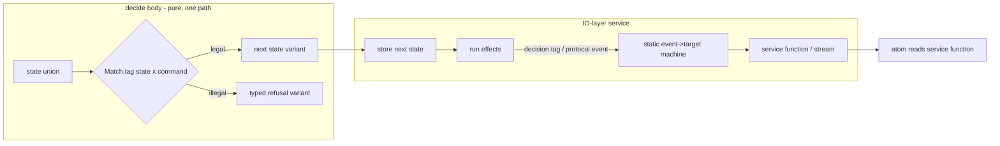

# Business choices stay in decide bodies; state machines live only in IO-layer services - Plan

## Goal Capsule

- **Objective:** no business choice can escape the decision gates. Every choice is made once, in a `Workflow.make` decide body that is single-path, matches exhaustively over closed unions, returns a typed refusal for every illegal command, is pure, and is mutation-tested. A state machine never makes a business choice.
- **Means:** the ruling R1-R4, written once in the `cell-architecture` pack (U1), the `lifecycle-machines` draft on `packs/ui-state` reconciled to it (U2), and gates G1-G6, each observed red then green (U3-U8).
- **Authority:** `CONSTITUTION.md` (D1, D2, D4, B1, B4, S1, S4, T12, E7), then the evidence in Sources, then the requester's candidate hypothesis, which this plan tests and adopts with amendments.
- **Stop conditions:** a gate that needs operator approval under GATE1 is not minted until it has that approval. A unit stops if the fork, Effect or oxlint would have to change.
- **Execution profile:** packs first; every gate's red cases are committed before its implementation; each gate change ships as its own commit.
- **Finisher:** a stacked set of pull requests against `main`, plus one rework layer on `packs/ui-state`, each watched to green.

---

## Product Contract

### Summary

The requester's candidate hypothesis is adopted, with three amendments. A lifecycle that a decision advances is a closed tagged union. The decide body matches over state × command and returns a typed refusal for every illegal pair. No state-machine library is reachable from a decide body: not the fork's root entry, and not its `/fsm` entry. State machines are allowed only inside an IO-layer service, only for protocol and process lifecycles, and only with transitions that follow an event to a fixed target. Atoms read the service's functions and never touch an actor.

The amendments are:

- Decide-body enforcement is fail-closed by provenance, not a per-export name table.
- I2 becomes "no decide-body rule is loosened", because main has a laundering hole that "unchanged" would keep open.
- Idempotent replays are named success variants.

### Problem Frame

Today a business choice can leave the gates through a state machine. All four of these probes pass on `main` (`02bf9653`) with zero diagnostics:

- M1: a module-scope `createMachine` const whose action calls `fetch`, stepped from the body.
- M2: a module-scope `/fsm` machine whose transition function calls `fetch`.
- M3: a business choice written as a transition table (`submitted: { on: { APPROVE: 'approved', REJECT: 'rejected' } }`).
- M4: a business choice written as a ternary inside a transition function.

The probe ran `make-body-purity` from `origin/main` through RuleTester. It was a fleeting scratch file, since deleted. PR #745's head extends the rule so that M1 and M2 are refused, but M3 and M4 still pass there too.

A table carries the choice as data, with no control flow. No gate sees data: not the stock `complexity` rule, not `scanControlFlow` (which walks only the resolved body, `make-body-purity.ts`, called once per boundary in `Program`), and not `workflow-match-exhaustive`. Stock `complexity` (max 1 on `**/src/**/*.workflow.ts`, `packages/oxlint-plugin/oxlint-plugin-dmmf-workflow/src/index.ts:56-61`) does catch M4 inside a workflow file. It does not catch the same callback in a sibling `*.machine.ts`, where the `src` ceiling is 2 (oxlint probe, deleted).

The fork turns illegal commands into silent success. At `c8c376cc2`, an event with no entry in the current state's `on` table resolves to `noTransition = {}`:

- `ownTransitionOf` returns `undefined` (`packages/xstate/src/fsm.ts:417-420`).
- `resolutionOfConfig` maps that to an empty resolution (`:390-397`).
- `nextSnapshot` returns the input snapshot object itself when nothing changed (`:451-463`).

A Bun probe against the fork source showed it: replaying `APPROVE` in `approved` returned the identical snapshot object with zero actions, and an undeclared `SHIP` did the same. Upstream documents the behaviour too: "Events without matching transitions are ignored" (https://stately.ai/docs/xstate/v6/build/troubleshooting). A declared `{}` no-op returns the same object as well, so a refusal cannot be told apart from a legal stay by identity.

Recognizing machines by name is an arms race. Five review rounds on #745 each found a new laundering shape:

- `satisfies`/`as` and `<T>` assertions
- a `.provide` chain
- a const-held `setup(...)`
- an aliased runtime export
- a method alias (`const step = lifecycle.transition`)
- an inline config handing over a record handler

A record-held machine, `createFSM.call(null, cfg)` and a non-factory initializer still pass at its head (round-5 reviewer probes). The root cause is general: a module-scope const referenced from a decide body passes as `moduleValue` whatever its initializer computes. That includes `const data = readFileSync(...)` (round-5 correctness residual).

Unnamed incidents dated 2026-10-10 show the harm when lifecycle choices sit outside one decision:

- **Incident n:** an agent-run lifecycle was a hand-rolled string union. Its transitions were spread over a SQL insert, a reassigned local and a raw-SQL startup recovery sweep.
- **Incident o:** a next state was chosen by reading a shared mutable object.
- **Incident p:** database writes and event mirroring were interleaved with transitions.
- **Incident q:** a durable lifecycle had no decider, and recovery rewrote state in raw SQL.
- **Incident r:** a connection lifecycle was held in component state.

### Requirements

**Where a business choice lives**

- R1. A lifecycle that a decision advances is a closed tagged union, one variant per state, each carrying only its own fields (CONST-D4). The decide body matches over the current state and the command with `Match.tag` and closes every dispatch with `Match.exhaustive`. A missing pair is then a compile error (TS2345 probe: an omitted `Reject` command and an omitted `Rejected` state were each refused).
- R2. Every illegal state × command pair returns a typed refusal: a variant of a closed refusal union declared by the decision. Each distinct refusal reason is its own variant (CONST-D2), and its fields carry the state and command tags as closed literals. A replay the business accepts is a named success variant. A decide branch never returns its input state unchanged as success.
- R3. No state-machine library is reachable from a decide body. That covers `@systemfsoftware/xstate` with every subpath, upstream `xstate`, and `@xstate/*`, whether imported directly or reached through any module-scope binding the body references (CONST-B4: the core imports no framework). The `/fsm` acceptance proposed by #745 does not ship.

**Where a state machine may live**

- R4. A state machine is allowed only inside the implementation of an IO-layer Effect service, and only for a protocol or process lifecycle such as a connection, a request in flight or a supervised child. It is never allowed for a business lifecycle, and never as a mirror of one. Its transitions follow events: each transition maps an event type to a fixed target. A transition function may copy fields from `event` into context through a single object literal, and nothing more. There are no guards, no `always`/eventless transitions, no context computed from context, and no clock or randomness. A business outcome reaches the machine only as a decision-result tag the shell sends as an event.
- R5. The service exposes functions or streams of plain values. An atom reads those service functions. No atom module imports an xstate package or `@systemfsoftware/xstate-effect`, and none subscribes to an actor. The UI keeps one subscription system, the atom registry.
- R6. A durable lifecycle's source of truth is the stored union value the decision returned; the shell stores it before running effects (sandwich order, `cell-architecture/sandwich-phase-order.md`). Recovery after a crash is a command to the same decision, never a direct state write.

**Packs and docs**

- R7. The ruling is written once, in `compound-packs/cell-architecture`: `pure-decision-workflows.md` gains the lifecycle clauses R1-R3 and R6, and a new `shell-machines-follow-decisions.md` carries R4-R5. Each rule names its dated incidents as unnamed patterns and ends with a `Gate:` line naming its gate class.
- R8. `packs/ui-state` is reconciled. Its `lifecycle-machines` pack and that pack's enrollment are removed, and plan R46-R56 are superseded by a new dated plan on that branch that points to R7's rules. The atom-over-actor form in `components-dispatch-to-runtime-atoms` (R53 form B) becomes the R5 form.
- R9. The plugin README rows and each rule's `meta.docs.description` match the pack text (I6).

**Gates** (each gate is observed red, then green, in its own commit. G1, G3, G4, G5 and G6 are new or tightened evaluators and need operator approval under GATE1 before they are minted.)

- R10. G1, tightening `make-body-purity`: a module-scope binding the body references is judged by running the body classifier over its initializer. Every failing verdict inside the initializer reports at the reference. This is fail-closed: aliases, assertions, records, `.call`, method reads and helper results all resolve, because the classifier follows references rather than recognizing shapes.
- R11. G2, in `make-body-purity`: an import whose specifier is in the state-machine family (R3) reports a dedicated `stateMachineReference` message, so the fix text names R1 and R4 instead of the generic unsealed text. The match is by specifier family, not by export name, so a fork release cannot move it.
- R12. G3, a new rule `shell-machine-follows-events` in `@systemfsoftware/oxlint-plugin-cell-architecture`. A machine config passed to any state-machine-family factory, in any `src` file, is refused at the offending node when it holds:
  - a function transition other than an event-copy literal
  - a `guard`/`cond` key
  - an `always` key
  - an `assign` or context patch that reads `context`
- R13. G4, a new rule `atoms-read-services`. A module that constructs atoms (calls `Atom.make`, `Atom.family`, `<runtime>.atom` or `<runtime>.fn` from the atom package) is refused when it imports a state-machine-family specifier or `@systemfsoftware/xstate-effect`. The rule identifies an atom module by what it constructs, not by its file name (CONST-T12).
- R14. G5, a new `repo-checks` lane `workflow-mutation`: every workspace package that holds a `src/**/*.workflow.ts` file has a `stryker.config.ts` whose `mutate` list includes `src/**/*.workflow.ts`. All 14 such packages hold today, so the red case is a planted fixture.
- R15. G6, a new decide-body rule `workflow-refuses-silent-noop`. A `Match` handler in a decide body that returns success wrapping the value it matched, unchanged, is refused, because it is R2's silent no-op.

### Acceptance tests (the requester's I1-I6, as revised)

- I1. Every business choice is made in a decide body. _Kept._ It is enforced by R1-R3 (G1, G2, G6), `sandwich-shell-is-straight-line` (already on main), G3 for machines, and the `src` complexity ceiling of 2. The single branch that ceiling still admits in a service is the named review residual.
- I2. **Replaced:** "no decide-body rule is loosened; #745's `/fsm` acceptance does not ship; the only decide-body changes are the G1, G2 and G6 tightenings." _Why:_ "the rules are unchanged" would keep the M1-M4 laundering hole that `main` has, which contradicts I4.
- I3. A lifecycle is a tagged union, and every illegal pair is a typed refusal, never a silent no-op. _Kept_, with R2's refinements: one variant per refusal reason, and replays as named successes.
- I4. **Replaced:** "every state-machine-family entry reachable from a decide body is refused by provenance and reported by package family." This covers root and `/fsm`, module-const machines, `satisfies`/`as`, `.provide`, const-held `setup`, method aliases, record-held machines and `.call`. _Why:_ the per-export name table kept leaking for five rounds, while a provenance walk fails closed (CONST-D1, CONST-S1).
- I5. Shell machines decide nothing. _Kept_, enforced by G3. What G3 cannot judge is review-owned, and the rule text says why: whether a lifecycle is protocol or business, and whether a machine mirrors a business lifecycle. Both are statements about meaning, and a rule that reads syntax cannot settle them.
- I6. The packs come first, and the plugin README and rule docs match them. _Kept_ (R7-R9, U1 precedes every gate unit).

### Key Decisions

- **The fsm-in-decider shape is not kept** (it was `lifecycle-machines` R48 and R52 on `packs/ui-state`, plan `docs/plans/2026-10-12-1541-feat-ui-state-pack-plan.md:297-314`). Its R52 detects a refusal by `next === snapshot`. That detection merges every illegal pair into one refusal variant, against CONST-D2. It makes a legal stay impossible to express, because a declared `{}` no-op returns the same object (probe at `c8c376cc2`). It also needs a fork-semantics pin that the boundary-testing pack requires and nothing provides (`pin-dependency-semantics.md`, reported contradicted by the round-5 learnings pass). Its R48 refuses `Match`-computed transitions, which inverts this ruling: here `Match` is the one sanctioned way to compute a next state.
- **Machines stay in the shell, not deleted from it.** A protocol lifecycle such as a socket, a request or a supervised child is not a business choice. A static event→target table states it more legibly than code. `sandwich-shell-is-straight-line` refuses `Match` in shell phases, so the shell already has no other sanctioned way to hold such a lifecycle.
- **Fail-closed provenance replaces recognition.** `classifyFunctionReferences` already follows helper functions and record members. Following a referenced const's initializer is the same move, applied to the remaining binding kind. It retires the four specifier tables, `calledExportOf`, `machineCallOf` and `configSourceOf` that #745 added.
- **Package-family naming replaces export naming.** It keeps a precise fix message (I4's "by name") without a table that drifts when the fork releases.

### Scope Boundaries

- The business-versus-protocol classification and "is this a mirror" stay review-owned (I5).
- Upstream `xstate` adoption, fork changes, and the effect-atom bridge are out of scope.
- The `src` complexity ceiling of 2 is unchanged. A single-branch choice inside a service is a review residual already named in `docs/solutions/architecture-patterns/make-boundary-owns-a-decision.md`.
- No `stryker.config.ts` changes. G5 reads the configs; it never edits them.

### Sources

- Fork `systemfsoftware/xstate` at `c8c376cc2` (public): `packages/xstate/src/fsm.ts:390-397`, `:406-415`, `:417-420`, `:451-463`, `:465-485`.
- Upstream semantics: Stately XState v6 troubleshooting, "Events without matching transitions are ignored."
- Decider pattern (`decide: Command -> State -> Event list`, a pure total function): https://gist.github.com/thinkbeforecoding/026a1d90ea2f3ea86d151b1229cad932.
- `compound-packs/cell-architecture/pure-decision-workflows.md:10-14`, `:44-45`. `packages/oxlint-plugin/oxlint-plugin-dmmf-workflow/src/index.ts:45-61`. `packages/oxlint-plugin/oxlint-plugin-cell-architecture/src/rules/sandwich-shell-is-straight-line.ts`.
- Mutation coverage: the 14 packages holding `*.workflow.ts` each mutate `src/**/*.workflow.ts` and `src/**/*.schema.ts` and nothing else (e.g. `packages/atom/effect-atom/stryker.config.ts:23-34`), so a machine in any other file is never mutated.
- `packs/ui-state` at `cfacc33a1`: plan R46-R56 (`:281-327`), incidents n-r (`:135-139`), R53 form B (`:312`).
- PR #745 review rounds 1-5 (reviewer artifacts recorded in that PR's body), and the probes listed in Problem Frame.

---

## Planning Contract

### Key Technical Decisions

- KTD1. **G1 is a new branch in the existing `FunctionName`/`Variable` arm of `classifyFunctionReferences`.** For a module-scope `const` whose initializer is not a function or a record (both already followed), the initializer node is classified with the shared `visited` set. That set stops cycles and already bounds helper follows. A `let`/`var` keeps its `moduleState` verdict. Governs R10.
- KTD2. **G2 adds one verdict kind, `stateMachineImport`.** `classifyImportBinding` reports it for a specifier equal to `xstate` or starting with `@xstate/` or `@systemfsoftware/xstate`. `FAILING_KIND` is keyed by the verdict union, so the compiler forces the new kind to be classified. Governs R11.
- KTD3. **G3 and G4 live in `oxlint-plugin-cell-architecture`,** the plugin that already owns the shell law (`sandwich-shell-is-straight-line`). They enter its `recommended` config at `error`. Governs R12, R13.
- KTD4. **G5 is a `repo-checks` lane** in the flake-delivered `scripts/tools/repo-checks`, an Evaluator surface. It ships in its own commit and is observed red against a planted package before its green commit. Governs R14.
- KTD5. **G6 compares identity syntactically.** Inside a `Match.tag`/`Match.when` handler of a decide body, the rule refuses a success constructor whose sole argument is the handler's own parameter or the decide parameter it destructures. Governs R15.

### High-Level Technical Design

### Sequencing

The stack runs bottom to top, each layer releasable on its own:

1. U1 packs.
2. U3 (G1, G2) and U8 (G6) in `oxlint-plugin-dmmf-workflow`.
3. U4 (G3) and U5 (G4) in `oxlint-plugin-cell-architecture`.
4. U6 (G5) in its own Evaluator commit.

U2 is one layer on `packs/ui-state`, after U1 merges. U7 closes #745 once this plan is accepted.

## Implementation Units

### U1. cell-architecture pack

- **Goal:** R1-R7 written once.
- **Files:** `compound-packs/cell-architecture/pure-decision-workflows.md` (amend), `compound-packs/cell-architecture/shell-machines-follow-decisions.md` (new), `compound-packs/cell-architecture/README.md` (index line).
- **Content:**
  - WRONG/RIGHT blocks: an `/fsm` table stepped in a decide body (WRONG) beside the `Match` state × command form with refusal variants (RIGHT); a guard reading a shared object (incident o, WRONG) beside an event→target table in a service (RIGHT).
  - Incidents n, o, p and q cited on the decision rule; o and r on the shell rule.
  - `Gate:` lines: `type-checker` + `lint` for the decision rule; `lint` (G3, G4) + `review` for the shell rule, with the review reason from I5.
- **Verification:** `pnpm check:local`; privacy grep over the diff (no private repo, product, path or PR names).

### U2. packs/ui-state reconciliation

- **Goal:** R8.
- **Files on that branch:**
  - remove `compound-packs/lifecycle-machines/` and its `.compound-engineering/config.yaml` entry
  - amend `compound-packs/ui-state/components-dispatch-to-runtime-atoms.md` (R5 form)
  - add a new dated plan superseding `2026-10-12-1541-feat-ui-state-pack-plan.md` R46-R56, which cites U1's files
- **Verification:** `pnpm check:local` on that branch; plain push, no force.

### U3. G1 + G2 in make-body-purity

- **Goal:** R10, R11, R3.
- **Red cases** (RuleTester, committed first): M1-M4, a record-held machine, `createFSM.call(null, cfg)`, a helper-returned machine, `const data = readFileSync(...)` at module scope, a direct `/fsm` import, and each family specifier. All pass on `main`.
- **Guards** (green on both commits): pure module consts built from the sealed effect surface or a relative schema import; local helper-built pure records.
- **Green:** KTD1, KTD2; README row and `meta.docs.description` (R9). Changeset by turbo hash (REPO-R2).

### U4. G3 shell-machine-follows-events

- **Goal:** R12.
- **Red:** M3 is valid (a static table); M4, a `guard` key, `always`, a context patch from `context`, and a function transition with a call are each refused. These are new rule tests, so red means "rule absent": the suite fails to import before the rule exists.
- **Green:** rule plus `recommended` enrollment.

### U5. G4 atoms-read-services

- **Goal:** R13.
- **Red:**
  - an atom module importing an xstate-family specifier is refused
  - an atom module importing `xstate-effect` is refused
  - an atom module reading a service function passes (guard)
  - a non-atom service module importing xstate passes (guard)
- **Green:** rule plus enrollment.

### U6. G5 workflow-mutation repo-check

- **Goal:** R14.
- **Red:** a planted fixture package holding a `*.workflow.ts` with no matching `mutate` glob makes the lane exit non-zero.
- **Green:** the lane passes on the real tree (all 14 packages).
- Its own commit (Evaluator surface).

### U7. #745 disposition

- Close #745 unmerged, with a comment linking this plan.
- The branch stays as is. The two local commits `0ec235a59` and `900b215ee` and the stash are never pushed.
- Two generic pieces are re-derived in U3, not cherry-picked:
  - the `TSSatisfiesExpression`/`TSTypeAssertion` type regions
  - the test-side literal oracle for `UNSEALED_IMPORT_FIX`

### U8. G6 workflow-refuses-silent-noop

- **Goal:** R15.
- **Red:** `Match.tag('Approved', (s) => Result.succeed(s))` in a decide body is refused.
- **Guards:** a handler that constructs a new variant passes; a named replay success variant passes.

## Test admission

Every admitted test is a RuleTester or repo-check case. It observes a published rule's diagnostics on real source text (CONST-T8), and its expected messages are literals in the test, not constants imported from the implementation (CONST-T10). The pack prose has no tests (review gate). There are no property tests: the rules are syntax classifiers with no generated-input law to state. No local mutation runs (REPO-D3).

## Verification Contract

| Gate           | Command                                                                | Proves                           |
| -------------- | ---------------------------------------------------------------------- | -------------------------------- |
| Packs          | `pnpm check:local`                                                     | dprint, conventions, plan count  |
| Rule red/green | `pnpm --filter <plugin> test` on the red commit, then the green commit | each case moves exactly once     |
| Repo lane      | `nix run .#repo-checks -- workflow-mutation`                           | G5 red on fixture, green on tree |
| CI             | `xd://github run_watch` per layer head                                 | green on exact head              |

## Definition of Done

- U1 merged before any gate layer. For every gate, its red commit fails and its green commit passes, with both SHAs in the PR body.
- G1, G3, G4, G5 and G6 carry a recorded operator approval (GATE1) before their layers open.
- #745 closed with a link to this plan; nothing further pushed to its branch.
- `lifecycle-machines` is gone from `packs/ui-state`, and nothing in the repo names a private repo, product, path or PR.

## Destructive review (Substitution lens, cycle 1)

- **Assumptions tested:**
  1. `Match` over state × command stays tractable for real lifecycles.
  2. A shell machine can be made to decide nothing mechanically.
  3. Decide-reach refusal can fail closed without a name recognizer.
- **Substitution tried:** replace `Match` with a total mapped-type table, `{ [S in State]: { [C in Command]: Next | Refusal } }`, indexed in the decide body. It is exhaustive by type and as legible as an FSM table. It fails assumption 1's need for data-dependent transitions, though: such cells become functions, which reintroduces branching outside `workflow-match-exhaustive`'s reach, and it would add a second sanctioned form (CONST-S4).
- **Delta:** kept `Match` as the single form; added R2's refusal-per-reason and replay-as-success clauses (from assumption 1); added the event-copy exception to R4 (from assumption 2: protocol machines must carry payloads); replaced name tables with provenance (from assumption 3).
