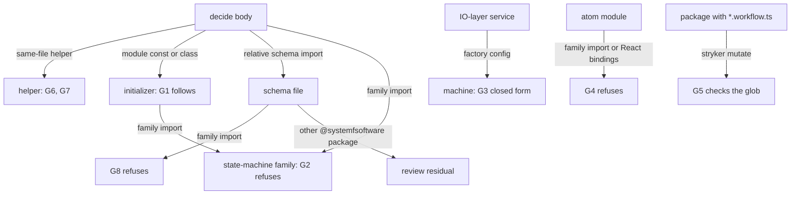
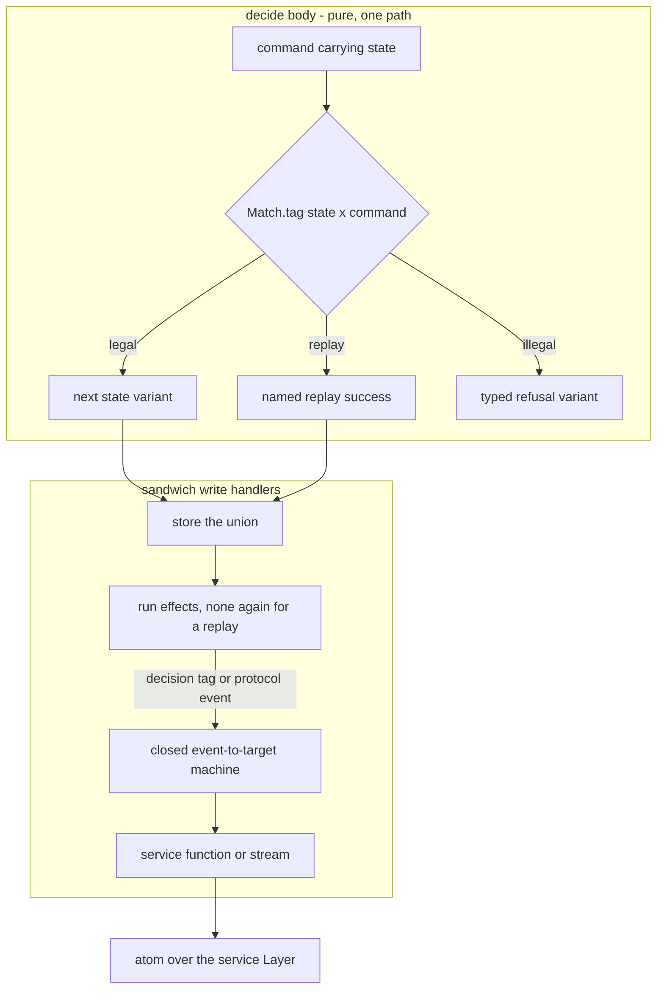
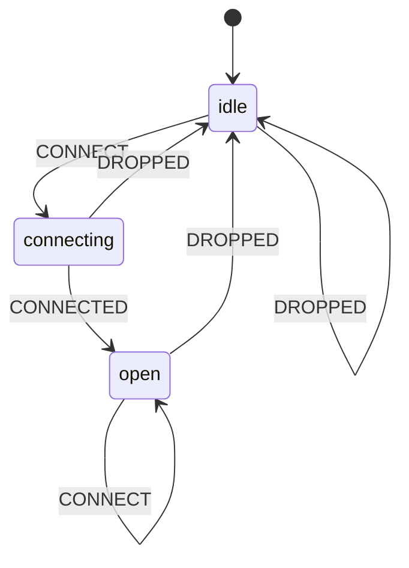

# Business choices stay in decide bodies; state machines live only in IO-layer services - Plan

## Goal Capsule

- **Objective:** every business choice in this repo's code is made where the decision gates can see it and refuse it, and no state machine makes one.
- **Means:** the ruling R1-R6 and R17, written once in the `cell-architecture` pack (R7); the `lifecycle-machines` draft on `packs/ui-state` reconciled to it (R8); and gates G1-G8 (R10-R16, R18-R20), each observed red, then green.
- **Product authority:** the conductor's intent of 2026-10-12, which delegates the placement ruling to this plan. Then `CONSTITUTION.md` (D1, D2, D4, B1, B4, S1, S4, T12, E7), then the verified evidence in Sources. The requester's candidate hypothesis is tested here and adopted with amendments.
- **Stop conditions:** no code is written until the conductor and the requester have debated this plan. No gate unit opens without operator approval under GATE1. A unit stops and reports if the fork, Effect or oxlint would have to change.
- **Execution profile:** packs first. In every gate unit the red RuleTester or repo-check cases are committed before the implementation, and live violations are migrated before enrollment (R20).
- **Finisher:** the implementing agent ships a `gh stack` of pull requests against `main`, plus one layer on `packs/ui-state`, and watches each to green.

---

## Product Contract

### Summary

The candidate hypothesis is adopted, with three amendments. A lifecycle that a decision advances is a closed tagged union, decided by `Match` over state × command, with a typed refusal for every illegal pair. No state-machine library is reachable from a decide body. Machines live only inside IO-layer services, for protocol and process lifecycles, and map each event to a fixed target.

The amendments:

- Decide-body enforcement fails closed by following what a referenced binding computes, instead of naming exports.
- The requester's I2 ("decide-body rules unchanged") becomes "no decide-body rule is loosened".
- A replay the business accepts is a named success.

### Problem Frame

A business choice can leave the gates through a state machine today. Each of these probes passes `make-body-purity` on `main` (`02bf9653`) with zero diagnostics:

- M1: a module-scope `createMachine` const whose action calls `fetch`, stepped from the body.
- M2: a module-scope `/fsm` machine whose transition function calls `fetch`.
- M3: a business choice written as a transition table (`submitted: { on: { APPROVE: 'approved', REJECT: 'rejected' } }`).
- M4: a business choice written as a ternary inside a transition function.

PR #745's head refuses M1 and M2, but M3 and M4 pass there too.

The cause is general. A module-scope `const` that a decide body references gets the passing `moduleValue` verdict whatever its initializer computes, and so does any module-scope class. Control flow is scanned only in the resolved body. A table carries a choice as data, which no gate reads: not stock `complexity`, not `scanControlFlow`, and not `workflow-match-exhaustive`, which fires only on a `Match.value(...).pipe(...)` chain inside the body. Stock `complexity` (max 1 on `*.workflow.ts`) catches M4 inside a workflow file, but the same callback in a sibling module sits under the `src` ceiling of 2. A decide body may also call operations from a relative `*.schema.ts` file, and a schema file may import any `@systemfsoftware/*` package, the fork included. Mutation testing covers only `*.workflow.ts` and `*.schema.ts`, so a machine anywhere else is never mutated.

The fork also turns illegal commands into silent success. At `c8c376cc2`, an event with no entry in the current state's `on` table resolves to an empty transition. `transition` then returns the input snapshot object itself, with no effects. Upstream documents the same behaviour: "Events without matching transitions are ignored." A declared `{}` stay returns the same object, so identity cannot tell a refusal from a legal stay.

Recognising machines by name is an arms race. Five review rounds on #745 each found a new laundering shape:

- `satisfies`/`as` and `<T>` assertions
- a `.provide` chain
- a const-held `setup(...)`
- an aliased runtime export
- a method alias
- an inline config handing over a record handler

A record-held machine, `createFSM.call(null, cfg)` and a non-factory initializer still pass at its head.

Unnamed incidents dated 2026-10-10 show the harm when lifecycle choices sit outside one decision:

- **Incident n:** an agent-run lifecycle was a hand-rolled string union, with transitions spread over a SQL insert, a reassigned local and a raw-SQL startup recovery sweep.
- **Incident o:** a next state was chosen by reading a shared mutable object.
- **Incident p:** database writes and event mirroring were interleaved with transitions.
- **Incident q:** a durable lifecycle had no decider, and recovery rewrote state in raw SQL.
- **Incident r:** a connection lifecycle was held in component state.

### Requirements

**Where a business choice lives**

- R1. A lifecycle that a decision advances is a closed tagged union, one variant per state, each carrying only its own fields, and its current state arrives inside the command. The decide body dispatches over state and command with `Match` and closes every dispatch with `Match.exhaustive`. (pack: cell-architecture, pure-decision-workflows.md; pack: schema-laws, tagged-unions-over-state-by-presence.md)
- R2. Every illegal state × command pair returns a typed refusal, one variant per distinct reason, whose fields name the state and command tags as closed literals. A replay the business accepts is a named success variant. A decide body never returns its input state unchanged as success.
- R3. No state-machine library is reachable from a decide body, directly, through any binding the body references, or through a schema file it imports. The state-machine family is any specifier equal to `xstate`, starting with `xstate/` or `@xstate/`, or starting with `@systemfsoftware/xstate`, which includes `-effect`, `-react` and `-store`. #745's `/fsm` acceptance does not ship.

**Where a state machine may live**

- R4. A state machine lives only inside the Layer implementation of an IO-layer service, for a protocol or process lifecycle such as a connection, a request in flight or a supervised child. Its config is closed: each transition maps an event type to a fixed target, a transition may only copy event fields into context, and every state names every event type the machine handles, so no event is dropped silently. A business outcome reaches a machine only as a decision-result tag the shell sends as an event. (pack: cell-architecture, service-and-layer-boundaries.md)
- R5. The service exposes functions or streams of plain values, which atoms read through an atom runtime over the service's Layer. No atom module imports a state-machine-family specifier, no module imports the family's React bindings, and nothing outside the service subscribes to an actor.
- R6. A durable lifecycle's source of truth is the stored union value the decision returned. Crash recovery is a command the shell sends to the same decision, never a direct state write and never a Medium's own recovery. (pack: cell-architecture, sandwich-phase-order.md)
- R17. The shell stores that union before running effects, and a replay success runs no irreversible effect a second time. (pack: cell-architecture, store-serializable-unit-of-work.md)

**Packs and docs**

- R7. The ruling is written once in `compound-packs/cell-architecture`. `pure-decision-workflows.md` gains R1-R3, R6 and R17, and a new shell-machines rule file carries R4-R5. Each rule cites its incidents as unnamed patterns and ends with a `Gate:` line; R6 and R17 are `review`, because effect ordering across Effect composition is not decidable from syntax or types.
- R8. `packs/ui-state` is reconciled to R7. Its `lifecycle-machines` pack and that pack's enrollment are removed, every ui-state file that routes readers there is repointed, and its plan is replaced by one that cites R7 and supersedes R46-R56, including R47, R48, R52 and R53, which contradict R1, R3 and R5.
- R9. The plugin READMEs, each rule's `meta.docs.description` and the published API reports match the pack text.

**Gates** (each lands alone and is observed red, then green, per R20)

- R10. G1: a module-scope `const` or class that a decide body references is judged by what its initializer or class body references, with the body's own classifier. Only references inside that initializer or class are judged, and an initializer the classifier cannot resolve is refused. A module-scope `let`/`var` keeps its existing refusal.
- R11. G2: a reference that resolves to a state-machine-family import (R3) reports a dedicated message whose fix names R1 and R4, matched by specifier family, never by export name.
- R12. G3: a machine config given to a state-machine-family factory in any `src` file is refused when it holds any key or transition shape outside R4's closed form, or when the rule cannot resolve it statically.
- R13. G4: a module that constructs or reads atoms is refused when it imports a state-machine-family specifier, and any module importing the family's React bindings is refused. An atom module is identified by its import edges and calls, not by its file name.
- R14. G5: every workspace package holding a `src/**/*.workflow.ts` file mutates `src/**/*.workflow.ts`; a package whose mutate list the check cannot read fails. The check runs in `gate:repo` and carries a planted-violation step in CI.
- R15. G6: a decide body is refused when a `Match` handler returns success wrapping its matched value unchanged, including through an alias, an assertion or a spread copy.
- R16. G6: a decide body is refused when it reads a member keyed by a `_tag` value, because that is dispatch by table outside `Match`.
- R18. G7: `workflow-match-exhaustive` and G6 judge every same-file function the decide body calls, not only the body.
- R19. G8: a `*.schema.ts` file imports, dynamically imports and re-exports no state-machine-family specifier.
- R20. Each gate lands in its own commit, observed red on planted cases before its implementation and green after. Live violations are migrated before the gate is enrolled at `error`, and enrollment is proved through `oxlint-config-recommended` or `gate:repo`.

### Acceptance tests (the requester's I1-I6, as revised)

- I1. Every business choice is made in a decide body. _Kept._ Enforced by R10-R13, R15-R16 and R18-R19 with `sandwich-shell-is-straight-line` and the `src` complexity ceiling. Four residuals are review-owned judgements, each named in the pack with its reason:
  - a single branch that the ceiling of 2 admits in service code;
  - a choice carried by a data lookup not keyed by `_tag`;
  - a decide body that hands its state × command dispatch to a schema-file operation, because schema files are where pure projections and evolves over unions live, and a one-file rule cannot tell a projection from a delegated choice;
  - a non-family `@systemfsoftware/*` package that exports a machine-built value to a schema file (no workspace package depends on the family today).
- I2. **Replaced:** no decide-body rule is loosened, and the only decide-body changes are the G1, G2, G6 and G7 tightenings. _Why:_ "unchanged" would keep the M1-M4 hole that `main` has, contradicting I4.
- I3. A lifecycle is a tagged union, and every illegal pair is a typed refusal, never a silent no-op. _Kept_, with R2's refinements: one refusal variant per reason, and replays as named successes.
- I4. **Replaced:** every state-machine-family binding reachable from a decide body is refused by following what it computes and reported by package family, and schema files may not import the family (G8). This covers root and `/fsm`, module-const machines, `satisfies`/`as`, `.provide`, const-held `setup`, method aliases, record-held machines and `.call`. _Why:_ the per-export name table leaked for five rounds, while following references fails closed (CONST-D1, CONST-S1).
- I5. Shell machines decide nothing. _Kept_, enforced by G3, which also refuses a state that drops an event. Two judgements are review-owned, and the rule text says why: whether a lifecycle is protocol or business, and whether a machine mirrors a business lifecycle. Both turn on meaning, which a syntax rule cannot read.
- I6. The packs come first, and the plugin READMEs and rule docs match them. _Kept_ (R7-R9).

### Acceptance Examples

- AE1. **Covers R2, R15.** **Given** an `Approved` order, **when** `Approve` arrives and the business accepts replays, **then** the decision returns the named success `AlreadyApproved`; a handler `Match.tag('Approved', (s) => Result.succeed(s))` is refused by G6.
- AE2. **Covers R10.** **Given** `const lifecycle = createFSM({ ... on: { START: () => { fetch(url); ... } } })` at module scope, **when** a decide body calls `lifecycle.transition(...)`, **then** G2 reports the family import and G1 reports `fetch`. A failing reference elsewhere in the same file and outside that initializer is not reported at the body.
- AE3. **Covers R4, R12.** **Given** a service's `createFSM` config, **when** every state's `on` names every event type with a fixed target, **then** it passes; **when** a transition is a function containing a ternary, a state omits an event type another state handles, or the config is spread from a binding the rule cannot resolve, **then** G3 refuses it.
- AE4. **Covers R14.** **Given** a planted package holding `src/a.workflow.ts` whose stryker config mutates only `src/**/*.schema.ts`, **then** the `gate:repo` lane exits non-zero; on the real tree it exits 0.
- AE5. **Covers R18.** **Given** a decide body that calls a same-file helper whose `Match.value(state).pipe(...)` ends in `Match.orElse` over a closed union, **then** `workflow-match-exhaustive` reports it as it would inside the body.
- AE6. **Covers R19.** **Given** a `*.schema.ts` file, **when** it holds `import { createFSM } from '@systemfsoftware/xstate/fsm'`, `await import('xstate')` or `export * from '@systemfsoftware/xstate'`, **then** each is refused; an import of another `@systemfsoftware/*` package still passes.

### Key Decisions

- **The fsm-in-decider shape is not kept.** It was `lifecycle-machines` R48 and R52 on `packs/ui-state`. R52 detects a refusal by an unchanged snapshot, which merges every illegal pair into one refusal (against CONST-D2) and cannot express a legal stay. R48 refuses `Match`-computed transitions, the one form this ruling sanctions. Governs R1-R3, R8.
- **Machines stay in the shell, not deleted from it.** The intent asks for a shell-machine entry and routes a shell machine to the UI through a service, so the allowance is the requester's. A protocol lifecycle is not a business choice, and an event→target table states one legibly. Governs R4, R5.
- **Following references replaces recognition.** The classifier already follows helper functions and record members. Following a referenced const's initializer and a referenced class is the same move for the two remaining binding kinds, so no specifier table or shape recognizer from #745 ships. Governs R10, R11.
- **Schema-file delegation stays review-owned; the machine route through schema files closes.** Over twenty schema files dispatch over unions with `Match` today (e.g. `SupervisorState.schema.ts:102-120`), so refusing dispatch there would refuse the repo's sanctioned projections. G8 closes the one route a machine takes through them. Governs R3, R19.
- **Shell machines are total over their events.** The fork drops an unhandled event silently. Requiring every state to name every event turns each drop into a declared stay, the shell's analogue of `Match.exhaustive`. Governs R4, R12.
- **A closed allowlist replaces a fork-semantics pin.** Nothing in this repo depends on xstate today, so no pin has a subject (pack: boundary-testing, pin-dependency-semantics.md). A closed key allowlist fails closed when the fork adds a key; adopters pin the semantics they rely on. Governs R12.
- **Every gate here waits for operator approval.** G1, G2, G6, G7 and G8 tighten published diagnostics; G3, G4 and G5 are new evaluators. GATE1 applies to all eight. Governs R10-R16, R18-R20.

### Scope Boundaries

- The business-versus-protocol judgement, mirror detection, and the four I1 residuals stay review-owned.
- Upstream `xstate` adoption, fork changes and an effect-atom bridge to actors are out of scope.
- The `src` complexity ceiling of 2 is unchanged.
- No `stryker.config.ts` changes; G5 reads the configs and never edits them.
- Considered and not built: refusing every `Match` pipeline in `*.schema.ts` that lacks `Match.exhaustive`. Schema files use `Match.orElse` for open predicate and literal dispatch today, so the rule would refuse sanctioned code. A measured count of union-typed `orElse` arms in schema files would change this call.
- Considered and not built: a repo-check that no package a schema file imports depends on the family. No workspace package depends on the family today; the first such dependency would change this call.

### Dependencies / Assumptions

- The fork stays at `c8c376cc2` for the evidence here; G3's allowlist does not depend on it.
- #745 stays open, unchanged, until this plan is accepted.
- `packs/ui-state` does not merge until U1 has merged to `main` and U2 has landed on that branch, so `main` never carries both conventions.

### Sources

- Fork `systemfsoftware/xstate` at `c8c376cc2` (public): `packages/xstate/src/fsm.ts:17-49` (transition forms), `:66-88` (config keys), `:390-397`, `:417-420` (unhandled event → empty transition), `:451-463`, `:475-483` (unchanged snapshot returned as-is).
- Upstream semantics: Stately XState v6 troubleshooting, "Events without matching transitions are ignored" (https://stately.ai/docs/xstate/v6/build/troubleshooting).
- Decider pattern, `decide: Command -> State -> Event list` as a pure total function: https://gist.github.com/thinkbeforecoding/026a1d90ea2f3ea86d151b1229cad932.
- `packages/oxlint-plugin/oxlint-plugin-dmmf-workflow/src/rules/ReferenceClassification.ts:633-692` (`collect` walks the given scope with no span filter; `ClassName` → `moduleValue` at `:655-658`; module const → `moduleValue` at `:681-682`); `make-body-purity.ts:291` (`scanControlFlow` on the body only).
- `packages/oxlint-plugin/oxlint-plugin-dmmf-workflow/src/index.ts:57-59` (max 1 on `*.workflow.ts`); `packages/oxlint-presets/oxlint-config-dmmf/src/index.ts:79-80` (max 2 on `src`); `workflow-match-exhaustive.ts:53-76`; `oxlint-plugin-cell-architecture/src/rules/sandwich-shell-is-straight-line.ts:190-195` (Sandwich read/write phases only).
- `packages/oxlint-plugin/oxlint-plugin-effect-schema/src/rules/schema-file-imports-pure-modules-only.config.ts:38-42` (any `@systemfsoftware/` source is allowed in a schema file); `schema-file-imports-pure-modules-only.ts:75-110` (static, dynamic and re-export forms share one source predicate).
- Mutation coverage: the 14 packages holding `*.workflow.ts` each mutate only `src/**/*.workflow.ts` and `src/**/*.schema.ts` (e.g. `packages/atom/effect-atom/stryker.config.ts:23-30`).
- `packs/ui-state` at `cfacc33a1`: plan `docs/plans/2026-10-12-1541-feat-ui-state-pack-plan.md` R48 (`:297`), R52 (`:311`), R53 (`:312`), incidents n-r.
- `docs/solutions/architecture-patterns/a-prohibition-must-close-transitively.md`, `label-routed-rules-are-unfalsifiable.md`, `dynamic-import-blinds-static-provenance-rules.md`, `constraint-reaches-only-via-window-or-gate.md`, `docs/solutions/tooling-decisions/rule-admission-severity-and-accretion.md`.
- `repos/constitution/ENFORCEMENT.md` § Changing an instrument and § Enrollment.
- PR #745 review rounds 1-5, whose findings are recorded in that PR's body.

---

## Planning Contract

**Product Contract preservation:** changed after planning research. R1, R3, R4, R5, R6, R8, R9, R10 and R13 gained a clause, and R17-R20 are new. Flow analysis found an open schema-file route (R3, R19), unchecked dispatch in same-file helpers (R18), silent event drops in shell machines (R4), a replay that could re-run effects (R17), and no migrate-then-enroll step (R20). No requirement was removed or weakened.

### Key Technical Decisions

- KTD1. **G1 adds a branch to the `FunctionName`/`Variable` arm of `classifyFunctionReferences`, plus a `ClassName` follow.** A module-scope `const` whose initializer is not a function or a record (both already followed), and a module-scope class, are classified with the shared `visited` set, which stops cycles. `collect` gains a span filter so only references inside the followed node are judged. It reuses `isWithinBody` from `@systemfsoftware/oxlint-make-boundary`, which the plugin already depends on, rather than a third containment helper. An initializer whose references resolve to nothing keeps the existing failing `unresolvable` verdict. Governs R10.
- KTD2. **G2 adds one verdict kind, `stateMachineImport`.** `classifyImportBinding` reports it for a family specifier (R3) before the generic unsealed arm. `FAILING_KIND` is keyed by the verdict union, so the compiler forces the new kind to be classified. The message states the specifier-family match only, which is all a depth-0 check decides. Governs R11.
- KTD3. **G3 and G4 are new rules in `oxlint-plugin-cell-architecture`**, the plugin that owns the shell law, so the judged code cannot weaken them. They resolve factories and atom calls through that plugin's own `module-origin.ts`, because plugins neither vendor nor depend on each other. They enter its `recommended` map at `error`, which the presets carry to every package. G3 follows `collectSandwichCells`' shape: locate the factory call by import origin, then judge its config argument against the closed allowlist (`id`, `initial`, `context`, `states`, `on`, `target`, the event-copy function). Governs R12, R13.
- KTD4. **G5 is a `repo-checks` lane, `workflow-mutation`.** It enumerates packages with `workspace.ts`, lists `src/**/*.workflow.ts` with `git ls-files`, and reads the string-literal array passed as `mutate` or as `shardMutate`'s sole argument. It never evaluates the config, because `STRYKER_SHARD` rewrites the result. An absent or non-literal list throws `Undecided` (exit 2). The `*.workflow.ts` key is sound only because `make-file-location` already confines every `Workflow.make` to such a file. Governs R14.
- KTD5. **G6 is a new rule, `workflow-decides-through-match`, in `oxlint-plugin-dmmf-workflow`.** It reuses the make-boundary kernel and `workflow-match-exhaustive`'s arm recognition. It resolves `Result.succeed` and `Match` by import origin rather than spelling, so an aliased import cannot hide a handler. The unchanged-success test compares the success argument with the handler parameter through `const` aliases, `as`/`satisfies`/`<T>` wrappers and a spread copy. Governs R15, R16.
- KTD6. **G7 exposes the set of same-file functions the classifier already follows.** `workflow-match-exhaustive` and G6 iterate that set instead of the body alone, so one walk defines "the decision" for every rule. Governs R18.
- KTD7. **G8 carves the family out of `isAllowedImportSource`.** Static, dynamic and re-export forms share that predicate, so one change closes all three. Governs R19.
- KTD8. **Every gate unit runs the tightened or new rule over the whole tree before enrollment.** It migrates any live violation in a preceding commit of the same layer. Each publishable package whose build hash moves gets a `pnpm change` intent, and plugin units regenerate `etc/*.api.md` with `api:update`. Governs R9, R20.

### High-Level Technical Design

Where each edge out of a decision is closed:

The lifecycle as a decision, then the shell:

A shell machine in R4's closed form, where every state names every event:

### Assumptions

- The intent's "add an entry for shell machines" sanctions shell machines; no consumer in this repo uses one yet.
- Upstream `xstate` and `@xstate/*` are refused by specifier, defensively, though only the fork is in reach today.
- A probe of G1, G2, G6, G7 and G8 over the current tree will find few or no live violations, since no package imports the family. R20's migrate-first step covers the case where it finds some.

### Sequencing

The stack runs bottom to top, each layer releasable on its own:

1. U1 packs.
2. U3 (G1, G2), then U8 (G6), then U9 (G7), in `oxlint-plugin-dmmf-workflow`.
3. U10 (G8) in `oxlint-plugin-effect-schema`.
4. U4 (G3), then U5 (G4), in `oxlint-plugin-cell-architecture`.
5. U6 (G5), with its CI plant in a separate Evaluator commit.

U2 is one layer on `packs/ui-state`, after U1 merges. U7 runs once this plan is accepted.

### Destructive review (Scope Challenge lens, cycle 2)

- **Assumptions broken:**
  1. Every gate must ship for the objective to hold.
  2. The ui-state reconciliation belongs in this plan.
  3. One rule reading one file can close every route out of a decision.
- **Challenge:** split the objective into "no machine in a decision" (G1, G2, G8), "decisions are explicit" (G6, G7), "shell machines decide nothing" (G3, G4) and "decisions are mutated" (G5). Each already holds alone: layers are independent after U1, so a rejected gate drops one layer, not the plan.
- **Delta:** kept one plan, because the objective is one sentence and every layer cites it. Assumption 2 holds, because two live conventions on `main` would defeat R7, hence the merge-order dependency. Assumption 3 fails for schema-file delegation, which became the third I1 residual instead of a rule that would refuse sanctioned projections.

---

## Implementation Units

### U1. cell-architecture pack

- **Goal:** the ruling written once.
- **Requirements:** R1-R7, R17; I6.
- **Dependencies:** none.
- **Files:** `compound-packs/cell-architecture/pure-decision-workflows.md` (amend), `compound-packs/cell-architecture/shell-machines-follow-events.md` (new), `compound-packs/cell-architecture/README.md` (index bullet).
- **Approach:**
  1. Amend `pure-decision-workflows.md` with R1-R3, R6 and R17: a WRONG block stepping an `/fsm` table in a decide body, and a RIGHT block of the `Match` state × command form with refusal and replay variants. Name incidents n, o, p and q, and the four I1 residuals with their reasons.
  2. Write `shell-machines-follow-events.md` with R4-R5: a WRONG guard reading a shared object (incident o), a RIGHT closed event→target table inside a service Layer, and an atom over the service function. Name incident r.
  3. End each file with its `Gate:` line: the rule ids of G1, G2 and G6-G8 plus `type-checker` and `review` for the decision file; G3, G4 and `review` for the shell file, with I5's reason.
- **Patterns to follow:** frontmatter and WRONG/RIGHT shape of `resource-vs-handle-duality.md`; bare rule ids in `Gate:` lines.
- **Test expectation:** none -- doctrine prose, owned by review.
- **Verification:** `pnpm check:local` exits 0; the privacy grep over the diff finds no private repo, product, path or PR name.

### U2. packs/ui-state reconciliation

- **Goal:** one convention on that branch.
- **Requirements:** R8.
- **Dependencies:** U1 merged to `main`.
- **Files (on `packs/ui-state`):** remove `compound-packs/lifecycle-machines/` and its entry in `.compound-engineering/config.yaml`; amend `compound-packs/ui-state/README.md`, `components-dispatch-to-runtime-atoms.md` (R53 form B becomes the R5 form) and `server-data-lives-in-atoms.md` to route to U1's files; replace `docs/plans/2026-10-12-1541-feat-ui-state-pack-plan.md` with a new dated plan that supersedes R46-R56 and cites U1.
- **Approach:** merge `origin/main` into the branch first (no force-push), then one commit for the removal and repointing and one for the plan replacement, so the branch still adds exactly one plan.
- **Test expectation:** none -- doctrine prose.
- **Verification:** `pnpm check:local` on that branch exits 0, including `single-plan`; `git grep lifecycle-machines` on the branch returns nothing.

### U3. G1 and G2 in make-body-purity

- **Goal:** a decide body can reach no family binding and no impure initializer.
- **Requirements:** R3, R10, R11, R20; AE2.
- **Dependencies:** U1; GATE1 approval.
- **Files:** `packages/oxlint-plugin/oxlint-plugin-dmmf-workflow/src/rules/ReferenceClassification.ts`, `make-body-purity.config.ts`, `src/rules/__tests__/make-body-purity.test.ts`, `README.md`, `etc/oxlint-plugin-dmmf-workflow.api.md`, a `.changeset/` intent.
- **Approach:** KTD1, KTD2. Re-derive, without cherry-picking, the two generic pieces from #745: the `TSSatisfiesExpression`/`TSTypeAssertion` type regions, and test-side literal message oracles.
- **Execution note:** commit the invalid cases first and observe each fail against `main`'s rule.
- **Test scenarios:**
  - Covers AE2. M1 (root `createMachine` const whose action calls `fetch`) reports `stateMachineReference` and `ioGlobalReference`.
  - M2 (`/fsm` const whose transition calls `fetch`) reports both.
  - A record-held machine, `createFSM.call(null, cfg)`, a helper-returned machine, `const step = lifecycle.transition`, and `lifecycle as Machine`/`satisfies` each report `stateMachineReference`.
  - `const data = readFileSync(path)` at module scope, referenced from the body, reports the I/O import.
  - A module-scope class whose static method calls `fetch`, referenced from the body, reports `fetch`.
  - A failing reference elsewhere in the file, outside the referenced initializer, is not reported at the body.
  - Each family specifier (`xstate`, `xstate/actors`, `@xstate/react`, `@systemfsoftware/xstate`, `@systemfsoftware/xstate/fsm`, `@systemfsoftware/xstate-effect`) reports `stateMachineReference`; `@systemfsoftware/xstated-thing` does not.
  - Guards (valid on both commits): a const built from the sealed effect surface; a const built from a relative schema import; a local helper-built pure record; a schema class.
- **Verification:** the plugin test suite passes on the green commit and the invalid cases fail on the red commit; `pnpm lint` over the tree is clean before enrollment.

### U4. G3 shell-machine-follows-events

- **Goal:** a shell machine decides nothing.
- **Requirements:** R4, R12, R20; AE3; I5.
- **Dependencies:** U1; GATE1 approval.
- **Files:** `packages/oxlint-plugin/oxlint-plugin-cell-architecture/src/rules/shell-machine-follows-events.ts`, `shell-machine-follows-events.config.ts`, `src/rules/__tests__/shell-machine-follows-events.test.ts`, `src/index.ts`, `README.md`, `etc/oxlint-plugin-cell-architecture.api.md`, a `.changeset/` intent.
- **Approach:** KTD3. Configs are resolved through `const` bindings and object spreads; anything else fails closed.
- **Test scenarios:**
  - Covers AE3. A flat `createFSM` config whose states each name every event with a string target passes.
  - An event-copy transition (`({ event }) => ({ target: 'open', context: { id: event.id } })`) passes.
  - A function transition with a ternary, a call, or a context read from `context` is refused.
  - A state that omits an event type another state handles is refused.
  - A root `createMachine` config with `guard`, `always`, `after`, `entry` or `invoke` is refused at the key.
  - A config spread from an import or a parameter is refused as unresolvable; one spread from a module `const` literal is judged.
  - A non-family `createFSM` from another package is not judged.
- **Verification:** suite red then green; the preset carries the rule (a consumer package's `oxlint` run reports a planted violation).

### U5. G4 atoms-read-services

- **Goal:** atoms never touch an actor.
- **Requirements:** R5, R13, R20.
- **Dependencies:** U4 (shared plugin layer); GATE1 approval.
- **Files:** `packages/oxlint-plugin/oxlint-plugin-cell-architecture/src/rules/atoms-read-services.ts`, `atoms-read-services.config.ts`, `src/rules/__tests__/atoms-read-services.test.ts`, `src/index.ts`, `README.md`, `etc/oxlint-plugin-cell-architecture.api.md`, a `.changeset/` intent.
- **Approach:** KTD3. A module is an atom module when it imports from `@systemfsoftware/effect-atom` or `@systemfsoftware/effect-atom-react` and calls one of their constructors or hooks.
- **Test scenarios:**
  - An atom module importing `@systemfsoftware/xstate` statically, by `import()`, or by re-export is refused.
  - An atom module importing `@systemfsoftware/xstate-effect` is refused.
  - Any module importing `@systemfsoftware/xstate-react` or `@xstate/react` is refused.
  - An atom module reading a service function through a runtime atom passes.
  - A service module that imports the fork and constructs no atom passes.
- **Verification:** suite red then green; preset carriage observed as in U4.

### U6. G5 workflow-mutation repo-check

- **Goal:** every decision file is mutated.
- **Requirements:** R14, R20; AE4.
- **Dependencies:** U1; GATE1 approval.
- **Files:** `scripts/tools/repo-checks/workflow-mutation.ts`, `scripts/tools/repo-checks/workflow-mutation.test.ts`, `scripts/tools/repo-checks/cli.ts`, `package.json` (`gate:repo` list); in a separate Evaluator commit, `.github/actions/checks-lane/action.yml` (one planted-violation group).
- **Approach:** KTD4. `flake.nix` permissions are unchanged, because the check runs only `git`.
- **Test scenarios:**
  - Covers AE4. A fixture package with `src/a.workflow.ts` and a `mutate` list without the workflow glob is `Violated`.
  - A fixture whose `mutate` is a non-literal expression is `Undecided`.
  - A fixture package with no workflow file and no stryker config holds.
  - The real tree holds across all 14 packages.
- **Verification:** `nix run .#repo-checks -- workflow-mutation` exits 1 on the planted fixture and 0 on the tree; the CI plant step expects exit 1.

### U7. #745 disposition

- **Goal:** the withdrawn design leaves no trace.
- **Requirements:** R3.
- **Dependencies:** this plan accepted.
- **Approach:** close #745 unmerged with a comment linking this plan. Push nothing more to its branch; its two local commits and the stash are never pushed.
- **Test expectation:** none -- repository housekeeping.
- **Verification:** #745 closed; its remote head unchanged at `242949baf`.

### U8. G6 workflow-decides-through-match

- **Goal:** a decide body has no silent stay and no table dispatch.
- **Requirements:** R2, R15, R16, R20; AE1.
- **Dependencies:** U3; GATE1 approval.
- **Files:** `packages/oxlint-plugin/oxlint-plugin-dmmf-workflow/src/rules/workflow-decides-through-match.ts`, `workflow-decides-through-match.config.ts`, `src/rules/__tests__/workflow-decides-through-match.test.ts`, `src/index.ts`, `README.md`, `etc/oxlint-plugin-dmmf-workflow.api.md`, a `.changeset/` intent.
- **Approach:** KTD5.
- **Test scenarios:**
  - Covers AE1. `Match.tag('Approved', (s) => Result.succeed(s))` is refused.
  - The same through `const same = s`, `s as Order`, `s satisfies Order` and `{ ...s }` is refused.
  - A handler returning `AlreadyApproved.make({})` or a new state variant passes.
  - `table[state._tag]` and `handlers[command._tag](command)` in a decide body are refused.
  - An aliased import (`import * as M from 'effect/Match'`, `import { succeed as ok } from 'effect/Result'`) still reports.
  - Code outside any decide body is not judged.
- **Verification:** suite red then green; clean-tree lint before enrollment.

### U9. G7 helpers judged as the body

- **Goal:** a decision cannot hide its dispatch in a same-file helper.
- **Requirements:** R18, R20; AE5.
- **Dependencies:** U8; GATE1 approval.
- **Files:** `packages/oxlint-plugin/oxlint-plugin-dmmf-workflow/src/rules/ReferenceClassification.ts`, `workflow-match-exhaustive.ts`, `workflow-decides-through-match.ts`, their tests, `README.md`, a `.changeset/` intent.
- **Approach:** KTD6.
- **Test scenarios:**
  - Covers AE5. A helper's `Match.value(state).pipe(..., Match.orElse(...))` over a closed union is reported.
  - A helper returning its matched value unchanged as success is reported by G6.
  - A helper the body never calls is not judged.
  - A helper reached through two calls is judged once, with no duplicate report.
- **Verification:** suite red then green; clean-tree lint before enrollment.

### U10. G8 schema files import no machine

- **Goal:** the schema-file edge out of a decision carries no machine.
- **Requirements:** R3, R19, R20; AE6.
- **Dependencies:** U1; GATE1 approval.
- **Files:** `packages/oxlint-plugin/oxlint-plugin-effect-schema/src/rules/schema-file-imports-pure-modules-only.config.ts`, `src/rules/__tests__/schema-file-imports-pure-modules-only.test.ts`, `README.md`, a `.changeset/` intent.
- **Approach:** KTD7, with the expected-text naming the family exclusion.
- **Test scenarios:**
  - Covers AE6. A static value import of `@systemfsoftware/xstate/fsm` is refused.
  - `await import('xstate')` outside the vitest guard is refused.
  - `export * from '@systemfsoftware/xstate'` and `export { createFSM } from '@xstate/fsm'` are refused.
  - A type-only import of a family specifier passes.
  - A value import of `@systemfsoftware/effect-cell-types` passes.
- **Verification:** suite red then green; clean-tree lint before enrollment.

---

## Verification Contract

Every admitted test is a RuleTester or repo-check case. It observes a published rule's or check's verdict on real source text or a planted fixture (CONST-T8), and its expected messages are literals in the test, never constants imported from the implementation (CONST-T10). Pack prose has no tests; it is owned by review. There are no property tests, because the rules are syntax classifiers with no generated-input law to state. No local mutation runs (REPO-D3).

| Gate                         | Command                                                                                                      | Proves                                                  |
| ---------------------------- | ------------------------------------------------------------------------------------------------------------ | ------------------------------------------------------- |
| Whole tree                   | `pnpm check:local`                                                                                           | format, conventions, plan count, lint, typecheck, tests |
| dmmf-workflow rules          | `pnpm --filter @systemfsoftware/oxlint-plugin-dmmf-workflow test` on each red commit, then each green commit | U3, U8, U9 cases move exactly once                      |
| cell-architecture rules      | `pnpm --filter @systemfsoftware/oxlint-plugin-cell-architecture test`                                        | U4, U5 red then green                                   |
| effect-schema rule           | `pnpm --filter @systemfsoftware/oxlint-plugin-effect-schema test`                                            | U10 red then green                                      |
| Clean tree before enrollment | `pnpm lint`                                                                                                  | no live violation of a tightened or new rule (R20)      |
| Repo lane                    | `nix run .#repo-checks -- workflow-mutation`                                                                 | G5 exits 1 on the fixture, 0 on the tree                |
| Intents                      | `pnpm change check`                                                                                          | every re-hashed publishable package carries an intent   |
| CI                           | `xd://github` `run_watch` per layer head                                                                     | green on the exact head                                 |

## Definition of Done

- U1 merged before any gate layer opens; U2 landed on `packs/ui-state` before that branch merges.
- Every gate carries a recorded operator approval under GATE1 before its layer opens.
- For every gate, its red commit fails and its green commit passes, and both SHAs are in its pull request body.
- `pnpm check:local` exits 0 on every layer head, and CI is green on each exact head.
- #745 is closed with a link to this plan, and nothing further was pushed to its branch.
- `lifecycle-machines` is gone from `packs/ui-state`; nothing in the repo names a private repo, product, path or PR.
- No abandoned-attempt code, scratch probe or unused helper remains in any layer's diff.
