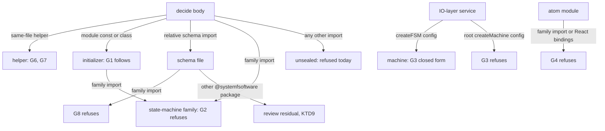
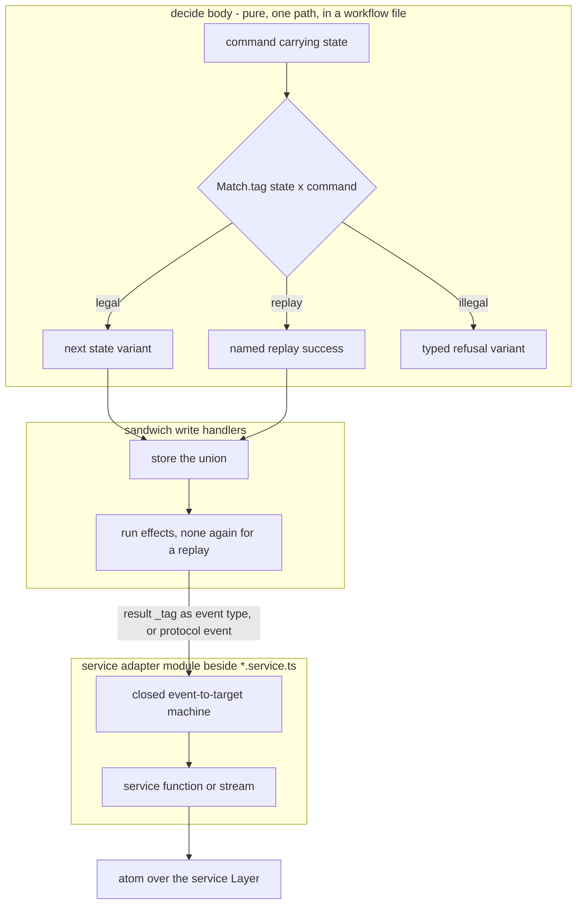
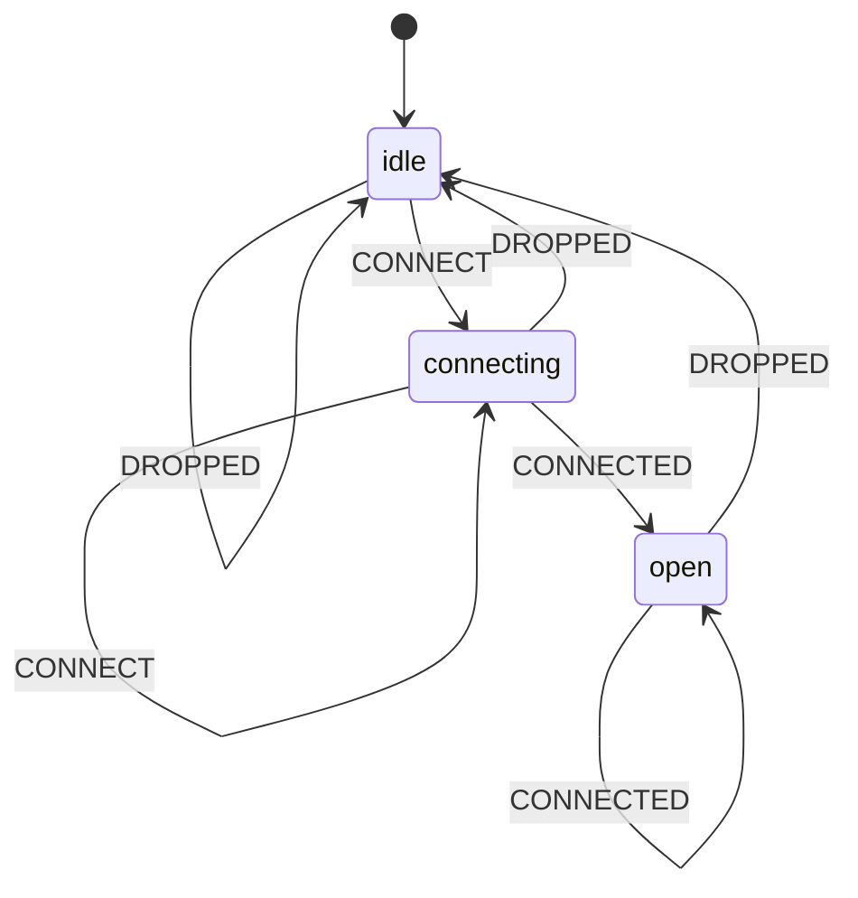

# Business choices stay in decide bodies; state machines live only in IO-layer services - Plan

## Goal Capsule

- **Objective:** every business choice in this repo's code is made in a decide body the gates can see and refuse, except the review-owned residuals I1 names with their reasons, and no state machine makes one.
- **Means:** the ruling R1-R6 and R17, written once in the `cell-architecture` pack (R7); R59 on `packs/ui-state` pointed at it (R8); and lint gates G1-G4 and G6-G8 (R10-R13, R15-R16, R18-R20), each observed red, then green, sharing one family predicate (KTD11). Mutation of decision files stays with the one evaluator M owns (R14, KTD4).
- **Product authority:** the conductor's intent of 2026-10-12, which delegates the placement ruling to this plan, as amended by the root revision intent of the same day. Then `CONSTITUTION.md` (D1, D2, D4, B1, B4, S1, S4, T12, E7), then the verified evidence in Sources.
- **Stop conditions:** no code is written until the conductor and the requester have debated this plan. No gate unit opens without operator approval under GATE1. A unit stops and reports if the fork, Effect, oxlint or tsgolint would have to change, or if migrating a live violation its gate finds needs a schema or variant change outside that layer's packages.
- **Execution profile:** packs first. In every gate layer, live violations are migrated in a commit before the gate's enrollment, and the red cases are committed before the implementation (R20).
- **Finisher:** the implementing agent ships a `gh stack` of pull requests against `main`, plus U2 wherever `components-dispatch-to-runtime-atoms.md` lives when U1 merges, and watches each to green.

---

## Product Contract

### Summary

A lifecycle that a decision advances is a closed tagged union, decided by `Match` over state × command, with a typed refusal for every illegal pair. No state-machine library is reachable from a decide body. Machines live only inside IO-layer services, for protocol and process lifecycles, and map each event to a fixed target; a decision's result reaches a machine as the event type.

The candidate hypothesis is adopted with three amendments:

- Decide-body enforcement fails closed by following what a referenced binding computes, instead of naming exports.
- The requester's I2 ("decide-body rules unchanged") becomes "no decide-body rule is loosened".
- A replay the business accepts is a named success.

### Problem Frame

A business choice can leave the gates through a state machine today. Each of these probes passes `make-body-purity` on `main` (`02bf9653`) with zero diagnostics:

- M1: a module-scope `createMachine` const whose action calls `fetch`, stepped from the body.
- M2: a module-scope `/fsm` machine whose transition function calls `fetch`.
- M3: a business choice written as a transition table (`submitted: { on: { APPROVE: 'approved', REJECT: 'rejected' } }`).
- M4: a business choice written as a ternary inside a transition function.

PR #745's head refuses M1 and M2, but M3 and M4 pass there too.

The cause is general. A module-scope `const` that a decide body references gets the passing `moduleValue` verdict whatever its initializer computes, and so does any module-scope class. Control flow is scanned only in the resolved body, so dispatch in a same-file helper is never judged. A table carries a choice as data, which no gate reads: not stock `complexity`, not `scanControlFlow`, and not `workflow-match-exhaustive`, which fires only on a `Match.value(...).pipe(...)` chain inside the body. A decide body may also call operations from a relative `*.schema.ts` file, and a schema file may import any `@systemfsoftware/*` package, the fork included.

Mutation testing is narrowing to decision files. Once #747 merges, Stryker mutates exactly `src/**/*.workflow.ts`, so a decision is mutation-tested only while its code sits in a workflow file. A machine, a service, or a schema-file operation that carries a choice is never mutated.

The fork turns illegal commands into silent success. At `c8c376cc2`, an event with no entry in the current state's `on` table resolves to an empty transition, and `transition` then returns the input snapshot object itself, with no effects. Upstream documents the same behaviour: "Events without matching transitions are ignored." A declared `{}` stay returns the same object, so identity cannot tell a refusal from a legal stay.

Recognising machines by name is an arms race. Five review rounds on #745 each found at least one new laundering shape:

- `satisfies`/`as` and `<T>` assertions
- a `.provide` chain
- a const-held `setup(...)`
- an aliased runtime export
- a method alias
- an inline config handing over a record handler

A record-held machine, `createFSM.call(null, cfg)` and a non-factory initializer still pass at its head.

Unnamed incidents dated 2026-10-10 show the harm when lifecycle choices sit outside one decision:

- **Incident n:** an agent-run lifecycle was a hand-rolled string union, with transitions spread over a SQL insert, a reassigned local and a raw-SQL startup recovery sweep.
- **Incident o:** a next state was chosen by reading a shared mutable object.
- **Incident p:** database writes and event mirroring were interleaved with transitions.
- **Incident q:** a durable lifecycle had no decider, and recovery rewrote state in raw SQL.
- **Incident r:** a connection lifecycle was held in component state.

### Requirements

**Where a business choice lives**

- R1. A lifecycle that a decision advances is a closed tagged union, one variant per state, each carrying only its own fields, and its current state arrives inside the command. The decide body dispatches over state and command with `Match` and closes every dispatch with `Match.exhaustive`. (pack: cell-architecture, pure-decision-workflows.md; pack: schema-laws, tagged-unions-over-state-by-presence.md)
- R2. Every illegal state × command pair returns a typed refusal, one variant per distinct reason, whose fields name the state and command tags as closed literals. A replay the business accepts is a named success variant. A decide body never returns its input state unchanged as success.
- R3. No state-machine library is reachable from a decide body: not directly, not through a binding the body references, and not through a schema file it imports. The state-machine family is a specifier equal to `xstate` or `@systemfsoftware/xstate`, or starting with `xstate/`, `@xstate/`, `@systemfsoftware/xstate/` or `@systemfsoftware/xstate-`. #745's `/fsm` acceptance does not ship.

**Where a state machine may live**

- R4. A state machine lives only in the adapter module that implements an IO-layer service's Layer, beside its `*.service.ts` and never inside it, for a protocol or process lifecycle such as a connection, a request in flight or a supervised child. It is written in the fork's `/fsm` table form. Its config is closed: each transition maps an event type to a fixed target, and a transition function may only copy event fields into context. Every state names every event type the machine handles, so no event is dropped silently. A decision's result reaches a machine as an event whose type is the result's `_tag`. (pack: cell-architecture, service-and-layer-boundaries.md)
- R5. The service exposes functions or streams of plain values, which atoms read through an atom runtime over the service's Layer. No atom module imports a state-machine-family specifier, no module imports the family's React bindings, and nothing outside the service's adapter module subscribes to an actor.
- R6. A durable lifecycle's source of truth is the stored union value the decision returned. Crash recovery is a command the shell sends to the same decision, never a direct state write and never a Medium's own recovery. (pack: cell-architecture, sandwich-phase-order.md)
- R17. The shell stores that union before running effects, and a replay success runs no irreversible effect a second time. (pack: cell-architecture, store-serializable-unit-of-work.md)

**Packs and docs**

- R7. The ruling is written once in `compound-packs/cell-architecture`. `pure-decision-workflows.md` gains R1-R3, R6 and R17; a new shell-machines rule file carries R4-R5; the `*.schema.ts` row of `service-and-layer-boundaries.md` names the family exception (R19). The pack also adopts the two definitions the retired `lifecycle-machines` draft held, which `packs/ui-state` now keeps only as research handed to this work: what counts as a lifecycle, and when a lifecycle is durable. Each rule cites its incidents as unnamed patterns and ends with a `Gate:` line; R6 and R17 are `review`, because effect ordering across Effect composition is not decidable from syntax or types.
- R8. `packs/ui-state` already removed its `lifecycle-machines` pack and lifecycle clauses and hands the boundary to this work. Its R59 (`components-dispatch-to-runtime-atoms.md` item 4) names `cell-architecture` as the owner of where a shell machine lives and cites no file, because none is on `main`. Once U1 merges, item 4 cites U1's shell-machines file.
- R9. The plugin READMEs, each rule's `meta.docs.description` and the published API reports match the pack text. Every gate unit owns R9 for the rules it changes.

**Gates** (each lands alone and is observed red, then green, per R20)

- R10. G1: a module-scope `const` or class that a decide body references is judged by what its initializer or class body references, with the body's own classifier. Only references inside that initializer or class are judged, and an initializer the classifier cannot resolve is refused. A module-scope `let`/`var` keeps its existing refusal.
- R11. G2: a reference that resolves to a state-machine-family import (R3) reports a dedicated message whose fix names R1 and R4, matched by specifier family, never by export name.
- R12. G3: a machine config given to a state-machine-family factory in any `src` file is refused when it holds any key or transition shape outside R4's closed form, or when the rule cannot resolve it statically. A root machine factory's config is refused outright. A dynamic import of a family specifier in a `src` file is refused, so every factory G3 judges is located by a static import.
- R13. G4: a module that constructs or reads atoms is refused when it imports a state-machine-family specifier, and any module importing the family's React bindings is refused. An atom module is identified by its import edges and calls, not by its file name.
- R14. Every workspace package holding a `src/**/*.workflow.ts` file mutates exactly `src/**/*.workflow.ts`. One evaluator owns this whole property: M's mutation planner (#747), with the inclusion refusal folded into it (KTD4). This plan adds no mutation check and edits no `stryker.config.*`.
- R15. G6: a decide body is refused when a `Match` handler returns success wrapping its matched value unchanged, including through an alias, an assertion or a spread copy.
- R16. G6: a decide body is refused when it reads a member keyed by a `_tag` value, because that is dispatch by table outside `Match`.
- R18. G7: `workflow-match-exhaustive` and G6 judge every same-file function the decide body reaches, not only the body.
- R19. G8: a `*.schema.ts` file imports, dynamically imports and re-exports no state-machine-family specifier.
- R20. Each gate lands in its own red and green commits, observed red on planted cases before its implementation and green after. Every live violation is migrated, in a commit of the same layer, before the gate is enrolled at `error`; there is no allowlist, baseline or escape hatch. Enrollment is proved by `turbo run lint --filter=...<plugin>`, which runs the plugin's own `lint` and every dependent's.

### Acceptance tests (the requester's I1-I6, as revised)

- I1. Every business choice is made in a decide body. _Kept._ Enforced by R10-R13, R15-R16 and R18-R19 with `sandwich-shell-is-straight-line` and the `src` complexity ceiling. Five residuals are review-owned judgements, each named in the pack with its reason:
  - a single branch that the ceiling of 2 admits in service code;
  - a choice carried by a data lookup not keyed by `_tag`;
  - a decide body that hands its state × command dispatch to a schema-file operation, because schema files are where pure projections and evolves over unions live, and a one-file rule cannot tell a projection from a delegated choice (such an operation is also unmutated once #747 merges);
  - a machine-typed value reached through a non-family `@systemfsoftware/*` package a schema file imports (KTD9: no type-aware host can judge it);
  - an event type in a machine's event union that no state's `on` table names, which only the type checker sees.
- I2. **Replaced:** no decide-body rule is loosened, and the only decide-body changes are the G1, G2, G6 and G7 tightenings. _Why:_ "unchanged" would keep the M1-M4 hole that `main` has, contradicting I4.
- I3. A lifecycle is a tagged union, and every illegal pair is a typed refusal, never a silent no-op. _Kept_, with R2's refinements: one refusal variant per reason, and replays as named successes.
- I4. **Replaced:** every state-machine-family binding a decide body can reach is refused by following what it computes and reported by package family, and schema files may not import the family (G8). This covers root and `/fsm`, module-const machines, `satisfies`/`as`, `.provide`, const-held `setup`, method aliases, record-held machines and `.call`. _Why:_ the per-export name table leaked for five rounds, while following references fails closed (CONST-D1, CONST-S1). It is not keyed on resolved types (KTD9).
- I5. Shell machines decide nothing. _Kept_, enforced by G3's closed shape, which refuses every guard, every function transition other than an event copy, and a state that drops an event. Three judgements are review-owned, and the rule text says why:
  - whether a lifecycle is protocol or business, and whether a machine mirrors a business lifecycle, because both turn on meaning;
  - whether the machine sits inside a service Layer and nothing outside that service subscribes to its actor, because placement across files is not a shape a one-file rule reads;
  - whether an event's copied fields carry a business value computed outside a decision, because a copy is syntactically identical whatever its source.
- I6. The packs come first, and the plugin READMEs and rule docs match them. _Kept_ (R7-R9).

### Acceptance Examples

- AE1. **Covers R2, R15.** **Given** an `Approved` order, **when** `Approve` arrives and the business accepts replays, **then** the decision returns the named success `AlreadyApproved`; a handler `Match.tag('Approved', (s) => Result.succeed(s))` is refused by G6.
- AE2. **Covers R10.** **Given** `const lifecycle = createFSM({ ... on: { START: () => { fetch(url); ... } } })` at module scope, **when** a decide body calls `lifecycle.transition(...)`, **then** G2 reports the family import and G1 reports `fetch`. A failing reference elsewhere in the same file and outside that initializer is not reported at the body.
- AE3. **Covers R4, R12.** **Given** a service's `createFSM` config, **when** every state's `on` names every event type with a fixed target, **then** it passes; **when** a transition is a function containing a ternary, a state omits an event type another state handles, or the config is spread from a binding the rule cannot resolve, **then** G3 refuses it.
- AE4. **Covers R14.** **Given** a workspace package holding `src/a.workflow.ts` and no `mutation` script, **then** M's mutation planner refuses it; this plan carries no case for it.
- AE5. **Covers R18.** **Given** a decide body that calls a same-file helper whose `Match.value(state).pipe(...)` ends in `Match.orElse` over a closed union, **then** `workflow-match-exhaustive` reports it as it would inside the body.
- AE6. **Covers R19.** **Given** a `*.schema.ts` file, **when** it holds `import { createFSM } from '@systemfsoftware/xstate/fsm'`, `await import('xstate')` or `export * from '@systemfsoftware/xstate'`, **then** each is refused; an import of another `@systemfsoftware/*` package still passes.

### Key Decisions

- **The fsm-in-decider shape is not kept.** It was the retired `lifecycle-machines` R48 and R52, recorded on `packs/ui-state` as research. R52 detects a refusal by an unchanged snapshot, which merges every illegal pair into one refusal (against CONST-D2) and cannot express a legal stay. R48 refuses `Match`-computed transitions, the one form this ruling sanctions. Governs R1-R3, R8.
- **Machines stay in service adapter modules, in the table form only.** A protocol lifecycle is not a business choice, and an event→target table states one legibly. The root factory's config carries guards, eventless and delayed transitions, invocations and actions, so it is refused rather than allowlisted. Governs R4, R5, R12.
- **Decision results are event types.** A shell machine never needs a guard to tell outcomes apart, so G3 can refuse every guard and every non-copy function. Governs R4, R12.
- **Following references replaces recognition.** The classifier already follows helper functions and record members. Following a referenced const's initializer and a referenced class is the same move for the two remaining binding kinds, so no specifier table or shape recognizer from #745 ships. Governs R10, R11.
- **Schema-file delegation stays review-owned; the machine route through schema files closes.** Over twenty schema files dispatch over unions with `Match` today (e.g. `SupervisorState.schema.ts:102-120`), so refusing dispatch there would refuse the repo's sanctioned projections. G8 closes the one route a machine takes through them. Governs R3, R19.
- **Shell machines are total over their events.** The fork drops an unhandled event silently. Requiring every state to name every event turns each drop into a declared stay, the shell's analogue of `Match.exhaustive`. Governs R4, R12.
- **One mutation evaluator, owned by M.** #747's planner refuses a mutate set wider than the workflow glob; the inclusion half folds into that same planner instead of a second check over the same configs (CONST-S4). Governs R14.
- **Every gate here waits for operator approval.** G1, G2, G6, G7 and G8 tighten published diagnostics; G3 and G4 are new evaluators. GATE1 applies to all seven. Governs R10-R13, R15-R16, R18-R20.

### Scope Boundaries

- The business-versus-protocol judgement, mirror detection, machine placement, copied-field provenance and the five I1 residuals stay review-owned.
- Upstream `xstate` adoption, fork changes and an effect-atom bridge to actors are out of scope.
- The `src` complexity ceiling of 2 is unchanged.
- No `stryker.config.*`, mutation script, planner or mutation workflow change ships in this plan; that surface is M's.
- No caching, affected-task or CI-scope mechanism ships in this plan. Its verification runs through Turbo (KTD10).
- Considered and not built: refusing every `Match` pipeline in `*.schema.ts` that lacks `Match.exhaustive`. Schema files use `Match.orElse` for open predicate and literal dispatch today, so the rule would refuse sanctioned code. A measured count of union-typed `orElse` arms in schema files would change this call.
- Considered and not built: a type-based gate refusing any decide-body reference whose resolved type is a family machine, actor or snapshot (KTD9). An oxlint type channel, a tsgolint custom-rule API, or the first workspace package that depends on the family would change this call.
- Deferred to the conductor's debate: closing KTD9's residual in the relation, by allowing a `@systemfsoftware/*` import in a schema file only when that package's dependency closure excludes the family. It is a new evaluator under GATE1 that would read manifests beside a one-file rule, and it has no instance to catch today; the trigger above reopens it.

### Dependencies / Assumptions

- The fork stays at `c8c376cc2` for the evidence here; G3's allowlist does not depend on it.
- #745 stays open, unchanged, until this plan is accepted.
- `packs/ui-state` carries no lifecycle convention at its head (`7372d509f`), so it may merge before or after U1; U2 lands on whichever branch holds item 4 once U1 merges.
- R14 holds once #747 merges and M lands the inclusion refusal (KTD4). Root coordinates that fold with M; no layer of this stack waits on it, and none edits mutation.

### Sources

- Fork `systemfsoftware/xstate` at `c8c376cc2` (public): `packages/xstate/src/fsm.ts:17-49` (transition forms), `:66-88` (config keys), `:390-397`, `:417-420` (unhandled event → empty transition), `:451-463`, `:475-483` (unchanged snapshot returned as-is); `types.ts:1244-1245` (root machine `version`, `schemas`); `types.ts:2906-2935` (root state-node keys `entry`, `exit`, `after`, `always`, `invoke`).
- Upstream semantics: Stately XState v6 troubleshooting, "Events without matching transitions are ignored" (https://stately.ai/docs/xstate/v6/build/troubleshooting).
- Decider pattern, `decide: Command -> State -> Event list` as a pure total function: https://gist.github.com/thinkbeforecoding/026a1d90ea2f3ea86d151b1229cad932.
- `packages/oxlint-plugin/oxlint-plugin-dmmf-workflow/src/rules/ReferenceClassification.ts:633-692` (`collect` walks the given scope with no span filter; `ClassName` → `moduleValue` at `:655-658`; module const → `moduleValue` at `:681-682`); `make-body-purity.ts:291` (`scanControlFlow` on the body only); `workflow-match-exhaustive.ts:53-117` (boundary span filter; `orElseOnClosedUnion`, `orElseOnOpenDispatch`, `missingExhaustive`).
- `packages/oxlint-plugin/oxlint-plugin-dmmf-workflow/src/index.ts:57-59` (max 1 on `*.workflow.ts`); `packages/oxlint-presets/oxlint-config-dmmf/src/index.ts:79-80` (max 2 on `src`); `oxlint-plugin-cell-architecture/src/rules/sandwich-shell-is-straight-line.ts:190-195` (Sandwich read/write phases only).
- `packages/oxlint-plugin/oxlint-plugin-effect-schema/src/rules/schema-file-imports-pure-modules-only.config.ts:38-42` (any `@systemfsoftware/` source is allowed in a schema file); `schema-file-imports-pure-modules-only.ts:75-110` (static, dynamic and re-export forms share one source predicate).
- PR #747 (`ci/mutate-workflow-only`): plan `docs/plans/2026-10-12-1517-refactor-workflow-only-mutation-planner-plan.md` R3 (a mutation script only where a workflow file exists), R6 (refusals judge only packages with a mutation script) and KTD8 (packages with no workflow file leave mutation); `scripts/tools/mutation-plan.ts:60` (the `Refusal` union: `mutation-script`, `no-workflow-file`, `config-unloadable`, `own-mutate-targets`, `non-workflow-target`, `test-file-target`; none refuses a workflow file in a package with no mutation script).
- Type-aware hosts: oxlint JS plugins expose no parser services (upstream `oxc-project/oxc`, not vendored here, `apps/oxlint/src-js/plugins/source_code.ts`, `parserServices: Object.freeze({})`; https://oxc.rs/docs/guide/usage/linter/js-plugins.html, "Not supported yet: … type-awareness"); tsgolint runs only its built-in `typescript/*` rules and is "not currently accepting PRs for new rules beyond what `typescript-eslint` supports" (https://github.com/oxc-project/tsgolint); `effect-tsgo patch --oxlint` patches the oxlint binary over a forked tsgolint runner (`_patches/oxlint/001-effect-plugin.patch`, https://github.com/Effect-TS/tsgo); the repo's TypeScript 7 exposes no JS compiler API (`docs/plans/2026-08-05-001-fully-on-typescript-7-plan.md:33`, `:82`; `node_modules/.bin/tsc --version` is 7.0.2); the planned in-tree type guard (`docs/plans/2026-08-27-001-feat-wire-declaration-boundary-plan.md` KTD1) never landed (no commit in any ref touches `scripts/guards/check-wire-boundary.ts`), and `scripts/guards/` was deleted in #687; the fork's machine, actor and snapshot types carry no nominal brand (`graph/types.ts:174` brands serialized strings only).
- Turbo task graph (`turbo query`, turbo 2.11.5): each of the three plugins this plan edits has 34 dependents, and every consumer's `lint` depends on all five plugins' `build` (e.g. `@systemfsoftware/effect-readiness#lint`); `turbo.json:116-139` (`lint` depends on `^build`); `turbo run lint --filter=...@systemfsoftware/oxlint-plugin-dmmf-workflow --dry=json` plans 35 `lint` tasks, the plugin and its 34 dependents.
- Release intents: `.changeset/README.md:16-20` (the Changeset Check workflow runs `changeset-management check` against the PR's base and blocks a changed build hash with no intent); `.github/workflows/changeset-check.yml:18-32` (the `packed-manifest` job).
- G7 sites, 18: `effect-readiness/src/evaluate-probe.workflow.ts:25`, `:31`, `:37`; `effect-microsandbox/src/render-sandbox-plan.workflow.ts:42`; `daemon/effect-daemon-spec/src/kernel/interpret-supervision-event.workflow.ts:258`, `:333`, `:428`, `:434`, `:634`, `:695`, `:734`, `:801`, `:814`, `:865`, `:1043`, `:1049`, `:1107`, `:1118`.
- Mutation coverage on `main`: the 14 packages holding `*.workflow.ts` each mutate `src/**/*.workflow.ts` and `src/**/*.schema.ts` (e.g. `packages/atom/effect-atom/stryker.config.ts:23-30`); #747 narrows that to the workflow glob.
- `packs/ui-state` at `7372d509f`: plan `docs/plans/2026-10-12-1729-feat-ui-state-pack-plan.md` `:88` (the 16:20 scope ruling removed `lifecycle-machines` and R41-R56 and assigned the lifecycle boundary to this work), `:213` (R59), `:259` (R59 cites no file until this work is on `main`), and its "Lifecycle research handed to unit X" section: lifecycle definition `:804-810`, R48 `:878`, R51 durability test `:891`, R52 `:892`, incidents n-r; `compound-packs/ui-state/components-dispatch-to-runtime-atoms.md:14` (item 4).
- `docs/solutions/architecture-patterns/a-prohibition-must-close-transitively.md`, `label-routed-rules-are-unfalsifiable.md`, `dynamic-import-blinds-static-provenance-rules.md`, `constraint-reaches-only-via-window-or-gate.md`, `docs/solutions/tooling-decisions/rule-admission-severity-and-accretion.md`.
- `repos/constitution/ENFORCEMENT.md` § Changing an instrument and § Enrollment.
- PR #745 review rounds 1-5, whose findings are recorded in that PR's body.

---

## Planning Contract

**Product Contract preservation:** changed by the root revision intent and the round-2 review.

- R14 moves to M's evaluator and loses its gate; the `workflow-mutation` lane and U6 are withdrawn.
- R3 narrows its family boundary to separator-delimited prefixes.
- R4 adopts the table form and decision results as event types.
- R7 adopts the lifecycle and durability definitions and the schema-row exception; R8 shrinks to citing U1 from R59, because `packs/ui-state` already retired its lifecycle content.
- R9 is owned by every gate unit; R12 refuses root factory configs and family dynamic imports; R20 names Turbo's dependents filter for enrollment proof.
- I1 gains two residuals and I5 gains two judgements.
- No requirement was weakened except R14's ownership, which moved, not dropped.

### Key Technical Decisions

- KTD1. **G1 adds a branch to the `FunctionName`/`Variable` arm of `classifyFunctionReferences`, plus a `ClassName` follow.** A module-scope `const` whose initializer is not a function or a record (both already followed), and a module-scope class, are classified with the shared `visited` set, which stops cycles. `collect` gains a span filter so only references inside the followed node are judged. It reuses `isWithinBody` from `@systemfsoftware/oxlint-make-boundary`, which the plugin already depends on. An initializer whose references resolve to nothing keeps the failing `unresolvable` verdict. Governs R10.
- KTD2. **G2 adds one verdict kind, `stateMachineImport`, reported under message id `stateMachineImportReference`.** `classifyImportBinding` reports it for a family specifier (R3) before the generic unsealed arm. `FAILING_KIND` is keyed by the verdict union, so the compiler forces the new kind to be classified. The message states the specifier-family match only, which is all a depth-0 check decides. Governs R11.
- KTD3. **G3 and G4 are new rules in `oxlint-plugin-cell-architecture`**, the plugin that owns the shell law, so the judged code cannot weaken them. They resolve factories and atom calls through that plugin's own `module-origin.ts`, because plugins neither vendor nor depend on each other; its seed is top-level imports and the aliases they flow through (`module-origin.ts:14-16`), so it gains a call-result pass that resolves `const x = setup(...)` and `const { createFSM } = setup(...)`. That file is shared with the plugin's existing rules, which keep their verdicts. They enter its `recommended` map at `error`. G3 follows `collectSandwichCells`' shape, locating the factory call by import origin and then judging its config argument:
  - **Located factories:** `createFSM` from the `/fsm` entry, and `setup(...)`'s `createFSM`, whether chained, destructured or const-held. A family dynamic import is refused at the `import()` (R12), so no factory escapes location.
  - **Allowlist:** `id`, `initial`, `context`, `states`, `on`, `target`, and the event-copy function, whose body is one object literal of `target` and a `context` patch of `event.<field>` reads.
  - **Root factories:** a `createMachine` or `setup(...).createMachine` config from the family is refused at the call, with a fix naming `createFSM`.
  - Governs R12, R13.
- KTD4. **The mutation-inclusion half of R14 folds into M's planner.** #747's `admitMutation` judges only packages that carry a mutation script (its R6), so a package holding a workflow file with no mutation script escapes it. The fold adds one refusal reason, a workflow file in a package with no `mutation` script, to `scripts/tools/mutation-plan.ts`'s `Refusal` union, with its planted fixture in M's test. M owns the change. Root coordinates it after #747 merges, and this plan's stack neither contains nor waits on it. Governs R14.
- KTD5. **G6 is a new rule, `workflow-decides-through-match`, in `oxlint-plugin-dmmf-workflow`.** It reuses the make-boundary kernel and `workflow-match-exhaustive`'s arm recognition, and resolves `Result.succeed` and `Match` by import origin rather than spelling. The unchanged-success test compares the success argument with the handler parameter through `const` aliases, `as`/`satisfies`/`<T>` wrappers and a spread copy. Governs R15, R16.
- KTD6. **G7 exposes the set of same-file functions the classifier already follows.** `workflow-match-exhaustive` and G6 iterate that set instead of the body alone, so one walk defines "the decision" for every rule. Governs R18.
- KTD7. **G8 carves the family out of `isAllowedImportSource`.** Static, dynamic and re-export forms share that predicate, so one change closes all three. Governs R19.
- KTD8. **Each gate layer migrates before it enrolls.** It runs the tightened rule over every consumer, and migrates any live violation in a preceding commit of the same layer. Each publishable package whose Turbo build hash moves gets an intent authored with `pnpm change --bump <none|patch|minor|major>`, proved on the layer's pull request by the Changeset Check workflow, and plugin units regenerate `etc/*.api.md` with `api:update`. G7's layer carries the 18 known sites (U11). Governs R9, R20.
- KTD9. **The family gate keys on specifiers and provenance, not resolved types.** A type-based gate needs a host that can resolve a reference's type, and none in this toolchain can take a repo-authored rule:
  - oxlint JS plugins get no parser services.
  - tsgolint runs only its built-in rules and accepts no new ones.
  - `effect-tsgo` is a binary patch over a forked runner.
  - The `repo-checks` lane spawns the TypeScript 7 CLI only to list a project's files (`scripts/tools/repo-checks/project-membership.ts:94`, `:121`); a CLI answers no type query.
  - TypeScript 7 has no JS compiler API; the only routes are the `typescript@6` bridge, TypeScript 7's unstable LSP API, or the vendored Go lint host in `repos/ttsc`. Each is a new toolchain for one rule, needing its own REPO-W8 record.
  - The mechanical claim is therefore narrowed: a decide body reaches code only through parameters, module bindings (G1), sealed effect imports, and relative schema files. Every other import is already refused as unsealed, G2 refuses family imports, and G8 refuses them in schema files.
  - What remains is a machine-typed value exported by a non-family `@systemfsoftware/*` package and imported by a schema file. It is review-owned (I1), and has no live instance today, because no workspace package depends on the family.
  - Governs R3, R11, R19.
- KTD10. **Verification runs through Turbo.** Per-package suites run as `turbo run test --filter=<package>`. The clean-tree check before enrollment is `turbo run lint --filter=...<plugin>`: every consumer's `lint` depends on each plugin's `build`, and the dependents filter plans the plugin's 34 dependents whatever the branch's SCM base. No custom hash cache, change classifier, affected script or cache gate is added. Governs R20.
- KTD11. **The family boundary is one predicate in `@systemfsoftware/oxlint-import-origin`.** It sits beside `isRelativeSchemaSpecifier` in `PuritySources.ts`; all three plugins already depend on that package, so G2, G3, G4 and G8 call the same function instead of three copies of R3's list. It lands in U3, the first gate layer, with an intent for the package. Governs R3, R11-R13, R19.

### High-Level Technical Design

Where each edge out of a decision is closed:

The lifecycle as a decision, then the shell:

A shell machine in R4's closed form, where every state names every event:

### Assumptions

- The intent's "add an entry for shell machines" sanctions shell machines; no consumer in this repo uses one yet.
- Upstream `xstate` and `@xstate/*` are refused by specifier, defensively, though only the fork is in reach today.
- G2 and G8 find no live violation, because no package imports the family. G1 and G6 find few or none, and R20's whole-tree run before enrollment measures that. G7 finds the 18 sites in Sources, all in workflow-file helpers.

### Sequencing

The stack runs bottom to top, each layer releasable on its own:

1. U1 packs.
2. U3 (G1, G2), then U8 (G6), then U11 with U9 (the G7 migration, then G7), in `oxlint-plugin-dmmf-workflow` and the three migrated packages.
3. U10 (G8) in `oxlint-plugin-effect-schema`.
4. U4 (G3), then U5 (G4), in `oxlint-plugin-cell-architecture`.

Outside this stack:

- U2 lands after U1 merges, on `packs/ui-state` if it is still open, otherwise as a layer on `main`.
- U7 runs once this plan is accepted.
- #747 merges on its own (M's stack). M's inclusion refusal (KTD4) then lands as a layer on top of #747, and R14 holds from that point.

### Destructive review (Scope Challenge lens, cycle 3)

- **Assumptions broken:**
  1. Every evaluator this plan names is its own.
  2. A gate keyed on types is buildable here.
  3. One rule reading one file can close every route out of a decision.
- **Challenge:**
  - Mutation inclusion has an owner already: #747's planner reads the same configs. A second lane would put two evaluators over one property, so it was withdrawn.
  - No host in the toolchain can take a repo-authored type-aware rule.
- **Delta:**
  - R14 moved to M (KTD4), and KTD9 narrowed the family claim to provenance plus specifiers, with a named residual.
  - Assumption 3 still fails for schema-file delegation and for the residual KTD9 names, so both stay review-owned with reasons.

---

## Implementation Units

### U1. cell-architecture pack

- **Goal:** the ruling written once.
- **Requirements:** R1-R7, R17; I6.
- **Dependencies:** none.
- **Files:** `compound-packs/cell-architecture/pure-decision-workflows.md` (amend), `compound-packs/cell-architecture/shell-machines-follow-events.md` (new), `compound-packs/cell-architecture/service-and-layer-boundaries.md` (the `*.schema.ts` row at `:26` gains the family exception, pointing at R3 and R19), `compound-packs/cell-architecture/README.md` (index bullet).
- **Approach:**
  1. Amend `pure-decision-workflows.md` with R1-R3, R6 and R17. Add a WRONG block stepping an `/fsm` table in a decide body, and a RIGHT block of the `Match` state × command form with refusal and replay variants.
  2. Carry over the lifecycle definition, with its four exclusions and the supervisor-child clause, and the durability test (persisted, waiting on a human, a provider callback or a redirect, or spanning a deploy). The decision form of R1 replaces the draft's machine requirement.
  3. In the same file, name incidents n, o, p and q, and the five I1 residuals with their reasons.
  4. Write `shell-machines-follow-events.md` with R4-R5:
     - a WRONG guard reading a shared object (incident o);
     - a RIGHT total `createFSM` table inside a service Layer, the same table as the High-Level Technical Design diagram, with decision results as event types;
     - an atom over the service function;
     - incident r, and the two fork behaviours an adopting repo's dependency pin must cover (an unhandled event returns the input snapshot; a declared stay returns the same object) (pack: boundary-testing, pin-dependency-semantics.md).
  5. End each file with its `Gate:` line:
     - decision file: the rule ids of G1, G2 and G6-G8, plus `type-checker` and `review`;
     - shell file: G3, G4 and `review`, with I5's three judgements and their reasons.
- **Patterns to follow:** frontmatter and WRONG/RIGHT shape of `resource-vs-handle-duality.md`; bare rule ids in `Gate:` lines.
- **Test expectation:** none -- doctrine prose, owned by review.
- **Verification:** `pnpm check:local` exits 0; the privacy grep over the diff finds no private repo, product, path or PR name.

### U2. R59 cites the shell-machines file

- **Goal:** the ui-state pack points at the one place shell machines are ruled.
- **Requirements:** R8.
- **Dependencies:** U1 merged to `main`.
- **Files:** `compound-packs/ui-state/components-dispatch-to-runtime-atoms.md` (item 4 and its `Gate:` line), on `packs/ui-state` while it is open, otherwise on `main`; if on the branch, its plan `docs/plans/2026-10-12-1729-feat-ui-state-pack-plan.md` `:259` drops "cites no file".
- **Approach:** merge `origin/main` into the branch first (no force-push), then one commit naming `compound-packs/cell-architecture/shell-machines-follow-events.md` in item 4. The branch still adds exactly one plan.
- **Test expectation:** none -- doctrine prose.
- **Verification:** `pnpm check:local` on that branch exits 0, including `single-plan`; item 4 names U1's file.

### U3. G1 and G2 in make-body-purity

- **Goal:** a decide body can reach no family binding and no impure initializer.
- **Requirements:** R3, R9, R10, R11, R20; AE2.
- **Dependencies:** U1; GATE1 approval.
- **Files:** `packages/oxlint-plugin/import-origin/src/PuritySources.ts` (the family predicate, KTD11), `packages/oxlint-plugin/oxlint-plugin-dmmf-workflow/src/rules/ReferenceClassification.ts`, `make-body-purity.config.ts`, `src/rules/__tests__/make-body-purity.test.ts`, `README.md`, `etc/oxlint-plugin-dmmf-workflow.api.md`, a `.changeset/` intent for each re-hashed package.
- **Approach:** KTD1, KTD2, KTD11. Re-derive, without cherry-picking, the two generic pieces from #745: the `TSSatisfiesExpression`/`TSTypeAssertion` type regions, and test-side literal message oracles.
- **Execution note:** G1 and G2 land as separate pairs: G1's invalid cases, then G1's implementation, then G2's invalid cases, then the predicate and G2's implementation. Each red commit is observed failing against the rule below it.
- **Test scenarios:**
  - Covers AE2. M1 (root `createMachine` const whose action calls `fetch`) reports `stateMachineImportReference` and `ioGlobalReference`.
  - M2 (`/fsm` const whose transition calls `fetch`) reports both.
  - Each of these reports `stateMachineImportReference`:
    - a record-held machine;
    - `createFSM.call(null, cfg)`;
    - a helper-returned machine;
    - `const step = lifecycle.transition`;
    - `lifecycle as Machine` and `satisfies`.
  - `const data = readFileSync(path)` at module scope, referenced from the body, reports the I/O import.
  - A module-scope class whose static method calls `fetch`, referenced from the body, reports `fetch`.
  - A failing reference elsewhere in the file, outside the referenced initializer, is not reported at the body.
  - Every family specifier reports `stateMachineImportReference`: `xstate`, `xstate/actors`, `@xstate/react`, `@systemfsoftware/xstate`, `@systemfsoftware/xstate/fsm`, `@systemfsoftware/xstate-effect`, `@systemfsoftware/xstate-test` and `@systemfsoftware/xstate-store-react`. `@systemfsoftware/xstated-thing` does not.
  - Guards (valid on both commits):
    - a const built from the sealed effect surface;
    - a const built from a relative schema import;
    - a local helper-built pure record;
    - a schema class.
- **Verification:** `turbo run test --filter=@systemfsoftware/oxlint-plugin-dmmf-workflow` fails on each red commit and passes on each green; `turbo run lint --filter=...@systemfsoftware/oxlint-plugin-dmmf-workflow` is clean before enrollment.

### U4. G3 shell-machine-follows-events

- **Goal:** a shell machine decides nothing.
- **Requirements:** R4, R9, R12, R20; AE3; I5.
- **Dependencies:** U3 (the family predicate); GATE1 approval.
- **Files:** `packages/oxlint-plugin/oxlint-plugin-cell-architecture/src/rules/shell-machine-follows-events.ts`, `shell-machine-follows-events.config.ts`, `src/rules/module-origin.ts` (call-result pass), `src/rules/__tests__/shell-machine-follows-events.test.ts`, `src/index.ts`, `README.md`, `etc/oxlint-plugin-cell-architecture.api.md`, a `.changeset/` intent.
- **Approach:** KTD3, KTD11. Configs are resolved through `const` bindings and object spreads; anything else fails closed.
- **Execution note:** the red commit registers the rule with an empty visitor outside `recommended`, so every invalid case fails on its missing report and every valid case passes; the green commit implements and enrolls it.
- **Test scenarios:**
  - Covers AE3. A flat `createFSM` config whose states each name every event with a string target passes.
  - Covers AE3. A function transition containing a ternary is refused.
  - Covers AE3. A state that omits an event type another state handles is refused.
  - Covers AE3. A config spread from an import or a parameter is refused as unresolvable; one spread from a module `const` literal is judged.
  - An event-copy transition (`({ event }) => ({ target: 'open', context: { id: event.id } })`) passes.
  - `setup({ ... }).createFSM(config)`, `const { createFSM } = setup()` and a const-held `setup(...)` result are judged like a direct `createFSM`.
  - A family `createMachine` or `setup(...).createMachine` call is refused at the call.
  - A non-family `createFSM` from another package is not judged.
  - `const mod = await import('@systemfsoftware/xstate/fsm')` at module scope, and the same import inside a function, are each refused at the `import()`.
  - The plugin's existing rule suites stay green across the `module-origin.ts` call-result pass.
- **Verification:** `turbo run test --filter=@systemfsoftware/oxlint-plugin-cell-architecture` red then green; `turbo run lint --filter=...@systemfsoftware/oxlint-plugin-cell-architecture` reports a planted violation in a consumer package and is clean on the real tree.

### U5. G4 atoms-read-services

- **Goal:** atoms never touch an actor.
- **Requirements:** R5, R9, R13, R20.
- **Dependencies:** U4 (shared plugin layer); GATE1 approval.
- **Files:** `packages/oxlint-plugin/oxlint-plugin-cell-architecture/src/rules/atoms-read-services.ts`, `atoms-read-services.config.ts`, `src/rules/__tests__/atoms-read-services.test.ts`, `src/index.ts`, `README.md`, `etc/oxlint-plugin-cell-architecture.api.md`, a `.changeset/` intent.
- **Approach:** KTD3. A module is an atom module when it imports from `@systemfsoftware/effect-atom` or `@systemfsoftware/effect-atom-react` and calls one of their constructors or hooks.
- **Execution note:** red with an empty-visitor registration, as in U4.
- **Test scenarios:**
  - An atom module importing `@systemfsoftware/xstate` statically, by `import()`, or by re-export is refused.
  - An atom module importing `@systemfsoftware/xstate-effect` is refused.
  - Any module importing `@systemfsoftware/xstate-react` or `@xstate/react` is refused.
  - An atom module reading a service function through a runtime atom passes.
  - A service module that imports the fork and constructs no atom passes.
- **Verification:** `turbo run test --filter=@systemfsoftware/oxlint-plugin-cell-architecture` red then green; consumer carriage observed with `turbo run lint --filter=...@systemfsoftware/oxlint-plugin-cell-architecture`, as in U4.

### U7. #745 disposition

- **Goal:** the withdrawn design leaves no trace.
- **Requirements:** R3.
- **Dependencies:** this plan accepted.
- **Approach:** close #745 unmerged with a comment linking this plan. Push nothing more to its branch; its two local commits and the stash are never pushed.
- **Test expectation:** none -- repository housekeeping.
- **Verification:** #745 closed; its remote head unchanged at `242949baf`.

### U8. G6 workflow-decides-through-match

- **Goal:** a decide body has no silent stay and no table dispatch.
- **Requirements:** R2, R9, R15, R16, R20; AE1.
- **Dependencies:** U3; GATE1 approval.
- **Files:** `packages/oxlint-plugin/oxlint-plugin-dmmf-workflow/src/rules/workflow-decides-through-match.ts`, `workflow-decides-through-match.config.ts`, `src/rules/__tests__/workflow-decides-through-match.test.ts`, `src/index.ts`, `README.md`, `etc/oxlint-plugin-dmmf-workflow.api.md`, a `.changeset/` intent.
- **Approach:** KTD5.
- **Test scenarios:**
  - Covers AE1. `Match.tag('Approved', (s) => Result.succeed(s))` is refused.
  - The same through `const same = s`, `s as Order`, `s satisfies Order` and `{ ...s }` is refused.
  - A handler returning `AlreadyApproved.make({})` or a new state variant passes.
  - `table[state._tag]` and `handlers[command._tag](command)` in a decide body are refused.
  - An aliased import (`import * as M from 'effect/Match'`, `import { succeed as ok } from 'effect/Result'`) still reports.
  - Code outside any decide body is not judged.
- **Verification:** suite red then green under `turbo run test --filter=@systemfsoftware/oxlint-plugin-dmmf-workflow`; `turbo run lint --filter=...@systemfsoftware/oxlint-plugin-dmmf-workflow` clean before enrollment.

### U11. G7 migration of the 18 helper dispatches

- **Goal:** the tree satisfies G7 before G7 exists, with no allowlist, baseline or escape hatch.
- **Requirements:** R1, R18, R20.
- **Dependencies:** U8 (same layer as U9, landing before it).
- **Files:** `packages/effect-readiness/src/evaluate-probe.workflow.ts`, `packages/effect-microsandbox/src/render-sandbox-plan.workflow.ts`, `packages/daemon/effect-daemon-spec/src/kernel/interpret-supervision-event.workflow.ts`, each package's existing tests, and one `.changeset/` intent per package whose build hash moves.
- **Approach:** each site ends its pipe in `Match.exhaustive`, keeping today's results. All sites are in Sources:
  1. Closed tagged unions (`evaluate-probe` `:25`, `:31`, `:37`; `interpret-supervision-event` `:333`, `:1043`, `:1049`): narrow the helper's parameter to the variants it receives, or add the missing `Match.tag` arms, each returning today's fallback value.
  2. Closed literal unions and booleans (`render-sandbox-plan` `:42`; `interpret-supervision-event` `:258`, `:428`, `:434`, `:634`, `:695`, `:734`, `:801`, `:814`, `:865`, `:1118`): enumerate every literal, or `true`/`false` for a derived boolean, with `Match.when`.
  3. The empty-string child-id sentinel at `interpret-supervision-event` `:1107`: dispatch on the timer target's existing tagged variant instead of the sentinel string.
- **Execution note:** behaviour-preserving; each package's suite stays green on the migration commit, and it lands before U9's red commit.
- **Test expectation:** none new -- existing workflow suites prove the behaviour is unchanged, and U9's enrollment proves the shape.
- **Verification:** `turbo run test --filter=...[origin/main]` green on the migration commit; U9's tightened rule reports zero sites on it.

### U9. G7 helpers judged as the body

- **Goal:** a decision cannot hide its dispatch in a same-file helper.
- **Requirements:** R9, R18, R20; AE5.
- **Dependencies:** U11; GATE1 approval.
- **Files:** `packages/oxlint-plugin/oxlint-plugin-dmmf-workflow/src/rules/ReferenceClassification.ts`, `workflow-match-exhaustive.ts`, `workflow-decides-through-match.ts`, their tests, `README.md`, a `.changeset/` intent.
- **Approach:** KTD6.
- **Test scenarios:**
  - Covers AE5. A helper's `Match.value(state).pipe(..., Match.orElse(...))` over a closed union is reported.
  - A helper returning its matched value unchanged as success is reported by G6.
  - A helper the body never calls is not judged.
  - A helper reached through two calls is judged once, with no duplicate report.
- **Verification:** suite red then green; `turbo run lint --filter=...@systemfsoftware/oxlint-plugin-dmmf-workflow` clean on the layer head, including the three migrated packages.

### U10. G8 schema files import no machine

- **Goal:** the schema-file edge out of a decision carries no machine.
- **Requirements:** R3, R9, R19, R20; AE6.
- **Dependencies:** U3 (the family predicate); GATE1 approval.
- **Files:** `packages/oxlint-plugin/oxlint-plugin-effect-schema/src/rules/schema-file-imports-pure-modules-only.config.ts`, `src/rules/__tests__/schema-file-imports-pure-modules-only.test.ts`, `README.md`, a `.changeset/` intent.
- **Approach:** KTD7, KTD11, with the expected-text naming the family exclusion.
- **Test scenarios:**
  - Covers AE6. A static value import of `@systemfsoftware/xstate/fsm` is refused.
  - `await import('xstate')` outside the vitest guard is refused.
  - `export * from '@systemfsoftware/xstate'` and `export { createFSM } from '@xstate/fsm'` are refused.
  - A type-only import of a family specifier passes.
  - A value import of `@systemfsoftware/effect-cell-types` passes.
- **Verification:** suite red then green; `turbo run lint --filter=...@systemfsoftware/oxlint-plugin-effect-schema` clean before enrollment.

---

## Verification Contract

Every admitted test is a RuleTester case. It observes a published rule's verdict on real source text (CONST-T8), and its expected messages are literals in the test, never constants imported from the implementation (CONST-T10). Pack prose has no tests; it is owned by review. There are no property tests, because the rules are syntax classifiers with no generated-input law to state. No local mutation runs (REPO-D3). Every task runs through Turbo and its cache (KTD10).

| Gate                         | Command                                                                                                    | Proves                                                                      |
| ---------------------------- | ---------------------------------------------------------------------------------------------------------- | --------------------------------------------------------------------------- |
| Whole tree                   | `pnpm check:local`                                                                                         | format, conventions, plan count, lint, typecheck, tests                     |
| dmmf-workflow rules          | `turbo run test --filter=@systemfsoftware/oxlint-plugin-dmmf-workflow` on each red, then each green commit | U3, U8, U9 cases move exactly once                                          |
| cell-architecture rules      | `turbo run test --filter=@systemfsoftware/oxlint-plugin-cell-architecture`                                 | U4, U5 red then green                                                       |
| effect-schema rule           | `turbo run test --filter=@systemfsoftware/oxlint-plugin-effect-schema`                                     | U10 red then green                                                          |
| Migration                    | `turbo run test --filter=...[origin/main]`                                                                 | U11 preserves behaviour in the three packages                               |
| Clean tree before enrollment | `turbo run lint --filter=...<plugin>`                                                                      | the plugin and its 34 dependents re-linted against the tightened rule (R20) |
| Intents                      | Changeset Check workflow on each layer PR (`changeset-management check`, `packed-manifest`)                | every re-hashed publishable package carries an intent                       |
| CI                           | `xd://github` `run_watch` per layer head                                                                   | green on the exact head                                                     |

## Definition of Done

- U1 merged before any gate layer opens; U2 landed after U1, on whichever branch holds item 4.
- Every gate carries a recorded operator approval under GATE1 before its layer opens.
- For every gate, its red commit fails and its green commit passes, and both SHAs are in its pull request body.
- U11's migration commit precedes U9's red commit in the same layer.
- `pnpm check:local` exits 0 on every layer head, and CI is green on each exact head.
- #745 is closed with a link to this plan, and nothing further was pushed to its branch.
- Item 4 of `components-dispatch-to-runtime-atoms.md` names U1's shell-machines file; nothing in the repo names a private repo, product, path or PR.
- Each changed rule's README text and `meta.docs.description` were read against the U1 pack text before its layer was called done (R9).
- No abandoned-attempt code, scratch probe or unused helper remains in any layer's diff.
