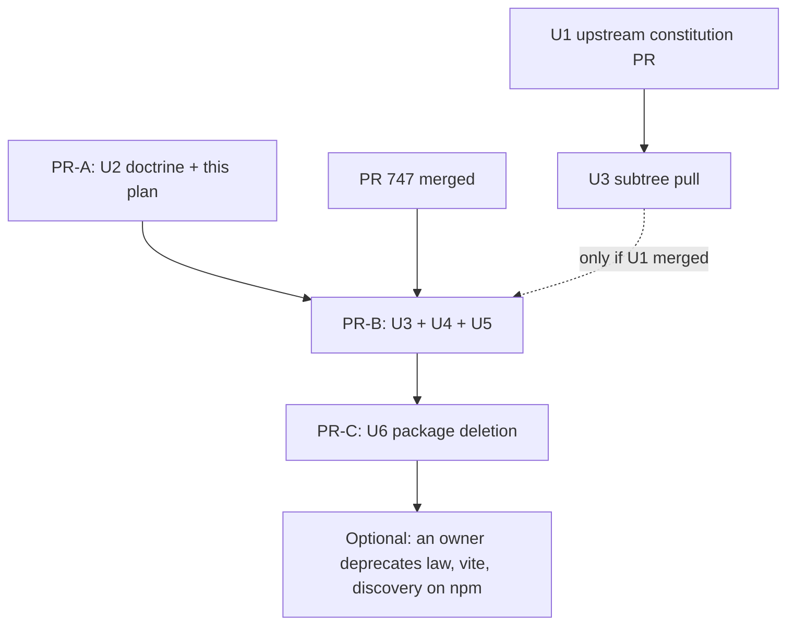

# Retire Generated Schema Laws - Plan

## Goal Capsule

- **Objective:** The systemfsoftware house standard no longer generates, requires, or keeps any test whose subject is serialization, while schemas keep enforcing their domain invariants and behaviour stays proven through deciders, workflows, and public surfaces.
- **Means:** U1, a PR on `systemfsoftware/constitution`, opened beside the first systemfsoftware PR. Then three systemfsoftware PRs, each off `main` after the one before it merges, with at most two SL PRs open at once. PR-A is U2 (doctrine) and this plan. PR-B is U3, U4, and U5, opened once #747 has merged; U3 rides along only if U1 has merged upstream by then, and otherwise follows as its own PR. PR-C is U6, package deletion (KTD1).
- **Product authority:** Ryan's outcome as relayed by the root conductor (Unit SL); the root's go of 2026-10-13, which binds sequencing and constraints; the rulings under Key Decisions; then `CONSTITUTION.md` and root `AGENTS.md`. Consumer template work (#736), `Pct.schema.ts` refusal properties (#744), the mutation-scope cleanup (#747), the other pack files (#748), and the changeset work (#752, #755, #757) are not active scope; this plan only records how it overlaps them.
- **Execution profile:** Doctrine, lint, and package-removal work across one upstream repo and the systemfsoftware workspace; no runtime behaviour of any published package changes.
- **Stop conditions:** Stop and return to the root before PR-B while #747 is open, before any registry action, and whenever evidence contradicts a Key Decision.
- **Who finishes:** The SL session implements, verifies, reviews, and opens each PR; the root conductor owns the merge verdict and the merges; registry deprecation is an optional action for a package owner.
- **Open blockers:** PR-B waits on #747; U3 waits on U1's upstream merge.

---

## Product Contract

### Summary

Retire the generated schema-law system doctrine-first: an upstream constitution change and a small doctrine/pack layer stop requiring generated laws, then the in-repo law files and plugin registrations go, then the three packages whose only job was generating laws leave the workspace.
Schema-level refusal properties stay legal where they prove a real domain boundary, and nothing is backfilled.

### Problem Frame

Every exported schema in 12 packages carries a generated `src/schema-laws.test.ts` whose round-trip and encode-stability laws draw inputs from the schema's own arbitrary, so they test the generator against itself.
The house measured this: hex-schema's laws stayed green while every `S.pattern` mutant survived (`docs/solutions/design-patterns/generated-schema-laws-are-tautological.md:35-37`).
The recursion laws add generator-shape properties such as `∀x_<label>Nesting_≤MaxDepth1` (`packages/schema/effect-schema-law/src/recursion-laws.ts:326`); the product repo's `∀x_JsonSchemaViewNesting_≤MaxDepth1` is the instance that exposed them as mockery rather than domain properties.

The requirement is load-bearing in several places at once: `AGENTS.md:27` mandates the plugin for production code, `CONCEPTS.md:139-146` defines "Generated Schema Law", the schema-laws pack is enrolled at `.compound-engineering/config.yaml:4` and states the laws as its verification story (`compound-packs/schema-laws/README.md:3,15-17`), test-placement lint whitelists the generated filename (`packages/oxlint-plugin/oxlint-plugin-test-discipline/src/rules/path.config.ts:20-24`), and the shared constitution's T10 check asks for a refusal "beside generated round-trip laws" at every refinement (`repos/constitution/ENFORCEMENT.md:213-214`).
The product repo has already declared a departure from the pack, so the house standard and its main consumer now disagree.

No open PR retires any of this, and nothing upstream needs adopting to replace it: vendored Effect v4 already ships `TestSchema.verifyRoundTrip` for anyone who wants a round-trip check (`repos/effect/packages/effect/src/testing/TestSchema.ts:271-319`), and `it.prop` takes a schema directly as its generator (`repos/effect/packages/vitest/src/internal/internal.ts:78-92`).

### Key Decisions

- **Delete the law packages; never leave deprecated published residue.** (session-settled: user-directed — chosen over keeping the packages published and marked deprecated: DEL1 bans repo-side residue, and Effect's own `TestSchema` already covers round-trip checking.) Governs R11, R12, R14.
- **Doctrine lands first and stays small.** (session-settled: user-directed — chosen over a single combined change and over adding a mechanical ban alongside: the product repo's departure needs the standard changed before consumer work.) Governs R4, R15.
- **Refusal properties are allowed where they prove a meaningful domain boundary, never required per refinement.** (session-settled: user-directed — chosen over keeping a refusal mandatory at every refinement and over retiring schema refusals too: the blanket requirement only existed because generated laws proved acceptance, and deleting real can-fail properties would contradict CONST-T3.) Governs R3, R5.
- **A pure codec package may end with zero tests.** (session-settled: user-directed — chosen over a one-off T8 exception test and over deferring the ruling: tests for hex-schema would only recreate serialization laws.) Governs R10.
- **No new mechanical ban on serialization-only properties.** (session-settled: user-directed — chosen over extending the existing codec-only-predicate refusal to every test file: a new gate needs independent incidents, general wording, blind different-family review, and a held-out-eval limitation, none of which this plan has.)
- **Recursion-budget generation stays.** (session-settled: user-approved — chosen over retiring the budget annotation, package, and lint rule with the laws: workflow properties may still draw recursive domain values, and the budget governs generation, not serialization.) Governs R8.
- **Only ENFORCEMENT.md changes upstream.** (session-settled: user-approved — chosen over also rewriting CONST-T3's hex-schema example: that example still describes a test that cannot fail and agrees with keeping refusals.) Governs R5.
- **Solution docs keep their incident records; prescriptions that require laws go.** (session-settled: user-approved — chosen over deleting every doc that mentions the laws: the tautology finding is the evidence for this retirement.) Governs R1.

### Requirements

**Doctrine and packs**

- R1. No house doctrine (root `AGENTS.md`, `CONCEPTS.md`, compound packs, `docs/solutions/` prescriptions, package READMEs) requires, generates, or recommends a round-trip or encode-stability law, a JSON-shape or nesting-depth property, or a property that decodes values drawn from the schema's own arbitrary (pack: schema-laws, README.md) (pack: mutation-discipline, kill-survivors-with-contract-properties.md).
- R2. The schema-laws pack's domain-invariant rules keep their force with their generated-law premises removed: refinements and brands, struct-level checks, tagged unions, rich types over foreign wire shapes, data-only classes, test-owned schemas, constructive generation, and recursive suspension (pack: schema-laws, invariants-as-refinements.md) (pack: schema-laws, tagged-unions-over-state-by-presence.md).
- R3. A hand-written refusal property is sanctioned only where no decider, workflow, or public behaviour that consumes the refined value can observe the refusal, and it judges decode against an oracle the schema did not produce. Each kept refusal property is checked against this rule on its own evidence (pack: schema-laws, refusal-properties-cover-unobservable-boundaries.md) (pack: boundary-testing, expected-values-never-come-from-the-subjects-output.md).
- R4. The first systemfsoftware change touches doctrine text only, and lands before any code or package removal.

**Constitution**

- R5. The shared constitution's checks stop presupposing generated round-trip laws, changed upstream in `systemfsoftware/constitution` first and then pulled into `repos/constitution` unchanged.

**In-repo removal**

- R6. No package in this repository generates or keeps a `schema-laws.test.ts`, and no Vitest configuration registers the law plugin.
- R7. Hand-written tests in the retired classes go too, and every other surviving test keeps passing. The retired classes are schema-codec round-trip or encode-stability laws, JSON-shape or nesting-depth properties, and properties that decode values drawn from the schema's own arbitrary. A test stays when serialization is only the mechanism of a public behaviour it proves against an independent oracle (hydration, tarball I/O, foreign-wire classification).
- R8. A production schema that declares a recursion budget still gets budgeted generation wherever its package's tests draw values from it (pack: schema-laws, recursive-schema-suspend.md).
- R9. Test-placement lint stops sanctioning the generated law filename and stops citing generated laws as its reason, and that change ships in a commit separate from the files it judges, observed red before and green after.
- R10. No test is added to restore counts; a package left with zero tests keeps its build, API report, and published-surface checks, and its rationale is recorded where reviewers read it.

**Packages and release**

- R11. `@systemfsoftware/effect-schema-law`, `@systemfsoftware/effect-schema-vite`, and `@systemfsoftware/effect-schema-discovery` leave the workspace with no shim, alias, forwarder, or live reference left in code, configs, or instructive docs (pack: package-topology, surface-changes-are-versioned.md).
- R12. Pending change intents that name a deleted package are repaired in the same change, so the release plan names only live workspace members.
- R13. Every surviving publishable package whose packed content changes ships a change intent whose body states only consumer-observable facts.
- R14. The agent never runs `npm deprecate`. U6's deletion intent records that registry deprecation is an optional owner action, because publishing stopped with #686 and the published versions stay installable, and it names the external repositories that still consume the deleted packages (KTD11).

**Delivery and evidence**

- R15. Each SL PR ships off `main` as its own single-layer `gh stack`, opened only after the previous SL PR merged, with at most two SL PRs open at once; each leaves `main` green and releasable.
- R16. Can-fail evidence comes only from real generated-input property runs, mutant IDs in the latest main CI report, a throwaway deliberate-red CI PR, or a new test run on the real pre-fix commit; anything else is reported as `red not shown`, and no mutation runs locally or on this work's PRs.

### Acceptance Examples

- AE1. **Covers R3, R10.** **Given** `packages/discern/src/Budget.schema.ts:40-48` refuses a `Limited` count that is not a non-negative integer, drawing from unrefined `Schema.Finite` plus boundary seeds and judging against `isNonNegativeInteger` (`:31`), **when** retirement lands, **then** that property stays, because no consumer can observe the refusal: the decider takes an already-typed `BudgetLimit` (`admit-budget-charge.workflow.ts:20-21,45,52`), `budget.handle.ts:20` stores the limits it is given, `decision-model.blueprint.ts:56` only reads `count`, and the only public entry is `Discern.Model.Limited.make` (`README.md:141`), which validates before any consumer sees the value (`repos/effect/packages/effect/src/Schema.ts:203-211`). hex-schema's refinements gain no new refusal property.
- AE2. **Covers R8.** **Given** `packages/discern/src/PatternAst.schema.ts:47` declares `recursionBudget`, **when** discern's tests stop registering the law plugin, **then** any discern test that draws a value through that schema still gets the declared budget, not stock depth.
- AE3. **Covers R9.** **Given** retirement has landed, **when** someone adds `src/schema-laws.test.ts` to a package, **then** test-placement lint refuses it like any other unsanctioned test under `src/`.
- AE4. **Covers R12.** **Given** the three packages are deleted, **when** the release planner consumes pending intents, **then** it reports no unknown package.
- AE5. **Covers R10.** **Given** hex-schema has no test file left, **when** CI runs the affected tasks, **then** no hex-schema task fails for lack of tests, and its build, API check, and type-export check still run.
- AE6. **Covers R7.** **Given** effect-atom's `Result.integration.test.ts` encodes `resultSchema` and decodes it back (`:204-221`, `:992-1011`), checks the value-less codec by encoding with `resultSchema` and decoding with `Atom.AsyncResult.Schema({ error })` directly (`:967-991`, decode at `:979`), and checks that `Schema.toFormatter(resultSchema)` renders a non-empty string (`:1012-1029`), **when** retirement lands, **then** all four scenarios are gone. Each one drives a codec or a schema-derived renderer, not a public `Atom` entry point, so being a negative test does not keep `:967-991`.

### Scope Boundaries

- Consumer-repo removal of generated laws and the consumer flake template (#736) stay out; this plan only sequences against them.
- `Pct.schema.ts` and `profile.schema.ts` refusal properties (#744), mutation scope and Stryker configs (#747), the other pack files (#748), and the changeset/lint work in #752, #755, #757 stay out.
- No mechanical ban on serialization-only properties (Key Decisions).
- No relocated replacement for the `Budget_RequiresTransform` loud failure that lived in the deleted `recursionLaws`; the loss is documented, not rebuilt.
- No rewrite of CONST-T3's example or of historical incident lines.

### Dependencies / Assumptions

- The product repo's departure from the schema-laws pack is the root's statement and is not verified here.
- npm still serves law 5.0.1, vite 3.0.1, and discovery 2.0.0, published by GitHub Actions OIDC on 2026-10-02 and earlier, with 7,666 and 3,865 downloads for law and vite in the month to 2026-10-11 (`npm view`, npm downloads API).
- Publishing to npm stopped with #686 on 2026-10-09 (`.changeset/README.md:99-103`), so the published versions stay installable and a deprecation notice is optional; trusted-publisher OIDC cannot deprecate, so only a package owner's credential can add one.
- Five external repositories consume the deleted packages (root's org search, 2026-10-13): api-extractor-effect, stryker-js-effect (`packages/toolchain/vitest-config/lib/schema-laws.js` and its manifest), effect-endgame-starter-kit and xstate (both through `pnpm-workspace`), and one private repository that the privacy rule keeps out of committed text. Each consumes flake-built `.sfs-deps` tarballs pinned to a systemfsoftware revision, so none breaks until it bumps past U6.

### Sources / Research

- Grounding and claim verdicts for this plan were taken against `origin/main` `763fd66399`.
- `docs/solutions/runtime-errors/pnpm-versioning-unknown-package-deleted-intent.md:59-75` — a deletion sweeps its intents in the same change.
- `.changeset/README.md:15-31` — when a packed tarball changes, an intent is owed.
- `packages/schema/effect-schema-recursion-budget/README.md:30-44` — the budget transform is a standalone Vite plugin.
- `packages/toolchain/vitest-config/lib/base.js:303` — the shared Vitest config sets `passWithNoTests: true`, so a package with no test file still passes its `test` task (precedent: `packages/schema/effect-schema-extensions`, which has none today).
- `docs/solutions/tooling-decisions/changeset-gate-enforces-intent-name-liveness.md` — the Changeset Check refuses any pending intent that names a package outside the workspace.
- `docs/solutions/architecture-patterns/deleting-a-consumer-leaves-its-requirement-standing.md` — a deletion is complete only when nothing still demands what the deleted code demanded.
- Hughes, "How to Specify It!" (TFP 2019, §2 and §4.1): an inverse property passes for a degenerate implementation, and a property over a generator tests the generator's own notion of validity.
- Product Contract preservation: the three Deferred-to-Planning questions were resolved in place into KTD9, KTD10, KTD11 and Open Questions; the root's go of 2026-10-13 then rewrote R3, R14, R15, AE1, and AE6 and settled OQ1-OQ3, OQ5, and OQ6.

---

## Planning Contract

### Key Technical Decisions

- KTD1. **Three sequential PRs off `main`, plus one upstream.** The root's sequencing binds. PR-A carries U2 and this plan, doctrine only. U1 opens on `systemfsoftware/constitution` in parallel with PR-A. PR-B opens off `main` only after PR-A and #747 have merged, and carries U3 (when U1 has merged upstream), U4, and U5, with U5 as its own evaluator commit; it splits only if review size requires. PR-C carries U6, off `main` after PR-B merges. At most two SL PRs are open at once. Each PR is its own single-layer `gh stack` on trunk `main`, so the OP13b stack check passes. #736 also edits `AGENTS.md`; the root ruled it independent, and whichever PR lands second reconciles. Each PR leaves `main` green and releasable: PR-B retires the laws while the packages still build, U5 tightens lint once nothing it would refuse remains, and PR-C deletes packages nothing imports. Governs R4, R15.
- KTD2. **Doctrine does not wait for upstream.** U2 lands whether or not U1 has merged. Until U3 lands, ENFORCEMENT.md's T10 check still asks for refusals beside generated laws; that check is review-only (`repos/constitution/ENFORCEMENT.md:215` mechanism `[review]`), so the lag misgrades nothing mechanically.
- KTD3. **PR-B waits for #747.** Today `packages/schema/hex-schema/stryker.config.ts:23-31` mutates its schema files at `break: 100`, and the generated laws are its only kills; `packages/schema/effect-schema-vite/stryker.config.ts` mutates the plugin itself. #747 deletes both configs and the mutation scripts of packages with no `*.workflow.ts` (its diff removes 36 lines from each config). Retiring the laws first would turn main's nightly Mutation lane red (pack: ci-wall-clock, heavy-suites-judge-every-main-commit.md) (pack: ci-wall-clock, red-main-reverts-its-culprit-same-day.md). PR-A also keeps away from `CONCEPTS.md`, which #747 edits; that edit moves to U4.
- KTD4. **Like-for-like generation in discern.** discern is the only package whose sources declare `recursionBudget` (`packages/discern/src/PatternAst.schema.ts:46-47`). It registers `recursionBudgetTransform()` from `@systemfsoftware/effect-schema-recursion-budget` directly in its Vitest config, which it already gets today through `inlineSchemaTests()` (`packages/schema/effect-schema-vite/src/mod.ts:128,146`). Every other consumer drops the plugin outright. No discern test draws through `PatternAst` today, but without the transform the annotation would go dead silently, so the existing contract is kept rather than judged. Governs R8.
- KTD5. **The lint change is its own evaluator commit.** U5 is one commit inside PR-B that holds only test-discipline rule source, rule tests, the rule README, `make-boundary-owns-a-decision.md:31`, and its intent. The rule stops treating `schema-laws.test.ts` as special, so the permanent suite needs no fixture that names it: the existing unsanctioned-test fixtures already cover any other basename. The can-fail evidence (R16, a new test run on the real pre-fix commit) is a throwaway RuleTester case for `/repo/pkg/src/schema-laws.test.ts`, kept in a gitignored dot-prefixed scratch file. It runs against the rule at the pre-change commit, where it is accepted (red for AE3), and against the changed rule, where it is refused. Both outputs go in the PR body, and the file is deleted. This follows the evaluator-commit convention in `docs/plans/2026-08-23-002-refactor-strykerjs-effect-restructure-plan.md` (KTD13) and `docs/plans/2026-09-04-0236-feat-schema-v4-arbitrary-enforcement-plan.md` (KTD3).
- KTD6. **`prop-generated-law-duplicate` keeps its rule ID.** Both of its arms (brand reflection; a predicate that calls only codec accessors) refuse serialization-only properties without needing generated laws to exist. U5 removes only the "generated or declared elsewhere" premise from `prop-generated-law-duplicate.config.ts:16-19`. Renaming the rule would change a published rule ID for every consumer config and is not needed by the outcome.
- KTD7. **The refusal rule is rewritten and renamed.** `compound-packs/schema-laws/refusals-beside-generated-laws.md` becomes `refusal-properties-cover-unobservable-boundaries.md`. It keeps its mechanics: draw from the unrefined base, judge against a predicate written from the domain contract, and append boundary seeds. It drops the generated-law premise and the blanket trigger. It writes a refusal property only where no consumer can observe the refusal, and otherwise sends the proof to the consumer. It prescribes no placement and defers to the test-placement lint, which today sends a schema property to an in-source block (`no-test-file-in-src.config.ts:24`) and a public-surface test to `tests/`. The old gate, "widen the refinement locally once", is deleted because it is a hand-applied mutant (REPO-D3); the new gate is review, with can-fail evidence from the R16 routes or `red not shown`. The external starter-kit link, which shows refusals "beside the generated accept-laws", goes. Every inbound reference is re-pointed: `README.md:16`, `invariants-as-refinements.md:20`, `cross-field-invariants-as-struct-checks.md:19`, `compound-packs/mutation-discipline/README.md:5`, `kill-survivors-with-contract-properties.md:42`. Governs R3.
- KTD8. **Pack and solution-doc sweep rule: prescriptions go, incident lines stay.** A prescription that requires or presupposes generated laws is deleted or rewritten. An incident line, a past-tense record of what happened, stays as history.
  - Deleted, because the whole file is a prescription whose entry condition is a failing generated law: `law-failure-is-a-codec-defect.md`, and `docs/solutions/test-failures/effect-schema-law-failure-diagnosis.md`, whose lines 9-11 and 18-58 are diagnosis steps and symptoms of a law test with no incident narrative. The inbound link at `docs/solutions/test-failures/withspan-annotates-every-cause-it-wraps.md:60` goes too.
  - Rewritten: the clause loses the law premise, or goes when nothing else supports it. `rich-type-over-foreign-encoded.md:17` and `:20`: rule 6 goes because only discovery needed it, and `schema-declaration-location` follows alias chains. Also `tests-own-no-schemas.md:11`, `recursive-schema-suspend.md:16` and its `:49` gate, `invariants-as-refinements.md:17,20`, `cross-field-invariants-as-struct-checks.md:19,29`, the pack `README.md:3,15-16`, `a-law-floor-must-be-structural.md:7` (the decision applies to any property floor), and `generated-schema-laws-are-tautological.md:9-14,127`, whose `applies_when` and "When to Apply" stop presenting the laws as live.
  - Kept as incident lines: `generated-schema-laws-are-tautological.md:5,35,45,48`, `a-law-floor-must-be-structural.md:34`, `extraction-strands-the-origins-gate.md:21,27`, `exports-types-rollup-drift.md:58,102`, `agent-outranks-ci-run-depth.md:20,46,74`, `pnpm-internal-range-breaks-recursive-versioning.md:46-65`, `fork-effect-vitest-as-lawful-runner.md:22,66`, and the cited WRONG case at `kill-survivors-with-contract-properties.md:22-26`.
  - Later units: `effect-v4-recursion-budget-generation.md:38-39` and `vitest-list-proves-test-selection-only-without-static-parse.md:25` describe the plugin while it still runs, so U4 rewrites them when it stops running.

  Governs R1, R2.
- KTD9. **DEL1 trace scope (OQ2, root ruling).** The removed identifiers are `effect-schema-law`, `effect-schema-vite`, `effect-schema-discovery`, `inlineSchemaTests`, `ruleOfSchemas`, `recursionLaws`, `generateSchemaLaws`, `LAW_FILE_BASENAME`, `SCHEMA_LAWS_BASENAME`, `schema-laws.test.ts`, `Budget_RequiresTransform`, and `Generated Schema Law`. Only immutable history may still name them after U6: `CHANGELOG.md` files, `docs/plans/*` (frozen under REPO-D2), vendored `repos/*`, `.changeset/ledger.yaml` history entries, and the incident lines KTD8 keeps in `docs/solutions/` and `ENFORCEMENT.md`. Everything else reaches zero, and the trace prints every remaining hit with its class. Three surfaces fall outside the root's list, so the plan asks the root to class them as history (OQ2):
  - `.changeset/changelogs/@systemfsoftware!effect-schema-vite@3.0.1.md:6` is a released changelog, the same class as `CHANGELOG.md`.
  - `docs/residual-review-findings/fix-referenced-project-typecheck.md:83-99` and `test-contribution-gate.md:73-74,142` are review receipts. Upstream cites one of them by line (`repos/constitution/ENFORCEMENT.md:234` cites `test-contribution-gate.md:146`), so an edit would break that citation.
  - `.omp/rules-corpus/solution-problem-type-enum.json:94,108,199,297` is the labelled corpus of a judgment rule. Editing it edits a grader (CONST-E7), and the precedent leaves it untouched (`docs/plans/2026-10-09-0830-refactor-own-vitest-configs-plan.md:104,134`; `docs/plans/2026-10-09-1108-refactor-constitution-rewrite-adoption-plan.md:336`).
- KTD10. **Upstream ENFORCEMENT wording (OQ3, root ruling).** U1 rewrites the CONST-T10 check at `repos/constitution/ENFORCEMENT.md:213-214`. Its question asks whether a hand-written refusal property exists only where no consumer of the refined value can observe the refusal. Its criteria require candidates from outside the refinement, an oracle the schema did not produce, and can-fail evidence from one of four routes: a generated-input property run, a mutant id in the latest main CI mutation report, a throwaway deliberate-red CI change, or a new test run on the real pre-fix commit; otherwise the change states `red not shown`. The hand-applied "Sabotage after green" sentence is deleted. In the CONST-T8 criteria at `:200`, "a refusal no generated law can express" becomes "a refusal no consumer can observe". Laws, examples, and incident lines stay. A blind DeepSeek review reads the upstream diff before the PR is reported. Governs R5.
- KTD11. **Change intents follow the packed-tarball rule (`.changeset/README.md:15-31`).**
  - U4: a `patch` intent for each of the 13 former plugin consumers. Their packed `package.json` loses a devDependency; discern also gains one.
  - U5: a `major` intent for `@systemfsoftware/oxlint-plugin-test-discipline` (5.0.0), because the rule now refuses a file it accepted (pack: package-topology, surface-changes-are-versioned.md).
  - U6: a `patch` intent for `@systemfsoftware/oxlint-plugin-effect-platform`, whose recommended port list drops a path that no longer exists. U6 also repairs every pending intent that names a deleted package, in frontmatter and body alike (`.changeset/full-version-dependency-ranges.md:46` names law and vite in its body).
  - U6's deletion intent rides on the `oxlint-plugin-effect-platform` intent, because a deleted package cannot carry one (AE4). It states three things: the packages are retired; their published versions stay installable, and registry deprecation is an optional owner action because publishing stopped with #686; and api-extractor-effect, stryker-js-effect, effect-endgame-starter-kit, xstate, and one private repository consume them through pinned `.sfs-deps` tarballs, so each breaks only when it bumps past U6. The private repository goes unnamed because the merge bar's privacy grep refuses its name. The root notifies those owners after PR-A.

  Governs R12, R13, R14.
- KTD12. **hex-schema keeps its `test` script.** With no test file it passes through the shared `passWithNoTests: true`, the same way `effect-schema-extensions` already does. Its `build` (with `api:check`) and `attw` scripts stay as its published-surface evidence. The rationale goes in U4's PR body. Governs R10.
- KTD13. **One refusal rule across SL, #744, and #736.** A kept refusal property must show, on its own evidence, that no consumer can observe the refusal (R3). AE1 shows it for discern's `Budget.schema.ts`. #744's `Pct.schema.ts` at head `264426273e` carries no refusal property: its bounds reach consumers only through `PctDepth`/`PctSeedCount`/`PctStepCount.make`, and the PCT search properties in `Pct.ts:297` draw valid counts as domain values. That is allowed and needs no SL change. #736's template `Slug` example is removed with O1's template machinery, so no rule applies to it. SL makes no edit to either PR.
- KTD14. **U4 inventories every test, not a keep-list.** U4 judges every test in a package it touches, and every in-source `it.prop` block, against R7's subject test: is serialization the subject, or only the mechanism of a public behaviour proven against an independent oracle? The tree holds 32 in-source blocks across 16 `*.schema.ts` files (`git grep -c "it\.prop(" -- 'packages/**/*.schema.ts'`). Known retirements beyond AE6:
  - `packages/trace/trace-spec/src/tempo-trace-store.ts:105-115`: HexId `decode(encode(x)) === x`, with no oracle except the input.
  - `packages/runner/vitest/src/replay.schema.ts:495-517`: writer-then-parser round trips of the replay text codec. `tests/property-replay.runner.test.ts` already proves the public behaviour that a printed replay reproduces its verdict.
  - `packages/runner/vitest/tests/replay.runner.test.ts:28-30`: an example write-back of `ReplayFromText`.
  - `packages/daemon/effect-daemon-spec/src/kernel/SupervisionLimits.schema.ts:131-135` (`∀m_Generated_=Small`): checks that the schema's own arbitraries stay in range, the same generator-shape class as the nesting-depth law.

  The sweep records each block's verdict in PR-B's body. Governs R7.

### Load-Bearing Premises

| Premise                                             | Evidence                                                                                                                                                                                                                                               | Strongest attack                                                                                                                                                                                                                                 | Verdict                                                                                                                                                                                               |
| --------------------------------------------------- | ------------------------------------------------------------------------------------------------------------------------------------------------------------------------------------------------------------------------------------------------------ | ------------------------------------------------------------------------------------------------------------------------------------------------------------------------------------------------------------------------------------------------ | ----------------------------------------------------------------------------------------------------------------------------------------------------------------------------------------------------- |
| Generated laws cannot detect a widened refinement   | hex-schema stayed green while every `S.pattern` mutant survived (`docs/solutions/design-patterns/generated-schema-laws-are-tautological.md:35-37`); inputs come from `of: [schema]` (`packages/schema/effect-schema-law/src/RuleOfSchemas.ts:160-176`) | Hughes treats round-trip (inverse) properties as legitimate, and Effect's docs call round-trip "a highly desirable property"                                                                                                                     | Holds for refinements. Hughes himself shows an inverse property passing for a degenerate implementation (§2)                                                                                          |
| The laws catch nothing a consumer would not         | —                                                                                                                                                                                                                                                      | They did catch real lossy-codec defects: `docs/solutions/test-failures/effect-schema-law-failure-diagnosis.md:23-56` at `763fd66399` (LAW-T1 to LAW-T4: wrong callback types, pattern/arbitrary parity, composition misalignment, byte-pair hex) | **False.** Retirement gives up this detection. Ryan's outcome retires round-trip laws explicitly, so it is an accepted loss, and lossy transformations must now show up in consumer behaviour (Risks) |
| Nothing outside the three packages needs them       | `git grep` inventory (`grounding.md`); the only importer of law and discovery is effect-schema-vite                                                                                                                                                    | npm shows 7,666 and 3,865 downloads in the month to 2026-10-11, and five external repositories consume them                                                                                                                                      | Holds in-repo. External consumers are pinned to a revision and named in U6's intent (KTD11)                                                                                                           |
| Removing the plugin changes no surviving generation | `inlineSchemaTests` only composes `recursionBudgetTransform` (`packages/schema/effect-schema-vite/src/mod.ts:128,146`)                                                                                                                                 | The transform is the plugin's other job                                                                                                                                                                                                          | Holds, given KTD4                                                                                                                                                                                     |
| A zero-test package stays green                     | `passWithNoTests: true` (`packages/toolchain/vitest-config/lib/base.js:303`); `effect-schema-extensions` already has no tests                                                                                                                          | Vitest's own default is `false`                                                                                                                                                                                                                  | Holds, because the shared config overrides the default                                                                                                                                                |
| An upstream change is needed at all                 | ENFORCEMENT.md:213-214 asks for a refusal at every refinement, beside generated laws                                                                                                                                                                   | The check is review-only and could be ignored                                                                                                                                                                                                    | Rejected: leaving it would contradict the refusal Key Decision on every review                                                                                                                        |

### High-Level Technical Design

U1 opens beside PR-A. If U1 has not merged when PR-B opens, U3 follows as its own PR off `main` once it does.

### Applicable Packs

The packs come from `.compound-engineering/config.yaml:1-9` and were matched by each file's `applies_when`:

- schema-laws: every file. It is the subject; KTD7 and KTD8 decide each file's fate.
- mutation-discipline: `kill-survivors-with-contract-properties.md` (references re-pointed) and `suppress-by-shape-in-an-ignorer.md`, whose `recursionBudget` example stays valid because the annotation survives.
- package-topology: `surface-changes-are-versioned.md` (KTD11).
- boundary-testing: `expected-values-never-come-from-the-subjects-output.md` (R3).
- ci-wall-clock: `pr-gate-runs-only-what-the-diff-affects.md`, because every layer is selected by turbo's affected graph and the plan adds no job; `no-lane-grades-the-repos-own-docs.md`, because the DEL1 trace check is a review command, not a CI lane; and `heavy-suites-judge-every-main-commit.md` with `red-main-reverts-its-culprit-same-day.md` (KTD3).
- cell-architecture: `decode-never-cast.md:37` only links to `recursive-schema-suspend.md`, which survives, so no change.
- storybook-testing and ui-state: no file applies; no UI or story surface changes.

### System-Wide Impact

- Published packages: three names stop being released; 13 consumers, `oxlint-plugin-test-discipline`, and `oxlint-plugin-effect-platform` release new versions. No runtime export of a surviving package changes.
- External users: npm keeps law 5.0.1, vite 3.0.1, and discovery 2.0.0 installable; a deprecation notice reaches them only if an owner adds one. Flake consumers pinned by `flake.lock` keep their pinned rev until they bump, and U6's intent names the five known ones.
- Agents: the user-level skill `test-layer-selection` (outside this repo) still lists "Schema codec laws (REQUIRED for non-errors)" for `schema` cells and routes them to `ruleOfSchemas`. Agents will keep being told to write the retired laws until it changes (OQ4).
- `.omp/rules-corpus/solution-problem-type-enum.json` embeds old solution-doc payloads. It is a judgment corpus and stays untouched here (KTD9).
- `@systemfsoftware/vitest` keeps its published `it.law.roundTrip` sugar (`packages/runner/vitest/README.md:252`); no doctrine requires it, and nothing outside the runner's conformance fixtures calls it (OQ7).

### Risks

| Risk                                                                                                                        | Decision                                                                                                                                                                                           |
| --------------------------------------------------------------------------------------------------------------------------- | -------------------------------------------------------------------------------------------------------------------------------------------------------------------------------------------------- |
| PR-B lands before #747 and main's nightly Mutation turns red                                                                | KTD3 makes #747's merge a hard prerequisite of PR-B                                                                                                                                                |
| A future test draws a budgeted schema without the transform and generates unbudgeted values silently                        | Accepted per Scope Boundaries. KTD4 keeps discern's registration, and U4 corrects `effect-schema-recursion-budget/README.md:42-44` so it no longer promises a loud failure                         |
| A stale package name in a pending intent blocks the release planner                                                         | U6 sweeps every pending intent in the same layer; the Changeset Check gate refuses the PR otherwise                                                                                                |
| External npm users keep installing an unmaintained package                                                                  | Accepted: publishing stopped with #686, so a deprecation notice is optional for an owner; unpublish is not available because the versions are older than 72 hours and have well over 300 downloads |
| A lossy transformation (`decodeTo` that drops information) ships unnoticed, since no generated round-trip law runs any more | Accepted loss (Load-Bearing Premises, row 2). Evidence must come from the consumer that decodes and re-encodes the value; this plan adds no test to replace it (R10)                               |
| Pack consumers in other repos follow the renamed refusal rule by path (KTD7)                                                | The pack is consumed by directory (`.compound-engineering/config.yaml` `source:`), not by file; the rename is recorded in the U2 PR body                                                           |
| PR-A collides with #736 on `AGENTS.md`                                                                                      | The root ruled #736 independent; whichever PR lands second reconciles the hunk                                                                                                                     |

### Open Questions

- OQ1. Resolved by the root: PR-A, PR-B, PR-C sequence off `main` (KTD1); #736 is independent.
- OQ2. Resolved by the root as KTD9's immutable-history list. Open: whether `.changeset/changelogs/`, `docs/residual-review-findings/`, and `.omp/rules-corpus/` count as history (KTD9 gives the evidence). Until the root rules, PR-C's trace prints their hits under those three classes.
- OQ3. Resolved by the root: KTD10.
- OQ4. Who updates the user-level `test-layer-selection` skill, which mandates `ruleOfSchemas` laws for schema cells. It is outside this repo's scope.
- OQ5. Resolved by the root: the agent never runs `npm deprecate`, and the deletion intent records it as an optional owner action (R14).
- OQ6. Resolved by the root: one single-layer stack per PR, sequential off `main` (KTD1).
- OQ7. Whether `@systemfsoftware/vitest`'s `it.law.roundTrip` falls under the outcome. It is a published law-kind API, not a test, and retiring it would be a breaking change to the runner outside this plan's scope.

### Deferred to Follow-Up Work

- A new solution doc recording this retirement, written by `ce-compound` after U6 merges. Each PR also records its own `ce-compound` learning as part of the merge bar.

### Considered and Not Built

- A relocated `Budget_RequiresTransform` guard. Only discern declares a budget and KTD4 registers its transform; build it if a second package declares a budget.
- Renaming the `schema-laws` pack directory. That would touch `.compound-engineering/config.yaml`, which #748 edits, and every consumer's pack source. The name still describes schema design law.
- Renaming `prop-generated-law-duplicate` (KTD6).

---

## Implementation Units

### U1. Reword the shared constitution's generated-law checks upstream

- **Goal:** `systemfsoftware/constitution` ENFORCEMENT checks no longer presuppose generated round-trip laws.
- **Requirements:** R5 (KTD10).
- **Dependencies:** none.
- **Files:** `ENFORCEMENT.md` in `systemfsoftware/constitution` (vendored here as `repos/constitution/ENFORCEMENT.md:200,213-214`).
- **Approach:**
  1. Work in a dedicated upstream clone, branched from upstream `main` at `f97212e007` or newer.
  2. Edit only the two checks KTD10 names.
  3. Run upstream's own checks, have a blind DeepSeek reviewer (the `adversarial-reviewer` route; never Grok) read the diff, and open the PR in that repo with the T10 rationale and the review's dispositions in its body.
- **Patterns to follow:** The upstream repo's rule-amendment PRs (e.g. #30 `fix(validator): refuse invented lineage ids and prose definition lines`).
- **Test expectation:** none. Doctrine text only; upstream's validator is the gate.
- **Verification:** Upstream CI is green, the PR number is reported to the root, and the upstream owner merges it.

### U2. Retire the generated-law doctrine

- **Goal:** Root doctrine, the schema-laws and mutation-discipline packs, and solution-doc prescriptions stop requiring, generating, or recommending serialization tests.
- **Requirements:** R1, R2, R3, R4 (KTD7, KTD8).
- **Dependencies:** none. PR-A opens off `main` now (KTD1).
- **Files:**
  - `AGENTS.md`
  - `compound-packs/schema-laws/README.md`
  - `compound-packs/schema-laws/law-failure-is-a-codec-defect.md` (delete)
  - `compound-packs/schema-laws/refusals-beside-generated-laws.md` (rewrite and rename)
  - `compound-packs/schema-laws/invariants-as-refinements.md`
  - `compound-packs/schema-laws/cross-field-invariants-as-struct-checks.md`
  - `compound-packs/schema-laws/recursive-schema-suspend.md`
  - `compound-packs/schema-laws/rich-type-over-foreign-encoded.md`
  - `compound-packs/schema-laws/tests-own-no-schemas.md`
  - `compound-packs/mutation-discipline/README.md`
  - `compound-packs/mutation-discipline/kill-survivors-with-contract-properties.md`
  - `docs/solutions/design-patterns/generated-schema-laws-are-tautological.md`
  - `docs/solutions/architecture-patterns/a-law-floor-must-be-structural.md`
  - `docs/solutions/test-failures/effect-schema-law-failure-diagnosis.md` (delete)
  - `docs/solutions/test-failures/withspan-annotates-every-cause-it-wraps.md`
  - this plan file
- **Approach:**
  1. Remove the `AGENTS.md:27` mandate.
  2. Rewrite pack text per KTD7 and KTD8.
  3. Replace the blanket "each refinement carries a refusal property" sentences at `invariants-as-refinements.md:20` and `cross-field-invariants-as-struct-checks.md:19` with the conditional rule (R3).
  4. Leave `CONCEPTS.md` to U4 (KTD3).
  5. Leave every file #747 touches alone.
  6. Name no private repository in any committed text.
- **Patterns to follow:** The existing pack rule anatomy: frontmatter `title`/`applies_when`/`tags`, a rule statement, a WRONG/RIGHT example, and a `Gate:` line. `docs/plans/2026-10-12-1754-docs-ci-wall-clock-pack-plan.md` is a recent doctrine-only plan.
- **Test expectation:** none. A docs-only diff, which CI's docs set skips (`.github/AGENTS.md:36`) (pack: ci-wall-clock, no-lane-grades-the-repos-own-docs.md).
- **Verification:**
  - `pnpm check:local` passes, including `single-plan`.
  - No pack or solution prescription still names generated laws, `schema-laws.test.ts`, or the law plugin as live.
  - Every inbound link to the renamed or deleted files resolves.

### U3. Pull the upstream constitution change into the subtree

- **Goal:** `repos/constitution` carries U1's merged change byte-for-byte.
- **Requirements:** R5.
- **Dependencies:** U1 merged upstream.
- **Files:** `repos/constitution/**` only.
- **Approach:** Follow the pull procedure of `docs/plans/2026-10-09-1108-refactor-constitution-rewrite-adoption-plan.md` (R1-R3, KTD2): a signed `--squash` subtree pull that changes nothing outside `repos/constitution/`. The PR that carries it (PR-B, or its own PR off `main` if U1 merges later) is merged with the merge method, so the squash stays reachable as a second parent.
- **Patterns to follow:** Squash commit `410a0ad0f1`, merged by `737405054f`.
- **Test expectation:** none. Vendored text.
- **Verification:** `nix run .#repo-checks -- subtrees` reports the subtree equal to its squash; `CONSTITUTION.md` (a symlink) is unchanged.

### U4. Retire the generated laws from every package

- **Goal:** No package generates or keeps a schema-law file, registers the law plugin, or keeps a hand-written test in the retired classes, and discern's budgeted generation is unchanged.
- **Requirements:** R6, R7, R8, R10, R13 (KTD3, KTD4, KTD11, KTD12); AE1, AE2, AE5, AE6.
- **Dependencies:** PR-A merged; #747 merged (KTD3).
- **Files:**
  - The 12 `packages/**/src/schema-laws.test.ts` (delete)
  - `vitest.config.ts` of the 13 consumers: atom/effect-atom, atom/effect-atom-react, daemon/effect-daemon-{cluster,conformance,process,socket,spec}, discern, effect-cell-types, effect-memfs, effect-microsandbox, effect-readiness, schema/hex-schema
  - `packages/atom/effect-atom/vitest.node.config.ts`, `packages/atom/effect-atom-react/vitest.node.config.ts`
  - the same 13 `package.json` files
  - `packages/atom/effect-atom/tests/Result.integration.test.ts`
  - every other test file the KTD14 inventory retires, at minimum `packages/trace/trace-spec/src/tempo-trace-store.ts`, `packages/runner/vitest/src/replay.schema.ts`, `packages/runner/vitest/tests/replay.runner.test.ts`, and `packages/daemon/effect-daemon-spec/src/kernel/SupervisionLimits.schema.ts`
  - `packages/schema/effect-schema-recursion-budget/README.md`
  - `compound-packs/schema-laws/recursive-schema-suspend.md` (if U2 left a plugin reference)
  - `docs/solutions/architecture-patterns/effect-v4-recursion-budget-generation.md`
  - `docs/solutions/tooling-decisions/vitest-list-proves-test-selection-only-without-static-parse.md` (drop the schema-laws example)
  - `CONCEPTS.md`
  - `pnpm-lock.yaml`
  - new `.changeset/*.md` intents, one per publishable package whose packed content changes
- **Approach:**
  1. Remove each plugin registration and devDependency.
  2. In discern only, register `recursionBudgetTransform()` and add its devDependency (KTD4).
  3. Run the KTD14 inventory. Delete the four `Result.integration.test.ts` scenarios AE6 names and every other test it retires. Each kept in-source refusal property states, in PR-B's body, why no consumer can observe its refusal (R3, AE1).
  4. Delete the `CONCEPTS.md:137-147` "Generated Schema Law" entry.
  5. Correct `effect-schema-recursion-budget/README.md:42-44` and `effect-v4-recursion-budget-generation.md:38-39` to name the standalone transform and to state that nothing reports a missing transform.
- **Execution note:** Prove AE2 with a throwaway generated-input run in a gitignored scratch file before committing: draw `PatternAst` values under discern's config and observe depth at most `maxDepth + 1`. Delete the file afterwards.
- **Patterns to follow:** Packages that already register `recursionBudgetTransform()` directly (`packages/schema/effect-schema-law/vitest.config.ts:5`). The intent shape in `.changeset/README.md:8-14`.
- **Test scenarios:**
  - Covers AE6. effect-atom's `Result.integration.test.ts` no longer contains the four codec or formatter scenarios, and its remaining scenarios pass unchanged.
  - Covers AE5. hex-schema's `test` task exits 0 with no test file, and its `build` and `attw` tasks still run.
  - Covers AE1. discern's suite still runs `Budget.schema.ts`'s refusal property, and it passes.
  - Every other consumer's existing suite passes unchanged.
- **Verification:**
  - `pnpm check:local` passes.
  - No `src/schema-laws.test.ts` and no `inlineSchemaTests` remain outside the three packages.
  - Changeset Check passes with the 13 intents.
  - The AE2 smoke result is recorded in the PR body.

### U5. Stop sanctioning the generated law file in test-placement lint

- **Goal:** `no-test-file-in-src` treats `src/schema-laws.test.ts` like any other unsanctioned test under `src/`, no test-discipline message cites generated laws, and no permanent fixture names the basename.
- **Requirements:** R9, R13 (KTD5, KTD6, KTD11); AE3.
- **Dependencies:** U4, in the same PR, as its own commit (KTD5).
- **Files:**
  - `packages/oxlint-plugin/oxlint-plugin-test-discipline/src/rules/path.config.ts`
  - `.../src/rules/no-test-file-in-src.ts` and `.../no-test-file-in-src.config.ts`
  - `.../src/rules/prop-generated-law-duplicate.config.ts`
  - `.../src/rules/__tests__/no-test-file-in-src.test.ts`
  - `.../src/rules/__tests__/src-property-test-cell.test.ts`
  - `.../src/rules/__tests__/property-file-purity.test.ts`
  - `.../README.md`
  - `docs/solutions/architecture-patterns/make-boundary-owns-a-decision.md:31`
  - one `.changeset/*.md` intent (`major`)
- **Approach:**
  1. Delete `SCHEMA_LAWS_BASENAME` and its early return.
  2. Keep the `*.schema.test.ts` ban, restating its reason at `path.config.ts:26-30` without generated laws.
  3. Reword the fix text at `no-test-file-in-src.config.ts:47-50` so a refusal still points to the in-source block of the schema file.
  4. Edit or drop the fixtures that used `schema-laws.test.ts` as a valid name; no fixture keeps the basename (KTD9).
- **Execution note:** Before changing the rule, run a throwaway RuleTester case for `/repo/pkg/src/schema-laws.test.ts` from a gitignored dot-prefixed scratch file against the unchanged rule. It is accepted (red for AE3). Run it again after the change, where it is refused, then delete it (KTD5).
- **Patterns to follow:** The existing RuleTester suites in `src/rules/__tests__/`.
- **Test scenarios:**
  - Covers AE3 through the throwaway run above; the permanent suite already refuses unsanctioned basenames generally.
  - `/repo/pkg/src/<stem>.workflow.property.test.ts` is still accepted.
  - `/repo/pkg/src/money.schema.test.ts` is still reported, with a message that does not mention generated laws.
  - `prop-generated-law-duplicate`'s `noDomainFunction` case still reports a predicate that only calls `Schema.decode*`/`encode*`, and its message no longer says acceptance is "generated".
- **Verification:**
  - The red-then-green record is in the PR body.
  - `pnpm --filter @systemfsoftware/oxlint-plugin-test-discipline test lint build` passes.
  - Repo-wide lint is green, because U4 left no file to refuse.

### U6. Delete the three law packages and every trace

- **Goal:** `effect-schema-law`, `effect-schema-vite`, and `effect-schema-discovery` leave the workspace with nothing left that names or demands them.
- **Requirements:** R11, R12, R13, R14 (KTD9, KTD11); AE4.
- **Dependencies:** PR-B merged.
- **Files:**
  - `packages/schema/effect-schema-law/`, `packages/schema/effect-schema-vite/`, `packages/schema/effect-schema-discovery/` (delete)
  - `packages/oxlint-plugin/oxlint-plugin-effect-platform/src/index.ts`, its `src/rules/__tests__/no-unported-time-source.test.ts`, and its `README.md`
  - `packages/oxlint-plugin/oxlint-plugin-effect-schema/src/rules/__tests__/schema-declaration-location.test.ts`
  - `.harness-validator.json`
  - `README.md`
  - `pnpm-lock.yaml`
  - the pending intents naming deleted packages, recomputed when U6 runs because the release PR may consume some first. At `763fd66399` that means deleting `.changeset/afraid-pigs-travel.md` and dropping the dead names, in frontmatter and body, from `fork-under-own-name.md`, `effect-4-0-1-floor.md`, `effect-4-0-1-rebuild.md`, `full-version-dependency-ranges.md`, `weak-houses-pretend.md`, `funny-maps-kiss.md`, `hungry-flies-wink.md`, `plenty-moons-relate.md`, `proud-falcons-dress.md`, `sour-forks-push.md`, `young-carrots-fetch.md`, `thick-snails-do.md`
  - one new `patch` intent for `oxlint-plugin-effect-platform`, carrying the deletion facts of KTD11
- **Approach:**
  1. Delete the directories.
  2. Drop `packages/schema/effect-schema-law/src/recursion-laws.ts` from `PLATFORM_PORTS` (`index.ts:20`) and from its test constant (`:28`).
  3. Remove the three rows at root `README.md:229-231`.
  4. Repair the intents per `docs/solutions/runtime-errors/pnpm-versioning-unknown-package-deleted-intent.md:59-75`.
  5. Run the KTD9 trace and print every remaining hit with its class.
  6. State in the PR body that registry deprecation is an optional owner action and that the agent ran none (R14).
- **Patterns to follow:** The 13-package deletion recorded in `docs/solutions/runtime-errors/pnpm-versioning-unknown-package-deleted-intent.md` and `docs/plans/2026-10-10-1718-chore-delete-upstream-grader-plan.md`.
- **Test scenarios:**
  - `no-unported-time-source` still reports a time source outside the remaining ports, and still accepts one inside `packages/atom/effect-atom/src/internal/HostTimer.ts`.
  - Covers AE4. Changeset Check passes, with every name in every pending intent a live workspace member.
- **Verification:**
  - `pnpm install --frozen-lockfile` and `pnpm check:local` pass.
  - The KTD9 trace prints no hit outside the immutable-history classes, and lists every hit inside them with its class.
  - `pnpm map` no longer lists the three packages.

---

## Verification Contract

| Gate                               | Command or mechanism                                                                                                                 | Applies to                                   |
| ---------------------------------- | ------------------------------------------------------------------------------------------------------------------------------------ | -------------------------------------------- |
| Local pre-delivery chain (REPO-D1) | `pnpm check:local` after the last edit                                                                                               | PR-A, PR-B, PR-C                             |
| Subtree integrity                  | `nix run .#repo-checks -- subtrees` (inside `pnpm gate:repo`)                                                                        | U3                                           |
| One plan per PR (REPO-D2)          | `nix run .#repo-checks -- single-plan`                                                                                               | PR-A carries this plan; no other PR adds one |
| Change intents (REPO-R2)           | `.github/workflows/changeset-check.yml` on each PR                                                                                   | PR-B, PR-C                                   |
| Lockfile                           | `pnpm install --frozen-lockfile`                                                                                                     | PR-B, PR-C                                   |
| Evaluator red then green (R16)     | The throwaway RuleTester case, run on the pre-change commit and then on the change                                                   | U5                                           |
| Budgeted generation (R8)           | Throwaway generated-input run under discern's config, file deleted afterwards                                                        | U4                                           |
| Trace removal (DEL1)               | `git grep -nI` for each KTD9 identifier, every remaining hit printed with its class                                                  | PR-C                                         |
| Stack and overlap (OP13b)          | Both OP13b checks before each push and PR create; an overlap with #736 is the root-sanctioned one                                    | PR-A, PR-B, PR-C                             |
| Privacy                            | `git grep` over the PR's diff for the root's privacy terms prints nothing                                                            | every PR, and U1                             |
| Code review                        | Full-path report-only `ce-code-review` on the exact head, a named DeepSeek or MiniMax peer, every enrolled pack ruled with file:line | every PR                                     |
| CI                                 | Watched through `xd://github run_watch`, never `gh pr checks` (global OP13)                                                          | every PR                                     |
| Mutation                           | Not run locally or on these PRs (REPO-D3); the outcome is read from main's nightly report after merge                                | none                                         |

Can-fail evidence the plan relies on: U5's red-then-green RuleTester run and U4's generated-input smoke. For every deletion, the report states `red not shown`.

---

## Definition of Done

- Every R1-R16 holds on `main`, PR-A, PR-B, and PR-C merged in KTD1's order, and U1 merged upstream with U3 vendored.
- Each PR was green on CI before the root merged it, and each PR's number and head SHA were reported to the root.
- The KTD9 trace prints no hit outside the immutable-history classes.
- No agent ran `npm deprecate`; U6's intent records the optional owner action and names the external consumers.
- No scratch files, throwaway smoke tests, or abandoned edits remain in any diff.
- Per unit: each unit's Verification bullets hold.

---

## Operational Notes

- Registry deprecation (optional, a package owner, after U6 merges): `npm deprecate` on the last published versions of `@systemfsoftware/effect-schema-law`, `@systemfsoftware/effect-schema-vite`, and `@systemfsoftware/effect-schema-discovery`, saying they are retired and receive no further releases. It needs an owner credential with 2FA, because trusted-publisher OIDC cannot deprecate.
- Root merge order: PR-A; then PR-B after #747; then PR-C. U3 rides in PR-B if U1 has merged upstream, otherwise it follows alone. The root relays PR-A's merge SHA to the external consumers' owners.
