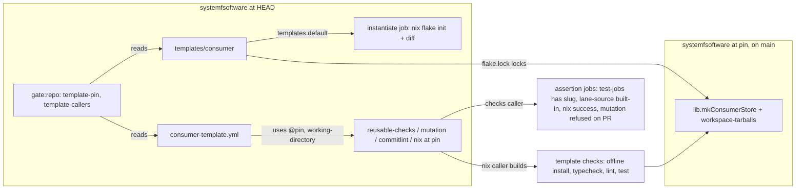

# Consumer flake template - Plan

## Goal Capsule

- **Objective:** A new repository started with `nix flake init -t github:systemfsoftware/systemfsoftware` gets the house toolchain and CI on its first commit: it installs the systemfsoftware toolchain packages, runs its checks, mutation, commitlint and nix CI through this repository's reusable workflows, and nobody copies config or workflow text by hand.
- **Means:** a `templates.default` flake output, plus CI in this repository that instantiates it.
- **Product authority:** PR 3 of the org shared tooling series. `docs/plans/2026-10-10-0734-ci-drop-in-reusable-workflows-plan.md` (#710, merged as 9154691d4b) defines it as "a `templates.default` that instantiates a consumer calling these reusables". PR 4 (pin update automation) is not active scope. PR 5 (the shared step that installs flake tarballs into a consumer) is a prerequisite, not part of this work (KTD12).
- **Open blockers:** PR 5 must merge before this PR pins, because the template's checks and mutation callers install the tarball dependencies through PR 5's step, and the pin must name a main commit that contains it (KTD12, Dependencies / Assumptions). #710 is on main.
- **Execution profile:** one PR, branch `feat/flake-template`, a `gh stack` layer above PR 5 until PR 5 merges. Evaluator files (U5, U6, U7) land in commits of their own.
- **Stop conditions:** stop and report before writing a final pin while PR 5 is unmerged, and when any reusable needs a change to pass, since the reusables are outside this work.

---

## Product Contract

### Summary

Add a flake template that writes a ready consumer pnpm workspace. The template's CI calls this repository's reusable workflows pinned to one commit SHA. A workflow in this repository runs the template's callers at that SHA against the template directory. The template's own flake checks install it offline and run its tests.

### Problem Frame

PR 1 (#707) made the toolchain config packages installable outside the monorepo, and #710 made checks, mutation, commitlint and nix callable from any repository. A new consumer still has to hand-assemble the flake input, the tarball dependencies, the config extends, four workflow callers with the right SHA, and the packs config. Each hand copy drifts. The cross-repository call by SHA has also never run: #710's review finding #5 deferred that proof to this PR, because #710's fixture calls the reusables through `./` at the same commit.

### Key Decisions

- **The template is static files, copied verbatim.** `templates.<name>.path` cannot be a derivation, so nothing in the template is filled in at init time. Probe on 2026-10-10: a `runCommand` path fails `nix flake init` with "access to absolute path '/nix/store/…-tpl' is forbidden in pure evaluation mode", and with `--impure` with "path … does not exist". A static path (`templates/consumer/`, KTD1) copies every file verbatim, including `.github/`, `.compound-engineering/` and `flake.lock`. No token is substituted at init: every pin is a literal SHA in the template's files. Governs R1, R9.
- **The pin names an earlier commit on main and is allowed to lag.** A commit cannot contain its own SHA, and squash merges are enabled (`allow_squash_merge: true`), so a PR-branch SHA is not durable once the branch is deleted. The pin therefore trails the newest reusable change by at least one merge. Staleness is not a gate; PR 4 automates the bump. Governs R9, R10.
- **The template is proven as a consumer gets it, at its own pin, by a workflow in this repository.** That workflow calls the template's callers at the pinned SHA with the template directory as the working directory. The template's nix caller then builds the template's own flake checks against the pin's tarballs. An in-repo flake derivation against this commit's tarballs was rejected for two reasons. It cannot run GitHub `uses:` calls, so it leaves #710 finding #5 open. And it deadlocks: the template's `pnpm-lock.yaml` records the pin's tarball integrities, so a PR making a breaking toolchain change would fail that derivation, while the template cannot change before a later pin bump. Governs R2, R12, R13.
- **A toolchain change reaches the template only through a pin bump.** A pin-bump PR changes the template's files, so it runs the template workflow. That is when a breaking change surfaces, which is also when a consumer would meet it. Governs R9, R12.
- **#710's hand-written consumer fixture stays.** It calls the reusables through `./` at HEAD and proves reusable changes inside the PR that makes them. The template calls them at the pin. Neither proof covers the other. Governs R13.

### Requirements

**Template content**

- R1. `nix flake init -t github:systemfsoftware/systemfsoftware` writes a pnpm workspace consumer whose files are exactly the template directory.
- R2. The consumer's flake takes this repository as an input and builds its checks from the toolchain tarballs through `lib.mkConsumerStore`. Those checks install the workspace offline and run its typecheck, lint and tests.
- R3. The consumer depends on the toolchain packages as flake tarballs and on effect 4.x, and every dependency is pinned to an exact version.
- R4. The consumer extends the shared `@systemfsoftware/tsconfig`, `@systemfsoftware/vitest-config` and `@systemfsoftware/oxlint-config-recommended` presets, and copies none of their settings.
- R5. The consumer has a working changesets setup, so `pnpm change` records an intent from its first commit.
- R6. The consumer has one workspace package with source, a `test` script and one property test in the house `it.prop` shape (from `@systemfsoftware/vitest`). The checks plan then schedules a real test job, not an empty one.
- R7. The consumer's `.compound-engineering/config.yaml` takes the packs from this repository as a git source, pinned by SHA.

**Workflow callers**

- R8. The consumer has workflow callers for checks and nix on pull requests and pushes to main, for commitlint on pull requests only (its reusable runs its job only on `pull_request`, `reusable-commitlint.yml:23`), and for mutation on pushes to main only. Each caller is a job-level `uses:` of this repository's reusable, and the template contains no copy of any reusable's jobs or steps.
- R9. One commit pins everything: the six pin sites (the four callers, the packs `ref` and the flake input's locked rev in `flake.lock`) all name the same commit, and that commit is reachable from main. A check enforces this.
- R10. Each of the four caller pins is written as `@<40-hex sha> # main`, the digest-plus-ref-comment form Renovate's github-actions manager updates. The packs `ref` and the `flake.lock` rev are bare SHAs: `flake.lock` is JSON and carries no comment, and Renovate's github-actions manager reads only workflow files, so PR 4 must move those two in the same commit as the callers.

**Proof**

- R11. The template's callers keep the reusables' docs-only classification, so a consumer's docs-only PR skips build and test.
- R12. A workflow in this repository runs the template's four callers at the template's pinned SHA, with the template directory as the working directory. It runs on pull requests that change one of its inputs (the template, the workflow itself, the root `flake.nix` and `flake.lock`, or a local action the workflow uses) and on every push to main, so its mutation lane judges every main commit (`ci-wall-clock/heavy-suites-judge-every-main-commit`).
- R13. That workflow fails unless the checks plan scheduled the template's package and its test job ran, and unless the nix caller built the template's flake checks.
- R14. A check fails when the workflow's calls differ from the template's callers in anything other than `working-directory` and `record`. Triggers are compared too: each template caller file's `on:` block against the `if:` condition of the matching job in the workflow, and the only allowed difference is the mutation refusal job's extra pull-request run.

**Budget**

- R15. On a pull request, the template workflow's whole run, first job start to last job end, finishes in 10 minutes or less. A docs-only pull request spends 3 minutes or less on it.

### Acceptance Examples

- AE1. **Covers R9.** Given a template whose checks caller pins commit A and whose packs `ref` pins commit B, when the pin check runs, then it fails and names both pins.
- AE2. **Covers R9.** Given every pin naming a commit that exists only on a deleted PR branch, when the pin check runs, then it fails because the commit is not reachable from main.
- AE3. **Covers R12.** Given a PR that changes only `packages/toolchain/vitest-config`, when CI runs, then the template workflow does not run, because its `paths` filter covers only `templates/consumer/**` and the workflow file.
- AE4. **Covers R13.** Given the checks plan emits no test job for the template's package, when the template workflow finishes, then it fails even though every reusable reported success.
- AE5. **Covers R8.** Given a pull request that changes the template, when the template workflow runs in this repository, then its mutation call does not start and `mutation-refuses-pull-request` passes, while the checks, commitlint and nix calls run.
- AE6. **Covers R14.** Given an edit that adds a `with:` input to the template's checks caller but not to the workflow's call, when the check runs, then it fails.

### Success Criteria

- #710's deferred finding #5 is closed: a run ID shows the reusables called by SHA from a caller that is not `./`, with the template's test job executed.
- Per-job times for the template workflow appear in the PR body, and are measured, not estimated.

### Scope Boundaries

**Deferred for later**

- Automation that bumps the pin (Renovate or update-flake-lock as code): PR 4. PR 3 makes the pin mechanical: one value in six places, the four callers in a form Renovate can parse.
- The shared step that installs flake tarballs into a consumer's GitHub job: PR 5, which lands before this PR pins (KTD12). PR 5 also owns checking out with `persist-credentials: false` in the reusables.
- A changeset-check caller in the template. Its reusable lives in `pnpm-release-management` at a different SHA, which breaks R9's single pin. Follow-up.
- R11's proof in a real consumer: deferred to the first adoption PR. In this repository a template docs-only PR is classified full, because the template sits below the repository root (KTD7).
- A real consumer repository instantiated from the template. Adoption PRs prove the foreign-`GITHUB_TOKEN` path; this repository's workflow proves the SHA path only.
- Replacing #710's consumer fixture with the template.

**Outside this work**

- Changes to `ci/drop-in-reusable-workflows` (#710) or to the reusables themselves.
- gritlint changes, and any local mutation run.

<!-- ce-section: work-relationships -->

### How This Work Fits Together

This plan covers PR 3. The series below is the current understanding, not a committed roadmap.

- PR 2 (#710): reusable workflows, merged as 9154691d4b. This plan depends on its input surface.
- PR 5: the tarball install step. The template's checks and mutation callers need the tarballs on disk before a frozen install, and PR 5 provides them. It merges before this PR pins (KTD12).
- PR 4: pin automation. It is enabled by R9 and R10, and updates the template's pins together with this repository's own.

### Dependencies / Assumptions

- #710 merged as 9154691d4b. The first final pin is PR 5's merge commit on main, or a later main commit (KTD12). Until PR 5 merges this branch is stacked on it (OP13b: it builds on that PR's code).
- The toolchain packages reach a consumer as flake tarballs. Distribution is the flake, not a registry (`.changeset/README.md:94-98`). `@systemfsoftware/vitest-config`, `tsdown-config` and `stryker-config` return HTTP 404 from registry.npmjs.org, and the GitHub Releases for their `v0.1.0` tags carry no assets. `tsconfig` 2.0.1, `oxlint-config-recommended` 4.0.0 and `vitest` 2.0.0 are on npm at the flake's versions (checked 2026-10-10), but the registry is not the channel and will lag. A consumer's `pnpm install --frozen-lockfile` therefore needs the tarballs on disk first. #710's `install-deps` composite runs only `corepack pnpm install --frozen-lockfile`.
- There is no binary cache in this repository's CI: nothing configures cachix push or extra substituters. Building any single tarball builds the whole `systemfsoftware-tarballs` derivation, so every job that provisions tarballs from scratch pays roughly one workspace build. [INFERENCE from the x86_64 `flake outputs` job: 322 to 334 s on #710 heads e1e909439f and 3c6b367be7.] The template's nix caller pays that once per system. PR 5's build-once-per-run step and its `actions/cache` restore are what keep the checks and mutation jobs inside R15 (KTD12).
- Measured references for R15 on #710 head 3c6b367be7: Nix workflow 6.2 min total (run 38045834020, longest job 334 s). Consumer fixture 1.6 min (run 38045833813).
- GitHub runs only workflows at the top level of `.github/workflows/`, so the template's own callers never run in this repository. R12 needs its own workflow file, and R14 keeps that file equal to the template's callers.
- PR 5 (the shared tarball-install step) merges before this PR pins, and the pin names a main commit that contains it (KTD12). A stacked layer is not enough, because the pin must name a main commit (R9) and only a pinned reusable reaches the template.
- GATE1: the R9 pin check and the R14 equality check were signed off by the operator on 2026-10-10. They land as Evaluator commits of their own, observed red on a planted violation before they are wired green (KTD8).
- Until PR 4, this unit owns pin bumps. A bump is one commit that moves all six pin sites and regenerates `templates/consumer/flake.lock` and `templates/consumer/pnpm-lock.yaml` against the new pin's tarballs. PR 4's automation must make the same change as one grouped commit.

### Sources / Research

- Probe, 2026-10-10, `/tmp/sfs-tpl-probe`: `nix flake init` refuses a derivation-valued template path and copies a static path verbatim, dotfiles and `flake.lock` included (Nix 2.35.2).
- `flake.nix:44-57` (`lib.mkConsumerStore`), `nix/consumer-load-check/default.nix`: the offline install pattern R2's checks follow.
- Renovate github-actions manager: its default file pattern `(^|/)(workflow-templates|\.(?:github|gitea|forgejo)/(?:workflows|actions))/.+\.ya?ml$` matches nested `.github/workflows`, and it pins job-level reusable workflows as depType `workflow` with a `# <ref>` comment (https://docs.renovatebot.com/modules/manager/github-actions/). Dependabot scans only top-level `.github/workflows/`.
- The CE packs resolver's git source shape (`source`, `ref`, `path`), from `ce-brainstorm/scripts/packs-resolve.py`.
- House test shapes: `packages/effect-readiness/src/__tests__/evaluate-probe.workflow.property.test.ts:26-31` (`it.prop`), `packages/atom/effect-atom/tests/AtomRef.integration.test.ts:5,24` (`makeFeature`).
- (pack: package-topology, declared-entry-points.md): R4 imports only the presets' declared exports. (pack: boundary-testing, real-system-oracles.md): R2 and R13 install the real tarballs, not a stub.
- `.github/workflows/reusable-checks.yml:4-8,220-232` (#710 head 3c6b367be7): under a non-root `working-directory` the caller's `checks-lane` hook is not visible and the built-in lanes run, so the template in this repository cannot provision tarballs through a hook.
- `.github/workflows/reusable-nix.yml:16-23,90-126` (#710): `extra-steps` installables run only when their derivation changed, and a push (no base) builds every output.
- `.github/workflows/consumer-fixture.yml` (#710): the caller and assertion shape U6 follows (`test-jobs`, `lane-source`, `record:`, the mutation refusal job).
- Probe, 2026-10-10: `nix flake init` into a directory holding a conflicting file reports "refusing to overwrite existing file", keeps that file, writes the rest, and ends with "encountered 1 conflicts".
- Tarball sizes at 732f66a0c8 (`.#workspace-tarballs`): `tsconfig` 8.6 KB, `vitest-config` 10 KB, `stryker-config` 7 KB, `vitest` 80 KB, the nine `oxlint-*` tarballs 201 KB together. `oxlint-config-recommended` 4.0.0 depends on five other `@systemfsoftware/oxlint-*` packages.
- `pnpm change --help` under `nix develop` (pnpm 12.9.0 from nixpkgs `pnpm_12`): `pnpm change` is pnpm's own command, configured by `release.jsonc`.
- Learnings: `docs/solutions/runtime-errors/raw-typescript-entries-fail-from-node-modules.md` (prove installs from outside the monorepo), `docs/solutions/tooling-decisions/push-currency-is-remote-trunk-tip.md` (an unreadable remote fails closed), `docs/solutions/tooling-decisions/pnpm-12-lockfile-stream-and-purge-semantics.md` (a pin in the lockfile is enforced), `docs/solutions/logic-errors/github-actions-backticks-are-command-substitution.md` (route expressions through `env`), `docs/solutions/integration-issues/parallel-lanes-race-on-one-immutable-cache-key.md` (distinct record names).

---

## Planning Contract

### Key Technical Decisions

- KTD1. The template lives at `templates/consumer/`, and `templates.default.path` points there. The name answers "template of what" (CONST-N1). None of the root workspace globs, tsconfig references or `repo-checks` scans reach `templates/` (`pnpm-workspace.yaml`, `scripts/tools/repo-checks/project-membership.ts:98`). `dprint` and `gritlint` do cover it, so template files must pass both. Governs R1.
- KTD2. The template uses only what exists at its pin. A pin cannot name the commit that adds a new `lib` function or reusable input, so the template's flake calls `lib.mkConsumerStore` as it is (`flake.nix:44-57`) and its callers use only the inputs of #710 and PR 5. A shared install helper for consumer checks is follow-up work, once this PR is on main. Governs R2, R8.
- KTD3. Every `@systemfsoftware/*` package this repository publishes comes from a flake tarball, including the ones npm also serves. `@systemfsoftware/stryker-js` and `@systemfsoftware/stryker-js-vitest-runner` are not built here, so no tarball exists for them; they stay exact npm pins, as #710's consumer fixture pins them (17.0.2, 8.1.1). The consumer maps the presets' transitive `@systemfsoftware/*` dependencies to their tarballs through `pnpm.overrides`; otherwise pnpm resolves the `oxlint-config-recommended` closure from npm. The `packages` list passed to `mkConsumerStore` is that same closure. Governs R3, R4.
- KTD4. The template package is `packages/slug`: one pure function that turns text into a URL slug, returned as an effect `Schema`-branded `Slug`. Its `it.prop` laws are idempotence and the output alphabet, so the oracle is a law, not the code under test (CONST-T10). The README tells the consumer to replace it. The template ships no generated schema laws: Ryan's ruling retires that machinery org-wide (Unit SL), so the slug carries no `effect-schema-vite` discovery, no `schema-laws.test.ts` stub and no in-source decode-verdict property, and the `Slug` refinement is exercised through the workflow property suite. Governs R6.
- KTD5. The consumer's flake exposes one check that installs the workspace offline from `mkConsumerStore` and runs `typecheck`, `lint` and `test`, following `nix/consumer-load-check/default.nix`. Its `nixpkgs` follows the systemfsoftware input, so the devShell's `pnpm_12` (12.9.0) and `nodejs_24` match this repository's. Governs R2, R5.
- KTD6. Each caller job declares the permissions its reusable declares, and the consumer workflows set no broader top-level grant: checks `contents: read, actions: read`; mutation `contents: read, actions: write`; commitlint and nix `contents: read` (`reusable-checks.yml:148-150`, `reusable-mutation.yml:261-263` on #710). No caller passes the optional `turbo-api`/`turbo-token` secrets. A foreign repository's default token may be read-only, so an inherited grant would fail mutation's timing upload. Governs R8.
- KTD7. The callers pass no `docs-globs`. The default docs set (`docs/**`, root `*.md`, `**/AGENTS.md`, `**/CLAUDE.md`) fits a consumer at its repository root. In this repository R15's docs-only budget is met by the template workflow's `paths` filter: a docs-only pull request does not start it. A pull request that edits only the template's own README is classified full, because the template sits below the root. Governs R11, R15.
- KTD8. R9 and R14 are two `repo-checks` subcommands, `template-pin` and `template-callers`, run from `pnpm gate:repo`. `repo-checks` already runs git and parses manifests (`scripts/tools/repo-checks/verdict.ts`), and the static lane already runs `gate:repo`. Each lands as an Evaluator commit, observed red on a planted violation before it is wired green. GATE1 signed off by the operator on 2026-10-10: both are real invariants with no other home.
- KTD9. `template-pin` reads the four callers' `uses:` refs, the packs `ref`, and the `systemfsoftware` node's `locked.rev` in `templates/consumer/flake.lock`, and requires one SHA. It then fetches main's commit graph without trees and requires that SHA to be an ancestor of `origin/main`. A fetch failure is a refusal, never a pass. Governs R9, R10.
- KTD10. The template workflow is `.github/workflows/consumer-template.yml`. It calls `systemfsoftware/systemfsoftware/.github/workflows/reusable-<name>.yml@<pin>`, never `./`, with `working-directory: templates/consumer`. It adds an `instantiate` job that runs `nix flake init -t` from this checkout into an empty directory and diffs the result against `templates/consumer/` (R1). Assertion jobs follow `consumer-fixture.yml`. Governs R1, R12, R13.
- KTD11. Until PR 5 merges, the callers pin PR 5's head SHA so the template workflow can run. On the PR the only expected red is `template-pin` reporting that the pin is not reachable from main; any other red is a real failure. The gate commits are shown red on planted violations, and `pnpm check:local` and `pnpm gate:repo` are proven green on the pin bump to PR 5's merge commit or a later main commit. The PR cannot go green on a branch pin.
- KTD12. Tarballs reach the template's jobs through PR 5's shared install step, and the final pin names a main commit that contains it. Rejected: committing the pinned tarballs to the template (binary blobs in every consumer's first commit, rebuilt by hand on each bump, which is the boilerplate this unit removes; neither existing consumer does it, and api-extractor-effect builds `.#sfs-deps` once and passes it as an artifact). Rejected: a Nix build of the tarballs in every job (about 5.5 min per job with no binary cache). PR 5's own brainstorm decides its shape under hard constraints: one home in the reusables (an input on `reusable-checks` and `reusable-mutation`, no consumer composite); tarballs built at most once per workflow run and restored from `actions/cache` keyed on the consumer's `flake.lock` `systemfsoftware` locked rev plus the package list, so a warm run restores in well under a minute; its cold cost stated; every PR lane 10 minutes or less.
- KTD13. R13's nix clause holds on push (no base, so every output builds) and on any pull request that changes `templates/consumer/`. A pull request that edits only `consumer-template.yml` leaves the template's check derivations unchanged, so the nix call builds nothing and still passes.

### High-Level Technical Design

Directional, not a specification.

### Test admission

- New permanent tests are the `repo-checks` subcommand tests (U5, U7), which reproduce AE1, AE2 and AE6 on planted fixtures; the template's own `it.prop` laws (R6), which also relate `isSlug` to `deriveSlug`'s fixed points over `Schema.String`; and the `pnpm change` integration test (both U1). No schema-law test: generated schema laws are retired (KTD4).
- Workflow behaviour (AE3, AE4, AE5) is proven by CI runs recorded in the PR body, and by one-off planted failures that are reverted.

### Assumptions

- R6's `it.prop` import comes from `@systemfsoftware/vitest`, as `packages/effect-readiness/src/__tests__/evaluate-probe.workflow.property.test.ts:26-31` uses it.
- Nested `.github/workflows/` under `templates/consumer/` never run in this repository and are not scanned by Dependabot. Renovate matches them (Sources / Research).

---

## Implementation Units

### U1. Template workspace

**Goal:** `templates/consumer/` is a pnpm workspace that installs, typechecks, lints, tests and records a changeset intent.

**Requirements:** R1, R3, R4, R5, R6, R7; KTD1, KTD3, KTD4.

**Dependencies:** none.

**Files:** under `templates/consumer/`: `package.json`, `pnpm-workspace.yaml`, `pnpm-lock.yaml`, `turbo.json`, `commitlint.config.mjs`, `release.jsonc`, `.changeset/README.md`, `.compound-engineering/config.yaml`, `.gitignore`, `README.md`, and `packages/slug/` (`package.json`, `tsconfig.json`, `vitest.config.ts`, `oxlint.config.ts`, `stryker.config.mjs`, `src/`, tests).

**Approach:**

- Root manifest: `private`, `packageManager: pnpm@12.9.0`, exact versions, `file:.sfs-deps/<tarball>` specs for every `@systemfsoftware/*` package this repository publishes, exact npm pins for `stryker-js` and its vitest runner, and the KTD3 overrides. Registry pins follow `.github/consumer-fixture/package.json` on #710 (effect 4.0.1, vitest 5.0.1, turbo 2.11.5, commitlint 21.2.3, stryker-js 17.0.2).
- `packages/slug` extends the three presets through their declared exports only (pack: package-topology, declared-entry-points.md), and has `build`, `typecheck`, `lint`, `test` and `mutation` scripts.
- `release.jsonc` and `.changeset/README.md` follow this repository's, trimmed to one package and no release surfaces.
- `.compound-engineering/config.yaml` lists the same packs as this repository's `.compound-engineering/config.yaml` at the pin (on main that includes `mutation-discipline`, #712), as git sources (`source`, `ref`, `path`).
- `.gitignore` keeps `node_modules/`, `reports/`, `.timings/` and `.sfs-deps/` out; PR 5's step fills `.sfs-deps/` per run (KTD12).
- README: empty-directory-only init (Sources: the overwrite probe), how to rename `slug`, the pin, and that a pin bump regenerates `pnpm-lock.yaml`.
- Generate `pnpm-lock.yaml` with the pin's tarballs in `.sfs-deps/`. Never hand-edit it.

**Patterns to follow:** `.github/consumer-fixture/` (#710); `packages/toolchain/vitest-config` usage in `packages/effect-readiness/vitest.config.ts`.

**Test scenarios:**

- `slug` is idempotent: for any string, slugging the slug returns it unchanged.
- `slug` output contains only `[a-z0-9-]`, with no leading, trailing or doubled `-`.
- Edge: text with no slug characters at all gives the empty slug.
- `isSlug` holds exactly for the fixed points of `deriveSlug` over `Schema.String`, so the branded `Slug` accepts every `slug` output and refuses every other string.
- Integration: `pnpm change --bump patch --summary x slug` writes one intent that `pnpm change check` accepts.

**Verification:** with `.sfs-deps/` filled from `.#workspace-tarballs`, `pnpm install --frozen-lockfile`, `pnpm -r typecheck`, `pnpm -r lint` and `pnpm -r test` pass in a copy of the template outside the monorepo; `./bin/dprint check` and `pnpm lint:conventions` pass at the root.

### U2. Template flake and its check

**Goal:** the template's `nix flake check` installs the workspace offline from the pin's tarballs and runs its checks.

**Requirements:** R2, R3; KTD2, KTD3, KTD5.

**Dependencies:** U1.

**Files:** `templates/consumer/flake.nix`, `templates/consumer/flake.lock`.

**Approach:** input `systemfsoftware` (ref-less URL, the rev in `flake.lock`) with `nixpkgs.follows = "systemfsoftware/nixpkgs"`. `checks.<system>.workspace` builds the store with `systemfsoftware.lib.mkConsumerStore { packages = <KTD3 closure>; }`, copies the tarballs into `.sfs-deps/`, installs offline with the `consumer-load-check` settings, and runs `typecheck`, `lint` and `test`. `devShells.default` carries `nodejs_24`, `pnpm_12` and `dprint`. Systems: `x86_64-linux` and `aarch64-linux`. Lock at the KTD11 pin.

**Patterns to follow:** `nix/consumer-load-check/default.nix` (install recipe), `nix/consumer-store-check.nix`.

**Test scenarios:**

- `nix build ./templates/consumer#checks.x86_64-linux.workspace` passes.
- One-off: a test that asserts a wrong slug fails the check build, then the change is reverted.

**Verification:** the check builds on x86_64-linux locally; the aarch64 build is proven by the nix caller in U6.

### U3. Template workflow callers

**Goal:** the consumer's CI is four job-level `uses:` of this repository's reusables at one pin.

**Requirements:** R8, R10, R11; KTD6, KTD7, KTD11.

**Dependencies:** U1.

**Files:** `templates/consumer/.github/workflows/{checks,commitlint,nix,mutation}.yml`.

**Approach:** checks and nix run on `pull_request` and on `push` to main. Commitlint runs on `pull_request` only (R8). Mutation runs on `push` to main only. Each job is `uses: systemfsoftware/systemfsoftware/.github/workflows/reusable-<name>.yml@<40-hex> # main`, with KTD6 permissions, the default `working-directory`, and no steps of its own. `concurrency` follows `consumer-fixture.yml`.

**Test scenarios:** `Test expectation: none -- caller wiring; U6 runs these exact calls and U7 keeps them equal.`

**Verification:** `actionlint`-clean YAML (strict parse as in #710's review rounds), and `dprint check` passes.

### U4. Root flake template output

**Goal:** `nix flake init -t github:systemfsoftware/systemfsoftware` writes `templates/consumer/`.

**Requirements:** R1; KTD1.

**Dependencies:** U1, U2, U3.

**Files:** `flake.nix`; `.github/AGENTS.md` (consumer section: init, the pin, PR 5's provisioning); `README.md` (one line naming the template).

**Approach:** add `templates.default = { path = ./templates/consumer; description = ...; }`. No other root output changes.

**Test scenarios:**

- `nix flake init -t "git+file://$PWD#default"` into an empty directory yields a tree whose `diff -r` against `templates/consumer/` is empty.
- `nix flake check --no-build` at the root accepts the `templates` output.

**Verification:** both commands above, run locally; the same diff runs in CI as U6's `instantiate` job.

### U5. `template-pin` gate (Evaluator commit)

**Goal:** a mismatched or unreachable pin fails `pnpm gate:repo`.

**Requirements:** R9, R10; KTD8, KTD9; AE1, AE2.

**Dependencies:** U2, U3; GATE1 signed off (KTD8).

**Files:** `scripts/tools/repo-checks/template-pin.ts`, its test, `scripts/tools/repo-checks/cli.ts`, `package.json` (`gate:repo`).

**Approach:** a `Verdict`-returning check registered in `cli.ts`, as `single-plan` is. It reads YAML with `@std/yaml` and `flake.lock` as JSON. A ref without the `# main` comment fails R10.

**Execution note:** test-first. Plant each violation, watch it fail, then wire the subcommand into `gate:repo`.

**Test scenarios:**

- AE1: checks caller at A and packs `ref` at B fails, and the message names both.
- AE2: all pins at a commit that main does not contain fails with "not reachable from main".
- A ref missing its `# main` comment fails and names the file.
- An unreachable remote is a refusal (`Undecided`), not a pass.
- All six pins equal and on main passes.

**Verification:** `deno test` for `scripts/tools/repo-checks/` passes; `pnpm gate:repo` exits non-zero on a planted mismatch and zero after the fix.

### U6. Template workflow (Evaluator commit)

**Goal:** this repository runs the template's callers at the pin and fails unless the template's package was really tested and built.

**Requirements:** R1, R12, R13, R15; KTD7, KTD10; AE3, AE4, AE5.

**Dependencies:** U3, U4; PR 5 merged (KTD12).

**Files:** `.github/workflows/consumer-template.yml`, `.github/AGENTS.md` (workflow table row).

**Approach:**

- Triggers: `pull_request` to main with `paths` covering every input of the run (`templates/consumer/**`, the workflow file, the root `flake.nix` and `flake.lock`, and the `failure-summary` and `mutation-event-guard` actions), named in the workflow as the `turbo-task-graph` closed-list item for an artifact no turbo task produces; `push` to main with no filter. Every step has an id, and each job that is not a reusable call ends a failure or cancellation in the shared `failure-summary` with a workspace-root reproduce (`ci-wall-clock/failures-name-the-gate-and-location`).
- Jobs: the four calls (KTD10) with this workflow's own `record:` names (R14); `mutation-refuses-pull-request` on pull requests, kept as AE5's proof; `instantiate`; and an assertion job requiring checks `success`, `lane-source == built-in`, a `test-jobs` entry whose packages include `slug`, and nix `success` (KTD13).
- Route every expression through `env`, never into backticks.

**Test scenarios:**

- AE3: a PR touching only `packages/toolchain/vitest-config` does not start the workflow, recorded as the run list for that head with no template workflow run in it.
- AE4: one-off, reverted: a planted `slug` test filter that leaves the plan with no `slug` job fails the assertion job while the checks call succeeds.
- AE5: on a PR, the `mutation` call is skipped and `mutation-refuses-pull-request` passes.
- A planted wrong integrity in the template lockfile fails the nix call (the `mkConsumerStore` sabotage path).

**Verification:** green run IDs on the PR head for every job, with per-job times in the PR body (R15: 10 min or less in total).

### U7. `template-callers` gate (Evaluator commit)

**Goal:** the workflow's calls cannot drift from the template's callers.

**Requirements:** R14; KTD8; AE6.

**Dependencies:** U3, U6; GATE1 signed off (KTD8).

**Files:** `scripts/tools/repo-checks/template-callers.ts`, its test, `scripts/tools/repo-checks/cli.ts`, `package.json` (`gate:repo`).

**Approach:** for each reusable, compare the template caller's job (`uses`, `with`, `secrets`, `permissions`) with the workflow's matching call after removing the exempt keys (`working-directory`, `record`). Compare each template caller file's `on:` block with the `if:` condition of the matching job in the workflow, allowing only the extra pull-request run of the mutation refusal; the workflow's own `paths` filter is outside the comparison.

**Execution note:** test-first, as U5.

**Test scenarios:**

- AE6: a `with:` input added to the template's checks caller only fails, naming the input.
- A different `@<sha>` between the two fails.
- A difference only in `working-directory` or `record` passes.
- A reusable called by the template but missing from the workflow fails.

**Verification:** `deno test` passes; `pnpm gate:repo` exits non-zero on the AE6 plant and zero after.

---

## Verification Contract

- **Local, after the last edit:** `pnpm check:local` exits 0, with `deno test` for `scripts/tools/repo-checks/` and the U4 init-and-diff run.
- **CI:** CI, Nix, Changeset Check, Commitlint and the template workflow green on the PR head through `xd://github run_watch`, with no `gh api` poll loops.
- **#710 finding #5:** the run ID of the template workflow on the final pin, showing the reusables called as `systemfsoftware/systemfsoftware/...@<sha>` and the `slug` test job executed.
- **Budget:** per-job times for the template workflow, measured from the run, in the PR body.
- **Residuals closed with tools, not prose:** the aarch64-linux nix build of the template check, timed from its CI job against R15; and `templates/consumer/.compound-engineering/config.yaml` loaded through CE's own packs resolver (`ce-brainstorm/scripts/packs-resolve.py`) at the pin, every git-source pack resolving with no errors.
- **Never:** local mutation runs (REPO-D3), `--no-verify`, force-push, hand-edited `pnpm-lock.yaml` or `flake.lock`.

## Definition of Done

- U1-U7 landed, with U5, U6 and U7 in Evaluator commits of their own.
- Every pin names one main commit that contains #710 and PR 5, and `template-pin` is green on it.
- The template workflow is green on the PR head; AE4 and AE5 are recorded with run IDs and AE3 as the run list for its head; and the Success Criteria evidence is in the PR body.
- `pnpm check:local` exits 0 after the last edit, and the PR is ready for review.
