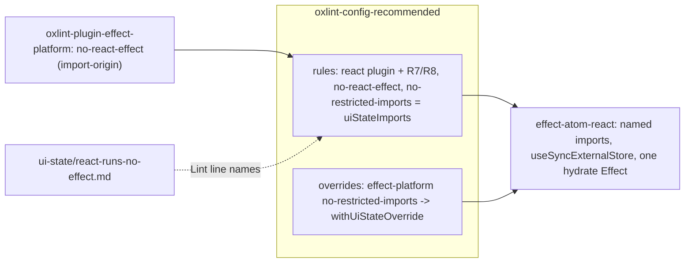

# Strict React rules and no React Effects - Plan

## Goal Capsule

- **Objective:** React code in every repository that extends `@systemfsoftware/oxlint-config-recommended` fails lint when it reaches a React Effect hook or breaks the Rules of React the preset derives. Planning and ce-code-review judge the same invariant through one ui-state pack rule. The one exception is the effect-atom React binding's after-commit hydration Effect, and it is admitted for what it does, not where it sits.
- **Means:** the effect-atom React binding moves its three subscription Effects to `useSyncExternalStore` and drops `useAtomSubscribe` (Key Decisions). The preset then enables the derived oxlint React rules and the effect-hook ban (KTD1-KTD5), and a ui-state rule states the invariant.
- **Product authority:** Ryan's ruling, grounded in react.dev "You Might Not Need an Effect", carried by the root follow-up intent of 2026-10-13. The operator answered the two binding questions on 2026-10-13 (Key Decisions). Repository law (`CONSTITUTION.md`, `repos/constitution/ENFORCEMENT.md`) outranks this plan; a conflict stops implementation and is reported.
- **Stop conditions:** a CONST article or enrolled pack rule that forbids a requirement; a React rule in R7/R8 that fires outside React code at the head being implemented; a binding scenario that cannot pass unchanged under R10.
- **Open blockers:** none. #750 merged as `5965b034b5`, which this branch takes.
- **Execution:** one agent owns every unit and the PR; units land in the order of Sequencing.

## Product Contract

### Summary

The preset gains the oxlint React plugin's derived rule set and refuses `useEffect`, `useLayoutEffect`, `useInsertionEffect` and `useEffectEvent` in every import form. The effect-atom React binding migrates first so it passes those rules. A new ui-state rule states that React components and hooks run no Effect and reach external systems through effect-atom.

### Problem Frame

Each of the effect-carried incidents in the ui-state pack (b, c, e and f, a product repo, 2026-10-11) ran its I/O, fiber, timer or persistence inside a `useEffect` (pack: ui-state, components-perform-no-io.md; pack: ui-state, server-data-lives-in-atoms.md; pack: ui-state, components-dispatch-to-runtime-atoms.md). The pack refuses those consequences, but nothing refuses the Effect that carries them, and no ui-state rule names it.

The preset on `main` (`a578c704a4`) enables no React plugin (`packages/oxlint-presets/oxlint-config-recommended/src/index.ts:30-40`) and bans no effect hook. The repository's only React code, `@systemfsoftware/effect-atom-react`, has five Effect sites: `hooks-value.ts:118` and `:310`, `hooks-ref.ts:32`, `registry-context.ts:181` and `hydration-boundary.ts:145`. The final rule set of R7/R8, run over `packages/` at `a578c704a4`, reports 16 findings, all in that binding: eleven test components that reassign variables declared outside them, four reads of `ref.current` during render (`scoped-atom.blueprint.ts:244`, `registry-context.ts:187`), and one missing dependency (`hooks-value.ts:311`).

### Key Decisions

- **HydrationBoundary keeps one admitted Effect.** (session-settled: user-directed — chosen over hydrating every atom during render, moving existing-atom hydration to callers, and keeping the binding out of scope: it preserves the transition-safe contract tested by "A reloaded page keeps showing its current value until the saved one is safely committed", and accepts a dedicated rule beside the `no-restricted-imports` composition.) Governs R3, R5, R11.
- **`useAtomSubscribe` leaves the public API.** (session-settled: user-directed — chosen over reimplementing it on `useSyncExternalStore`: a component that runs a side effect on every atom change conflicts with ui-state's "Components render and dispatch only".) Governs R12.
- **React is imported by name only.** The pinned oxlint (1.82.0) refuses every namespace import of a module whose `importNames` are banned, unused or type-only included, so an effect-hook ban in `no-restricted-imports` cannot leave `import * as React` open. All five Effect sites reach the hook as `React.useEffect`. Governs R2.
- **The Rules of Hooks come from the React Compiler's `react/hooks`, not `react/rules-of-hooks`.** `react/rules-of-hooks` decides what is a hook from its name alone (`is_react_hook_name`, `crates/oxc_linter/src/utils/react.rs:759`), so on `a578c704a4` it reports Effect `Service.use(...)` and `useSync` calls in `discern`, `effect-daemon-microvm` and `effect-atom`, none of them React code. That makes it stricter than the Rules of Hooks, and it applies a requirement by name, which CONST-T12 forbids. This departs from react.dev's recommended `eslint-plugin-react-hooks` set, which lists `rules-of-hooks`. "Only call Hooks from React functions" therefore stays review-owned in the pack rule. Governs R7, R8, R15, R16.
- **Registry lifetime is a subscription.** A mount and a registry lease are subscriptions to the registry, so they move to `useSyncExternalStore`. HydrationBoundary's write is not a subscription, so it stays an Effect rather than running inside `subscribe` under another name. Governs R10, R11.
- **`useInsertionEffect` and `useEffectEvent` are banned with the other two.** react.dev reserves `useInsertionEffect` "for CSS-in-JS library authors", and no CSS-in-JS library is in `pnpm-lock.yaml`. Effect Events "can only be called from inside Effects", so with Effects banned they have no use. Governs R1, R4.

### Requirements

**Effect-hook ban**

- R1. No module calls or references `useEffect`, `useLayoutEffect`, `useInsertionEffect` or `useEffectEvent` from `react`, in any form: a named or aliased import, a namespace or default member, a destructured binding, a re-export, or a value passed around. The only exception is R3.
- R2. `react` is imported by named specifiers only; namespace and default imports, type-only ones included, are refused.
- R3. The one admitted Effect is a `useEffect` with a dependency array whose callback only calls effect-atom's `Atom.Hydration.hydrate` with a registry and a hydration queue, decided from what the code imports and calls.
- R4. The bans on `useLayoutEffect`, `useInsertionEffect`, `useEffectEvent` and on namespace and default `react` imports join the preset's `no-restricted-imports` composition, so every override that sets `no-restricted-imports` keeps them beside its own patterns.
- R5. A dedicated lint rule refuses every `useEffect` reach that R1 names, resolving where an identifier was imported from, and admits only R3's construct.
- R6. Every diagnostic from R4 and R5 names the ui-state rule id and effect-atom as the path instead of an Effect: a runtime atom read with `useAtomValue`, a command dispatched with `useAtomSet`. R4's diagnostic also names importing `react` by name as the fix, because one `react` pattern reports the namespace and default forms too.

**Rules of React**

- R7. The preset enables the oxlint React plugin, so every React rule in the `correctness` category, the React Compiler checks included, runs at error, except `react/rules-of-hooks`.
- R8. The preset also enables `react/hooks`, `react/capitalized-calls`, `react/rule-suppression`, `react/unsupported-syntax`, `react/no-unstable-nested-components`, `react/no-array-index-key`, `react/no-clone-element`, `react/no-react-children` and `react/prefer-function-component`, each citing the react.dev statement or repository law it enforces.

**Binding migration**

- R9. `@systemfsoftware/effect-atom-react` and its tests pass every rule in R1-R8 with no disable comment, override or allowlist.
- R10. `useAtomRef`, `useAtomMount` and `RegistryProvider` hold their subscriptions through `useSyncExternalStore`, server rendering included, and their existing scenarios keep passing unchanged.
- R11. `HydrationBoundary` keeps hydrating new atoms during render and existing atoms after commit, through R3's construct.
- R12. `useAtomSubscribe` is removed from the public API along with the scenarios that exercise only it, and the changeset names where a reaction to an atom change goes instead: `Atom.Registry.subscribe` in a scoped Effect outside React.
- R13. The binding migrates in commits before the commit that turns the bans on, so the ban lands on a clean tree.

**Pack**

- R14. A new ui-state rule states R1-R3 and cites incidents b, c, e and f (2026-10-11) and the 2026-10-13 ruling. Its `applies_when` covers writing or reviewing React components and hooks, the effect-atom bindings included, and its Gate question is answerable from the diff.
- R15. The rule's Lint line names exactly what R4 and R5 refuse; the forms they cannot see stay review-owned.
- R16. The ui-state README narrows its bindings carve-out to the other rules and names this rule as the one that governs `packages/atom/effect-atom-react`, and lists the React rules the preset enables.

**Proof and release**

- R17. Real oxlint runs over planted and clean fixtures prove each R1/R2 reach form reported once and R3's construct admitted only with an effect-atom origin. They also prove both bans fire on a file under an override that sets `no-restricted-imports`, R7/R8 fire on planted React code, and Effect `Service.use(...)` code draws no React diagnostic.
- R18. Changesets ship `major` for `@systemfsoftware/oxlint-config-recommended` and `@systemfsoftware/effect-atom-react`, and `minor` for `@systemfsoftware/oxlint-plugin-effect-platform` (KTD4).

### Acceptance Examples

- AE1. **Covers R2, R6.** `import * as React from 'react'` followed only by `React.useState(0)` is reported once, naming the ui-state rule and importing `react` by name.
- AE2. **Covers R3, R5.** `useEffect(() => { Atom.Hydration.hydrate(registry, queue) }, [registry, queue])` with `Atom` from `@systemfsoftware/effect-atom` is admitted. The same call with `Atom` from a local module, without the dependency array, or with a second statement in the callback, is reported.
- AE3. **Covers R4.** In a file that an effect-platform override covers, `import { readFile } from 'node:fs'` and `import { useLayoutEffect } from 'react'` are both reported.
- AE4. **Covers R1, R5.** `export { useEffect } from 'react'` is reported in the re-exporting module, so a component importing `useEffect` from that local module cannot reach it through a module that lints clean.
- AE5. **Covers R8, R17.** `MicroVM.use((vm) => vm.start)` at module top level draws no React diagnostic. A hook called inside an `if` in a component is reported by `react/hooks`.
- AE6. **Covers R10.** A provider re-rendered under StrictMode serves the same registry, and an unmounted provider's registry is disposed after its delay (the existing scenarios).

### Scope Boundaries

- The jsx-a11y and react-perf plugins, the React `style` category, `react/no-danger` (react.dev allows trusted HTML) and `react/react-in-jsx-scope` (wrong under the automatic JSX runtime) stay off.
- A dynamic `import('react')`, and an effect hook re-exported by a third-party package, are review-owned; the lint is narrower than the rule there.
- The other four ui-state rules, #759, #746's merged branch and every existing follow-up worktree are untouched. #750's files are touched only where KTD3's rename reaches them after #750 merges.

### Dependencies / Assumptions

- #750 merged (`5965b034b5`) and this branch is based on it.
- oxlint 1.82.0 (`oxlint_v1.82.0`, `b4da00b621`) and React 19.3.0 stay pinned.
- `.changeset/slow-lamps-begin.md` is still pending at implementation time, so the export names it lists have never shipped (latest tag `@systemfsoftware/oxlint-config-recommended@v4.0.0`).

### Sources / Research

- react.dev: "You Might Not Need an Effect" (Effects "let you 'step outside' of React and synchronize your components with some external system"; "React has a purpose-built Hook for subscribing to an external store that is preferred instead"); `useSyncExternalStore`; `useInsertionEffect` ("for CSS-in-JS library authors"); `useEffectEvent` ("can only be called from inside Effects"); Rules of Hooks; "Never pass around Hooks as regular values"; "Never call component functions directly"; `useRef` ("Do not write or read `ref.current` during rendering, except for initialization"); Legacy APIs; keys ("Index as a key often leads to subtle and confusing bugs"); nesting component definitions; `eslint-plugin-react-hooks` recommended rules (https://react.dev/reference/eslint-plugin-react-hooks).
- oxc at `oxlint_v1.82.0`: `crates/oxc_linter/src/rules/react/` (85 rules; categories read from each `declare_*_lint!`), `crates/oxc_linter/src/utils/react_compiler.rs:96` (the Compiler rules skip only `node_modules` and multi-script files).
- `CONSTITUTION.md` CONST-T12; `repos/constitution/ENFORCEMENT.md` (clean-tree enrollment, no `warn`, instrument changes in their own commit).
- `docs/solutions/architecture-patterns/a-prohibition-must-close-transitively.md`; `docs/solutions/build-errors/oxlint-preset-overrides-are-replaced-by-a-spread.md`.
- (pack: ui-state, README.md) for the bindings carve-out this work amends; `packages/oxlint-plugin/AGENTS.md` OP-D1 for rule messages; `packages/oxlint-plugin/import-origin` (`resolveImportOrigin`, `originMemberSequence`) for resolving an identifier's import origin.

## Planning Contract

### Key Technical Decisions

- KTD1. **The import ban is a `patterns` entry with `importNames`.** One pattern `{ group: ['react'], importNames: ['useLayoutEffect', 'useInsertionEffect', 'useEffectEvent', 'default'] }` joins the server-state patterns. `useEffect` stays out of it so R3's import survives; the namespace refusal comes from `importNames` being set, as probed on oxlint 1.82.0 (named, aliased, namespace, type-only namespace, default, `export { x } from` and `export * from` all reported). Governs R2, R4.
- KTD2. **R5's rule is `no-react-effect` in `@systemfsoftware/oxlint-plugin-effect-platform`.** That plugin already ships in the preset's `jsPlugins`, bundles `@systemfsoftware/oxlint-import-origin`, and owns `runtime-construction-placement`, the nearest rule (incident d). A new plugin package would add a published surface, api report, mutation config and release-age entry for one rule. The rule reports every reference to a binding imported as `useEffect` from `react` and every `export { useEffect } from 'react'`. It admits a reference only when it is the callee of a call with two arguments: an array literal second, and first a function whose block body is one expression statement calling something whose origin is `@systemfsoftware/effect-atom` with member sequence `Atom`, `Hydration`, `hydrate` and two arguments. A block body is required because `hydrate` returns a `Fiber`, which an expression-bodied callback would hand React as its cleanup. Governs R3, R5, R6.
- KTD3. **The composed import ban is renamed for what it now carries.** `serverStateImports` becomes `uiStateImports`, `nodeBuiltinAndServerStateImports` becomes `nodeBuiltinAndUiStateImports`, and `withServerState`/`withServerStateOverride` become `withUiState`/`withUiStateOverride`. The old names never shipped (Dependencies), so every caller migrates in this PR: `src/index.ts`, `ui-state-fixture/consumer-spread.config.ts`, the tests, and `.changeset/slow-lamps-begin.md`. If a release consumes `slow-lamps-begin.md` before this PR merges, the new preset changeset names each rename instead. Governs R4.
- KTD4. **The rule is enabled by the preset, not by the plugin's own `recommended`.** The preset applies the plugin's `recommended` rules through `libraryRules` to `**/src/**` and the test and entry globs, but not to other linted paths such as a package's root `.tsx` or fixture files. Setting `no-react-effect` in the preset's top-level `rules` reaches every linted path, and the plugin's published `recommended` keeps its behaviour and only gains an exported rule: `minor`. Governs R5, R18.
- KTD5. **React rules sit in the preset's top-level `rules`.** `'react'` joins `plugins`; `categories: { correctness: 'error' }` then turns R7's rules on; `'react/rules-of-hooks': 'off'` and R8's rules at `error` are set explicitly, each with a comment citing its react.dev statement or the Key Decision. No override mentions a React rule, so no override can drop one. Governs R7, R8.
- KTD6. **Binding tests read results through `renderHook` and `screen`.** `@testing-library/react` is already a test dependency. A probe on 1.82.0 reports `react/globals` for a component assigning an outer `let`, and nothing for `renderHook(() => useAtomValue(a))` or a component rendering the value read back with `screen`. Governs R9.
- KTD7. **Render-time ref reads become lazy state.** `scoped-atom.blueprint.ts:240-244` and `registry-context.ts:177-187` create a value once and read it from `ref.current` during render; `useState(() => create(...))` gives the same once-only value without a render-time ref read. A mutable disposal handle that only `subscribe` and its cleanup touch stays in a ref. Governs R9, R10.

### High-Level Technical Design

### Sequencing

U1 → U2 → U3 → U4 → U5 → U6, one commit or more per unit, so the binding is clean (U1-U3) and the rule exists but is enabled nowhere (U4) before U5 turns everything on (R13). U6 has no code dependency and lands last so its Lint line describes shipped config.

### Risks

- StrictMode double-invokes lazy initializers; a discarded registry from the second call must not leak a live node. AE6's existing scenarios are the check.
- `useSyncExternalStore` resubscribes whenever `subscribe`'s identity changes, so each `subscribe` is memoized on exactly the values it closes over.
- #750's merge may move line numbers and add exports that KTD3 must rename; U5 starts from a fresh `git merge origin/main`.

## Implementation Units

### U1. Binding: named React imports and subscriptions through useSyncExternalStore

- **Goal:** the binding's source passes R2 and R7/R8; `useAtomMount`, `useAtomRef` and `RegistryProvider` hold their subscriptions through `useSyncExternalStore`; `useAtomSubscribe`'s and HydrationBoundary's Effects remain until U2.
- **Requirements:** R2, R9, R10, R13. KTD7.
- **Files:** `packages/atom/effect-atom-react/src/hooks-value.ts`, `hooks-ref.ts`, `registry-context.ts`, `scoped-atom.blueprint.ts`, `hooks-suspense.ts`, `hydration-boundary.ts`, and every other `src/*.ts` that imports `react`.
- **Approach:** replace `import * as React` with named value imports and `import type` names. `useAtomMount` (`hooks-value.ts:118`), `useAtomRef` (`hooks-ref.ts:32`) and `RegistryProvider` (`registry-context.ts:181`) move to `useSyncExternalStore` with a memoized `subscribe` and a `getServerSnapshot`. Helpers that call hooks (`mountAtom`, `atomResultOrSuspend`) are renamed as hooks.
- **Test scenarios:** the existing `keeping-registry-alive`, `scoped-atoms`, `ssr` and `restoring-saved-state` integration scenarios pass unchanged.
- **Verification:** `pnpm --filter @systemfsoftware/effect-atom-react test` passes; the R7/R8 rule set run over `src/` reports nothing.

### U2. Binding: remove useAtomSubscribe and reshape HydrationBoundary's Effect

- **Goal:** the binding exposes no hook that runs a side effect, and its one Effect has R3's shape.
- **Requirements:** R3, R11, R12, R18. Key Decisions (HydrationBoundary, `useAtomSubscribe`), KTD2.
- **Files:** `packages/atom/effect-atom-react/src/hooks-value.ts`, `src/AtomReact/mod.ts`, `src/hydration-boundary.ts`, `etc/effect-atom-react.api.md`, the scenarios that exercise only `useAtomSubscribe`, `README.md` if it names the hook, a new `.changeset/*.md` (`major`).
- **Approach:** delete `useAtomSubscribe` and its export. `queueHydration` returns an array, empty when nothing is deferred, so the Effect is `useEffect(() => { Atom.Hydration.hydrate(registry, queue) }, [registry, queue])` with no guard. The changeset names `Atom.Registry.subscribe` in a scoped Effect outside React as the replacement.
- **Test scenarios:** "A reloaded page keeps showing its current value until the saved one is safely committed" and the other `restoring-saved-state` scenarios pass unchanged.
- **Verification:** `pnpm --filter @systemfsoftware/effect-atom-react api:update` regenerates the report without `useAtomSubscribe`; `git grep -n useAtomSubscribe -- packages/` returns nothing. The vendored upstream copies under `repos/effect/packages/atom/` keep the upstream name and are out of scope.

### U3. Binding tests: named imports and no outer reassignment

- **Goal:** the binding's tests pass R2 and R7/R8.
- **Requirements:** R2, R9. KTD6.
- **Files:** every file under `packages/atom/effect-atom-react/tests/` that imports `react` (ten integration tests and `tests/__fixtures__/render-suspending.ts`).
- **Approach:** named value imports and `import type` names replace `import * as React`. Each of the eleven `react/globals` sites reads its hook result through `renderHook` or the rendered DOM through `screen` instead of assigning an outer variable from a component.
- **Test scenarios:** every scenario keeps its Given/When/Then wording and outcome.
- **Verification:** the package's tests pass; the R7/R8 rule set run over `tests/` reports nothing; `git grep -n -e "import \* as React" -e "import React " -- packages/atom/effect-atom-react` returns nothing.

### U4. Plugin rule no-react-effect

- **Goal:** a rule that refuses every `useEffect` reach and admits only R3's construct exists, enabled by no config.
- **Requirements:** R3, R5, R6, R18. KTD2, KTD4.
- **Files:** `packages/oxlint-plugin/oxlint-plugin-effect-platform/src/rules/no-react-effect.ts`, `no-react-effect.config.ts`, `src/rules/__tests__/no-react-effect.test.ts`, `src/index.ts` (rules map only), `etc/*.api.md`, `README.md`, a new `.changeset/*.md` (`minor`).
- **Approach:** follow `no-unported-time-source` (rule + `.config.ts` verdicts + RuleTester suite). The message follows OP-D1 and names `ui-state/react-runs-no-effect`, `useAtomValue` and `useAtomSet`.
- **Test scenarios:** reported: named, aliased, passed as a value (`const e = useEffect`), `export { useEffect } from 'react'`, `export { useEffect as e } from 'react'`, admitted shape with `Atom` from a local module, without a dependency array, with an expression body, with a second statement. Admitted: AE2's construct, including with `Atom` imported under an alias. Not reported: `useEffect` from a module other than `react`.
- **Verification:** `pnpm --filter @systemfsoftware/oxlint-plugin-effect-platform test` passes; mutation runs in CI only (REPO-D3).

### U5. Preset: React rules, the effect-hook ban and its proof

- **Goal:** the preset enforces R1-R8 on every consumer and proves it with real oxlint runs.
- **Requirements:** R1, R2, R4, R6, R7, R8, R17, R18. KTD1, KTD3, KTD4, KTD5.
- **Files:** `packages/oxlint-presets/oxlint-config-recommended/src/index.ts`, `ui-state-fixture/` (new planted and clean files, `consumer-spread.config.ts`), `tests/server-state-imports.test.ts`, a new `tests/react-effect.test.ts`, a new `tests/react-rules.test.ts`, `.changeset/slow-lamps-begin.md` (export names only), a new `.changeset/*.md` (`major`).
- **Approach:** `git merge origin/main` first. Add KTD1's pattern to the composed ban under KTD3's names; add `'react'` to `plugins`, KTD5's rule values and `'@systemfsoftware/oxlint-plugin-effect-platform/no-react-effect': 'error'` to top-level `rules`. Tests use `tests/__fixtures__/oxlint-diagnostics.ts` as `fetch-in-tsx.test.ts` does.
- **Test scenarios:** AE1, AE3, AE4, AE5; each R1/R2 reach form reported exactly once with a message starting with the ui-state rule id; AE2's construct clean and its three variants reported; a planted `react/hooks`, `react/refs` and `react/no-array-index-key` violation each reported; an Effect `Service.use(...)` module and a `useSync` call outside React clean; `consumer-spread.config.ts` keeps both bans when it spreads `nodeBuiltinAndUiStateImports`.
- **Verification:** the package's tests pass; a red run against `src/index.ts` at the merge base fails every new test; `git grep -n -e serverStateImports -e nodeBuiltinAndServerStateImports -e withServerState` returns nothing outside `docs/plans`; the R7/R8 set over `packages/` reports nothing.

### U6. Pack rule and README

- **Goal:** planning and ce-code-review judge R1-R3 from one ui-state rule.
- **Requirements:** R14, R15, R16.
- **Files:** `compound-packs/ui-state/react-runs-no-effect.md`, `compound-packs/ui-state/README.md`.
- **Approach:** the existing ui-state rule format (frontmatter `title`/`applies_when`/`tags`, prescriptive body, WRONG/RIGHT, `Gate:` and `Lint:` lines). WRONG examples are neutral code of the incident shapes; RIGHT is the binding's `useSyncExternalStore` and HydrationBoundary shapes. The Lint line names U5's bans and `no-react-effect`, and leaves dynamic `import('react')`, third-party re-exports and "Only call Hooks from React functions" to review.
- **Test scenarios:** none; prose only.
- **Verification:** `./bin/dprint check` passes; the privacy grep over the pack files finds nothing.

## Verification Contract

- Per unit: the unit's Verification line.
- Whole branch, in the worktree: `./bin/dprint check`; `pnpm turbo run build typecheck lint test --filter=@systemfsoftware/effect-atom-react --filter=@systemfsoftware/oxlint-plugin-effect-platform --filter=@systemfsoftware/oxlint-config-recommended --force`; `pnpm gate:repo`; `pnpm check:local`, where only `@systemfsoftware/effect-daemon-microvm#test` may fail, for lack of `/dev/kvm` (OP27).
- `pnpm turbo run lint` over every package passes, which proves R7/R8 and both bans draw nothing outside the binding's migrated code.
- Each new changeset passes the author-changesets validator (`check_changeset.ts`).
- Before push: OP13b's stacked and overlap checks exit 0, and the privacy grep over changed files, commit messages and the PR body is clean.
- After push: CI green at the exact head; full-path report-only ce-code-review at that head with every matched pack rule COMPLY or VIOLATE with file:line, a named MiniMax or DeepSeek peer, every finding fixed, rejected with a source, or owned as a follow-up, and no residual section.

## Definition of Done

- R1-R18 hold and AE1-AE6 are exercised by U5's tests or the binding's scenarios.
- Every unit's Verification passes at the final head, and the Verification Contract's commands pass.
- No disable comment, override or allowlist silences an R7/R8 rule or a ban; `react/rules-of-hooks: 'off'` is the only React rule set off, with its comment citing the Key Decision.
- No abandoned-attempt code or throwaway probe remains in the diff.
- The PR body carries the review receipt, the cross-model peer, the ce-compound call, the overlap evidence and the privacy result; the PR number and head are reported for root merge.
