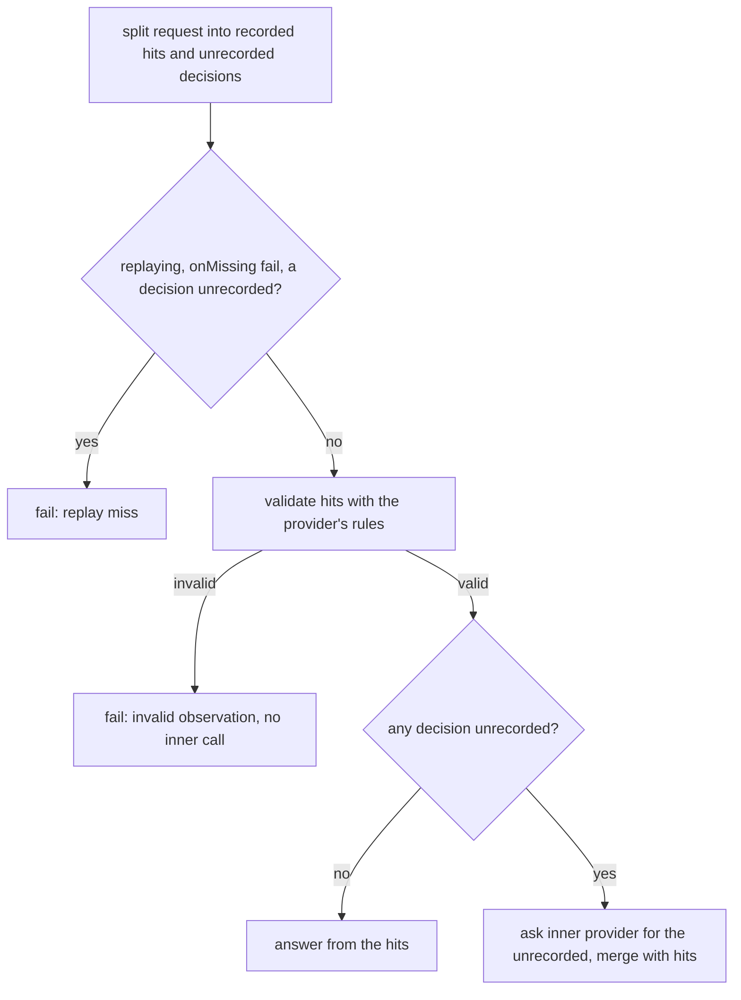
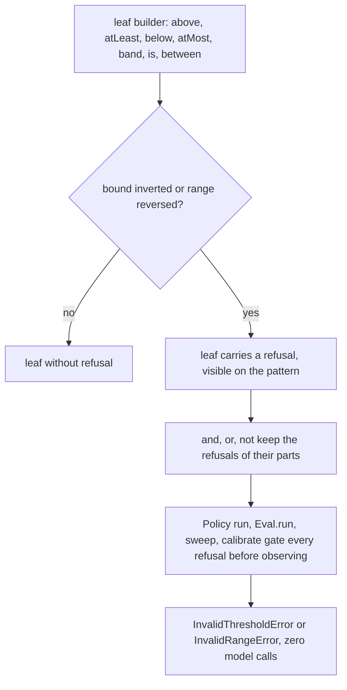

# Discern Upstream 0.5.0 Parity - Plan

## Goal Capsule

- **Objective:** A policy author using `@systemfsoftware/discern` gets a named failure, before any model call, from three mistakes that today decide quietly: a tampered recording, an unsatisfiable threshold or range, and an empty calibration candidate list.
- **Means:** Typed failures through the package's existing refusal channels, not thrown errors (KTD1). Stored answers are checked with the provider's own validator (KTD4).
- **Authority:** `packages/discern/AGENTS.md` (D2, D4, D5) and `CONSTITUTION.md` outrank this plan. The upstream release v0.5.0 (commit `a4cb0854a`, https://github.com/doeixd/discern/commit/a4cb0854a5a8aa44f5531903da25134c67f9a2c0) is the oracle for observable behavior, not for mechanism.
- **Execution profile:** Test-first per fix (KTD7). The three test units (U1, U3, U5) are written and run on unmodified `src/` before any fix unit lands. Local commits only.
- **Stop conditions:** Stop and report if a fix needs `Effect.die`, `throw`, a cast, or an edit to a D-rule gate; if a hook rejects a red test commit; or if every red scenario of a test unit is already green on the base tip. A single already-green red scenario is dropped and noted in the commit body (KTD7).
- **Ships:** The branch is handed back unpushed. The executor never pushes, opens or comments on a pull request, or runs `gh` against this repository.

---

## Product Contract

### Summary

Bring three upstream 0.5.0 refusals into the fork: stored answers validated like a provider's, reversed ranges and inverted miss bounds refused when a pattern is built, and an empty calibration set refused. Each lands as a failing test first, then the fix.

### Problem Frame

The fork was cut from upstream at the commit named above and has since diverged in structure: patterns are blueprint values, refusals travel as data on the pattern, and `src/` may not throw (D5). Upstream's three refusals therefore cannot be ported as written. Reading the code shows what is missing here:

- A recorded answer that fails the provider's rules is rejected only by the outermost `DecisionModel.make`, after the inner provider has already been asked for the unrecorded half. The failure reads as a provider fault, and `Model` has no `isInvalidObservation`.
- Only classify thresholds and `band` carry a refusal. `above`, `atLeast`, `below` and `atMost` with an inverted miss bound build a silently two-valued pattern, and both `between` forms accept a reversed range that can never match.
- The refusal gate in `run-policy.cell.ts` inspects only the cases up to the first deterministic match, so refusal depends on the input. `sweep` and `calibrate` observe the union of all candidates before any refusal fires.
- `Eval.calibrate` already rejects `values: []` in its type. An untyped caller still gets past it: `calibrate` reads the first candidate as `undefined`, builds a pattern from it and resolves instead of failing.

### Requirements

**Stored answers**

- R1. A stored answer that breaks the provider's rules (probability outside [0, 1], unknown label, rating outside the level range, kind mismatch, distribution that does not sum to 1) fails the run with an `AiError` that `Model.isInvalidObservation` recognises and `Model.isReplayMiss` does not, under both `replaying` and `caching`.
- R2. The check runs on the recorded half before any call reaches the inner provider, so a tampered hit beside an unrecorded decision costs no model call.
- R3. Under `replaying` with `onMissing: 'fail'`, an unrecorded decision is reported as a replay miss even when a recorded hit is also tampered.
- R4. The check applies to stores built from a typed `Observations` value without decoding (`store(initial)`, `replaying(observations)`) exactly as to a decoded snapshot.

**Pattern construction**

- R5. An inverted miss bound on `above`, `atLeast`, `below` or `atMost` is detected when the pattern is built and refused before any model call. Equal bounds stay legal and two-valued.
- R6. A reversed `between` (numeric `low > high` for probability; `low` after `high` on the scale for rating) is detected when the pattern is built and refused as a new `InvalidRangeError`. Equal ends stay legal and match exactly that value or level.
- R7. Refusal does not depend on the input or on the number of examples. It holds when an earlier deterministic case would match, in `Policy` runs, and in `Eval.run`, `sweep` and `calibrate` for every candidate pattern, before any observation, including with no examples.
- R8. A refused leaf stays refused under `and`, `or` and `not`.

**Calibration**

- R9. `Eval.calibrate` called with no candidate values fails with a typed tagged error before the pattern builder or the model is called.

**Proof**

- R10. Each fix is proven by tests that fail on the base tip for the reason the unit names, observed before the fix exists.

### Key Decisions

- **Refusals stay typed, not thrown.** Upstream throws at build; D5 forbids `throw` in `src/` and its gate cannot be loosened by this work. Governs R5, R6, R9. Rationale and alternatives in KTD1.

### Scope Boundaries

**Considered and not built**

- Literal throw at build. D5 forbids it; see Open Questions.
- Tightening `ProviderAnswer` (branding `probability`). A schema cannot express label membership or the per-decision rating range, and it would change the public `Observation` and `Observations` types. KTD4's single validator covers the same ground. Revisit if a stored answer reaches a policy past the new check.
- Validating answers at record time with the provider's full rules. `recordAnswers` checks shape only, so a bad raw provider answer can be written to a store under `Model.layer` before the outer check rejects it. The next read fails loudly with the new error, so the fault is caught. Revisit if a poisoned store is reported.
- Refusing `NaN` or out-of-domain thresholds, and unknown rating levels in `between`. The request covers inverted and reversed bounds. Typed callers cannot pass an unknown level; a `number` can still be `NaN` or outside [0, 1], and that behaves as it does today.
- Non-finite bounds (`Infinity`). `InvalidThresholdError` and `InvalidRangeError` carry finite numbers or level names, and the existing refusal tests pin that. A refusal is built only from finite bounds, so a non-finite bound behaves as it does today instead of surfacing as a thrown defect. Revisit if the error classes should carry non-finite values.
- Reconciling a stored classify `label` with the argmax of its `probabilities`. The live path does not check it either.

**Deferred to Follow-Up Work**

- Upstream's README note that a rating between two levels satisfies neither `atLeast` the upper nor `atMost` the lower. Documentation only, outside the three fixes.

**Already at parity, no work**

- Finite, non-empty label sets for `classify` and `rate` (`docs/solutions/architecture-patterns/closed-literal-label-sets.md`).
- `Observation` and `Observations` are Schemas, decoded at `load` in `observation-store.handle.ts`.
- `DecisionIdCollisionError` is a typed `Schema.TaggedError`.
- `Eval.calibrate` rejects `values: []` at the type level (`packages/discern/test-types/discern.tst.ts`, "the values a calibration sweeps").

### Open Questions

**Deferred**

- The request says patterns fail "when built". Detection happens at build and the refusal is visible on the pattern, but the failure surfaces at the first consumer (KTD1). If literal throws are wanted, D5 must change first, which needs the requester's approval. The plan does not depend on the answer.
- `Eval.calibrate` with `examples: []` returns an arbitrary first candidate as `best`. The request's "empty set" is read as `values`. Say if `examples` should be refused too.

---

## Planning Contract

### Key Technical Decisions

- KTD1. **Detect at build, carry as data, fail typed at every consumer.** Leaf builders compute the refusal when the pattern is built and store it in the pattern's `refusals`, the mechanism `band` and classify thresholds already use. `Policy` runs and the `Eval` entry points fail with the typed error before observing. Direct `Discern.evaluate` and `Discern.preview` calls are not gates: a refused leaf resolves `Uncertain` with its message, as `band` does today. Alternatives: a literal throw (D5); builders returning `Result` (changes every builder and every call site for faults a typed `Pattern` can carry); failing at policy finish (finish has no error channel).
- KTD2. **`PatternRefusal` becomes a tagged union of threshold and range refusals, with one pure producer mapping each variant to its error.** `InvalidThresholdError` keeps its `{ threshold, value, limit, message }` shape, which existing refusal tests pin. `InvalidRangeError` is a new `Schema.TaggedError` carrying `low` and `high` as number or level name. Today `run-policy.cell.ts` and `eval-measure.ts` each construct `InvalidThresholdError` directly. After the change neither does (`docs/solutions/architecture-patterns/workflow-error-channel-gates.md`, Gate C). `PatternRefusal` is exported and `Pattern.refusals` exposes it, so the union narrows a declared type: a breaking change to the surface (pack: package-surface, `surface-changes-are-versioned.md`).
- KTD3. **The refusal gate covers every case and every candidate, once.** `readOf` in `run-policy.cell.ts` gates all of `spec.cases` and keeps the prefix only for deciding which nodes to observe. `Eval.run` gates its pattern, and `sweep` and `calibrate` gate every candidate pattern, once before iterating examples and before `answeredExamplesOf`. A definition fault must not depend on the input or on the number of examples.
- KTD4. **Stored answers are checked with the provider's own rules, after the source decision and before any inner call.** The rules live in `validateAnswers` inside `DecisionModel.make` (`repos/effect/packages/effect/src/ai/DecisionModel.ts`) and are not exported. The check hands the hits to a throwaway `DecisionModel.make` whose provider returns them, and decides over the hit decisions, so live and stored answers share one rule set. It is a gate only: on success the stored hits pass through unchanged, because they already carry the `_tag` the validator's kind check needs and the outer `DecisionModel.make` re-checks them; on failure the error becomes an `AiError` with module `Discern` and a new method `observation`. With no hits it does nothing, because `Decision.make` rejects an empty decision set (`repos/effect/packages/effect/src/ai/Decision.ts`). The cells receive the check as a field on their request, as `CacheRequest.record` is passed today, so they keep their type-only import of the blueprint. Alternatives: re-implementing the rules (drifts from the provider's) or tightening the `ProviderAnswer` schema (Scope Boundaries).
- KTD5. **Calibrate fails typed, inside its Effect, before anything runs.** A new `Schema.TaggedError` joins `MeasureError`. The guard is the first statement of `calibrate`, ahead of `candidatesOf`. Not `Effect.die`: D5 bans it.
- KTD6. **Tests follow the package's layers.** Refusal and replay behavior goes in Gherkin integration tests in the style of `tests/recording-and-replay.integration.test.ts`. The bound and range contracts also get a property whose generator draws plain finite numbers and whose verdict is the contract inequality, not the code under test (pack: schema-modelling, `refusal-properties-draw-from-the-base-type.md`). Existing assertions are not edited (pack: testing, `failing-tests-are-fixed-not-weakened.md`).
- KTD7. **Each fix is a test unit, then a fix unit.** The test unit is run against code that does not yet contain its fix, and the failing assertions are recorded. An assertion that already passes on the base tip is not a gap: drop it rather than keep a characterization test, except the green-on-base controls and guards a unit names, which protect a requirement the fix must not flip. (session-settled: user-directed — chosen over landing each test and fix together: the failure observed on the base is the evidence the gap exists.)

### Assumptions

- Reading `fromProvider`, `decoratedModel` and `observe` shows stored answers already pass through the outer `DecisionModel.make`, so a tampered recording fails today, late and mislabelled. This was read, not run. U1's red run confirms which of its assertions fail for the stated reasons.
- The pattern value exposes its `refusals` target, so detection at build can be asserted without running. If it is not exposed, assert through the package's inspection output.

### High-Level Technical Design

Stored-answer read order under `replaying` and `caching` (`caching` has no `onMissing: 'fail'` branch):

Refusal lifecycle from builder to consumer:

### Risks & Dependencies

- Gating every case changes behavior for existing callers: a refused leaf behind a deterministic match used to be silent for inputs that never reached it. The changeset says so.
- `DecisionModel.make` is `@stability unstable` in the vendored tree. U2's tests pin the behavior the validator relies on (label, range and distribution rules), so a change in effect fails them.
- The `PatternRefusal` union touches the error unions in `matcher.blueprint.ts`, `run-policy.cell.ts`, `measure-pattern.cell.ts` and `eval-measure.ts`, plus `test-types/discern.tst.ts`. A missed union fails typecheck, which is the intended check.
- A hook may reject a red test commit. If so, stop and report the hook output; the plan does not fall back to landing test and fix together (KTD7).
- U2, U4 and U6 run in that order, not in parallel: U4 and U6 share `eval-measure.ts` and `DiscernError.schema.ts`.

---

## Implementation Units

Order: U1, U3, U5 (test units, each run on unmodified `src/`), then U2, U4, U6 (fixes, in that order), then U7.

### U1. Red tests: stored answers are validated like a provider's

- **Goal:** Tests that fail on the base tip for the behavior R1-R4 name.
- **Requirements:** R1, R2, R3, R4, R10
- **Dependencies:** none
- **Files:**
  - Create `packages/discern/tests/stored-answer-validation.integration.test.ts`
  - Read for patterns: `packages/discern/tests/recording-and-replay.integration.test.ts`, `packages/discern/tests/__fixtures__/counting-model.fixture.ts`, `packages/discern/tests/__fixtures__/answering-model.fixture.ts`
- **Approach:**
  - Record a valid run into a store, then corrupt the recording. Cover the typed `Observations` path and a decoded snapshot.
  - Assert on the error discriminators and on `CountingModel` call counts, so a red result comes from behavior and not only from a missing export.
- **Execution note:** Write the tests first and run them before touching `src/`. Expected red reasons are listed per scenario. Record each failing assertion.
- **Test scenarios:**
  - Replay where every hit is tampered (`probability: 7` on a probability decision): fails, `isInvalidObservation` true and `isReplayMiss` false. Red: the failure is provider-attributed and the predicate does not exist.
  - Replay with an unknown classify label, a rating of 99 and of -1 on a four-level scale, a `_tag` that disagrees with the decision kind, and a distribution summing to 0.5: each fails with `isInvalidObservation`. Red for the same reason.
  - Caching with one tampered hit and one unrecorded decision: fails invalid-observation with 0 model calls. Red: 1 call is made.
  - Replay with `onMissing: 'ask'`, one tampered hit and one unrecorded decision: fails, and the model is asked for nothing. Red: it is asked for the unrecorded decision.
  - The same tampering through `replaying(observations)` and `store(initial)` with no decode: same failure.
  - Replay with `onMissing: 'fail'`, a tampered hit and an unrecorded decision: replay miss, not invalid-observation. Expected green on base; this guards R3 against the fix flipping it.
  - A valid recording replays and caches unchanged with 0 model calls. Expected green on base.
  - Caching with an empty store, and replay with `onMissing: 'ask'` and an empty store: the model is asked for every decision, and answers are recorded or returned as today. Expected green on base; this guards the no-hits path of the new check.
- **Verification:** The file fails on the base tip for the reasons above, and its green-on-base scenarios (replay-miss precedence, valid recording, empty store) pass.

### U2. Validate stored hits before any inner call

- **Goal:** Stored answers fail with `isInvalidObservation` before any inner call.
- **Requirements:** R1, R2, R3, R4 (KTD4)
- **Dependencies:** U1
- **Files:**
  - Modify `packages/discern/src/decision-model.blueprint.ts` (`DiscernMethod`, predicate, validator), `packages/discern/src/replay-provider.cell.ts`, `packages/discern/src/cache-provider.cell.ts`, `packages/discern/src/Model/mod.ts`
  - Test: `packages/discern/tests/stored-answer-validation.integration.test.ts`
- **Approach:**
  - Add `DiscernMethod.observation` and `isInvalidObservation` beside `isReplayMiss`, and export it from `Model/mod.ts`.
  - Build the check per KTD4: a gate that leaves the stored hits unchanged on success, maps its failure to the `observation` `AiError`, and does nothing when there are no hits.
  - Run it in the `AllRecorded` and `AskForMissing` write branches of both cells, before any `inner.decide`, and after the replay-miss decision (R3). Do not run it in the cells' `read` step: that runs before the source decision and would report a tampered hit ahead of a replay miss. The hit decisions come from the request's decisions.
  - Pass the check to the cells as a request field, like `CacheRequest.record`, so no cell imports a value from `decision-model.blueprint.ts` (a value import cycle).
  - Declare the new failure in the sandwich `write` error types so `replaying` and `caching` still type-check.
  - D2, D4 and D5 hold: no `provide`, no change to fingerprints or addresses, no throw or cast.
- **Patterns to follow:** `observedAnswerOf` and `answerEntryOf` for turning a Schema result into an `AiError`; `replayMissFailure` for the discriminator shape.
- **Test scenarios:** U1's file passes. `tests/replay-parity.differential.test.ts` and `tests/caching-parity.differential.test.ts` pass unchanged.
- **Verification:** U1's red scenarios are green and no existing assertion was edited.

### U3. Red tests: inverted bounds and reversed ranges are refused

- **Goal:** Tests that fail on the base tip for R5-R8.
- **Requirements:** R5, R6, R7, R8, R10
- **Dependencies:** none
- **Files:**
  - Create `packages/discern/tests/pattern-bounds.integration.test.ts`
  - Create `packages/discern/src/__tests__/pattern-bounds.property.test.ts` (follow `skill://architect-property-tests` and the layout of the existing property tests there)
  - Read for patterns: `packages/discern/tests/policy-matching-and-uncertainty.integration.test.ts` (the existing `InvalidThresholdError` case asserts `asked: 0`)
- **Approach:**
  - Assert detection at build through the pattern's `refusals`, and consumption through a policy run and the `Eval` entry points.
  - Assert on `_tag` strings, so a red result is a behavioral miss and not an import error for the not-yet-existing class.
- **Execution note:** Written and run before any fix unit lands, so the red results are the base tip's.
- **Test scenarios:**
  - `above(0.5, { missBelow: 0.8 })`, `atLeast` likewise, `below(0.5, { missAbove: 0.2 })` and `atMost` likewise: the built pattern holds one refusal naming the bound (value 0.8 or 0.2, limit 0.5). Red: no refusal.
  - A policy using each of those: fails `InvalidThresholdError`, 0 model calls. Red: it runs and asks.
  - `between(0.6, 0.4)`: fails with `_tag` `InvalidRangeError`, low 0.6, high 0.4. Rate `between('major', 'minor')` and `between('critical', 'trivial')`: fails with the level names. Red: the run succeeds with a silent miss.
  - Equal bounds and ends are legal: `above(0.5, { missBelow: 0.5 })` never yields Uncertain; `between(0.5, 0.5)` matches 0.5 and misses 0.51; rate `between('major', 'major')` matches rating 2 and misses 1.5. Expected green on base.
  - `band({ match: 0.5, miss: 0.8 })` and classify `is(label, { match: 0.5, miss: 0.8 })` keep their current `InvalidThresholdError` shape. Expected green on base.
  - A policy whose first case is a deterministic guard that matches and whose second case is refused: fails for that input. Red: it succeeds.
  - A refused leaf under `and`, `or` and `not`: the composed pattern is refused.
  - `Eval.run` on a refused pattern, with examples and with `examples: []`: refused with 0 model calls. Red: it succeeds, with an empty report when there are no examples.
  - `Eval.sweep` over `values` with a valid candidate then an inverted one: refused with 0 model calls. Red: the model is asked. `sweep` with `examples: []` and an inverted candidate: refused. Red: it returns results.
  - A direct `Discern.evaluate` of a refused probability leaf answers `Uncertain` with the refusal message. Red: it answers Match or Miss.
  - `above(0.5, { missBelow: Infinity })` builds with no refusal and runs as today, with no defect. Expected green on base.
  - Property: for arbitrary finite `(threshold, miss)`, the pattern is refused exactly when the miss bound is strictly on the wrong side of the match bound. For arbitrary finite `(low, high)`, `between` is refused exactly when `low > high`. Generators draw plain finite numbers plus 0 and 1.
- **Verification:** The listed scenarios fail on the base tip for the stated reasons; the green-on-base scenarios pass.

### U4. Refuse inverted bounds and reversed ranges at build

- **Goal:** Every leaf detects its fault when built, and every consumer refuses before observing.
- **Requirements:** R5, R6, R7, R8 (KTD1, KTD2, KTD3)
- **Dependencies:** U3
- **Files:**
  - Modify `packages/discern/src/DiscernError.schema.ts` (`InvalidRangeError`), `packages/discern/src/pattern.blueprint.ts` (`PatternRefusal` union), `packages/discern/src/decision.blueprint.ts` (probability `above`/`atLeast`/`below`/`atMost`, both `between` forms, `band`), `packages/discern/src/run-policy.cell.ts`, `packages/discern/src/eval-measure.ts`, `packages/discern/src/measure-pattern.cell.ts`, `packages/discern/src/matcher.blueprint.ts`, `packages/discern/src/Discern/mod.ts`, `packages/discern/test-types/discern.tst.ts`
  - Test: the U3 files
- **Approach:**
  - Make `PatternRefusal` a tagged union and add one pure function mapping each variant to its error. `run-policy.cell.ts` and `eval-measure.ts` call it and no longer construct `InvalidThresholdError` themselves.
  - Probability leaves with an inverted miss bound take the existing refused-leaf path that `band` and classify thresholds use. Rate `between` compares level positions, with equal positions legal.
  - `readOf` gates all of `spec.cases`. `Eval.run` gates its pattern once before iterating examples. `sweep` and `calibrate` gate every candidate before `answeredExamplesOf`.
  - Export `InvalidRangeError` from `Discern/mod.ts` and extend every error union that names `InvalidThresholdError`.
  - Build a refusal only from finite bounds, so the error classes' finite fields never fail at construction (Scope Boundaries).
- **Patterns to follow:** `bandRefusalOf`, `thresholdRefusalOf` and `refusedLeaf` in `decision.blueprint.ts`; `refusalGate` in `eval-measure.ts`.
- **Test scenarios:** U3's file and property pass. The existing refusal tests in `tests/refusals-name-what-went-wrong.integration.test.ts` and `tests/policy-matching-and-uncertainty.integration.test.ts` pass unchanged.
- **Verification:** U3 is green; `pnpm --filter @systemfsoftware/discern test:types` reports the widened error unions with no edits to existing type assertions beyond adding `InvalidRangeError` to the unions.

### U5. Red test: calibrate refuses an empty candidate list

- **Goal:** A test that fails on the base tip for R9.
- **Requirements:** R9, R10
- **Dependencies:** none
- **Files:** Modify `packages/discern/tests/evaluation.integration.test.ts` (add a scenario; leave existing ones as written)
- **Approach:** Call `Eval.calibrate` the way an untyped caller does, with an empty `values`. Count calls to the `pattern` function and to the model.
- **Test scenarios:**
  - Empty `values`: fails with the new tagged error, and the `pattern` function is never called. Red: `pattern` is called with `undefined` and `calibrate` does not fail with the tagged error.
  - Empty `values`: the model is called 0 times. Expected green on base, because `observe` returns early when there are no decision nodes; keep it as a guard.
  - One candidate: returns it as `best`, `results` has length 1. Expected green on base.
  - The type-level refusal of `values: []` stays in `test-types/discern.tst.ts`. Do not duplicate it.
- **Verification:** The empty-values scenario fails on the base tip for the stated reason.

### U6. Guard calibrate before anything runs

- **Goal:** `Eval.calibrate` fails typed on empty `values`.
- **Requirements:** R9 (KTD5)
- **Dependencies:** U4, U5
- **Files:** Modify `packages/discern/src/eval-measure.ts` (`calibrate`), `packages/discern/src/DiscernError.schema.ts`, `packages/discern/src/measure-pattern.cell.ts` (`MeasureError`), `packages/discern/src/Discern/mod.ts`; test in U5's file
- **Approach:**
  - Add the tagged error and put it in `MeasureError` and the public exports.
  - Check `options.values` first in `calibrate` and return `Effect.fail` before `candidatesOf` runs.
- **Test scenarios:** U5's file passes.
- **Verification:** U5 is green; the D5 gate in Verification Contract prints nothing.

### U7. Docs, API report, changeset

- **Goal:** The public surface and its documentation match the new behavior.
- **Requirements:** R1, R5, R6, R9
- **Dependencies:** U2, U4, U6
- **Files:** Modify `packages/discern/README.md`, `packages/discern/etc/discern.api.md` (regenerate with the package's `api:update`); add one `.changeset/` intent through `pnpm change`
- **Approach:**
  - README: say that an inverted miss bound or a reversed range is refused with `InvalidThresholdError` or `InvalidRangeError` before any model call in `Policy` runs and the `Eval` entry points, that a direct `Discern.evaluate` of a refused pattern answers `Uncertain` with the refusal message, and that `replaying` and `caching` validate stored answers and fail with an error `Model.isInvalidObservation` recognises. Remove any claim that these throw.
  - Changeset: recommend `major`, because `PatternRefusal` becomes a tagged union and a consumer reading `refusal.threshold` stops compiling (pack: package-surface, `surface-changes-are-versioned.md`). The body states only what a consumer can observe: the union, the new exports (`InvalidRangeError`, `Model.isInvalidObservation`, the calibrate error), patterns that were silently accepted now being refused, refusal no longer depending on the input, and direct `Discern.evaluate` answering `Uncertain` (REPO-R2).
- **Test expectation:** none -- documentation, generated report and changeset intent.
- **Verification:** `api:check` passes against the regenerated report; the changeset check passes.

---

## Verification Contract

| Scope                 | Command                                                                                                                           | Notes                                       |
| --------------------- | --------------------------------------------------------------------------------------------------------------------------------- | ------------------------------------------- |
| Red runs (U1, U3, U5) | `pnpm --filter @systemfsoftware/discern test` on the new or changed test files, before any fix unit lands                         | Record the failing assertions and messages. |
| Unit and integration  | `pnpm --filter @systemfsoftware/discern test`                                                                                     | After each fix unit.                        |
| Type tests            | `pnpm --filter @systemfsoftware/discern test:types`                                                                               | After U4 and U6.                            |
| Types and lint        | `pnpm --filter @systemfsoftware/discern typecheck`, `pnpm --filter @systemfsoftware/discern lint`                                 | After each fix unit.                        |
| API report            | `pnpm --filter @systemfsoftware/discern api:check`                                                                                | After U7.                                   |
| D5 gate               | `git grep -n -E 'Effect\.die\|orDie\|getOrThrow\|\bthrow\b\|as unknown\|@ts-expect-error' -- packages/discern/src` prints nothing | After U2, U4, U6.                           |
| D2 gate               | `git grep -n -e 'Effect.provide(' -e 'Layer.provide' -- packages/discern/src` prints nothing                                      | After U2.                                   |
| Full check            | `pnpm check:local`                                                                                                                | After the last edit (REPO-D1).              |

Do not run mutation, e2e or journey suites locally (REPO-D3, OP28). Do not push, open a pull request, or run `gh` against this repository.

## Definition of Done

**Global**

- R1-R10 hold, and each of U1, U3 and U5 was observed failing on unmodified `src/` before any fix unit landed.
- `pnpm check:local` exits 0 after the last edit, and both D gates print nothing.
- No existing assertion was edited, loosened or deleted. Test additions follow the pack rule on weakened tests.
- No scratch files, probes or abandoned-attempt code remain in the diff.
- The branch is unpushed and no pull request or `gh` call was made.

**Per unit**

- U1, U3, U5: the failing assertions and their messages are recorded; assertions that were already green on the base tip were dropped or kept only as the green-on-base guards named above.
- U2, U4, U6: the matching test unit is green and its gates pass.
- U7: README, API report and changeset agree with the shipped behavior.

---

## Sources & Research

- Upstream oracle: commit `a4cb0854a` in https://github.com/doeixd/discern (`src/index.ts`, `src/model.ts`, and the new tests in `test/index.test.mjs`). Its `validateStored` is the model for KTD4. Its throwing builders are the part this plan replaces (KTD1).
- Provider-side validation rules: `repos/effect/packages/effect/src/ai/DecisionModel.ts` (`validateAnswers`, `make`).
- Fork structure: `packages/discern/src/decision-model.blueprint.ts` (`fromProvider`, `decoratedModel`, `recordAnswers`, `splitObservations`, `replaying`, `caching`); `packages/discern/src/decision.blueprint.ts` (`observe`, `bandRefusalOf`, `thresholdRefusalOf`, `refusedLeaf`); `packages/discern/src/run-policy.cell.ts` (`refusalOfCases`, `prefixCasesOf`, `readOf`); `packages/discern/src/eval-measure.ts` (`refusalGate`, `sweep`, `calibrate`).
- Prior learnings: `docs/solutions/architecture-patterns/workflow-error-channel-gates.md` (one producer per error variant); `docs/solutions/logic-errors/sandwich-read-must-not-validate-what-decode-rejects.md` (a check placed where its failure has no handler becomes a defect); `docs/solutions/architecture-patterns/closed-literal-label-sets.md` (the label-set refusal already shipped).
- Pack rules: (pack: testing, `failing-tests-are-fixed-not-weakened.md`), (pack: schema-modelling, `refusal-properties-draw-from-the-base-type.md`), (pack: package-surface, `surface-changes-are-versioned.md`).
