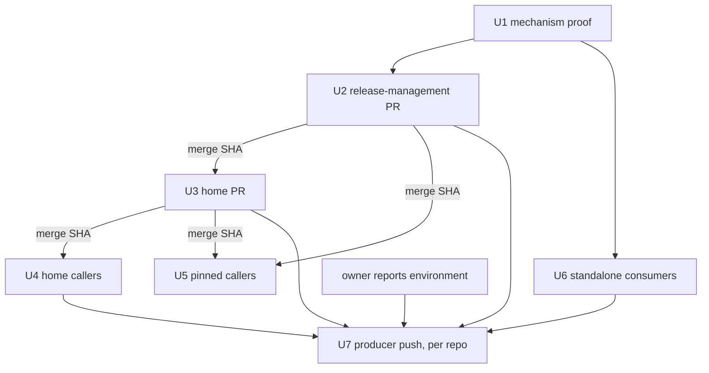

# Public Nix Cache Rollout - Plan

## Goal Capsule

- **Objective:** Every public organization repository that has a flake substitutes Nix store paths from the organization's public binary cache (`https://nix.systemfsoftware.com`), locally and in every CI Nix job, and a cache miss or an unreachable cache never fails a job. The five repositories whose outputs the others build publish to the cache from `main` only.
- **Means:** The cache settings ride on every Nix installer step and in each flake's `nixConfig` (KTD1, KTD2). Shared workflows change first and callers then pin them (KTD3). Pushing is a separate main-only workflow per producer (KTD5).
- **Authority:** Requirements outrank decisions; decisions outrank units. The owner alone creates or reads credentials, GitHub environments, repository settings and secret syncs. This plan never does, and never asks a peer to.
- **Stop conditions:** Stage 3 stops per repository until the owner reports that repository's environment. A pin bump whose PR CI fails for a reason the bump imported stops that PR and is reported, not patched around.
- **Execution profile:** Stage 2 is 21 pull requests, one per repository. Stage 3 is 5 more, one per producer. The maker opens them and supplies evidence; the conductor arranges review and authorizes merges through each repository's own path. The maker never merges by hand.

---

## Product Contract

### Summary

Roll the public cache out to all 21 flake repositories as consumers, then give the 5 producers a main-only publish job. Consumer work needs no credential and proceeds first. Producer work waits, per repository, on the owner's environment.

### Problem Frame

The cache is live and its contract is fixed: three Nix settings for readers, a signed `nix copy --to` for producers. No repository uses it yet. Each repository installs Nix its own way, so "use the cache" is about 53 installer steps, a handful of shared workflows that other repositories pin by commit, and 21 flakes.

`fallback = true` makes a wrong configuration invisible: the job stays green and builds from source. That, and the pinned shared workflows, are where this rollout can look done and not be.

The previous cache actions are retired and now only warn. A scan of all 21 default branches finds no reference to them, so that requirement is already true and must stay true.

### Requirements

**Consumption**

- R1. Every Nix installer step in a consumer's workflows and local composite actions configures the cache as an additional substituter, trusts the cache's public key, and sets `fallback = true`, so a CI Nix job substitutes from the cache and builds from source on a miss.
- R2. Every consumer flake declares the same three settings as its `nixConfig`, so `nix develop` and `nix build` on a developer machine use the cache once that user accepts the flake's settings and is trusted by their Nix.
- R3. A job that runs Nix inside a shared workflow another repository owns is configured only when the caller pins a commit of that workflow that carries R1. The shared workflows are the home repository's reusables and the release-management repository's `changeset-check.yml` and `release.yml`.
- R4. No consumer references the retired cache actions, before or after the rollout.
- R5. No CI job fails because the cache has no path, is unreachable, or resolves through a stale wildcard DNS record.
- R6. The public key written in each consumer equals the cache's published public key byte for byte; a PR proves it.

**Delivery**

- R7. Each repository's change is its own pull request, merged through that repository's own merge path after an independent review of its exact head. Titles, bodies and commit messages obey the public-repository pack (pack: public-repository, names-are-public-or-placeholders.md).
- R8. Every pull request is reported with its number, head SHA and command output that shows the change works in that repository.

**Production**

- R9. A producer pushes only on a push to its default branch, never on `pull_request`, `merge_group` or manual dispatch.
- R10. Push credentials come from a GitHub environment restricted to the default branch, never from repository-level secrets.
- R11. Before any upload the job derives the public key from the signing key and compares it with the cache's published public key; a mismatch uploads nothing and fails the job.
- R12. The job uploads, with the cache's documented `nix copy --to`, every output another repository's flake builds from that producer.
- R13. A path the cache refuses with 413 (compressed NAR over the 100 MB request cap) is reported by store path, with the paths that depend on it, and is not hidden.
- R14. A producer's PR waits for that repository's environment. No consumer PR waits for a producer PR.

### Scope Boundaries

**Outside this work**

- Creating, moving or reading a credential, environment, repository setting or secret sync; the owner's later OIDC and Worker-signing steps.
- Creating a repository or changing a repository's visibility.
- Changing the cache, its Worker, its public key or its retired actions.
- Editing historical plans and solution documents that mention the installer actions.
- Adding a committed test, check or CI job that grades the rollout itself (pack: ci-workflows, ci-never-grades-the-repository-itself.md).

**Considered, not built**

- A `connect-timeout` or other setting beyond the contract's three. A cache that hangs instead of failing is visible as a slower job and cheap to fix then; evidence that would change this is a job slower than its median by a wide margin while the DNS record propagates.
- `accept-flake-config` in CI. It lets any flake's `nixConfig` set arbitrary Nix options for the job; the installer-level settings give CI the cache with no such exposure.
- A shared composite action carrying the cache settings. Its pin would chain every repository behind the home repository and the home repository behind the release-management repository.
- Pushing outputs of non-producers, other platforms than `x86_64-linux` and `aarch64-linux`, or the closure's already-public paths selectively.

**Deferred to Follow-Up Work**

- Rotating the cache key. It touches every site this plan edits; a stale key is a miss, never a failure.

### Outstanding Questions

Blocking Stage 3, for the owner:

- Q1. The name of the GitHub environment in each of the five producers, and whether it is one name for all five.
- Q2. The `comment-checker` default branch is `master`, not `main`. Which branch does its environment restrict to, and does "from main" mean its default branch?
- Q3. Is the push token URL-safe? It reaches `nix copy --to` as Basic-auth credentials and must match GitHub's log masking exactly.

Not blocking, for the owner or conductor:

- Q4. Local `nix develop`: a flake's `nixConfig` applies only to a user the Nix daemon trusts, and only after one interactive acceptance; direnv cannot answer it. Does the owner's machine trust the user, or should contributor docs say how to?
- Q5. Who enqueues each approved PR (each repository's own queue, or the owner), and on what instruction? The maker waits for it.

---

## Planning Contract

### Key Technical Decisions

- KTD1. **Attach the settings to each installer step, not to workflow `NIX_CONFIG`.** The installer writes them to the daemon's system configuration, so they hold for every later Nix call in the job whatever the environment, sudo or caller. A step either carries the block or it does not, which one inventory per repository can prove; an environment variable's reach through composite actions and reusable workflows cannot be proven that way, and a miss is silent under `fallback`. The contract's README shows `NIX_CONFIG`; it fixes the three settings, not the carrier. Chosen over workflow-level `env`, which edits fewer files but leaves transitive callers unverifiable. The Determinate installer takes the same lines through `extra-conf` and the Cachix installer through `extra_nix_config`; both trust the runner user by default and write the system file, so trust does not decide the result.
- KTD2. **`nixConfig` in each flake for local use, with no `accept-flake-config` anywhere in CI.** A scratch flake with `nixConfig` reached the cache under `--accept-flake-config` in a trusted store and was refused with "ignoring untrusted substituter" in an untrusted one, so local use depends on the machine (Q4).
- KTD3. **Waves.** The release-management repository first, then the home repository, then every repository that pins them. A caller's Nix jobs inside a shared workflow substitute only after the caller pins a commit that contains R1, so the pin bump belongs in the caller's one PR. Callers pinned to `@main` change on the publisher's merge and need no edit. Chosen over letting Dependabot bump pins, whose timing nothing controls.
- KTD4. **Two PRs per producer.** The Stage 2 PR is the consumer change. The Stage 3 PR adds the push workflow. A single PR would hold the five consumer changes, and the home repository's wave, behind the owner's environments.
- KTD5. **The push is its own workflow, triggered by a push to the default branch only, with `environment:` on its job.** An environment on a job that also runs for pull requests would block those runs. A reference to an environment that does not exist creates an unrestricted one, so a Stage 3 PR merges only after the owner reports the environment.
- KTD6. **A 413 is reported, not fatal.** It is a property of the path, so failing every main push over it leaves main red permanently and hides real failures. The job names the paths in an annotation and the step summary and exits non-zero for any other upload failure, including a failed key check.
- KTD7. **Each producer carries its own copy of the push logic.** Each Stage 3 PR then waits only for its own environment, and no producer's PR depends on another producer's merge.
- KTD8. **Proof is a one-time mechanism proof, a per-repository inventory and a local observation, none of them committed.** Verbosity 2 (`-vv`) shows `downloading '…/nix-cache-info'` and `querying info about … on 'https://nix.systemfsoftware.com'` when the cache is in use; nothing shows it at default verbosity. In a scratch run, the cache answered the `nix-cache-info` request. (pack: ci-workflows, ci-never-grades-the-repository-itself.md)
- KTD9. **Public-safe text.** PR titles, bodies and commit messages for public repositories name the cache by its URL and call its key file "the cache's published public key". They name no private repository, tracker key, branch containing a tracker key, secret store or sync. Stage 2 branches get neutral names.
- KTD10. **No read or write of environments, secrets, rulesets or repository settings.** Environment existence and restriction come from the owner's report.

### Assumptions

Agent bets, not confirmed with anyone:

- A1. The owner's Stage 2 expectation is KTD4's split, so a producer's consumer change merges before its environment exists.
- A2. Consumer pins at `21dfc32e99…` are a safe bump to the home merge commit: `.github` changed there in two commits, one an added input, one a package removal.
- A3. `api-extractor-effect`, pinned at `732f66a0c8…` with 21 `.github` commits of drift, may import behavior changes its CI must absorb.
- A4. A bump that makes a repository's CI fail on unrelated drift is that PR's problem to report; it is not an R5 failure.
- A5. No change here moves a publishable package's turbo build hash, because every edit is in `.github/`, `flake.nix` or `docs/`. Each repository's own changeset gate decides on its PR.
- A6. The first push of a producer uploads a whole closure and takes far longer than later ones. Not measured.
- A7. Conventional commit type `ci` fits every change; the repositories' commitlint rules apply as written.

### Cache settings (the contract the units copy)

Three settings, verbatim from the cache's contract: the cache URL as an extra substituter, the cache's public key as an extra trusted key, `fallback = true`. The key is copied from the cache's published public key file; this plan carries no copy so there is nothing to drift from it.

### Site inventory

Counts are Nix installer steps found in each repository's default branch on 2026-11-10. A unit re-counts before editing.

| Repository                                                                                             | Installer steps                                                                        | Pins to bump                                                                | Unit |
| ------------------------------------------------------------------------------------------------------ | -------------------------------------------------------------------------------------- | --------------------------------------------------------------------------- | ---- |
| pnpm-release-management                                                                                | changeset-check ×1, ci ×1, release ×3, sandbox ×2                                      | none                                                                        | U2   |
| systemfsoftware                                                                                        | checks-lane action ×6, sfs-deps action ×1, reusable-nix ×1                             | release-management in `changeset-check.yml`, `release.yml`                  | U3   |
| discern, effect-daemon, effect-e2e, effect-memfs, effect-readiness, hex-schema, npm-package, rx-effect | local checks-lane action ×1 each                                                       | home `@21dfc32e99…` everywhere it appears                                   | U4   |
| effect-microvm                                                                                         | local checks-lane ×1, `ci.yml` ×1                                                      | home `@21dfc32e99…` everywhere                                              | U4   |
| api-extractor-effect                                                                                   | local checks-lane ×1, `ci.yml` ×1                                                      | home `reusable-checks` `@732f66a0c8…`; release-management ×2 `@b9b4a1d48c…` | U5   |
| gritlint                                                                                               | `ci.yml` ×1, `mutants.yml` ×2                                                          | release-management ×2 `@b9b4a1d48c…`                                        | U5   |
| qmd                                                                                                    | `nix.yml` ×1 (already sets `extra_nix_config`)                                         | none                                                                        | U6   |
| are-the-types-wrong-effect                                                                             | `ci.yml` ×2                                                                            | none (`@main`)                                                              | U6   |
| omp-claude-compat                                                                                      | `ci.yml` ×1                                                                            | none (`@main`)                                                              | U6   |
| comment-checker                                                                                        | `ci.yml` ×2, Determinate installer, already sets `extra-conf`; default branch `master` | none (`@main`)                                                              | U6   |
| effect-endgame-starter-kit                                                                             | `check.yml` ×1, `deploy.yml` ×2                                                        | none                                                                        | U6   |
| frontend                                                                                               | `check.yml` ×1, `deploy.yml` ×2, `release.yml` ×1                                      | none (`@main`)                                                              | U6   |
| stryker-js-effect                                                                                      | `bench.yml` ×1, `ci.yml` ×5, `e2e.yml` ×1, `nix.yml` ×1, `released-tarballs` action ×1 | none (`@main`)                                                              | U6   |
| xstate                                                                                                 | `dev-shell` action ×1                                                                  | none (`@main`)                                                              | U6   |

Every row also gets its flake's `nixConfig`.

### High-Level Technical Design



The producers are `systemfsoftware`, `stryker-js-effect`, `xstate`, `pnpm-release-management` and `comment-checker`. Each U7 PR starts after that repository's own Stage 2 PR merged and its owner report arrived.

Push job per producer and system, directional only:

```text
on push to default branch only
job (environment: <Q1>, matrix: x86_64-linux, aarch64-linux)
  install Nix with the cache settings
  build each output in the producer's output list
  derive public key from the signing key; compare to published key; stop on mismatch
  upload each output closure with the documented copy command
  on 413: list the refused paths and the paths depending on them; do not fail for these alone
  any other upload failure: fail
```

Outputs per producer are those another repository's flake references, read on 2026-11-10: `systemfsoftware` — `workspace-tarballs`, `dprint`, `test-timings`, `repo-checks`; `stryker-js-effect` — `workspace-tarballs`; `xstate` — `workspace-tarballs`; `pnpm-release-management` — `release-tools`, `sandbox`, `changeset-management`; `comment-checker` — `comment-checker`. U7 re-derives the list from the consuming flakes.

### Risks

| Risk                                             | Consequence                                      | Handling                                                                               |
| ------------------------------------------------ | ------------------------------------------------ | -------------------------------------------------------------------------------------- |
| A site missed or misconfigured                   | The job stays green and builds from source       | Per-repository inventory of every installer step; one runner proof per installer (U1)  |
| Pin bump imports drift                           | A PR fails for a reason unrelated to the cache   | CI on each PR; the repository's own gate; report, never patch around (A4)              |
| Stale wildcard DNS or a hanging cache            | Slow job, no failure                             | Contract's `fallback`; slowness reported; `connect-timeout` is a named non-goal        |
| Stage 3 PR merged before the environment exists  | GitHub creates an unrestricted environment       | Merge only after the owner's report (KTD5)                                             |
| One signing key trusted by every consumer        | A poisoned push poisons all                      | Owner's later OIDC and Worker-signing steps; main-only environment; key check (R9–R11) |
| First push is large and some paths exceed 100 MB | Their dependents stay uncached                   | R13 reports them by name                                                               |
| Release jobs are not run by pull-request CI      | `release.yml` Nix steps unexercised before merge | U1 runner proof, static inventory, first main run reported                             |
| Dependabot opens competing bumps                 | Duplicate or conflicting PRs                     | Compare heads before pushing; close nothing by hand                                    |

### Sources

- The cache's contract: its README and public key file (a private repository; the maker has read access) for the three settings, the push command, the 413 behavior and the retired actions.
- `.github/AGENTS.md` for the reusable workflows' pin contract; `flake.nix` and `nix/` for the home repository's outputs.
- `.github/actions/checks-lane/action.yml`, `.github/actions/sfs-deps/action.yml`, `.github/workflows/reusable-nix.yml`, `.github/workflows/changeset-check.yml`, `.github/workflows/release.yml` for the home sites.
- The Cachix and Determinate installer actions' `action.yml` and `install-nix.sh`: both write to the system configuration and trust the runner user by default.

---

## Implementation Units

### U1. Prove the settings on runners and in a trusted local store

- **Goal:** Establish that the exact block works under both installer actions and under `nixConfig`, before 21 repositories copy it.
- **Requirements:** R1, R2, R5, R6
- **Dependencies:** none
- **Files:** none committed. A scratch flake outside any repository; one push-triggered scratch workflow on a throwaway branch of the home repository with a neutral name, deleted afterward.
- **Approach:**
  1. Run the scratch workflow with the Cachix installer carrying the block and with the Determinate installer carrying it through `extra-conf`. Each builds a trivial derivation at `-vv` and prints the effective settings.
  2. Repeat each with the cache hostname replaced by an unreachable one to show `fallback = true` ends in a source build and a passing job.
  3. Locally, build the scratch flake with `--accept-flake-config` against a trusted scratch store at `-vv`.
  4. Keep the logs in session scratch outside the repository; quote excerpts in later PR bodies.
- **Test expectation:** none -- throwaway proof; nothing committed (pack: ci-workflows, ci-never-grades-the-repository-itself.md).
- **Verification:** Both installers log the `nix-cache-info` download and a `querying info about … on 'https://nix.systemfsoftware.com'` line, with no "ignoring untrusted substituter". The unreachable run exits 0.

### U2. Release-management repository PR (wave 1)

- **Goal:** Every Nix job in `pnpm-release-management`, including the shared `changeset-check.yml` and `release.yml` other repositories call, carries R1; the flake carries R2.
- **Requirements:** R1, R2, R3, R5, R6, R7, R8
- **Dependencies:** U1
- **Files:** `.github/workflows/changeset-check.yml`, `.github/workflows/ci.yml`, `.github/workflows/release.yml`, `.github/workflows/sandbox.yml`, `flake.nix`
- **Approach:**
  1. Add the block to all 7 installer steps and `nixConfig` to the flake.
  2. Leave the workflows' inputs and outputs unchanged, since pinned callers use them.
  3. Record the merge commit as the pin for U3 and U5.
- **Patterns to follow:** The installer action's existing `with:` usage elsewhere in the same file.
- **Test expectation:** none -- CI configuration; its own CI and U1 are the proof.
- **Verification:** An inventory lists 7 installer steps, each carrying the block; the key matches the published one; the PR's CI is green at the head; the repository's changeset gate demands nothing for these files, or its own rule is followed.

### U3. Home repository PR (wave 1)

- **Goal:** The reusables and local actions the other repositories call carry R1, the home flake carries R2, and the home repository pins the new release-management commit.
- **Requirements:** R1, R2, R3, R6, R7, R8
- **Dependencies:** U2 merged
- **Files:** `.github/actions/checks-lane/action.yml`, `.github/actions/sfs-deps/action.yml`, `.github/workflows/reusable-nix.yml`, `.github/workflows/changeset-check.yml`, `.github/workflows/release.yml`, `.github/AGENTS.md`, `flake.nix`
- **Approach:**
  1. Commit the `.github/workflows` and `.github/actions` edits by themselves, since this is an Evaluator surface (root `AGENTS.md`, Surface Classes). No gate is added, edited or loosened.
  2. Commit `flake.nix` and one standing fact in `.github/AGENTS.md` separately: every Nix install in this repository's workflows and actions carries the cache settings.
  3. Bump both release-management pins to U2's merge commit.
  4. Keep reusable workflows' inputs backward compatible for pinned callers.
  5. Record the merge commit as the pin for U4 and U5.
- **Test expectation:** none -- CI configuration; `consumer-fixture.yml` exercises the changed reusables.
- **Verification:** `pnpm check:local` exits 0 after the last edit; the inventory lists 8 installer steps carrying the block; `consumer-fixture.yml` is green at the head; the Evaluator commit contains no other file.

### U4. Home reusable callers (wave 2): nine repositories

- **Goal:** `discern`, `effect-daemon`, `effect-e2e`, `effect-memfs`, `effect-readiness`, `hex-schema`, `npm-package`, `rx-effect` and `effect-microvm` each substitute from the cache in every Nix job, including the jobs inside the reusables they call.
- **Requirements:** R1, R2, R3, R6, R7, R8
- **Dependencies:** U3 merged
- **Files:** per repository, `.github/actions/checks-lane/action.yml`, `.github/workflows/ci.yml`, `.github/workflows/commitlint.yml`, `.github/workflows/nix.yml`, `flake.nix`; for `effect-microvm` also its own installer step in `ci.yml`.
- **Approach:**
  1. Add the block to the local `checks-lane` installer step and, for `effect-microvm`, to the `ci.yml` step.
  2. Replace every occurrence of the old home pin with U3's merge commit, in workflows and in the local action.
  3. Add `nixConfig` to the flake.
- **Patterns to follow:** U3's shape for the block; the repositories' existing pin comments.
- **Test expectation:** none -- CI configuration.
- **Verification:** The old pin appears nowhere; every installer step carries the block; key matches; the PR's CI, including the called reusables' Nix and sfs-deps jobs, is green at the head; a local `nix build --dry-run -vv --accept-flake-config` against a trusted scratch store logs queries to the cache.

### U5. Pinned callers (wave 2): `api-extractor-effect` and `gritlint`

- **Goal:** Both repositories' own Nix steps and the shared-workflow jobs they call carry R1.
- **Requirements:** R1, R2, R3, R6, R7, R8
- **Dependencies:** U2 merged; U3 merged for `api-extractor-effect`
- **Files:** `api-extractor-effect`: `.github/actions/checks-lane/action.yml`, `.github/workflows/ci.yml`, `.github/workflows/changeset-check.yml`, `.github/workflows/release.yml`, `flake.nix`. `gritlint`: `.github/workflows/ci.yml`, `.github/workflows/mutants.yml`, `.github/workflows/changeset-check.yml`, `.github/workflows/release.yml`, `flake.nix`.
- **Approach:**
  1. Add the block to each installer step; both repositories pin the installer by commit, so confirm the pinned version accepts the input.
  2. Bump the release-management pins to U2's merge commit and, for `api-extractor-effect`, the home pin to U3's.
  3. Add `nixConfig`.
- **Execution note:** `api-extractor-effect` crosses 21 `.github` commits of home drift (A3). Read the drift before bumping and let the PR's CI report anything that breaks.
- **Test expectation:** none -- CI configuration.
- **Verification:** As U4, plus no old release-management or home pin remains.

### U6. Standalone consumers (wave 2): eight repositories

- **Goal:** `qmd`, `are-the-types-wrong-effect`, `omp-claude-compat`, `comment-checker`, `effect-endgame-starter-kit`, `frontend`, `stryker-js-effect` and `xstate` each carry R1 and R2.
- **Requirements:** R1, R2, R3, R6, R7, R8
- **Dependencies:** U1. These repositories call release-management at `@main`, so their release-management jobs change on U2's merge with no edit here.
- **Files:** the site inventory rows for U6, plus each repository's `flake.nix`.
- **Approach:**
  1. Add the block to every installer step in the inventory. In `qmd` and `comment-checker` append it to the existing `extra_nix_config` and `extra-conf`.
  2. In `stryker-js-effect` and `xstate`, edit the composite action that installs Nix (`released-tarballs`, `dev-shell`), not the workflows that call it.
  3. Add `nixConfig`.
- **Execution note:** `comment-checker` triggers on `master`. Leave its triggers alone; Q2 concerns only U7.
- **Test expectation:** none -- CI configuration.
- **Verification:** Every installer step in the repository carries the block; key matches; the PR's CI is green at the head; the local dry-run observation (U4) logs queries to the cache.

### U7. Producer push workflow (Stage 3): five repositories

- **Goal:** `systemfsoftware`, `stryker-js-effect`, `xstate`, `pnpm-release-management` and `comment-checker` each publish the outputs consumers build to the cache, from their default branch only, with credentials from the owner's environment.
- **Requirements:** R9, R10, R11, R12, R13, R14
- **Dependencies:** That repository's Stage 2 PR merged; the owner's report for its environment and Q1, Q2, Q3 answered; U1
- **Files:** per producer, one new workflow under `.github/workflows/` in its own directory.
- **Approach:**
  1. Trigger on push to the default branch alone, with a minimal `contents: read` permission and no persisted checkout credentials.
  2. Run one job per system, with the repository's own runner labels for `x86_64-linux` and `aarch64-linux`, in the environment named by Q1.
  3. Build the outputs listed in the design section; confirm each name against the producer's flake and the consuming flakes before writing it.
  4. Write the signing key to a private temporary file, derive its public key and compare it with the published one before any request; never print either secret, only lengths.
  5. Upload with the documented copy command, keeping the token out of arguments and logs. Choose the carrier that does so under GitHub's masking (Q3).
  6. Attribute a 413 to a store path and list it with its dependents in an annotation and the step summary, then fail only for non-413 failures (KTD6).
  7. Carry the cache settings on the installer step (R1).
- **Execution note:** Prove the push logic against a local HTTP stand-in for the cache that returns 401, 413 and 422 and accepts a signed narinfo, using a freshly generated key pair. Throwaway, not committed.
- **Patterns to follow:** The Stage 2 shape of the repository's installer step.
- **Test scenarios:**
  - Matching key: a signed path uploads and the job passes.
  - Mismatched key: no request is made and the job fails before uploading.
  - 413 on one path: the path and its dependents are listed by store path; the job passes if nothing else failed.
  - 401 or 5xx: the job fails.
  - Trigger: no event other than a push to the default branch can start the job.
  - Token: it appears in no log line at `-vv` on any scenario above.
- **Verification:** The stand-in scenarios above behave as listed; the first real main run after merge (owner's environment present) pushes and reports; the maker reports the run's URL and any 413 paths.

---

## Verification Contract

| Applies to               | Command or evidence                                                                                                                                   | Outcome                                                                                           |
| ------------------------ | ----------------------------------------------------------------------------------------------------------------------------------------------------- | ------------------------------------------------------------------------------------------------- |
| Home repository          | `pnpm check:local` after the last edit                                                                                                                | Exit 0                                                                                            |
| Every repository         | The installer-step inventory: every `cachix/install-nix-action` and `DeterminateSystems/nix-installer-action` `uses:` in `.github/` carries the block | Zero steps without it                                                                             |
| Every repository         | The key in the diff against the cache's published public key                                                                                          | Byte-identical                                                                                    |
| Every repository         | A scan of `.github/`, `flake.nix` and `nix/` for the retired actions and the private cache repository's name                                          | No match                                                                                          |
| Every PR                 | The repository's own gate and CI at the exact head                                                                                                    | Green                                                                                             |
| Every U4–U6 PR           | A local `nix build --dry-run -vv --accept-flake-config` on a trusted scratch store                                                                    | `querying info about … on 'https://nix.systemfsoftware.com'` and no untrusted-substituter warning |
| Pin bumps                | The old pin string across the repository                                                                                                              | Not found                                                                                         |
| U7                       | The stand-in scenarios and the first main run                                                                                                         | As U7's verification                                                                              |
| Whole rollout, last step | The inventory, key and retired-action scans repeated on each default branch after its PR merges                                                       | All 21 clean; 5 producers' push workflows present and run                                         |

## Definition of Done

- Global: every one of the 21 repositories passes the inventory, key and retired-action checks on its default branch; every shared-workflow caller pins a commit carrying R1 or calls `@main` after U2 merged; each PR is reported with number, head SHA and command output; the owner's questions are answered or listed as open.
- U1: the proof logs exist in scratch and their excerpts are in the first PR's body.
- U2–U6: each unit's PRs are merged through their repository's own path after a fresh reviewer's approval of the exact head; no throwaway branch or scratch file remains in any repository.
- U7: each producer's PR is merged only after the owner's report; its first main run is reported; any 413 path is listed by name.
- Cleanup: no abandoned-attempt code, scratch workflow or proof branch remains.
