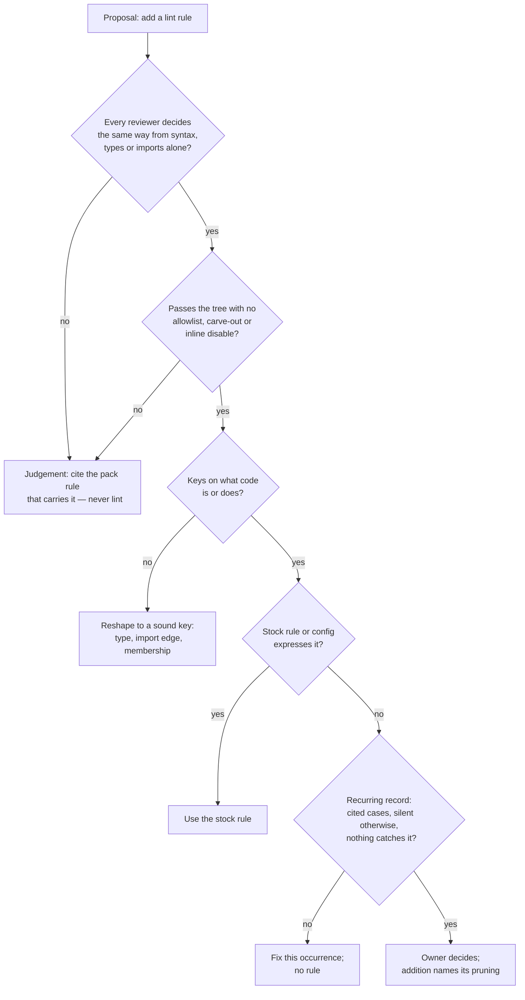

# The lint-hygiene compound pack - Plan

## Goal Capsule

- **Objective:** a planner, a reviewer and a compound-learning author in this repository hold every lint-rule proposal to one test: a rule is proposed only for an objective, recurring restraint, and a judgement call stays a pack rule that review applies. The test is applied by reading, not by running anything.
- **Means:** a new pack `compound-packs/lint-hygiene/` (a README plus six rule files) in the shape the packs README sets, enrolled in `.compound-engineering/config.yaml` and the packs table (KTD1, KTD2).
- **Authority:** the SYS-1264 brief (items 1 to 9; "Done when" and "Does not count" are the contract), the owner's 2026-11-10 quote and the saved lesson "Enforce a forbidden import with an oxlint no-restricted-imports rule, not with a prose claim in AGENTS.md", `CONSTITUTION.md` (CONST-S4, CONST-T12), and the packs README's rule shape.
- **Stop conditions:** the pack files, the two enrolment lines, and this plan. No new lint rule, test, check, hook or CI job; no edit under `.github/`, `packages/`, `scripts/`; no change in any other repository.
- **Execution profile:** docs-only, one pull request from `origin/main` on branch `docs/sys-1264-lint-hygiene-pack`. Verification is the pack resolver, `pnpm check:local` on the head, and the PR body's per-record verdicts.
- **Finishes and ships:** the ce-work executor authors the pack, commits this plan with it, pushes with a plain literal command naming the branch, and opens the PR. The conductor arranges the independent review at the exact head; the PR merges through the queue after a clean review.
- **Open blockers:** none.

---

## Product Contract

### Summary

Add a compound pack of six review rules for lint-rule proposals. The tests a proposal must pass: the restraint is objective (every reviewer decides the same way from syntax, types or imports alone), recurring (a record, not one occurrence), keyed on what code is or does, expressible in stock rules before custom ones, and free of allowlists; every addition names what it prunes; and the test is applied wherever a rule is proposed — review findings, plans, PR bodies, `docs/solutions` Prevention sections, compound learnings. Judgement calls are never lint; they stay pack rules that review cites. The pack holds no incident narrative; the PR body carries the per-record verdicts.

### Problem Frame

Agents propose brittle, overfit linter rules for domains where reviewers decide case by case. The owner, 2026-11-10: "often times the agent will recommend a ridiculous brittle and overfit linter rule that doesn't even make sense since the domain is entirely subjective. For example you cannot have a linter rule that bans all subpath exports. Whether or not a subpath export should be added is a judgement layer." The closed records show the shape: #670 (rules refused for a test-discipline plugin), the seven-PR stack #751–#757 (a lint rule for every same-file function a decide body reaches, state-machine imports in decide bodies and schema files, `Match.exhaustive` on every helper dispatch), and a deleted approval script that refused every PR adding a `package.json` subpath. The counter-ruling must survive: objective restraints do belong in lint — this repository's preset already enforces forbidden imports as `no-restricted-imports`. No doctrine owns the proposal test today; the nearest owners hold neighbouring domains and are cited, not restated.

### Key Decisions

- KD1. **One new pack, not disjoint rules in an existing pack.** No enrolled pack owns lint-rule proposals; the brief's item 9 says the packs table lists "the pack". Governs R1, R2, R9.
- KD2. **The restraint tests govern; the record verdicts stay in the PR body.** Governs R3–R8, R10.

### Requirements

**Pack shape**

- R1. `compound-packs/lint-hygiene/` sits beside the enrolled packs in the packs README's shape: one rule per top-level `.md` file, frontmatter keys exactly `title`, `applies_when`, `tags`; `applies_when` written as situations a task would name; short prescriptive always/never prose; at most one short WRONG/RIGHT example per rule; examples generic (no repository, product, person, path or link a signed-out reader cannot open); no `Gate:` line; no incident narrative, history or evidence in any body (KTD2, KTD3).
- R2. The pack README describes the pack and cites the neighbouring owners instead of restating them: `ci-workflows/ci-never-grades-the-repository-itself.md` (what a check may grade), `testing/configuration-gets-no-test-and-no-gate.md` (configuration gets no gate), `package-surface/subpaths-serve-consumers.md` (where the subpath judgement lives). No rule shares a fix with a neighbour's rule (CONST-S4).

**The restraint tests**

- R3. `lint-carries-only-objective-restraints.md`: lint (oxlint or gritlint, stock config or custom plugin) is proposed only for a restraint every reviewer would decide the same way on every instance, from syntax, types or imports alone. Whether a subpath export, an abstraction, a module split, a dependency or a name is right is a judgement, and a judgement is a pack rule that review applies, never lint. The detection clause for a judgement: a proposal that needs an allowlist, carve-outs or inline disables to pass the current tree is a judgement. The counter-case stands in the same rule: an objective restraint — a forbidden import — becomes lint, as stock `no-restricted-imports` (the preset's `serverStateImports` is the shipped example).
- R4. `a-rule-needs-a-recurring-record.md`: one occurrence earns a fix, not a rule. A proposal needs recurring product-code cases, cited; a violation that would otherwise stay silent; and nothing that already catches it — a type, a stock rule, a test. Adding a rule is the owner's call.
- R5. `rules-key-on-what-code-is-or-does.md`: no rule keys on a file name, suffix, path or the words of the last incident (CONST-T12). A key is sound when the author cannot silently opt out of it: a type, an import edge, package membership.
- R6. `stock-rules-before-custom.md`: stock rules and configuration (`no-restricted-imports`, `no-restricted-syntax`, or the gritlint equivalent) come before a custom plugin rule.
- R7. `every-addition-prunes.md`: an added rule names what comes out — the prose, the check or the rule it replaces. A rule that restates configuration, or never fires, is deleted (CONST-S4).
- R8. `a-lint-proposal-is-tested-wherever-it-is-written.md`: `applies_when` covers writing a review finding, a plan, a PR body, a `docs/solutions` Prevention section, or a compound learning that proposes a lint rule. "Add a lint rule to prevent this" is a finding only when R3–R7 hold; otherwise the text cites the pack rule that carries the judgement.

**Enrolment and delivery**

- R9. `compound-packs/README.md`'s table lists the pack; `.compound-engineering/config.yaml` enrolls `compound-packs/lint-hygiene` (KTD4).
- R10. The PR body carries item 8's verdict per record — not lint: #670, #751–#757, the subpath-export ban; lint is right: a forbidden import as `no-restricted-imports` — each verdict naming the pack rule that grounds it, and one line per source quote (the brief's five) saying which rule it grounds. The record map is Appendix A; the quote map is Appendix B.
- R11. The diff adds no lint rule, test, check, hook or CI job, carries nothing from `.review-input/`, and needs no changeset (no publishable package changes).
- R12. Publication: a plain literal push command naming `docs/sys-1264-lint-hygiene-pack`; the executor opens the PR; `pnpm check:local` exits 0 on the head; review and merge through the queue are post-PR stages the conductor owns.

### Acceptance Examples

- AE1. **Covers R3, R8.** A review finding proposes banning all subpath exports. Refused: whether a subpath should exist is a judgement; the finding cites `(pack: package-surface, subpaths-serve-consumers.md)` instead.
- AE2. **Covers R3, R6.** A proposal forbids importing a module a file may not reach: recurring, silent otherwise, caught by nothing. Accepted as a `no-restricted-imports` value — the counter-case holds; the pack does not forbid lint outright.
- AE3. **Covers R4.** One occurrence of a violation reaches review. It earns a fix; no rule is proposed.
- AE4. **Covers R5.** A proposed rule keys on a filename suffix or quotes last week's incident. Refused, or reshaped to key on an import edge or a type.
- AE5. **Covers R3.** A proposed rule passes the current tree only with an allowlist or inline disables. It is a judgement; review owns it.
- AE6. **Covers R7.** A proposal adds a rule and names no removal, or the rule restates configuration. Refused; a rule that never fires is deleted.
- AE7. **Covers R8.** A Prevention section wants a lint rule for a style preference. The section cites the judgement's pack rule instead.

### Scope Boundaries

- No enforcement of this pack: no lint rule, test, check, hook or CI job enforces it — judgement belongs in review (the brief's "Does not count").
- No consumer-repo work: repositories that enroll this repo's packs move their `ref` and enroll the new pack themselves (the brief's follow-up).
- No lint escalation loop: the loop that returns a refused rule change is researched separately; this pack cites its entry requirements (R4) without implementing it.
- No incident narrative anywhere in `compound-packs/lint-hygiene/`; records live in the PR body only.

---

## Planning Contract

### Key Technical Decisions

- KTD1. **A new pack `lint-hygiene`, not disjoint rules in `ci-workflows` or `testing`.** Those packs own what a CI check is for and what gets a test or gate; none owns when a lint rule may be proposed. Governs R1, R2, R9.
- KTD2. **Six rules, not one per brief item.** Item 5's allowlist test folds into R3's rule as the detection clause for a judgement — both fix the same failure (refuse the rule, keep the judgement in review), and the packs README says rules sharing a fix merge (CONST-S4). Item 8 needs no rule: it is the PR body's verdict work. Governs R3.
- KTD3. **Records appear only in the PR body.** The packs README puts incident narratives, history and evidence outside rule bodies; the brief repeats it. Governs R1, R10.
- KTD4. **Enrolment order: after `ci-workflows`, before `public-repository`** in both `.compound-engineering/config.yaml` and the table — harness-conduct doctrine groups together. Governs R9.
- KTD5. **The pack cites `docs/solutions` doctrine instead of restating it**, one owner per claim: `rule-admission-severity-and-accretion.md` (advisory checks are not lint rules; false-positive budget), `label-routed-rules-are-unfalsifiable.md` and `what-a-filename-suffix-can-enforce.md` (what a rule may key on), `an-escape-hatch-is-an-unfalsified-hypothesis.md` (allowlists), `constraint-reaches-only-via-window-or-gate.md` (who enforces what). Governs R3–R8.
- KTD6. **Citation practice follows the repo's committed plans:** the brief is cited as SYS-1264 the way `docs/plans` cites its briefs; records on the public forge are cited by number; rule bodies and examples name nothing at all. Governs R1, R10.

### High-Level Technical Design

The proposal test the six rules carry, as a reviewer walks it:



Directional map of the test sequence, not implementation specification; the rule files' prose is authoritative.

### Output Structure

```text
compound-packs/lint-hygiene/
  README.md
  lint-carries-only-objective-restraints.md
  a-rule-needs-a-recurring-record.md
  rules-key-on-what-code-is-or-does.md
  stock-rules-before-custom.md
  every-addition-prunes.md
  a-lint-proposal-is-tested-wherever-it-is-written.md
```

---

## Implementation Units

### U1. Write the lint-hygiene pack

**Goal:** the six rules and the pack README exist in the packs README's shape.
**Requirements:** R1–R8, AE1–AE7; KTD1–KTD3, KTD5–KTD6.
**Dependencies:** none.
**Files:** `compound-packs/lint-hygiene/README.md` and the six rule files named in Output Structure.

**Approach:**

- README: what the pack holds (the proposal test), the citation form `(pack: lint-hygiene, <file>.md)`, and R2's three neighbour citations with the boundary sentence for each — the neighbours keep their rules.
- R3's rule carries the objective test, the judgement list, the allowlist detection clause, and the counter-case with a generic RIGHT (`no-restricted-imports` refusing a named module) and WRONG (a ban on every subpath export).
- R4's rule states the three-part record test and that adding a rule is the owner's call.
- R5's rule states CONST-T12 and the three sound keys; cites `docs/solutions/architecture-patterns/label-routed-rules-are-unfalsifiable.md` and `what-a-filename-suffix-can-enforce.md`.
- R6's rule states stock-before-custom; cites the preset's composed import bans as the shipped form.
- R7's rule states prune-on-add and delete-when-restating-or-silent.
- R8's rule lists the five places and the cite-instead-of-lint outcome.
- Every rule cites its `docs/solutions` owners (KTD5) and names nothing private (R1).

**Test expectation:** none -- docs-only doctrine; no behavioural surface exists to test, and the brief forbids adding checks for the pack.
**Verification:** the pack resolver lists `lint-hygiene` with zero warnings and errors; `./bin/dprint check` passes; a read-through confirms each rule holds its brief item and stays disjoint from the neighbours.

### U2. Enroll the pack

**Goal:** the resolver and the table see the pack.
**Requirements:** R9; KTD4.
**Dependencies:** U1.
**Files:** `.compound-engineering/config.yaml`, `compound-packs/README.md`.

**Approach:** append `- source: compound-packs/lint-hygiene` after the `ci-workflows` line; add one table row after `ci-workflows` with a one-line "Holds" entry.

**Test expectation:** none -- config and table edit.
**Verification:** the resolver reports 14 roots, zero warnings and errors.

### U3. PR body, gate, and ship

**Goal:** the PR carries the verdict work and passes the gate.
**Requirements:** R10–R12; KTD6.
**Dependencies:** U1, U2.
**Files:** the PR body (no repository file; this plan commits with the pack).

**Approach:**

- Compose the PR body from Appendix A (one verdict per record, each naming its grounding rule) and Appendix B (one line per source quote naming the rule it grounds).
- Delete `.review-input/` before any gate and keep it out of every commit.
- Run `pnpm check:local` on the head; commit this plan with the pack in the same PR (the repository refuses a plan-only PR).
- Push with a plain literal command naming the branch; open the PR; watch CI by REST; report `ARTIFACTS` and `NEXT`.

**Test expectation:** none -- delivery unit; the gate is the proof.
**Verification:** `pnpm check:local` exits 0 on the head; the PR is open with the verdict table and quote lines present; CI green.

---

## Verification Contract

| Check         | Command                                              | Passes when                                            |
| ------------- | ---------------------------------------------------- | ------------------------------------------------------ |
| Pack resolves | `python3 <ce-plan skill>/scripts/packs-resolve.py`   | 14 roots, zero warnings, zero errors                   |
| Gate          | `pnpm check:local` (after deleting `.review-input/`) | exit 0 on the head                                     |
| Formatting    | `./bin/dprint check` (inside the gate)               | exit 0                                                 |
| Changeset     | none needed                                          | changeset gate exits 0: no publishable package changed |

`pnpm check:local` runs the whole local chain; on a host without `/dev/kvm` the `effect-daemon-microvm#test` task fails its KVM preflight — a known environmental failure this repository's CI covers. A docs-only diff is judged by its own tasks: format, `lint:conventions`, `gate:layers`. Report whatever the run prints, verbatim.

---

## Definition of Done

- Item map: 1→R3, 2→R4, 3→R5, 4→R6, 5→R3, 6→R7, 7→R8, 8→R10, 9→R9 + R12 and the review/merge stages.
- U1's files exist, in shape, disjoint from the neighbours, examples generic.
- U2's two lines land; the resolver sees the pack.
- U3: PR open from `docs/sys-1264-lint-hygiene-pack`, body carrying Appendix A and B's content, gate output recorded, `ARTIFACTS` and `NEXT` reported; no push force, no `--no-verify`, no merge.
- No scratch files, no `.review-input/` content anywhere in the diff.

---

## Appendix A: record verdicts (item 8)

| Record                 | What it proposed                                                                                   | Verdict       | Grounding rule                                                                                                             |
| ---------------------- | -------------------------------------------------------------------------------------------------- | ------------- | -------------------------------------------------------------------------------------------------------------------------- |
| #670                   | rules for `@systemfsoftware/oxlint-plugin-test-discipline`; closed "not approved"                  | Not lint      | `a-rule-needs-a-recurring-record.md` — no record of recurring product-code cases or an objective restraint                 |
| #751                   | pack doctrine for decision-machine placement, wired to a lint stack                                | Not lint      | `lint-carries-only-objective-restraints.md` — the placements are architecture judgements                                   |
| #752                   | `make-body-purity` follows every module binding; refuses the state-machine family in decide bodies | Not lint      | `lint-carries-only-objective-restraints.md` — which helper a decide body may reach is decided per case                     |
| #753                   | `Match.exhaustive` required on every helper dispatch                                               | Not lint      | `lint-carries-only-objective-restraints.md` — dispatch idiom is a judgement; the fix landed as code, no rule               |
| #755                   | judge every same-file function a decide body reaches                                               | Not lint      | `lint-carries-only-objective-restraints.md` — the brief refuses this design choice by name                                 |
| #756                   | refuse state-machine imports in schema files                                                       | Not lint      | `rules-key-on-what-code-is-or-does.md` — extends a design ruling by file kind, not from a recurring record                 |
| #757                   | keep shell machines closed (cell-architecture plugin gates)                                        | Not lint      | `lint-carries-only-objective-restraints.md` — shell-machine closure is a design judgement                                  |
| the subpath-export ban | a deleted script refusing every PR that added a `package.json` subpath                             | Not lint      | `lint-carries-only-objective-restraints.md`; the judgement lives in `(pack: package-surface, subpaths-serve-consumers.md)` |
| forbidden import       | banning a module a file may not reach                                                              | Lint is right | `lint-carries-only-objective-restraints.md` + `stock-rules-before-custom.md` — objective, recurring, stock rule            |

## Appendix B: source quotes and the rules they ground

| Source (quoted from the page)          | Quote                                                                                                                                                                            | Grounds                                                                           |
| -------------------------------------- | -------------------------------------------------------------------------------------------------------------------------------------------------------------------------------- | --------------------------------------------------------------------------------- |
| Agent-Skills, `evaluation`             | "Run deterministic validation before LLM judgment whenever the artifact has machine-checkable structure." / "Separate deterministic validation failures from quality judgments." | `lint-carries-only-objective-restraints.md`                                       |
| Agent-Skills, `advanced-evaluation`    | "Is there an objective ground truth? ... Is it a preference or quality judgment?"                                                                                                | `lint-carries-only-objective-restraints.md`                                       |
| Agent-Skills, `self-improvement-loops` | "Fix a recurring failure at the lowest rung that can express the fix."                                                                                                           | `a-rule-needs-a-recurring-record.md`, `stock-rules-before-custom.md`              |
| Agent-Skills, `harness-engineering`    | "Agents stack changes and rarely remove them. Require pruning rounds."                                                                                                           | `every-addition-prunes.md`                                                        |
| Osmani, brownfield agentic engineering | "When the same review comment appears again, move it into a lint rule ... Keep prose for constraints that cannot be enforced mechanically."                                      | `lint-carries-only-objective-restraints.md`, `a-rule-needs-a-recurring-record.md` |
