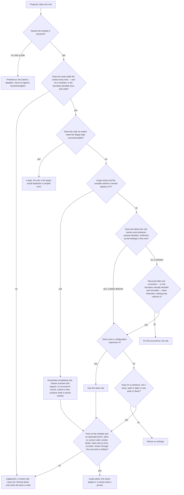

# The lint-hygiene compound pack - Plan

## Goal Capsule

- **Objective:** a planner, a reviewer and a compound-learning author hold every lint-rule proposal to one test an independent reader can apply from the pack text alone: a lint rule encodes a decision made once that holds for every case, never a decision taken case by case, and it names who decided the boundary. The test decides, for a case nobody listed, whether lint is admissible at all, which channel carries it (a type, a rule that completes a type's guarantee, a stock rule, a custom rule), who decides, and the one shape a rule ships in (error over a clean tree, or off, with no hatch). Acceptance is that independent reader's verdicts on cases including ones this plan never sees, among them proposals the pack must admit (R15).
- **Means:** a new pack `compound-packs/lint-hygiene/` (a README plus two rule files), self-contained for a consumer that holds only the pack directory; the four overlapping `docs/solutions` learnings slimmed or reconciled under the packs guide's promotion rule; the repository's own lint-rule instructions inventoried and outside practice weighed against them; enrolment in `.compound-engineering/config.yaml` and the packs table (KTD1, KTD2, KTD5, KTD7, KTD8).
- **Authority:** the SYS-1264 issue as amended through 2026-11-10 (items 1 to 9 as corrected by the owner, the item 10 amendment, the item 11 amendment, the conductor's correction naming `repos/constitution/ENFORCEMENT.md`, and the owner's correction that outside research is weighed, not followed); the conductor's edge-case direction E1–E10, as KTD7 adjusts it; `repos/constitution/ENFORCEMENT.md` and `CONSTITUTION.md` as the bar; the repository records the Clause grounding table names; the packs README's rule shape; the CE packs guide. Brief phrasing grounds nothing by itself (CONST-S2): each clause of each rule carries a repository record (R18).
- **Stop conditions:** the pack files, the four named `docs/solutions` learnings, the two enrolment lines, and this plan. No new lint rule, test, check, hook or CI job; no edit under `.github/`, `packages/`, `scripts/` or `repos/`; no other `docs/solutions` file; no change to any law file (`AGENTS.md`, `CODING_STANDARDS.md`, `CONSTITUTION.md`); no preset severity change; no change in any other repository; no quotation, pointer or restatement of the instrument-builder's law inside the pack (R21).
- **Execution profile:** docs-only, one pull request from `origin/main` on branch `docs/sys-1264-lint-hygiene-pack`. The pack is Doctrine under the root `AGENTS.md` surface classes: never an input to a gate. Verification is the pack resolver, the mechanical greps and `pnpm check:local` on the head. Acceptance is the conductor's independent-reader run at the PR head (R15).
- **Finishes and ships:** the ce-work executor authors the pack and the reconciliation, commits this plan with them, pushes with a plain literal command naming the branch, and opens the PR. The conductor runs the acceptance comparison at the exact head; the PR merges through the queue after a clean independent review.
- **Open blockers:** none. KTD8 and KTD9 are decided positions the owner may overrule at review; neither blocks execution.

---

## Product Contract

### Summary

Add a compound pack of two review rules. The proposal rule carries the whole test a lint-rule proposal must pass, as one sequential procedure a reader applies to a case nobody listed, under one principle: a lint rule encodes a decision made once that holds for every case, it never makes a per-case decision, and where the boundary was decided is cited. The test names the mistake the rule prevents, decides who may add it, asks whether the code settles the verdict, picks the strongest channel (a type; a rule that completes a type's guarantee; a stock rule; a custom rule), tells a defect detector from a restraint and applies the recurrence bar to restraints only, keys on what the code is, checks the rule's shape, and fixes the one shipping form: error over a clean tree, or off, with no hatch. The prune rule owns the estate moment. Both rules are complete for a reader who holds only the pack directory. The four overlapping `docs/solutions` learnings slim or reconcile under the promotion rule.

### Problem Frame

Agents propose brittle, overfit linter rules for domains where reviewers decide case by case. The owner, 2026-11-10: "often times the agent will recommend a ridiculous brittle and overfit linter rule that doesn't even make sense since the domain is entirely subjective. For example you cannot have a linter rule that bans all subpath exports. Whether or not a subpath export should be added is a judgement layer." The closed records show the shape: #670, the seven-PR stack #751–#757, and a deleted approval script that refused every PR adding a `package.json` subpath. The counter-ruling must survive: objective restraints do belong in lint. This repository's preset already ships forbidden-import bans as `no-restricted-imports` values, and a solution doc records one catching a real case. A second class must survive too: a lint rule that closes a hole the compiler admits in a type's guarantee is what makes the type true, and it takes its own test.

The bar is this repository's own law and records, not any outside practice. `repos/constitution/ENFORCEMENT.md` is the standing law for any instrument that grades the maker, and lint gates are named in it; the `docs/solutions` and `docs/plans` records decide the cases it leaves open. Outside practice (the brief's five sources, anti-slop, oxc, ESLint, tsgo) is weighed against that bar: where this repository's law is stricter, its law stands and the outside practice is recorded as rejected; an outside practice enters the pack only where this repository's law is silent and the practice survives it (R22). The existing rule estate is not precedent (CONST-S2) and no grading of it is made here.

### Key Decisions

- KD1. **One new pack, not disjoint rules in an existing pack.** No enrolled pack owns lint-rule proposals; the brief's item 9 says the packs table lists "the pack". Governs R1, R2, R9.
- KD2. **The restraint tests govern; the record verdicts, the sources and the acceptance run live outside the rule bodies.** Governs R3–R8, R10, R13, R15, R18.
- KD3. **No escape hatch for authored code; a baseline or allowlist is a hatch.** (session-settled: user-directed — chosen over an in-code justified exemption: "if you give an agent an escape it will take it", owner, 2026-11-10.) Governs R19, R13.
- KD4. **A rule that completes a type's guarantee is admitted on its own test, not refused as a substitute for the type.** (session-settled: user-directed — chosen over "a type comes before lint; lint never substitutes": the rule is what makes the type's guarantee true, owner amendment, 2026-11-10.) Governs R20, R4, R6.
- KD5. **Severity and taste are tests of the rule, never labels the proposer writes.** (session-settled: user-directed — chosen over a declared oxc category: a declared label is a ritual, conductor correction, 2026-11-10.) Governs R13, R23.
- KD6. **The bar is this repository's law and records; outside practice is weighed, not followed.** (session-settled: user-directed — chosen over treating the research comment as the bar: owner correction, 2026-11-10.) Governs R18, R22.

### Requirements

**Pack shape**

- R1. `compound-packs/lint-hygiene/` sits beside the enrolled packs in the packs README's shape and follows the CE packs guide (https://every.to/compound-engineering/guides/packs): one rule per top-level `.md` file; frontmatter keys exactly `title`, `applies_when`, `tags`; each rule a prescriptive always/never statement with a situational `applies_when`, one situation per line; at most one short WRONG/RIGHT example per rule, illustrating the test and never defining it; examples generic (no repository, product, person, path or link a signed-out reader cannot open); no `Gate:` line; no incident narrative, history or evidence in any body; pack text is evidence that planning and review quote, never an enforcement contract (KTD2, KTD3).
- R2. Each rule is complete for a reader who holds only the pack directory: every discriminating test, carve-out and neighbour boundary is stated in rule text — the subpath judgement, the CI-check boundary and the configuration-gate boundary each as one sentence of this pack's own position, never a pointer. The README describes the pack; resolving stages never read it as a rule, so it carries no load-bearing text (KTD5).
- R21. The pack carries the proposal side only: should this rule exist, and who decides. It states outcomes a reviewer re-derives and never the techniques that make an instrument resist the maker. It never quotes, names or points to the instrument-builder's law, and never carries its corpus (reviewer checks and criteria, severity and waiver tables, incident ledgers, judging rules) or its mechanisms (how a verdict is recomputed, how an empty input is made to fail, how a rubric is held read-only). KTD8 lists what may and may not appear, and why.

**The proposal rule** — one rule file, `a-lint-rule-is-proposed-only-when-the-code-settles-it.md`, carries the following clauses as one sequential test, opening with the principle: a lint rule encodes a decision made once that holds for every case; it never makes a decision that must be taken case by case; lint enforcing a boundary is separate from who decided the boundary; and no rule is landed by the hands that hold the work it judges.

- R23. The shape test: the proposal names the mistake the rule prevents, in one sentence that names no file, name or incident; a proposal that cannot is a preference (R13). It shows the rule firing on the mistake in the idiom the code actually uses, firing on an equivalent form of the same mistake, and silent on the correct form beside it: a rule that catches one spelling and passes an equivalent form is a spelling rule. It shows the compliant rewrite and that the rewrite is better, not merely legal, because a rule's cost includes the shape it forces on every author. It shows carriage by running the artifact the way a consumer resolves it: a rule proved only in its own test harness is not enrolled.
- R24. The decision test: adding a rule is the owner's call. The agent that holds the work a rule would judge never lands the rule with that work: the rule lands alone, in its own change, observed failing before and passing after, by someone who does not hold that work, and the work that prompted it follows. A plan that proposes a rule and the work it would judge is two changes.
- R3. The code-at-hand test: lint is proposed only when the code settles the verdict the same way on every instance — from the file's own syntax, its types or its imports, and from what the module graph carries about the edges this workspace declares (an import edge, a duplicate package), though no single file's text shows it. What the graph does not carry, it does not settle: consumers beyond the workspace — another repository, the package's next consumer — decide a surface's verdict, and a verdict that needs them, or needs intent or product context, is review's, carried as a pack rule review applies, never lint. Review is not free: a pack rule binds when it is read at plan and review, not when the code is written, so sending a verdict there costs coverage, and the pack says so. A stock name is not a boundary: a restraint under `no-restricted-imports` or any stock rule cites the record that decided the boundary, which the reviewer opens; without it the restraint is a per-case judgement wearing a stock name. The rule states what it can resolve, and an input it cannot resolve is surfaced — a finding naming the unread input — never skipped; no proposal names a backstop for silence (KTD9). The judgement list — subpath export, abstraction, module split, dependency, name — appears only as illustrations of the test, never as its definition (CONST-S2).
- R20. The channel test, with three cases. A restraint the code as written makes unconstructable is a type, and a lint rule that duplicates a compile error is refused — no redesign is imagined: while the shipped code still lets the value be built, the type's case fails. A restraint whose type exists as written but whose guarantee the compiler lets a bypass defeat (a structurally identical record built by hand, a cast, an export that hands out a private definition) takes a guarantee-completing rule: it names the invariant the compiler enforces and the specific bypass the compiler admits, reports only what the compiler cannot decide, selects on the bypass itself — always a construct in the code — and never on a file name, needs no recurrence record because one bypass silently voids the guarantee, may be custom because stock-before-custom does not refuse it, and surfaces what it cannot resolve (R3). A rule without a named invariant and a named bypass is an ordinary proposal; a rule that says a file named X must be built with Y selects by a file name (R5) and is refused. Everything else is an ordinary proposal.
- R4. The record test. A rule is a defect detector or a restraint, decided by the failure the mistake names, never by an upstream category, default severity or label or by one finding's site. Ask of the mistake, not of a finding's site: does the failure exist whatever anyone decided? A defect detector names a failure that does — an effect never run or a promise never awaited loses its result or its failure signal whatever anyone chose. A decision can excuse one site; an excused site is fixed — the choice made explicit in code — before the rule ships over a clean tree, never by a hatch. A reader confirms the class by naming, for each finding from running the rule over this tree before its violations are fixed, the failure that code causes without citing a decision anyone made. A restraint names a wrong that exists only once a boundary is decided — an import is legal until a boundary forbids it, a call is correct until taste forbids it. A restraint keeps the record test: one occurrence earns a fix, not a rule; recurring means the same violation appears again after it was corrected once; the proposal needs recurring product-code cases, cited, or the recorded decision the rule encodes, which the reviewer opens — with neither, it is not proposed. A defect detector, stock or custom, needs no recurrence record, because the defect is its justification; it still meets every other test here: the named mistake, a clean tree at error, equivalent forms caught, no hatch, and nothing already catching it (a type, a stock rule, a test).
- R5. The key test: no rule selects what it applies to by a file name, suffix or path, by a comment, marker or declaration its author writes, or by the words of the last incident — a rename or a re-label silences it, and a selector of that kind is refused whatever tool names the path. The unit a rule keys on is the boundary the code constructs through (a constructor call, an import edge, a type), not a name. A custom rule's logic names no application-specific identifier, path or name; a stock rule's configured list carries the decided boundary. A rule whose description needs more than two "and"s is too specific.
- R6. The stock test: a stock rule or configuration (`no-restricted-imports`, `no-restricted-syntax`, or the gritlint equivalent) comes before a custom plugin rule, except for R20's guarantee-completing class.
- R19. The shipping form: a rule ships at error over a clean tree, every live violation fixed first, or it is off. No escape hatch for authored code: no justification comment, marker, disable directive, allowlist of files or paths, baseline of existing violations, carve-out, or per-rule option that opts a file or site out. A rule that cannot hold on every instance without a hatch is a judgement and review owns it; a proposal that ships with a hatch is refused on that ground alone. Excluding code the team does not author is not a hatch, and it is proven, not declared: the exclusion names a path a vendoring manifest pins or a generating tool's configuration lists, the reviewer plants a hand edit in a file there and the tool's own run overwrites it — a surviving edit is authored code and the exclusion is refused — and a planted violation in that path stays unreported in the consumer's own lint run, because an ignore list in a shared preset does not reach a config that extends it. A path whose producer cannot be named is authored code.
- R7. The prune clause: the addition names what comes out — the prose, the check or the rule it replaces. Two directions of one predicate are one rule. A migration rule is off with the reason named while its count is nonzero — never baselined, never at warn — and at zero it enrolls at error as the guard against the retired shape, or is deleted.
- R13. The severity test: severity is the outcome of the tests above, never a label the proposer writes. A rule is on at error over a clean tree, or off with the reason named; `warn` is forbidden. A rule that names a mistake — a defect, a broken guarantee, a limit a published contract sets — is objective; a rule that can name only a style is a preference: the owner's adoption, never an agent's recommendation, and enrolling any rule for every package is the owner's call. A threshold — a size, a count, a depth — is objective only at a measured cliff (the value where a named mistake begins, measured on this code) or a published contract (an external specification, a platform limit, or an interface budget the code's consumers or tools hold it to); a team style guide is a preference. A violation whose fix is mechanical and uncontested belongs to an autofix or the formatter, not to an error a person resolves.
- The same rule states the counter-case: a forbidden import whose boundary was decided and recorded is a stock `no-restricted-imports` value and is right — the counter-case holds, and the pack never forbids lint.

**The prune rule** — one rule file, `lint-rules-are-pruned-not-accreted.md`, owns the estate moment:

- R7 continues: a rule that restates configuration is deleted; a rule no configuration defines, or one set off without its reason named, is deleted; no two rules report the same finding. A rule set off with the reason named — the migration form the proposal side keeps — is resting, not dead: the audit holds it while its count is nonzero, and at zero it enrolls at error or is deleted. A planted violation staying unreported deletes a rule a configuration enrolls; an off rule's silence is its defined state. A rule silent on a clean tree is healthy, not dead. This rule's `applies_when` covers auditing, consolidating or removing lint rules, and reviewing whether an existing rule still earns its place — distinct from the proposal moment, so the two rules stay disjoint in what they prescribe.

**Reach**

- R8. The proposal rule's `applies_when` names each surface of item 7 in the vocabulary its authoring stage's task uses: proposing a lint rule in a review finding; reviewing a change that adds or shapes a lint rule; planning a change and deciding whether it needs one; grounding requirements in lint rules during a brainstorm; writing a pull request body that proposes one; documenting a solved problem and weighing lint as its prevention; writing or refreshing a compound learning that proposes one. Appendix C's reach table names, per surface, the installed stage that loads packs there; the PR-body surface is reported as not covered — no installed stage loads packs while a pull request body is written.

**Acceptance**

- R15. Acceptance is an independent reader applying the pack text alone — as a consumer repository receives it, only the pack directory at the PR's ref — to lint-rule proposals the conductor holds at the PR head: cases this plan never sees, and proposals the pack must admit, drawn from the repository records and the pack's own examples, so the run exercises every discriminating clause. The bar is absolute on the packed reader; the run fails when it endorses lint for a proposal whose verdict needs consumers, intent or product context; endorses any hatch or baseline; admits a rule on an upstream label or a proposer's declaration alone; rejects the forbidden-import counter-case, a guarantee-completing rule that names its invariant and bypass, or any proposal the records or the pack's examples show the pack must admit; or cannot reach a verdict from the pack text alone. The same reader without the pack runs the same cases; the comparison is reported with the results and is not a pass condition.

**Contradictions and grounding**

- R16. The pack takes one position on file-name keys: never a selector on a name, suffix or path, whatever tool names the path. The decision unit is the constructor boundary, not a filename. Every instruction this repository loads that speaks to adding or shaping a lint rule is inventoried (Appendix C) with its relation recorded. The existing rule estate is not precedent (CONST-S2); the pack orders no existing rule deleted, changed or re-graded, and orders no preset severity change — the existing tsgo promotion is recorded in the preset's code and comment, neither endorsed nor re-graded.
- R18. The Clause grounding table, a Planning Contract table, carries every clause's grounding — a repository record opened this run, or the issue's own text; rule bodies and examples name no record, source or law (KTD3, KTD6). No clause rests on an outside source alone when a repository record covers it. A clause with no row in the table is cut before the pack ships. Sources stay out of rule bodies; the PR body carries them.
- R22. Outside practice is weighed, not followed. For each outside practice the pack or this plan uses or contrasts, Appendix B records whether this repository's law already holds it, holds something stricter, or lacks it. Where the law is stricter the law stands and the practice is recorded as rejected with the reason. A practice enters the pack only where the law is silent and the practice survives the law.

**Enrolment and delivery**

- R9. `compound-packs/README.md`'s table lists the pack; `.compound-engineering/config.yaml` enrolls `compound-packs/lint-hygiene` (KTD4).
- R10. The PR body carries item 8's verdict per record with only record-stated reasons — unknown where the record states none — each verdict naming the pack rule that grounds it; one line per outside practice weighed (Appendix B), saying whether it was kept or rejected; the instruction inventory with its relations; the acceptance-run description; and anti-slop's justification-comment rule as a contrast case, not a pattern. Appendix A, Appendix B and Appendix C are the maps.
- R11. The diff adds no lint rule, test, check, hook or CI job, carries nothing from `.review-input/`, and needs no changeset (no publishable package changes).
- R12. Publication: a plain literal push command naming `docs/sys-1264-lint-hygiene-pack`; the executor opens the PR; `pnpm check:local` exits 0 on the head; review and merge through the queue are post-PR stages the conductor owns.
- R14. No rule depends on text outside the pack (R2). The four `docs/solutions` learnings follow the guide's promotion rule: what a rule now states is slimmed out of the learning — or the learning is deleted when fully subsumed — and each learning that contradicts a rule is reconciled to the pack's position; a learning's unique analysis stays. The dispositions are KTD5's table; U4 executes them.

### Acceptance Examples

- AE1. **Covers R3.** A review finding proposes banning all subpath exports. The reader applies the code-at-hand test: deciding needs to know who consumes the subpath — the verdict is review's; the finding carries the judgement instead of lint, and says review binds only when the pack is read.
- AE2. **Covers R3, R6.** A proposal forbids importing a module a file may not reach, citing the recorded boundary decision. Accepted as a `no-restricted-imports` value — the counter-case holds. The same ban with no cited boundary is a per-case judgement under a stock name and is refused.
- AE3. **Covers R4.** One occurrence of a restraint's violation reaches review. It earns a fix; no rule is proposed.
- AE4. **Covers R5.** A proposed rule selects by filename suffix, by a marker its author writes, by a runner's collection glob, or quotes last week's incident. Refused, or reshaped to key on an import edge, a type or the construct itself.
- AE5. **Covers R19.** A proposed rule passes the current tree only with a path allowlist, a baseline of existing violations, a justification comment, a marker, a disable directive or a per-rule opt-out option. It is a judgement, refused on that ground alone. A rule excluding a generated directory passes when the generator's configuration lists that path, the tool's own run overwrites a hand edit there, and a planted violation stays unreported in the consumer's own lint run; a rule exempting a path whose producer cannot be named is exempting authored code, and is a judgement.
- AE6. **Covers R7.** An audit finds a rule that restates configuration, a rule whose planted violation stays unreported, and a second rule reporting the same finding as a first. All three are deleted. A rule silent on a clean tree is kept. A migration rule with a nonzero count is off with the reason named — no baseline, no warn — and at zero it enrolls at error or is deleted. A rule set off with its reason named is resting, not dead: the audit keeps it.
- AE7. **Covers R8.** A Prevention section documents a solved problem and proposes a lint rule. The authoring moment matches the proposal rule's applies_when; the section applies the test instead.
- AE8. **Covers R5.** A rule's description needs four "and"s to say what it refuses. Too specific; refused or narrowed.
- AE9. **Covers R13.** An agent recommends a rule whose only case for its rewrite is a style: it cannot name a mistake, so it is a preference — the owner's adoption, never the agent's recommendation. A proposed rule resting at warn is refused: on at error over a clean tree, or off. A category or severity the proposer writes decides nothing.
- AE10. **Covers R14.** A learning states the key test's claim. The claim is slimmed out of the learning; the learning keeps its incident story and cites the rule.
- AE11. **Covers R15.** The conductor's unseen case: a proposal whose verdict needs knowing the product's consumers. The packed reader refuses it; the no-pack reader may endorse it — a difference the comparison reports. The run fails if the packed reader endorses the proposal or cannot reach a verdict.
- AE12. **Covers R4.** A stock rule is proposed because its upstream default severity or category is high. That label is not evidence: the proposal shows the findings from running the rule over this tree, and the findings confirm the class the mistake's failure names.
- AE13. **Covers R13.** A max-lines rule cites a measured cliff or an external limit; it is objective. A max-params rule citing a team style guide is a preference: a style guide is not a published contract.
- AE14. **Covers R20.** A proposed restraint duplicates what a type already refuses. No rule: a lint report would duplicate a compile error.
- AE15. **Covers R3.** A rule needing types it cannot resolve in re-exported modules reports the input it could not read — surfaced, never skipped; it never stays silent on input it cannot resolve.
- AE16. **Covers R20.** A branded record is minted only through its constructor, yet the compiler admits a hand-built object of the same shape. A rule reporting the hand-built literal names the invariant (minted only through the constructor) and the bypass (the object literal). It needs no recurrence record, may be custom, selects on the literal anywhere it appears, and surfaces what it cannot resolve. Without the named bypass it is an ordinary proposal.
- AE17. **Covers R5.** A rule saying "a file named X must be built with Y" selects by a file name: refused; what the code builds through — a constructor call, an import edge, a type — is the unit a rule keys on.
- AE18. **Covers R23.** A rule bans one spelling of a mistake and passes an equivalent form. Refused as a spelling rule; it ships when it fires on both.
- AE19. **Covers R23.** A rule's compliant rewrite is legal but no better than the code it replaces. The proposal fails until the rewrite is shown better: the rule's cost is the shape it forces.
- AE20. **Covers R24.** A plan adds a lint rule and the code the rule would judge in one change. Split into two: the rule lands alone first, observed failing before and passing after; the work follows.
- AE21. **Covers R23.** A rule is shown passing in its own test harness only. It is not enrolled until shown firing through the artifact a consumer resolves.
- AE22. **Covers R19.** An exclusion for generated code sits in a shared preset's ignore list, and a consumer that extends the preset still reports the generated file. The proposal is incomplete until a planted violation shows the exclusion binds in the consumer's own lint run.
- AE23. **Covers R4.** A stock rule reports a promise that is never awaited, and every finding in this tree is a promise whose result or failure is lost. It is a defect detector: no recurrence record is demanded. It still ships only at error over a clean tree, with equivalent forms caught and no hatch.
- AE24. **Covers R4.** A rule's findings include a call that is correct at a module's own public composition point, so the rule needs a carve-out or an override to stay quiet there. One finding is correct code under a choice, so it is a restraint, not a defect detector: it needs the recurrence record, and the carve-out is a hatch under R19.

### Scope Boundaries

- No enforcement of this pack: no lint rule, test, check, hook or CI job enforces it (the brief's "Does not count").
- No existing lint rule is deleted, changed or re-graded; no preset severity changes; the existing estate is not precedent (CONST-S2) and no grading of it is made. The preset's tsgo promotion stays as recorded — neither endorsed nor re-graded by this work.
- Law files (`AGENTS.md`, `CODING_STANDARDS.md`, `CONSTITUTION.md`, anything under `repos/`) are never edited; no amendment is pending.
- Reconciliation touches only the four learnings named in KTD5; no other `docs/solutions` file moves or shrinks.
- No consumer-repo work: repositories that enroll this repo's packs move their `ref` and enroll the new pack themselves (the brief's follow-up).
- No lint escalation loop: the pack cites its entry requirements (R4) without implementing the loop.
- No incident narrative anywhere in `compound-packs/lint-hygiene/`; records, sources, the inventory and the acceptance description live in the PR body and this plan only.

---

## Planning Contract

### Key Technical Decisions

- KTD1. **A new pack `lint-hygiene`, not disjoint rules in `ci-workflows` or `testing`.** Those packs own what a CI check is for and what gets a test or gate; none owns when a lint rule may be proposed. Governs R1, R2, R9.
- KTD2. **Two rules, justified by two distinct moments.** Item 7's surfaces are one moment — a lint rule being proposed — so one rule file carries the whole sequential test (items 1–6 and 9a, item 10, and the instrument-law positions as R3–R7, R13 and R19–R24's clauses, under the once-decided principle); the guide's disjointness holds because nothing else in the pack prescribes at that moment. The estate moment — auditing, consolidating or removing rules — is a distinct situation with a distinct fix (subtraction), so it gets its own file. Loaded-text cost: a proposal decision loads one body of roughly eighty lines; an audit loads one body of roughly fifteen. No rule exists only to route. Governs R1, R7, R8.
- KTD3. **Records, sources, the inventory and the acceptance description appear only in the PR body and this plan** — never in rule bodies. Governs R1, R10, R16.
- KTD4. **Enrolment order: after `ci-workflows`, before `public-repository`** in both `.compound-engineering/config.yaml` and the table. Governs R9.
- KTD5. **Rules are self-contained; learnings slim or reconcile under the promotion rule.** A consumer resolves only the pack directory, so no rule cites `docs/solutions` or any text outside the pack; boundaries and carve-outs are stated in rule text. The four learnings each slim whatever a rule now states — or are deleted when fully subsumed — and reconcile whatever contradicts a rule, keeping their unique analysis and incident stories, citing the owning rule for what moved:

  | Learning                                                                               | What the rules now state                                                                                | Disposition                                                                                                                                                                                                                                                                                                                 |
  | -------------------------------------------------------------------------------------- | ------------------------------------------------------------------------------------------------------- | --------------------------------------------------------------------------------------------------------------------------------------------------------------------------------------------------------------------------------------------------------------------------------------------------------------------------- |
  | `docs/solutions/architecture-patterns/label-routed-rules-are-unfalsifiable.md`         | The key test's claim, over the same cases (R5)                                                          | Slim: delete the normative argument, the sound-key table and the resulting-shape prescriptions; keep the decision line, supersession notes, stories and decision rationale; cite `(pack: lint-hygiene, a-lint-rule-is-proposed-only-when-the-code-settles-it.md)`                                                           |
  | `docs/solutions/architecture-patterns/an-escape-hatch-is-an-unfalsified-hypothesis.md` | The shipping form: no hatch for authored code, no baseline, no allowlist, no opt-out option (R19)       | Reconcile and slim: its decision line grants a hatch once a probe fails to defeat the claim; the pack grants none, so a surviving "cannot comply" claim narrows the rule's claim and is pinned by a test. Keep the probe method, probe hygiene and the no-manual-tag-member incident; rewrite the Related line on baselines |
  | `docs/solutions/architecture-patterns/what-a-filename-suffix-can-enforce.md`           | The one file-name position: no name selector, whatever tool names the path (R5, R16)                    | Reconcile: the frame and decidability analysis stays; the guidance's permissive blanket ("rules may key on it" in the authoring frame) is replaced by the position; cite the proposal rule                                                                                                                                  |
  | `docs/solutions/tooling-decisions/rule-admission-severity-and-accretion.md`            | On at error over a clean tree or off; no warn; no baseline; advisory checks are review's (R13, R19, R3) | Slim the overlapping normative bullets; reconcile "error plus a dated baseline" as the migration posture, which the shipping form retires: fix the tree first, off with the reason named until then; keep the measurements, the false-positive arithmetic, the warn analysis and the accretion mechanisms                   |

  Governs R14, R2.
- KTD6. **Citation practice follows the repo's committed plans:** the brief is cited as SYS-1264; records on the public forge are cited by number; rule bodies and examples name nothing at all. Governs R1, R10.
- KTD7. **The file-name position and the conductor's edge cases are settled against the repository's own records.** (1) File names: the decision unit is the constructor boundary, not a filename (`docs/solutions/architecture-patterns/make-boundary-owns-a-decision.md`); the pack takes no name, suffix or path selector, whatever tool names the path. `what-a-filename-suffix-can-enforce.md` reconciles to this in U4. (2) TP3 is compatible, not a licence: it assigns where placement verdicts live; a new rule enforcing placement by name still fails R5. (3) Severity is a test of the rule (KD5). (4) Four edge cases change against the standing law: E1 (a stock rule's upstream label is no evidence, R4), E3 (the unresolvable input is surfaced, never skipped, R3, KTD9), E5 (type-first becomes three cases, R20), E7 (a migration rule is off, never baselined, R7). Governs R16, R5, R20.
- KTD8. **What of the instrument-builder's law may appear in pack text.** The pack is read by makers — planners, reviewers and authors — and the builder's law is withheld from makers by its own terms, because a maker who sees the grader's internals shapes work to the grader. The line is outcomes versus mechanisms. May appear, in the pack's own words — never the law's sentences — and as outcomes a reviewer re-derives: that a rule forbids an outcome and never commands a declaration; the channel order for deciding whether a rule should exist (a type; a rule completing a type's guarantee; a stock rule; a custom rule; review carries what lint cannot); the shipping terms (error over a clean tree or off; no warn; no baseline); that a rule names the mistake it prevents; that a rule is proved by running the artifact the way a consumer resolves it (R23); that an input a rule cannot resolve is surfaced, never skipped (KTD9); and who decides (the owner adopts; an instrument lands alone, not with the work it judges), which the constitution already states to makers. May not appear: the corpus of reviewer checks, criteria, severity and waiver tables and incident ledgers; the judging rules; the mechanisms (how a verdict is recomputed, how an empty input is made to fail, how a grader's rubric is held read-only); and any quotation of, name of, or pointer to the file. U1's clause list and this list are the same list: every clause U1 mandates is named above, in the pack's own wording. The test is recomputable by construction: each step names a fact a reviewer re-derives from the code or the tool, never a field the proposer writes (R13, KD5), so showing it to a proposer hands over no lever. This is a decided position, owner-reviewable. Governs R21.
- KTD9. **Failure direction: surfaced, never skipped.** The standing law states the direction without exception — an unreadable input is surfaced, never skipped — and where the law is stricter the law stands (KD6). The dynamic-import record's fail-open-with-a-named-backstop is the weaker form the law's direction supersedes for lint proposals; the record keeps its provenance analysis and is not edited (outside the four named learnings), and the pack states the law's direction in its own words: a rule states what it can resolve and reports every input it cannot; no proposal names a backstop for silence. Decided position, owner-reviewable. Governs R3, R20.

### Clause grounding (R18)

Every row names a repository record first. The issue's own text grounds the items it states. Outside sources appear only in Appendix B.

| Clause                           | Grounding — repository record or issue text opened this run                                                                                                                                                                                                                                                                                                                                                                                                                                                                                                                                 |
| -------------------------------- | ------------------------------------------------------------------------------------------------------------------------------------------------------------------------------------------------------------------------------------------------------------------------------------------------------------------------------------------------------------------------------------------------------------------------------------------------------------------------------------------------------------------------------------------------------------------------------------------- |
| The once-decided principle       | `docs/solutions/architecture-patterns/make-boundary-owns-a-decision.md` (the constructor boundary owns a decision); the counter-case's own structure: the preset ships the boundary as a value and `docs/solutions/build-errors/tests-outside-tsconfig-hide-workspace-source-errors.md` records its catch                                                                                                                                                                                                                                                                                   |
| Names the mistake (R23)          | `repos/constitution/ENFORCEMENT.md`: "Every gate names the mistake it prevents"; `docs/solutions/tooling-decisions/rule-admission-severity-and-accretion.md` (the earn test must reach gates)                                                                                                                                                                                                                                                                                                                                                                                               |
| Equivalent forms; rewrite (R23)  | `docs/plans/2026-09-23-1830-fix-drop-strict-effect-provide-plan.md` (a promoted upstream rule "catches the spelling rather than the lifetime bug" and passes an equivalent form); `docs/solutions/conventions/the-oxlint-gate-wall-shapes-new-package-code.md` (a gate's cost is the compliant shape it forces)                                                                                                                                                                                                                                                                             |
| Carriage (R23)                   | `repos/constitution/ENFORCEMENT.md`: a rule registered only in its own test harness is not enrolled; `docs/solutions/architecture-patterns/dynamic-import-blinds-static-provenance-rules.md` (plant the violation in the idiom the corpus uses; fixtures in one idiom certify nothing)                                                                                                                                                                                                                                                                                                      |
| Who decides; lands alone (R24)   | `repos/constitution/ENFORCEMENT.md` ("Changing an instrument": lands alone, by hands that do not hold the work it judges); `CONSTITUTION.md` CONST-E7; issue item 2 (adding a rule is the owner's call)                                                                                                                                                                                                                                                                                                                                                                                     |
| Code-at-hand test (R3)           | `docs/solutions/architecture-patterns/provenance-ritual-gates.md` (name the claim; if a machine cannot decide it the check asserts a proxy, so leave it to review); `docs/solutions/architecture-patterns/what-a-filename-suffix-can-enforce.md` (what is decidable from a file); `docs/solutions/architecture-patterns/label-routed-rules-are-unfalsifiable.md` (a whole-graph fact is a sound key)                                                                                                                                                                                        |
| Review's cost (R3)               | `docs/solutions/architecture-patterns/constraint-reaches-only-via-window-or-gate.md` (a constraint binds only at the writing act: a window or a gate)                                                                                                                                                                                                                                                                                                                                                                                                                                       |
| Failure direction (R3, KTD9)     | `repos/constitution/ENFORCEMENT.md`: "an unreadable input is surfaced, never skipped"; the shipped `no-inline-suppression` (an unparseable file is a finding, an unreadable one exits nonzero); `docs/solutions/architecture-patterns/dynamic-import-blinds-static-provenance-rules.md` (a rule states its fail direction; its fail-open-with-backstop line is the weaker form KTD9 supersedes); `constraint-reaches-only-via-window-or-gate.md` (a message must claim no more than the check)                                                                                              |
| Channel test (R20)               | `CONSTITUTION.md` CONST-D1; `repos/constitution/ENFORCEMENT.md` (the type, then the command); `docs/solutions/architecture-patterns/constructor-rule-boundary.md` (a type and a rule read disjoint surfaces and are complementary; where the compiler already decides, a rule can never fire); `packages/oxlint-plugin/AGENTS.md` EW1; issue item 10 and its in-tree evidence                                                                                                                                                                                                               |
| Record test (R4)                 | Issue item 2 (for restraints); the owner's close comment on #751–#757 ("a real case from product code and a reproduction"); `docs/plans/2026-09-23-1830-fix-drop-strict-effect-provide-plan.md` (an upstream severity is not evidence of the mistake in this tree, and its findings include correct code at a module's public composition point, which makes that rule a restraint)                                                                                                                                                                                                         |
| Key test (R5)                    | `CONSTITUTION.md` CONST-T12 (what applies to code comes from what it is, never its name or location); `label-routed-rules-are-unfalsifiable.md`; `make-boundary-owns-a-decision.md`; issue item 3; the two-"and"s limit is outside practice kept where the law is silent (Appendix B)                                                                                                                                                                                                                                                                                                       |
| Stock test (R6)                  | Issue item 4; the shipped preset carries forbidden-import bans as `no-restricted-imports` values                                                                                                                                                                                                                                                                                                                                                                                                                                                                                            |
| Shipping form; no hatch (R19)    | Owner ruling 2026-11-10 (KD3); `repos/constitution/ENFORCEMENT.md` (enroll over a clean tree only; a baseline is suppression; `warn` is forbidden); `docs/solutions/architecture-patterns/an-escape-hatch-is-an-unfalsified-hypothesis.md`; `provenance-ritual-gates.md` (a reason checked only for presence is a ritual); the shipped `no-inline-suppression` ("no comment can exempt a file"); `docs/plans/2026-10-09-0046-fix-lint-rule-hygiene-plan.md` (R11: an ignore entry names its producer; the severity rule: zero findings is error, any findings is off with the reason named) |
| Exclusion binds where read (R19) | `docs/solutions/build-errors/oxlint-extends-drops-ignore-patterns.md` (an ignore list does not reach a config that extends it; probe the consumer's own lint)                                                                                                                                                                                                                                                                                                                                                                                                                               |
| Prune clause and prune rule (R7) | `CONSTITUTION.md` CONST-S4; `repos/constitution/ENFORCEMENT.md` (gate economy: subtraction must leave an artifact); `docs/plans/2026-10-09-0046-fix-lint-rule-hygiene-plan.md` (two directions of one predicate merged into one biconditional rule)                                                                                                                                                                                                                                                                                                                                         |
| Severity test (R13)              | `repos/constitution/ENFORCEMENT.md` (forbid an outcome, never command a ritual; `warn` is forbidden); `docs/plans/2026-10-09-0046-fix-lint-rule-hygiene-plan.md`; the preset's own comment at `packages/oxlint-presets/oxlint-config-recommended/src/index.ts:46` ("Off, not warn: a warning fails no command"); the threshold and mechanical-fix limits rest on the conductor's direction E4 and E9 and on the wall-shapes record                                                                                                                                                          |
| Counter-case                     | The preset's shipped `serverStateImports` and the build-errors record (both opened this run); the owner's saved lesson frames it in the brief                                                                                                                                                                                                                                                                                                                                                                                                                                               |

### Edge-case map (E1–E17)

| Case                                                                                  | Deciding clause                                                                                                                                                                |
| ------------------------------------------------------------------------------------- | ------------------------------------------------------------------------------------------------------------------------------------------------------------------------------ |
| E1 — enabling a stock rule (any upstream category)                                    | R4: the failure the mistake names decides; findings in this tree confirm; the upstream label is no evidence                                                                    |
| E2 — a whole-program fact (import graph edge, duplicate package)                      | R3: the code at hand includes what the module graph carries                                                                                                                    |
| E3 — a rule that needs types it cannot see                                            | R3, KTD9: surfaced, never skipped — the unread input is reported                                                                                                               |
| E4 — a threshold (size, count, depth)                                                 | R13: objective only at a measured cliff or a published contract; otherwise a preference                                                                                        |
| E5 — a restraint a type could make unconstructable, or whose guarantee a bypass voids | R20: a type; or a guarantee-completing rule; or an ordinary proposal                                                                                                           |
| E6 — a bar for "recurring"                                                            | R4: for a restraint, the same violation appears again after it was corrected once, or the boundary's decision is already recorded; a defect detector needs neither             |
| E7 — a migration rule                                                                 | R7: off with the reason named while nonzero; at zero it enrolls at error or is deleted                                                                                         |
| E8 — scope by authorship                                                              | R19: an exclusion names a path a manifest or generator configuration lists, the tool overwrites hand edits there, and is proven in the consumer's lint run; otherwise authored |
| E9 — a mechanical, uncontested fix                                                    | R13: autofix or formatter concern, not an error for a person                                                                                                                   |
| E10 — the boundary behind a stock value                                               | R3: the proposal cites the record that decided it; without it, a per-case judgement wearing a stock name                                                                       |
| E11 — a path-scoped override of a stock rule                                          | R5: a name selector, refused whatever tool names the path                                                                                                                      |
| E12 — a guarantee-completing rule that cannot resolve a binding                       | R20, R3: surfaced — the unresolvable binding is reported                                                                                                                       |
| E13 — one predicate enforced in two directions                                        | R7: one rule                                                                                                                                                                   |
| E14 — a rule proposed in the change that holds the work it would judge                | R24: two changes; the rule lands alone first                                                                                                                                   |
| E15 — a rule shown only in its own harness                                            | R23: not enrolled until shown through the artifact a consumer resolves                                                                                                         |
| E16 — an exclusion written in a shared preset                                         | R19: does not reach an extending config; proven in the consumer's own lint run                                                                                                 |
| E17 — a rule the proposer says is correctness-grade                                   | R13: the label decides nothing; the rule names its mistake or is a preference                                                                                                  |

### High-Level Technical Design

The proposal rule's sequential test, as a reader walks it:



The sequential test the proposal rule carries; the rule file's prose is authoritative. The prune rule owns the separate audit moment and has no flowchart: its body is the prune law (R7's estate side).

### Output Structure

```text
compound-packs/lint-hygiene/
  README.md
  a-lint-rule-is-proposed-only-when-the-code-settles-it.md
  lint-rules-are-pruned-not-accreted.md
```

---

## Implementation Units

### U1. Write the lint-hygiene pack

**Goal:** the README and the two rule files exist in the packs README's and the guide's shape, self-contained, grounding-mapped, and deciding every mapped edge case.
**Requirements:** R1–R8, R13, R16, R18–R24, AE1–AE24; KTD1, KTD2, KTD5–KTD9.
**Dependencies:** none.
**Files:** `compound-packs/lint-hygiene/README.md`, `compound-packs/lint-hygiene/a-lint-rule-is-proposed-only-when-the-code-settles-it.md`, `compound-packs/lint-hygiene/lint-rules-are-pruned-not-accreted.md`.

**Approach:**

- README: what the pack holds (the once-decided principle and the proposal test, and the prune law), the citation form `(pack: lint-hygiene, <file>.md)`. No load-bearing text (R2).
- Proposal rule: opens with the principle (a lint rule encodes a decision made once; never a per-case decision; the boundary's decider is cited; no rule lands with the work it judges); then the clauses in the Clause grounding table as one sequential body, in this order: the mistake named (R23), who decides (R24), code-at-hand with review's cost and the failure direction (R3), the channel with the guarantee-completing class (R20), record (R4), stock (R6), key (R5), shape (R23), shipping form with the exclusion test (R19), severity (R13), prune (R7). Then the counter-case, the judgement list framed as illustrations, and the boundary sentences for subpaths (a subpath earns its place with a consumer and a reason — never a ban), CI checks (a lint rule is proposed like any other; it is not a gate on the repository itself) and configuration gates (a configuration gets no test and no gate of its own). One generic WRONG/RIGHT pair; `applies_when` per R8.
- Prune rule: the estate prune law (rules that restate configuration, or that no configuration defines or that sit off without their reason named, are deleted; a rule off with its reason named is resting, kept while its count is nonzero; no two rules report the same finding; a rule silent on a clean tree is healthy); `applies_when` covering audits, consolidation and removals.
- Every clause carries its grounding per the Clause grounding table; a clause with none is cut (R18); every E1–E17 case decides per the Edge-case map; examples stay generic and illustrative (R1, R3); nothing from the instrument-builder's law appears beyond KTD8's list (R21).

**Test expectation:** none -- docs-only doctrine; no behavioural surface exists to test, and the brief forbids adding checks for the pack.
**Verification:** the mechanical greps in the Verification Contract return zero hits; `./bin/dprint check` passes. The resolver lists the pack only once U2 enrols it — that check (14 roots, zero warnings and errors) is U2's verification, not U1's. Whether each rule decides every AE and edge case from the pack text alone is the conductor's acceptance run at the PR head and the queue's independent review, not the executor's own reading (R15).

### U2. Enroll the pack

**Goal:** the resolver and the table see the pack.
**Requirements:** R9; KTD4.
**Dependencies:** U1.
**Files:** `.compound-engineering/config.yaml`, `compound-packs/README.md`.

**Approach:** append `- source: compound-packs/lint-hygiene` after the `ci-workflows` line; add one table row after `ci-workflows` with a one-line "Holds" entry.

**Test expectation:** none -- config and table edit.
**Verification:** the resolver reports 14 roots, zero warnings and errors.

### U3. PR body, gate, and ship

**Goal:** the PR carries the verdict work, the inventory and the acceptance description, and passes the gate.
**Requirements:** R10–R12; KTD3, KTD6.
**Dependencies:** U1, U2, U4.
**Files:** the PR body (no repository file; this plan commits with the pack and the reconciliation).

**Approach:**

- Compose the PR body from Appendix A (per-record verdicts, record-stated reasons, unknown where the record is silent), Appendix B (one line per outside practice weighed, kept or rejected, with anti-slop's justification-comment rule as the contrast case) and Appendix C (the instruction inventory with its relations, the decided positions KTD8 and KTD9 flagged as owner-reviewable, and the acceptance-run description with its failure conditions).
- Delete `.review-input/` before any gate and keep it out of every commit.
- Run `pnpm check:local` on the head; commit this plan with the pack and the reconciliation in the same PR (the repository refuses a plan-only PR).
- Push with a plain literal command naming the branch; open the PR; watch CI by REST; report `ARTIFACTS` and `NEXT`.

**Test expectation:** none -- delivery unit; the gate is the proof.
**Verification:** `pnpm check:local` exits 0 on the head; the PR is open with the three appendix sections present; CI green.

### U4. Reconcile the four learnings

**Goal:** no learning states what a pack rule now states, none contradicts a rule, and the suffix learning carries the one file-name position.
**Requirements:** R14; KTD5.
**Dependencies:** U1.
**Files:** `docs/solutions/architecture-patterns/label-routed-rules-are-unfalsifiable.md`, `docs/solutions/architecture-patterns/an-escape-hatch-is-an-unfalsified-hypothesis.md`, `docs/solutions/architecture-patterns/what-a-filename-suffix-can-enforce.md`, `docs/solutions/tooling-decisions/rule-admission-severity-and-accretion.md`.

**Approach:** execute KTD5's dispositions row by row — slim each learning of the claims the rules now state; reconcile the suffix learning's permissive blanket to the one position; reconcile the escape-hatch learning's decision line and Related line, and the severity learning's baseline posture, to the shipping form; keep each learning's unique analysis, arithmetic, methods and incident stories; cite the owning rule where text moved.

**Test expectation:** none -- doctrine reconciliation; the duplicate check below is the mechanical proof, the acceptance run the semantic one.
**Verification:** for each learning, the citation stands and the text a rule states is gone; no learning grants a hatch or prescribes a baseline; the suffix learning no longer says rules may key on a suffix in the authoring frame; the unique content survives; both corpora still resolve.

---

## Verification Contract

| Check                     | Command / runner                                                                                                    | Passes when                                                                                                                                                   |
| ------------------------- | ------------------------------------------------------------------------------------------------------------------- | ------------------------------------------------------------------------------------------------------------------------------------------------------------- |
| Pack resolves             | `python3 <ce-plan skill>/scripts/packs-resolve.py`                                                                  | 14 roots, zero warnings, zero errors                                                                                                                          |
| Self-containment          | grep the two rule bodies for `docs/solutions`, `AGENTS.md`, `compound-packs/`, `CONST-`, `ENFORCEMENT` and `repos/` | zero hits — no pointer to text outside the pack, and none to the instrument-builder's law (R2, R21)                                                           |
| No hatch or label residue | grep the pack for `SAFETY`, `pedantic` and `suspicious`                                                             | zero hits — no justification-comment form and no declared-category vocabulary (R13, R19)                                                                      |
| Citations in learnings    | grep each of the four learnings for its pack-rule citation                                                          | the citation stands in every KTD5 row that cites one                                                                                                          |
| Learnings reconciled      | the queue's independent review on the PR diff, where the pack and the four learnings are both present               | no learning states what a rule states, grants a hatch, or prescribes a baseline; the suffix learning carries the one position — semantic, not a grep          |
| Acceptance run            | the conductor, at the PR head, against unseen and must-admit cases                                                  | every R15 failure condition avoided — no over-admission, no rejected must-admit proposal, no unreachable verdict; the no-pack comparison reported, not graded |
| Gate                      | `pnpm check:local` (after deleting `.review-input/`)                                                                | exit 0 on the head                                                                                                                                            |
| Formatting                | `./bin/dprint check` (inside the gate)                                                                              | exit 0                                                                                                                                                        |
| Changeset                 | none needed                                                                                                         | changeset gate exits 0: no publishable package changed                                                                                                        |

`pnpm check:local` runs the whole local chain; on a host without `/dev/kvm` a microVM test task can fail its KVM preflight — a known environmental failure this repository's CI covers. A docs-only diff is judged by its own tasks: format, `lint:conventions`, `gate:layers`. Report whatever the run prints, verbatim.

---

## Definition of Done

- Traceability: item 1→R3, 2→R4 and R24, 3→R5, 4→R6, 5→R19, 6→R7, 7→R8 with Appendix C's reach table, 8→R10 with Appendix A, 9a→R13, 9b→R1 and R14, 9→R9 and R12 with the review and merge stages, 10→R20, 11→R23, R19, R13 and R24; A1→R19 and KD3, A2→R13 and KD5, A3→R3 and KTD9, A4→R23, R24, R19, R5 and R4, A5→R21 and KTD8, A6→R22 and Appendix B; B1→R23, B2→R23, B3→R3, B4→R7, B5→R5 and KTD7, B6→R19; C→R20 and KD4.
- Review traceability: F1→R20, F2→R19, R13, R3, R21, F3→R13 (no category vocabulary), F4→R19, F5→Appendix C, F6→R5, F7→R10, F8→KTD5, F9→Appendix C's reach table, F10→R13, F11→the Verification Contract.
- U1's files exist, self-contained, grounding-mapped, examples generic and illustrative, nothing from the instrument-builder's law beyond KTD8's list.
- U2's two lines land; the resolver sees the pack.
- U4's dispositions hold: each learning slimmed or reconciled, unique content kept, citations in place, no hatch and no baseline prescribed.
- U3: PR open from `docs/sys-1264-lint-hygiene-pack`, body carrying Appendices A, B and C's content, gate output recorded, `ARTIFACTS` and `NEXT` reported; no push force, no `--no-verify`, no merge.
- No scratch files, no `.review-input/` content anywhere in the diff.

---

## Appendix A: record verdicts (item 8)

Reasons are only what the record states; the record is the PR's close comment and its own title and body, or a repository record. Where a record states no reason, the reason is "unknown". Item 8's verdict is the issue's. The close comment states a missing adjudication record, so the pack's reason for #751–#757 is the record test (R4); whether any of them names an invariant and a bypass (R20), which needs no record, the records do not say — unknown, not asserted.

| Record                 | What the record states                                                                                                                                                                                                                                                                                                                                                       | Verdict (item 8)     | Grounding rule                                                                       | Reason per record                                                                                                                                                                                                                             |
| ---------------------- | ---------------------------------------------------------------------------------------------------------------------------------------------------------------------------------------------------------------------------------------------------------------------------------------------------------------------------------------------------------------------------- | -------------------- | ------------------------------------------------------------------------------------ | --------------------------------------------------------------------------------------------------------------------------------------------------------------------------------------------------------------------------------------------- |
| #670                   | Close comment: "Closed: not approved. These rules are not going into `@systemfsoftware/oxlint-plugin-test-discipline`." Nothing else.                                                                                                                                                                                                                                        | Not lint             | `a-lint-rule-is-proposed-only-when-the-code-settles-it.md`                           | unknown — the record states no reason                                                                                                                                                                                                         |
| #751                   | Doctrine for decision-machine placement wired to a lint stack; identical close comment (below).                                                                                                                                                                                                                                                                              | Not lint as proposed | proposal rule                                                                        | close comment: "There is no record of how this rule change was decided, or what product code it was measured against. A rule change comes back only through the lint escalation loop, with a real case from product code and a reproduction." |
| #752                   | `make-body-purity` follows module bindings and refuses the state-machine family in decide bodies; same close comment.                                                                                                                                                                                                                                                        | Not lint as proposed | proposal rule                                                                        | same close-comment record                                                                                                                                                                                                                     |
| #753                   | `Match.exhaustive` on every helper dispatch; same close comment.                                                                                                                                                                                                                                                                                                             | Not lint as proposed | proposal rule                                                                        | same close-comment record                                                                                                                                                                                                                     |
| #754                   | Refuse silent stays and tag-keyed dispatch in decide bodies; same close comment.                                                                                                                                                                                                                                                                                             | Not lint as proposed | proposal rule                                                                        | same close-comment record                                                                                                                                                                                                                     |
| #755                   | Title: "judge every same-file function a decide body reaches"; same close comment.                                                                                                                                                                                                                                                                                           | Not lint as proposed | proposal rule                                                                        | same close-comment record                                                                                                                                                                                                                     |
| #756                   | Refuse state-machine imports in schema files; same close comment.                                                                                                                                                                                                                                                                                                            | Not lint as proposed | proposal rule                                                                        | same close-comment record                                                                                                                                                                                                                     |
| #757                   | Keep shell machines closed; same close comment.                                                                                                                                                                                                                                                                                                                              | Not lint as proposed | proposal rule                                                                        | same close-comment record                                                                                                                                                                                                                     |
| the subpath-export ban | The issue names a deleted script that refused every PR adding a `package.json` subpath; `compound-packs/package-surface/subpaths-serve-consumers.md` states the judgement: a subpath earns its place with a consumer and a reason.                                                                                                                                           | Not lint             | proposal rule                                                                        | the pack rule states the judgement the ban mechanised; the script's text is deleted, so no in-tree record of it remains                                                                                                                       |
| forbidden import       | `packages/oxlint-presets/oxlint-config-recommended/src/index.ts` ships `serverStateImports` as a `no-restricted-imports` value; `docs/solutions/build-errors/tests-outside-tsconfig-hide-workspace-source-errors.md` records a real case it caught (`node:buffer` imported in `effect-memfs`, rejected because its source compiles under the Node-free consumer's settings). | Lint is right        | proposal rule (counter-case) + `lint-rules-are-pruned-not-accreted.md` (stock first) | the shipped stock value and the recorded catch are the record                                                                                                                                                                                 |

## Appendix B: outside practice weighed (R22)

The research comment's sources, anti-slop, oxc, ESLint and tsgo, and the brief's five sources are comparison points. The bar is this repository's law and records. The owner, 2026-11-10: "i never said anti-slop was good. in fact our repo is probably much better. i asked you to weigh what was out there."

| Outside practice (source, as quoted on the issue)                                                                                                   | This repository's law                                                                                                                       | Disposition                                                                                                         |
| --------------------------------------------------------------------------------------------------------------------------------------------------- | ------------------------------------------------------------------------------------------------------------------------------------------- | ------------------------------------------------------------------------------------------------------------------- |
| Agent-Skills `evaluation`: "Run deterministic validation before LLM judgment whenever the artifact has machine-checkable structure."                | Holds it: `provenance-ritual-gates.md` (name the claim; leave to review what a machine cannot decide) and the mechanism ladder              | Rejected as a ground; R3 rests on the records                                                                       |
| Agent-Skills `advanced-evaluation`: "Is there an objective ground truth? ... Is it a preference or quality judgment?"                               | Holds it: key every verdict on a recomputation; a preference is the owner's adoption                                                        | Rejected as a ground; R3 and R13 rest on the records                                                                |
| Agent-Skills `self-improvement-loops`: "Fix a recurring failure at the lowest rung that can express the fix."                                       | Stricter: four named rungs, type first, and `constructor-rule-boundary.md` on how a type and a rule complement each other                   | Rejected as stated, ours stands: the practice is subsumed and not cited                                             |
| Agent-Skills `harness-engineering`: "Agents stack changes and rarely remove them. Require pruning rounds."                                          | Stricter: subtract first; net line delta on every change; the addition names what comes out                                                 | Rejected as a cadence ("rounds"); R7 prunes per change and at audit                                                 |
| Osmani: "When the same review comment appears again, move it into a lint rule ... Keep prose for constraints that cannot be enforced mechanically." | Stricter: a recurrence is necessary for a restraint, never sufficient; the code must settle the verdict first                               | Rejected as a sufficient trigger; recurrence stays for restraints (the issue's item 2) and not for defect detectors |
| anti-slop: an exemption by a `SAFETY:` comment with "a nearby, non-empty invariant justification"                                                   | Stricter: no escape hatch; a reason checked only for presence is a ritual; the shipped `no-inline-suppression` refuses a comment exemption  | Rejected; the PR body carries it as a contrast case, never a pattern                                                |
| anti-slop: "Keep rules generic and suitable for reuse across repositories. Do not add application-specific names, paths, or exceptions."            | Silent on a rule's own identifiers; stricter on name and path keys                                                                          | Kept for custom rule logic (R5); no exceptions clause                                                               |
| anti-slop: rules that document "when enforcement is intentionally local"                                                                            | Stricter on direction: an unreadable input is surfaced, never skipped; silent on stating what a rule can resolve                            | Kept: a rule states what it can resolve (R3); the direction is the law's — surfaced, never skipped (KTD9)           |
| oxc: categories (correctness, suspicious, pedantic, restriction) and severity tiers, including tsgo's warning tier                                  | Stricter: "declare a category" is the ritual the law names; `warn` is forbidden                                                             | Rejected; severity is a test of the rule (R13)                                                                      |
| oxc: "Remember that `correctness` rules will be run by default, so be careful when choosing this category."                                         | Silent on what runs for every package; stricter on enrollment (a clean tree, error or off)                                                  | Kept in translation: enrolling a rule for every package is the owner's call (R13)                                   |
| oxc: no new rule families without discussion first                                                                                                  | Lacks it; the guarantee-completing class is custom by nature and the packages are owned outright                                            | Rejected as stated; "adding a rule is the owner's call" is the shared substance (R24)                               |
| ESLint: "A rule is typically too specific if describing what it does requires more than two 'and's"                                                 | Silent                                                                                                                                      | Kept (R5)                                                                                                           |
| ESLint: "No two rules can produce the same warning."                                                                                                | Partly holds: two directions of one predicate are one rule (`2026-10-09-0046-fix-lint-rule-hygiene-plan.md`)                                | Kept as the general form, grounded in the record (R7)                                                               |
| ESLint: "Individual preferences for uncommon patterns are not supported."                                                                           | Differs: a preference is admitted as the owner's adoption                                                                                   | Rejected as stated; R13                                                                                             |
| ESLint: "we have over 200 rules, and that is daunting"                                                                                              | Stricter: rule count is the wrong axis; false-positive arithmetic and diagnostic volume decide (`rule-admission-severity-and-accretion.md`) | Rejected                                                                                                            |

## Appendix C: instruction inventory, closed decisions, and reach

**Inventory of loaded instructions and records that speak to adding or shaping a lint rule (R16):**

| Instruction (as loaded here)                                                                                                                                   | What it says                                                                                                                                                          | Relation to the pack                                                                                                                           | Resolution                                                                                                                                                                                     |
| -------------------------------------------------------------------------------------------------------------------------------------------------------------- | --------------------------------------------------------------------------------------------------------------------------------------------------------------------- | ---------------------------------------------------------------------------------------------------------------------------------------------- | ---------------------------------------------------------------------------------------------------------------------------------------------------------------------------------------------- |
| `repos/constitution/ENFORCEMENT.md`                                                                                                                            | The law for any instrument that grades the maker; lint gates are named. Outcomes, never rituals; enroll over a clean tree; `warn` forbidden; names the mistake        | The bar; stricter than every outside practice; grounds R13, R19, R23, R24 and the failure direction                                            | Read in full; positions restated in the pack's own words under KTD8; never `@`-imported, quoted or pointed to from the pack                                                                    |
| `CONSTITUTION.md` CONST-D1, CONST-T12, CONST-S4, CONST-E7                                                                                                      | Close your types; what applies to code comes from what it is; subtract first; a needed gate is a proposal to its owner and the work waits                             | Grounds R20, R5, R7, R24                                                                                                                       | Cited in this plan only                                                                                                                                                                        |
| `packages/oxlint-plugin/AGENTS.md` EW1                                                                                                                         | Never add a rule that fails a workflow for lacking a schema: `Workflow.make`'s `Inhabited` constraint already refuses it, so a lint report duplicates a compile error | Compatible; the pack's "a type, and no rule" case (R20)                                                                                        | none needed                                                                                                                                                                                    |
| `packages/oxlint-plugin/AGENTS.md` OP-D1                                                                                                                       | Every rule message is one line in four parts; `Fix:` names the literal replacement                                                                                    | Compatible; the rewrite R23 asks the proposal to show is what `Fix:` carries; a message claims no more than the check                          | none needed                                                                                                                                                                                    |
| `packages/oxlint-plugin/AGENTS.md` TP3                                                                                                                         | "File placement — which filenames may exist where — lives only in `@systemfsoftware/oxlint-plugin-test-discipline`; no other plugin reports on a file's location."    | Compatible — it assigns where placement verdicts live (a uniqueness criterion), not a licence to key new rules on suffixes                     | Recorded as compatible with the line quoted; no amendment; no law-file change                                                                                                                  |
| `packages/oxlint-plugin/AGENTS.md` TP5                                                                                                                         | A third test suffix lands only together with the rule that enforces it                                                                                                | Compatible — rule and key ship together; a proposed suffix-enforcing rule is itself judged by R5, which admits no name key                     | none needed                                                                                                                                                                                    |
| `packages/oxlint-plugin/AGENTS.md` TP6                                                                                                                         | The `vitest-runner` role exists because no import key separated the runner packages' tests; one package-declared exemption read by every rule                         | A package-declared exemption is a hatch under R19; the pack admits no new one on its precedent                                                 | Recorded; the pack orders nothing changed and neither endorses nor re-grades it. Whether TP6 stands is a separate owner question, flagged in the PR body                                       |
| The shipped `no-inline-suppression` (test-discipline plugin)                                                                                                   | Fails on any disable directive or `@ts-` suppression comment; "no comment can exempt a file"; an unparseable file is a finding; an unreadable one exits nonzero       | Compatible and stricter than any in-code exemption form; grounds R19 and the failure direction                                                 | none needed                                                                                                                                                                                    |
| The preset `packages/oxlint-presets/oxlint-config-recommended/src/index.ts`                                                                                    | Ships `serverStateImports` as a stock value, path-scoped overrides, and disables Effect's unstable-API rule with "Off, not warn: a warning fails no command"          | The stock value is the counter-case; the path-scoped overrides select by name and are not precedent (CONST-S2); the tsgo promotion is recorded | Recorded, neither endorsed nor re-graded; no preset severity change in this work                                                                                                               |
| The existing rules that key on names or file kinds (for example the kind rules, scoped to "blueprint and handle files" in the cell-architecture plugin README) | Existing rules key on names                                                                                                                                           | Not precedent (CONST-S2); no grading of the estate is made                                                                                     | The pack orders no deletion, change or re-grade; it governs proposals prospectively                                                                                                            |
| `docs/solutions/architecture-patterns/what-a-filename-suffix-can-enforce.md`                                                                                   | A suffix can carry edge and depth-0 syntactic properties; "rules may key on it" in the authoring frame                                                                | Superseded for proposals by the one file-name position                                                                                         | Reconciled in U4; analysis kept; permissive blanket replaced; cites the proposal rule                                                                                                          |
| `docs/solutions/architecture-patterns/label-routed-rules-are-unfalsifiable.md`                                                                                 | A label-routed rule cannot fail on the case it targets                                                                                                                | Grounds R5                                                                                                                                     | Slimmed: decision line, supersession notes, stories and decision rationale kept; normative argument, sound-key table and resulting-shape prescriptions deleted; cites the proposal rule (KTD5) |
| `docs/solutions/architecture-patterns/an-escape-hatch-is-an-unfalsified-hypothesis.md`                                                                         | A hatch is a hypothesis; probe before granting                                                                                                                        | The pack grants none; the probe method survives as the way to learn a rule is a judgement                                                      | Reconciled and slimmed (KTD5)                                                                                                                                                                  |
| `docs/solutions/tooling-decisions/rule-admission-severity-and-accretion.md`                                                                                    | Warn is dominated; "error plus a dated baseline" as the migration posture; false-positive budget arithmetic                                                           | Grounds R13; its baseline posture contradicts R19                                                                                              | Slimmed and reconciled (KTD5); keeps the arithmetic and mechanisms                                                                                                                             |
| `docs/solutions/architecture-patterns/provenance-ritual-gates.md`                                                                                              | A gate that checks the form of a justification is a ritual; a five-step test before adding a check                                                                    | Grounds R3, R13, R19; compatible                                                                                                               | Cited in this plan only; not edited                                                                                                                                                            |
| Root `AGENTS.md`                                                                                                                                               | Lint runs per package via `oxlint.config.ts` with the `all` preset; surface classes                                                                                   | Config mechanics; the pack is Doctrine, never an input to a gate                                                                               | none needed                                                                                                                                                                                    |
| `CODING_STANDARDS.md`                                                                                                                                          | None exists in this repository                                                                                                                                        | —                                                                                                                                              | none needed                                                                                                                                                                                    |
| `compound-packs/ci-workflows`, `compound-packs/testing`                                                                                                        | What a CI check is for; configuration gets no test or gate                                                                                                            | Different domains                                                                                                                              | Boundary sentences in the proposal rule's text (R2)                                                                                                                                            |

**Records that decide a case**, each with the clause that decides it:

| Record                                                                                  | The case it decides                                                                                   | Clause       |
| --------------------------------------------------------------------------------------- | ----------------------------------------------------------------------------------------------------- | ------------ |
| `docs/plans/2026-09-23-1830-fix-drop-strict-effect-provide-plan.md`                     | A promoted upstream rule catches a spelling, not the bug; an equivalent form passed                   | R23, R4      |
| `docs/solutions/conventions/the-oxlint-gate-wall-shapes-new-package-code.md`            | A gate's cost includes the compliant shape it forces; the rewrite must be better, not legal           | R23, R13     |
| `docs/solutions/architecture-patterns/constraint-reaches-only-via-window-or-gate.md`    | A constraint binds only at the writing act; review is a window read at plan and review                | R3           |
| `docs/plans/2026-10-09-0046-fix-lint-rule-hygiene-plan.md`                              | Two directions of one predicate are one rule; severity by finding count; an ignore names its producer | R7, R13, R19 |
| `docs/solutions/architecture-patterns/make-boundary-owns-a-decision.md`                 | The constructor boundary, not a filename, owns a decision                                             | R5, R16      |
| `docs/solutions/build-errors/oxlint-extends-drops-ignore-patterns.md`                   | An ignore list does not reach a config that extends it                                                | R19          |
| `docs/solutions/architecture-patterns/constructor-rule-boundary.md`                     | A type and a rule read disjoint surfaces; where the compiler decides a rule can never fire            | R20          |
| `docs/solutions/architecture-patterns/dynamic-import-blinds-static-provenance-rules.md` | A rule needs a stated fail direction; a violation planted in the corpus's real idiom                  | R3, R23      |

**Owner decisions:** none remain open. KTD8 (what of the instrument-builder's law may appear) and KTD9 (failure direction) are decided positions the owner may overrule at review. The three earlier decisions stay closed: the file-name position (KTD7), TP3 compatible as quoted, severity a test of the rule (KD5).

**Reach table (R8):** the stage that loads packs per surface, read from the installed sources.

| Surface (item 7)                     | Stage that loads packs there (installed source)                                                                                                                                                                                                                                                      | Matching applies_when line                                                                                 |
| ------------------------------------ | ---------------------------------------------------------------------------------------------------------------------------------------------------------------------------------------------------------------------------------------------------------------------------------------------------- | ---------------------------------------------------------------------------------------------------------- |
| Review findings                      | `ce-code-review`: declared packs select the learnings researcher (`references/persona-catalog.md`, `references/select-and-route.md`); pack roots are search roots and a contradicted rule becomes a finding with the `(pack: <id>, <path>)` citation (`references/personas/learnings-researcher.md`) | "reviewing a change that adds or shapes a lint rule"; "proposing a lint rule in a review finding"          |
| Plans                                | `ce-plan`: Pack discovery in `references/research.md` resolves the declared packs; matching files are read inline on the Lightweight path and feed the learnings researcher's search roots                                                                                                           | "planning a change and deciding whether it needs a lint rule"                                              |
| PR bodies                            | none — `ce-work`'s SKILL.md and references load no packs; the guide's ce-work row matches packs against the files the work changes, and no stage reads packs while a PR body is written                                                                                                              | "proposing a lint rule in a pull request body" — carried for manual authoring; **reported as not covered** |
| `docs/solutions` Prevention sections | `ce-compound` at capture: the Related Docs Finder reads every pack rule's frontmatter and records `pack_overlap` (`references/research.md`); a pack-covered capture refines the rule instead of restating it (`references/assembly.md`)                                                              | "documenting a solved problem and weighing lint as its prevention"                                         |
| Compound learnings                   | `ce-compound` at capture (same sources)                                                                                                                                                                                                                                                              | "writing or refreshing a compound learning that proposes a lint rule"                                      |
| Brainstorm grounding                 | `ce-brainstorm`: pack discovery runs on every path and the scout quotes matching rules (`references/dialogue.md`, `references/phase-0.md`)                                                                                                                                                           | "grounding requirements in lint rules during a brainstorm"                                                 |
