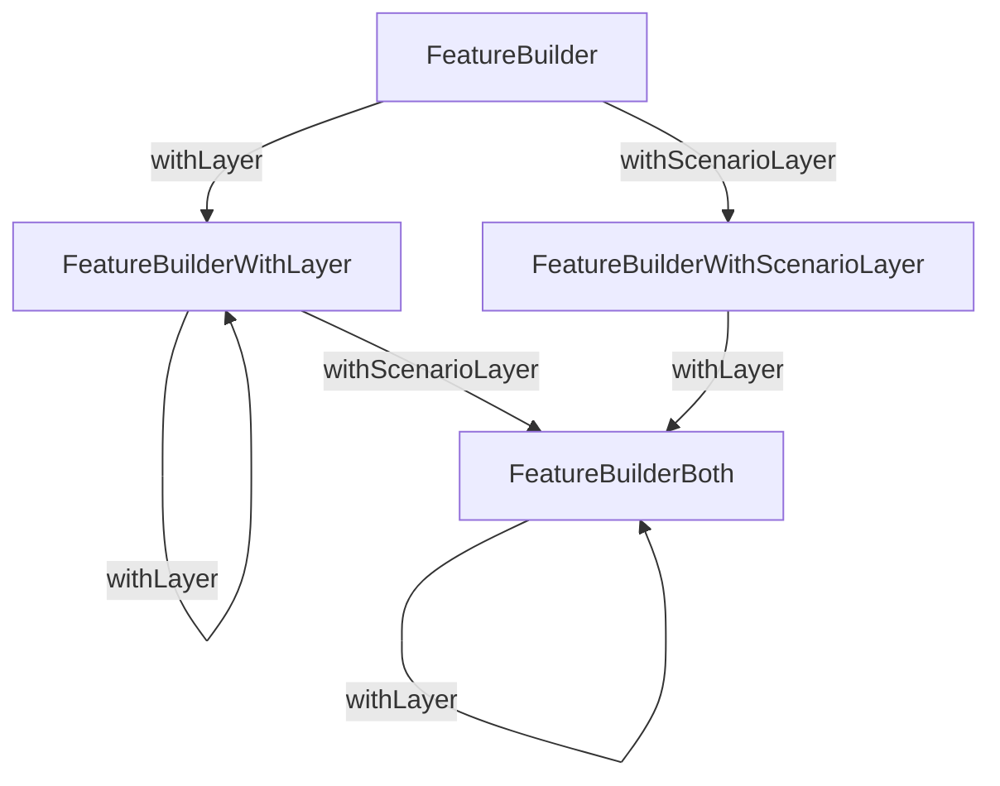

# Alchemy Stacks in Gherkin Features - Plan

## Goal Capsule

- **Objective:** A test author writes a Gherkin integration Feature against a deployed alchemy stack by declaring the stack and the scenarios, and the same file runs against the local Workers runtime or real Cloudflare by alchemy's own toggle, with every deployed resource torn down.
- **Means:** a published package, `@systemfsoftware/alchemy-stack-layer`, that turns an alchemy stack into an Effect layer on top of `@alchemy.run/test`'s engine module (KTD1, KTD2), plus one shared-layer mechanism in effect-spec-runtime (KTD7) and chainable `.withLayer` in effect-gherkin-spec (KTD8).
- **Product authority:** the Product Contract below wins on behaviour; KTDs win on mechanism. effect-gherkin-spec and effect-spec-runtime take no dependency on alchemy; the new package composes them.
- **Execution profile:** one pull request on `systemfsoftware/systemfsoftware` carrying U1-U6, opened and watched to CI green, not merged.
- **Stop conditions:** stop and report if the engine module cannot deploy under this repository's Node/vitest runner (the dev/cloud settled decision would then be unproven), or if a gate can only pass by editing an Evaluator surface.
- **Finishes the work:** the implementing session; the real-Cloudflare success criterion runs when credentials and a durable state store are reachable, and is recorded in the PR body when they are not.
- **Open blockers:** none.

---

## Product Contract

### Summary

A new package exports `alchemyStack(name, config)`: a typed service tag whose outputs steps read with `yield* SignInStack`, and a scoped layer that deploys the stack on acquire and destroys it on release.
effect-gherkin-spec gains chainable `.withLayer` and a file-level `sharedLayer`, so a stack is one more shared layer and one file deploys it once.
The first adopter is a downstream application's sign-in Feature, migrated in that application's repository after release.

### Problem Frame

Today an alchemy-backed Feature wires the two libraries by hand: `Test.make`, a `beforeAll` that deploys, a hand-declared service class, a `Layer.effect` over the deploy result, and `.withLayer(...).live(...)`.
In the one Feature that does this, that glue is about 18 of 195 lines, but it carries defects the author cannot see.
The runner wrapper's `beforeAll` hands back its result through a mutable variable (`repos/alchemy/packages/alchemy-test/src/Vitest.ts:176-181`), so a layer built before that hook runs reads `undefined` typed as the outputs.
Its `destroy` closes the file-wide scope (`Vitest.ts:233-235`), so a second destroy in one file runs on a closed scope, and the adopting Feature never calls destroy at all.
The Feature also re-imports `Gherkin.Do`, which `body()` already provides (`packages/gherkin/effect-gherkin-spec/src/Feature.ts:268`).

### Key Decisions

- **No new grammar; the stack is a layer.** A string-matched or declarative DSL would be a second Gherkin dialect beside the existing builder, for about 18 lines of glue. A deployed stack written as a Gherkin Background was rejected because Background runs per scenario and the deploy runs once per file. Governs R1, R5.
- **Build on `@alchemy.run/test`'s engine, not its Vitest wrapper and not raw alchemy.** Three options were weighed: keep the Vitest wrapper (every lifecycle defect above lives there), build on alchemy's own deploy and destroy modules (about 30 imports through alchemy's `"./*"` wildcard export and a rewrite of the sidecar, auth, stage and log wiring upstream maintains), or build on the engine module (one wildcard import, a scoped layer with no hooks). The engine module was chosen. Governs R2, R4.
- **Dev and cloud are one code path.** The toggle already exists in alchemy-test; the package forwards it and adds no switch. (session-settled: user-directed — chosen over a dev-only first release: a DSL that cannot run the cloud toggle out of the box is wrong.) Governs R3.
- **A cloud deployment is reclaimable by the next run.** Teardown runs only while the process lives, so a cancelled or killed run must leave its stack where a later run can find it: durable state and a stage that repeats per branch, not per run. Governs R3, R7, R8.
- **Teardown has no opt-out.** A switch that leaves deployed resources running was considered and not built: no goal needs it, and it breaks the promise that every deployed resource is torn down. Governs R2.
- **File-level sharing is its own primitive, not a Feature preset.** An earlier `composeFeature` combined curried Feature defaults with file-scoped hooks; it was dropped for a `sharedLayer` that reuses the suite runtime's existing build-once mechanism. Governs R11, R12.
- **The composition seam stays runner- and alchemy-agnostic.** effect-gherkin-spec gets no alchemy dependency and may change to allow composition. (session-settled: user-directed — chosen over an adapter that effect-gherkin-spec depends on: the alchemy library composes the Gherkin library, not the reverse.) Governs R9.

### Requirements

**Stack as a layer**

- R1. `alchemyStack(name, config)` returns a service tag, nominal per stack name, whose service is the stack's outputs, together with a layer that provides it; the author declares no service class and no output mapping. Passed to a plain `.withLayer`, the stack deploys once per Feature; passed through `sharedLayer` (R11), once per file.
- R2. Acquiring the layer starts the dev sidecar when one is needed and deploys; releasing it destroys every stack it deployed in reverse deploy order, then closes the sidecar, on success, failure and interruption.
- R3. Dev mode, sidecar and stage resolve exactly as alchemy-test's engine resolves them: `ALCHEMY_TEST_DEV`, then the config's `dev`, then `ALCHEMY_DEV`; `stage` from the config, else `ALCHEMY_TEST_STAGE`, else the per-user test stage. When the config gives no `stage`, the resolved stage gets a suffix derived from the test file's repo-relative path, so two files never share a deployment; a config `stage` is used as given. The config may carry `dev`, `stage`, `sidecar` and `profile`, each forwarded unchanged; where a deployment records its state is the stack definition's own `state`.
- R4. `config.deploy` takes either a stack definition or a function that receives a `deploy` and returns the outputs, for setups that deploy more than one stack or provision a dependency first. The config may carry a setup layer that provides what that function needs, and the stack's layer then requires nothing further.

**Teardown in the cloud**

- R5. A stack is registered for destroy before its deploy starts, so a deploy that fails or is interrupted part-way still has what it created destroyed. Each deploy runs in its own child scope that closes after that stack's destroy, whether the destroy succeeds or fails, so the resources a deploy holds outlive its destroy.
- R6. A failed destroy fails the run, and its error names the stack and the resolved stage; it is never swallowed and never retried in a loop by the package.
- R7. When dev resolves false and a stack's own `state` is not a durable, non-local store, the run fails before deploying that stack.
- R8. Before deploying, acquiring a stack destroys any leftover deployment recorded at its resolved stage, so the next run at that stage reclaims what a killed run left.

**Feature composition**

- R9. effect-gherkin-spec and effect-spec-runtime import nothing from alchemy; the stack enters a Feature through the existing `.withLayer`.
- R10. `.withLayer` can be chained after `.withLayer` and after `.withScenarioLayer`, and a later layer may require services an earlier one provides; a missing requirement is a compile error.
- R11. `sharedLayer(layer)`, called at module top level, builds the layer once before the file's first scenario and releases it once when the file ends; it takes and returns a plain `Layer`.
- R12. The suite runtime's per-Feature shared layer and `sharedLayer` are one mechanism, so both have the same build and release behaviour.
- R13. A shared layer, per Feature or through `sharedLayer`, is built before the scenarios that use it start, in setup with no time limit, and released with no time limit; deploying a stack needs no `.live` or timeout from the author.

### Key Flows

- F1. **Local run.**
  - **Trigger:** a developer runs a Feature file with dev resolved true.
  - **Steps:** before the first scenario, the sidecar starts and the stack deploys to the local Workers runtime under the developer's stage and the file's suffix; every Feature in the file reads its outputs; the file ends; stacks are destroyed, then the sidecar closes.
  - **Covers R2, R3, R11, R13.**
- F2. **Cloud run.**
  - **Trigger:** CI runs the same file with `ALCHEMY_TEST_DEV=0`, durable state, and an `ALCHEMY_TEST_STAGE` that repeats for the branch or CI job slot, one run at a time per stage.
  - **Steps:** no sidecar starts; any deployment a killed earlier run left at that stage is destroyed; the stack deploys to Cloudflare; scenarios run; the file ends; destroy runs against Cloudflare with no time limit.
  - **Covers R3, R6, R7, R8, R13.**

### Acceptance Examples

- AE1. **Covers R5.** Given a setup that deploys stack A then fails deploying stack B, when the file ends, then A's destroy runs and the run reports B's deploy failure.
- AE2. **Covers R6.** Given a cloud run whose destroy fails, when the file ends, then the run fails and the error names the stack and its stage.
- AE3. **Covers R8.** Given a cloud run killed after deploying and before teardown, when the next run starts at the same stage, then it destroys the leftover deployment before deploying.
- AE4. **Covers R11.** Given two Features in one file that both use one `sharedLayer` of a stack, when the file runs, then the stack deploys once and is destroyed once.
- AE5. **Covers R10.** Given `.withScenarioLayer(X).withLayer(stack).withLayer(rpcClient)` where `rpcClient` needs the stack's service, when the file compiles and runs, then it typechecks and the stack lives until the Feature ends.
- AE6. **Covers R3.** Given a file whose config says `dev: true`, when it runs with `ALCHEMY_TEST_DEV=0`, then it deploys to Cloudflare.
- AE7. **Covers R13.** Given a stack whose deploy takes longer than the runner's default test timeout, when the Feature runs, then it deploys once and the Feature's scenarios pass.
- AE8. **Covers R3.** Given two test files that deploy the same stack with no config `stage`, when they run in parallel, then each deploys under its own stage and is destroyed only by its own teardown.
- AE9. **Covers R7.** Given dev resolved false and only local state, when the file runs, then it fails before any deploy and the error says durable state is required.

### Success Criteria

- The downstream sign-in Feature, migrated, contains no `Test.make`, no `beforeAll`, no hand-declared stack service class and no `Gherkin.Do` import, and passes locally.
- Every acceptance example runs as a test in this repository.
- Before release, a fixture stack in this repository runs F2 against real Cloudflare: it deploys, runs a scenario and destroys, and a check of the account finds nothing left under that stage.

### Scope Boundaries

**Deferred for later**

- A reusable browser-over-RPC actor and a Postgres fixture: extract them after a second alchemy-backed Feature shows what varies.
- A cloud run of the downstream sign-in Feature: its database is a local microVM that Cloudflare cannot reach, a limit of that fixture rather than of this package.
- A Bun runner binding.

**Outside this work**

- Any change to the vendored `repos/alchemy` tree.
- A string-matched step grammar or `.feature` files.

### Dependencies / Assumptions

- `@alchemy.run/test/Core` is reachable only through the package's `"./*"` wildcard export (`repos/alchemy/packages/alchemy-test/package.json`), not a curated entry; an alchemy beta bump may move it.
- `ALCHEMY_TEST_DEV` must be set before the process imports the engine: `repos/alchemy/packages/alchemy-test/src/Core.ts:378` reads it once at import to decide the engine's dev-only test services, while `resolveDev`, which picks the deploy target, reads it per call.
- The dev sidecar is a process-wide singleton counted per handle (`Core.ts`, `makeSidecarHandle`); building once per file keeps the count from reaching zero between Features in a file.
- The suite runtime already releases a Feature's shared layer with no hook timeout (`packages/effect-spec-runtime/src/Suite.ts:175`, `packages/effect-spec-runtime/src/Register.ts:85`), but builds it lazily inside the first case (`Suite.ts:170-177`), so R13's setup-time build is new wiring (KTD7).
- A stack definition carries its own `providers` and `state` (`repos/alchemy/packages/alchemy/src/Stack.ts:368-373`); deploy and destroy build from them (`repos/alchemy/packages/alchemy/src/Destroy.ts:32-41`), and alchemy-test's `MakeOptions.state` only fills the outer environment (`Core.ts:590`).
- Breaking changes to effect-gherkin-spec and effect-spec-runtime ship directly; both are pre-1.0.

### Outstanding Questions

The three questions deferred to planning are resolved in the Planning Contract: package name and folder (KTD1), the `@alchemy.run/test` version range (KTD2), and the durable state store and CI cadence (KTD10). A CI stage that repeats per branch, with one run per stage, is deferred to follow-up work with the CI lane that needs it; until then F2's CI trigger is run by hand with `test:cloud`.

**Product Contract preservation:** changed: R3, R7 — `state` leaves the forwarded config fields because a config store never reaches a stack's deploy (the stack definition carries its own); R7 checks each stack's own store before that stack deploys, since a multi-stack setup function reveals its stacks only as it runs. The engine-route Key Decision's "one wildcard import" is four imports in KTD2, the same route.

### Sources / Research

- `repos/alchemy/packages/alchemy-test/src/Core.ts`, `Vitest.ts`: the engine and the Vitest wrapper this design splits.
- `packages/gherkin/effect-gherkin-spec/src/Feature.ts`: builder types; `withLayer` is absent from the layered builder (lines 45-52); `withOrphanRequirements` (lines 126-137) builds inside the suite scope.
- `packages/effect-spec-runtime/src/Suite.ts`: `suiteLayerOf` (lines 166-177), the build-once mechanism R11 reuses.
- `packages/gherkin/effect-gherkin-spec/src/extensions/Pairwise.ts`: precedent for extending the builder from outside its core.

---

## Planning Contract

### Key Technical Decisions

- KTD1. **Package `@systemfsoftware/alchemy-stack-layer` at `packages/alchemy-stack-layer`, layer `harness`.** REPO-S5 puts a lone package at `packages/<name>`; no alchemy family exists and one package cannot found one. The name says what it ships: an alchemy stack as an Effect layer. `package-layers.json` maps it beside effect-spec-runtime and effect-gherkin-spec, whose edges it may take.
- KTD2. **Consume the published alchemy packages at exactly `2.0.0-beta.87`.** `@alchemy.run/test` is a dependency and `alchemy` a peer dependency, both pinned through new catalog entries, because the engine's only entry is the uncurated `"./*"` export and the author's stacks must share the package's `alchemy` instance for its service tags to match. The vendored tree is never linked: its `import` condition serves raw TypeScript, and `repos/` is not a workspace member. The R7 check (KTD5) adds three alchemy subpath imports (`alchemy/EvalStack`, `alchemy/Stack`, `alchemy/State`) beside `@alchemy.run/test/Core`; this widens the Product Contract's "one wildcard import" to four, still the engine route and not the thirty-import rewrite it rejected. `@effect/platform-node` is a required peer: under Node, alchemy loads it dynamically for its platform services and exits the process when it is missing (`repos/alchemy/packages/alchemy/src/Util/PlatformServices.ts`).
- KTD3. **The tag is a function-form `Context.Service` whose identifier is nominal per stack name.** `alchemyStack(name, config)` returns a `Context.Service<AlchemyStack<Name>, Outputs>` keyed `@systemfsoftware/alchemy-stack-layer/<name>` with the stack's layer attached as `.layer`, so `yield* SignInStack` reads outputs and `.withLayer(SignInStack.layer)` provides them (R1). Effect v4 accepts an arbitrary identifier type in the function form (`repos/effect/packages/effect/src/Context.ts:210-217`); the repo has no prior per-name tag, so a tstyche test pins that two names give two distinct requirements.
- KTD4. **Each stack's lifecycle is ordered by scope finalizers on the layer scope.** Acquire order: open the sidecar handle (only when the engine's `resolveSidecar` says one is needed) and register its close first, so it runs last; then for each `deploy` call, run KTD5's durability check before anything else for that stack, then fork a child scope, register the stack's destroy after the fork, destroy any leftover at the stage, and deploy into the child scope (R2, R5, R8). `Scope.fork` registers the child's close on the parent, and finalizers run last-in first-out, so registering destroy after the fork makes destroy run before the child closes (`repos/effect/packages/effect/src/Scope.ts:433-447`). The destroy finalizer also closes the child scope whether destroy succeeds or fails, and a failed destroy is raised as a defect wrapping the tagged `StackDestroyFailed` value (stack name and stage), because a scope finalizer has no error channel (R6), which `Scope.close` surfaces as the release's failure (`repos/effect/packages/effect/src/internal/effect.ts:4028-4047`). A sequential layer scope runs the finalizers in reverse, giving reverse deploy order.
- KTD5. **Cloud mode checks the stack's own state store id before its deploy.** When dev resolves false, the package builds the stack's `state` (an omitted `state` counts as local) through alchemy's `evalStack` and reads `StateService.id`, before any child scope, destroy finalizer or leftover destroy exists for that stack; `local` and `inmemory` fail with `DurableStateRequired` naming the stack and stage before anything deploys for that stack (R7). The id is alchemy's own store identity (`repos/alchemy/packages/alchemy/src/State/State.ts:44-53`), so no store list is copied into this package.
- KTD6. **The stage suffix is a short hash of the running test file's repo-relative path.** Without a config `stage`, the stage is `resolveStage({})` plus `_` and the first 8 hex digits of the SHA-256 of the file's path relative to the nearest ancestor holding `.git` (a directory or a worktree file), falling back to the path relative to the working directory when no ancestor has one (R3, AE8). The running file comes from a `TestFile` reference that effect-spec-runtime supplies to every layer it builds (KTD7); a `Context.Reference` with an empty default keeps the stack's layer free of requirements (R1, R4). A build with neither a config `stage` nor a running file fails with `StageUnresolved` instead of sharing a stage with other files.
- KTD7. **One shared-layer mechanism in effect-spec-runtime: build in an untimed `beforeAll`, read from a per-call cell, release in an untimed `afterAll`.** `suiteLayerOf` becomes this mechanism, and `Suite.sharedLayer(layer)` exposes it at any collection level, file top level included (R11, R12, R13). The cell and its scope are created per call, never at module level, so `isolate: false` workers get one per file (`docs/solutions/logic-errors/file-end-hook-installed-at-module-load-judges-one-file-per-worker.md`; pack: effect-architecture, instance-state-lives-in-the-constructor.md). The hook resolves the running file from the hook's own suite and provides it as `TestFile` during the build. A build failure rejects the setup hook, so the enclosing suite fails with the build's cause, no scenario under it runs, and the release still runs for what was acquired; a reader that runs before a build dies with `SharedLayerNotBuilt`. Shared layers may carry a typed error channel, since a deploy can fail, and take no requirements: `TestFile` is a reference with a default, so a layer that needs anything else fails to typecheck where it is passed (R10).
- KTD8. **`.withLayer` is available at every builder stage and composes by `provideMerge`.** Each call returns a builder whose shared layer is `next` provided by and merged with the shared layers before it, so a later layer may require an earlier one's services and a missing requirement fails to typecheck (R10). The scenario-layer path keeps its scope-only requirement typing; `withOrphanRequirements` stays only where that typing needs it. effect-gherkin-spec re-exports `sharedLayer` so a Feature file imports from one package.
- KTD9. **Offline tests use a fixture alchemy provider; the cloud test uses Cloudflare.** A fixture `Resource` and `Provider` record create and delete calls (with stack, stage and resolved dev flag) in a test ledger, and can delay or fail on demand. A fixture state store reuses alchemy's in-memory store under a non-local id, standing in for durable state in-process. These exercise the real alchemy engine through the built package without network access. Telemetry is disabled in tests with `ALCHEMY_TELEMETRY_DISABLED`.
- KTD10. **The durable store is `Cloudflare.state()`; cloud tests run on demand, not on every pull request.** CI holds no Cloudflare credentials and `.github/` is Evaluator surface, so this change adds no CI job: the cloud roundtrip lives under its own vitest config, outside the package's default `test` include, and runs only through an explicit `test:cloud` script with `ALCHEMY_TEST_DEV=0`, Cloudflare credentials, and its config `stage` taken verbatim from `ALCHEMY_TEST_STAGE`. A CI lane with a branch-stable stage and per-stage concurrency is follow-up work.

### High-Level Technical Design

Acquire and release of one `alchemyStack` layer (single-stack form; the function form repeats the per-stack block for each `deploy` call):

```mermaid
sequenceDiagram
  participant H as Setup hook (effect-spec-runtime)
  participant L as Stack layer
  participant E as alchemy-test engine
  H->>L: build in untimed beforeAll, TestFile provided
  L->>L: resolve dev, stage (+ file suffix)
  L->>E: makeSidecarHandle when needed; register close (runs last)
  alt dev resolved false
    L->>E: build stack state, read id
    E-->>L: local/inmemory => fail DurableStateRequired
  end
  L->>L: fork child scope; then register destroy finalizer
  L->>E: destroy leftover at stage (child scope)
  L->>E: deploy into child scope
  E-->>L: outputs => provided under the stack's tag
  Note over H,L: scenarios read outputs from the built cell
  H->>L: release in untimed afterAll
  L->>E: destroy (reverse deploy order), then close child scope
  L->>E: close sidecar handle
```

Builder stages and where `.withLayer` lives after this change:



Author-facing shape, directional only:

```text
const SignInStack = alchemyStack("SignInStack", { deploy: SignInStackDefinition })
const Shared = sharedLayer(SignInStack.layer)            // once per file
Feature("Sign in").withLayer(Shared).withLayer(rpcClient) // rpcClient requires SignInStack
  .body(({ scenario }) => scenario("...", Do.pipe(... yield* SignInStack ...)))
```

### Assumptions

- The engine module deploys under this repository's Node/vitest runner; nothing in `Core.ts` calls Bun, and alchemy picks Node platform services when Bun is absent (`repos/alchemy/packages/alchemy/src/Util/PlatformServices.ts:19`). U3's fixture deploy is the first proof.
- Vitest passes the running suite to a `beforeAll` hook, so KTD7 can name the running file inside the hook; U1's test that two files get two `TestFile` values proves it.
- A stack used through `.withScenarioLayer` would deploy per scenario and again on the runner's second run; authors are pointed at `.withLayer` and `sharedLayer` in the README rather than refused.
- Stack scenarios run twice against one deployment (the runner's leaked-state check), and explored cases replay further, so scenarios that change deployed state must be idempotent or declare a `rerun`, and scenarios that call the deployed stack over the network declare `.live(...)`; this is documented, not enforced.
- `ALCHEMY_TEST_DEV` is read once at engine import only to choose emulator test services, which this package does not use; the deploy target comes from `resolveDev`, which reads it on every call (`Core.ts:166-171`), so a test that sets it at run time, as AE6's does, changes the target.
- A stage given verbatim (config `stage`) belongs to one writer at a time; R8 reclaims whatever is recorded there. The README states this; enforcing it is the deferred CI lane's per-stage concurrency.
- Two layers of the same stack name at the same stage must not be alive at once: R8's reclaim in the second would destroy the first. Sequential Features in one file release before the next builds, so this only bites when one file uses a stack both through `sharedLayer` and directly in a Feature; the README says to pick one.
- A file whose scenarios are all skipped or filtered out runs no setup hooks, so it deploys nothing; U1 confirms this for file-level `sharedLayer`.

### Sequencing

U1 changes the runtime; U2 (builder) and U3 (package) build on it and can proceed side by side; U4 and U5 test the package; U6 lands packaging, changesets and docs. All ship in one pull request.

---

## Output Structure

```text
packages/alchemy-stack-layer/
  package.json, tsdown.config.ts, oxlint.config.ts, vitest.config.ts,
  tsconfig*.json, api-extractor.json, tstyche.json, README.md, LICENSE
  etc/alchemy-stack-layer.api.md
  src/mod.ts                  public entry: alchemyStack, errors, types
  src/AlchemyStack.ts         tag + layer constructor
  src/StackLifecycle.ts       per-stack acquire/release on the engine
  src/StageName.ts            stage resolution and file suffix
  src/StackErrors.ts          tagged failures
  tests/__fixtures__/         fixture provider, ledger, durable store, stacks
  tests/*.integration.test.ts offline AE tests and the cloud roundtrip
  test-types/*.tst.ts         tag nominality and builder typing
```

---

## Implementation Units

### U1. One shared-layer mechanism and `sharedLayer` in effect-spec-runtime

**Goal:** shared layers build once in untimed setup before their scenarios, release once in untimed teardown, and can be declared per file.

**Requirements:** R11, R12, R13; F1, F2; AE4, AE7 (runtime half).

**Dependencies:** none.

**Files:**

- `packages/effect-spec-runtime/src/Suite.ts` (modify: replace `suiteLayerOf` with the KTD7 mechanism; export `sharedLayer`)
- `packages/effect-spec-runtime/src/TestFile.ts` (create: the `TestFile` reference)
- `packages/effect-spec-runtime/src/mod.ts` (modify: export it)
- `packages/effect-spec-runtime/tests/shared-layer.suite.runner.test.ts` (modify)
- `packages/effect-spec-runtime/tests/shared-layer-setup.suite.runner.test.ts` (create)
- `packages/effect-spec-runtime/test-types/suite-params.tst.ts` (modify if `Shared` gains an error parameter)
- `packages/effect-spec-runtime/etc/effect-spec-runtime.api.md` (regenerate)

**Approach:**

1. The mechanism takes a layer, creates its scope and cell per call, registers `beforeAll(build, UNTIMED)` and `afterAll(release, UNTIMED)` in the current collection context, and returns a reader layer (KTD7).
2. `openShared` and `openSharedCase` call it inside their describe; `sharedLayer` is the same call made by the author.
3. The build provides `TestFile` from the hook's running suite file.
4. `Shared<R>` widens to carry the layer's error type.

**Patterns to follow:** the counter-and-trailing-case shape of `tests/shared-layer.suite.runner.test.ts`; `Register.UNTIMED` for hook timeouts; tests register through the fork's `it` from `@systemfsoftware/vitest`.

**Test scenarios:**

- A shared layer whose build waits longer than the file's test timeout still lets every scenario pass, and is built before the first scenario starts (Covers AE7, runtime half).
- `sharedLayer` called once and read by two describes builds once and releases once, checked by a trailing case after both describes (Covers AE4, runtime half).
- The existing three-case suite still sees one build, including the explored case, with the build now counted before any case runs.
- A shared layer whose build fails fails its enclosing suite with the build's cause, no scenario under it runs, and its release still runs for what was acquired.
- A layer built through the mechanism reads `TestFile` as this test file's absolute path; a second test file reads its own path.
- A describe declared with `skip` whose shared layer counts builds never builds it.

**Verification:** effect-spec-runtime `test`, `test:types` and `api:check` pass; trace-spec, which calls `openShared`, still passes its tests.

### U2. Chainable `.withLayer` in effect-gherkin-spec

**Goal:** every builder stage accepts `.withLayer`, later layers may require earlier ones, and `sharedLayer` is importable from effect-gherkin-spec.

**Requirements:** R9, R10, R11; AE5.

**Dependencies:** U1.

**Files:**

- `packages/gherkin/effect-gherkin-spec/src/Feature.ts` (modify: builder types and `makeBuilder*` per KTD8)
- `packages/gherkin/effect-gherkin-spec/src/mod.ts` (modify: re-export `sharedLayer`)
- `packages/gherkin/effect-gherkin-spec/test-types/layer-chaining.tst.ts` (create)
- `packages/gherkin/effect-gherkin-spec/tests/layer-chaining.integration.test.ts` (create)
- `packages/gherkin/effect-gherkin-spec/etc/effect-gherkin-spec.api.md` (regenerate)

**Approach:** add `withLayer` to `FeatureBuilderWithLayer` and `FeatureBuilderBoth`, and widen every `withLayer` to a layer with an error channel and requirements drawn from the layers already given (KTD8). R9 is kept by importing nothing new.

**Patterns to follow:** `makeBuilderWithScenarioLayer`'s `withLayer` (`Feature.ts:405-414`); `test-types/live-declaration.tst.ts`.

**Test scenarios:**

- `.withScenarioLayer(X).withLayer(A).withLayer(B)` where B requires A's service typechecks, and B without A's service fails to typecheck (Covers AE5, type half).
- `.withLayer(A).withLayer(B)` and `.withLayer(A).withScenarioLayer(X).withLayer(B)` typecheck and expose both services to steps.
- At runtime, a Feature built as in AE5 sees A built once before its scenarios and released after its last scenario, with B reading A's value (Covers AE5).
- `sharedLayer` imported from effect-gherkin-spec behaves as U1's, used by two Features in one file.

**Verification:** effect-gherkin-spec `test`, `test:types`, `api:check` and `attw` pass, and its manifest gains no alchemy dependency (R9).

### U3. The `alchemy-stack-layer` package and `alchemyStack`

**Goal:** a published package whose `alchemyStack(name, config)` deploys on acquire and destroys on release on the alchemy-test engine.

**Requirements:** R1-R8; F1, F2.

**Dependencies:** U1.

**Files:**

- `packages/alchemy-stack-layer/` scaffold per Output Structure (create)
- `packages/alchemy-stack-layer/src/AlchemyStack.ts`, `StackLifecycle.ts`, `StageName.ts`, `StackErrors.ts`, `mod.ts` (create)
- `packages/alchemy-stack-layer/test-types/alchemy-stack.tst.ts` (create)
- `pnpm-workspace.yaml` (modify: catalog entries for `alchemy` and `@alchemy.run/test`)
- `package-layers.json` (modify: map the package to `harness`)

**Approach:**

1. Config: `deploy` is a stack definition or a function of `deploy` returning outputs; optional setup layer, `dev`, `stage`, `sidecar`, `profile` (R3, R4).
2. Tag and layer per KTD3; lifecycle per KTD4; durability per KTD5; stage per KTD6.
3. Errors are tagged variants: `StackDeployFailed`, `StackDestroyFailed`, `DurableStateRequired`, `StageUnresolved`, each naming stack and stage where one exists (CONST-D2); `StackDestroyFailed` reaches the caller as a defect, per KTD4.
4. `@effect/platform-node` is a peer and dev dependency (KTD2); the cloud roundtrip gets its own `vitest.cloud.config.ts` and a `test:cloud` script (KTD10).
5. Engine calls go through `Core.toEffect` with the child scope and sidecar handle, so dev sidecar and stage resolve exactly as the engine resolves them (R3).

**Execution note:** prove a fixture-provider deploy and destroy through the built package under vitest before building the rest; the Goal Capsule's stop condition fires if it cannot run.

**Patterns to follow:** `packages/gherkin/effect-gherkin-spec` scaffold (tsdown `injectTypes`, api-extractor, tstyche); `docs/solutions/conventions/the-oxlint-gate-wall-shapes-new-package-code.md` for helper shape under the `recommended` preset.

**Test scenarios:**

- Two `alchemyStack` calls with different names produce tags whose requirements are distinct types, and the tag's service type is the stack's outputs.
- Stage derivation gives the same suffix for the same repo-relative path and different suffixes for two paths, and uses a config `stage` verbatim.
- Stage derivation with no config `stage` and no running file fails with `StageUnresolved`.

**Verification:** the package builds, `api:check`, `attw` and `test:types` pass, and `pnpm pack:all` accepts its tarball.

### U4. Offline acceptance tests for the stack layer

**Goal:** every acceptance example runs as a test against the built package without network access.

**Requirements:** R2, R3, R5, R6, R7, R8, R11, R13; AE1-AE4, AE6-AE9.

**Dependencies:** U2, U3.

**Files:**

- `packages/alchemy-stack-layer/tests/__fixtures__/` (create: fixture resource, provider, ledger, durable store, stacks)
- `packages/alchemy-stack-layer/tests/stack-lifecycle.integration.test.ts` (create)
- `packages/alchemy-stack-layer/tests/stack-in-feature.integration.test.ts` (create)
- `packages/alchemy-stack-layer/tests/stage-isolation-a.integration.test.ts`, `stage-isolation-b.integration.test.ts` (create)

**Approach:** lifecycle tests build the layer in a scope they close and read the exit and the ledger; Feature tests compose the layer through effect-gherkin-spec as authors will (KTD9).

**Test scenarios:**

- Covers AE1. A setup function deploys stack A, then stack B's deploy fails: closing the scope destroys A, and the exit reports B's deploy failure.
- Covers AE2. Dev false with the fixture durable store and a provider whose delete fails: closing the scope fails with `StackDestroyFailed` naming the stack and its stage.
- Covers AE3. A first build deploys at stage S and its scope is abandoned unclosed; a second build at S destroys the leftover resource before it creates the new one, in that ledger order.
- Covers AE4. Two Features in one file read one `sharedLayer` of a fixture stack: the ledger shows one create and, after the file's Features end, one delete.
- Covers AE6. Config `dev: true` with `ALCHEMY_TEST_DEV=0` set at run time and the fixture durable store records a deploy whose resolved dev flag is false; with `ALCHEMY_TEST_DEV` unset and config `dev: false`, the flag is also false.
- Covers AE7. A fixture deploy that takes longer than the file's test timeout leaves the Feature's scenarios passing, deployed once.
- Covers AE8. Two test files, which vitest runs in separate workers, deploy one fixture stack with no config `stage`; each asserts its recorded stage equals the base stage plus `_` plus a spec-literal 8-hex SHA-256 prefix of its own repo-relative path, the two literals differ, and each file's delete records only that stage.
- Covers AE9. Dev false with `State.localState()` fails with `DurableStateRequired` saying durable state is required, and the ledger shows no create and no delete.
- Release order: two stacks deployed A then B are destroyed B then A, and the sidecar handle closes after both.

**Verification:** `pnpm --filter @systemfsoftware/alchemy-stack-layer test` passes offline with telemetry disabled.

### U5. Real-Cloudflare roundtrip test

**Goal:** the release success criterion: a fixture Cloudflare stack deploys, runs a scenario and destroys, and nothing is left under its stage.

**Requirements:** F2; Success Criteria (real Cloudflare).

**Dependencies:** U2, U3.

**Files:**

- `packages/alchemy-stack-layer/tests/__fixtures__/cloudflare-stack.ts` (create)
- `packages/alchemy-stack-layer/cloud/cloudflare-roundtrip.integration.test.ts` (create; outside the default `tests` include)
- `packages/alchemy-stack-layer/vitest.cloud.config.ts` (create)

**Approach:** a minimal Cloudflare Worker stack with `Cloudflare.state()` and config `stage: ALCHEMY_TEST_STAGE` (used verbatim, so the check reads the same stage) runs as a live Feature through Feature-level `.withLayer`, so its destroy runs when that Feature ends; a trailing case in the same file then lists the stage's state and the account's workers and finds none (KTD10). The file runs only through `test:cloud`, never in the default suite, so CI neither runs nor skips it.

**Test scenarios:**

- With credentials, the Feature's scenario reaches the deployed worker over HTTP and gets its expected response.
- After release, the stage holds no state rows and no worker carrying the stage's name remains.

**Verification:** one run with credentials passes and its output is quoted in the PR; without credentials, the PR body records the unmet criterion and what it needs.

### U6. Packaging, changesets and docs

**Goal:** the change ships as releasable packages with consumer-facing notes.

**Requirements:** Success Criteria; REPO-R2.

**Dependencies:** U1-U5.

**Files:**

- `.changeset/*.md` (create, via `pnpm change`, one per publishable package whose build hash moved)
- `packages/alchemy-stack-layer/README.md` (create)
- `packages/gherkin/effect-gherkin-spec/README.md`, `packages/effect-spec-runtime/README.md` (modify: `.withLayer` chaining, `sharedLayer`)
- `pnpm-lock.yaml` (modify)

**Approach:** changeset bodies state the published surface from each package's exports, not the diff (`docs/solutions/conventions/a-release-note-claims-the-published-surface.md`). The README covers the dev and cloud toggles, durable state, the stage suffix, `.withLayer` over `.withScenarioLayer` for stacks, and idempotent scenarios.

**Test expectation:** none -- packaging and docs; the gates in the Verification Contract check them.

**Verification:** the changeset check passes in CI and `pnpm check:local` exits 0.

---

## Verification Contract

| Gate                | Command                                                                                                                                    | Proves                                                                                         |
| ------------------- | ------------------------------------------------------------------------------------------------------------------------------------------ | ---------------------------------------------------------------------------------------------- |
| Local gate          | `pnpm check:local`                                                                                                                         | format, conventions, layers, build, lint, typecheck, tests and type tests across the workspace |
| Package tests       | `pnpm --filter @systemfsoftware/alchemy-stack-layer test`                                                                                  | AE1-AE4, AE6-AE9 offline                                                                       |
| Runtime and builder | `pnpm --filter @systemfsoftware/effect-spec-runtime test`, `pnpm --filter @systemfsoftware/effect-gherkin-spec test`                       | R10-R13, AE5                                                                                   |
| Type tests          | `pnpm --filter <pkg> test:types`                                                                                                           | R1 nominality, R10 compile errors                                                              |
| Published surface   | `pnpm --filter <pkg> api:check`, `pnpm --filter <pkg> attw`, `pnpm pack:all`                                                               | CONST-T8: what ships is what is tested                                                         |
| Cloud roundtrip     | `ALCHEMY_TEST_DEV=0 ALCHEMY_TEST_STAGE=<stage> pnpm --filter @systemfsoftware/alchemy-stack-layer test:cloud`, with Cloudflare credentials | F2 success criterion                                                                           |
| CI                  | `gh pr checks --watch --fail-fast`                                                                                                         | REPO-D1                                                                                        |

Mutation runs are CI-only (REPO-D3).

---

## Definition of Done

- U1-U6 implemented; every AE has a named test that passes.
- `pnpm check:local` exits 0 after the last edit.
- Changesets exist for every publishable package whose build hash moved.
- The pull request is open and CI is green; it is not merged.
- The real-Cloudflare roundtrip either passed with its output quoted in the PR, or the PR body states it is unmet and exactly what it needs.
- The downstream sign-in migration criterion is checked after release in that application's repository; this PR records it as pending.
- No abandoned-attempt code, skipped tests or gate edits remain in the diff.

---

## Scope Boundaries (planning)

### Considered and not built

- A wall-clock bound on deploy and destroy: R13 asks for no time limit, and a hung deploy still ends at the CI job's limit; build it if a hang reaches CI without the stack named in its log.
- Refusing a stack passed to `.withScenarioLayer`: documented instead (Assumptions); refuse it if an adopter deploys per scenario by mistake.

### Deferred to Follow-Up Work

- A CI lane that runs the cloud roundtrip with a branch-stable `ALCHEMY_TEST_STAGE` and one run per stage at a time (KTD10); it needs Cloudflare credentials in CI and an Evaluator commit of its own.
- Migrating the downstream sign-in Feature after release, in that application's repository.
